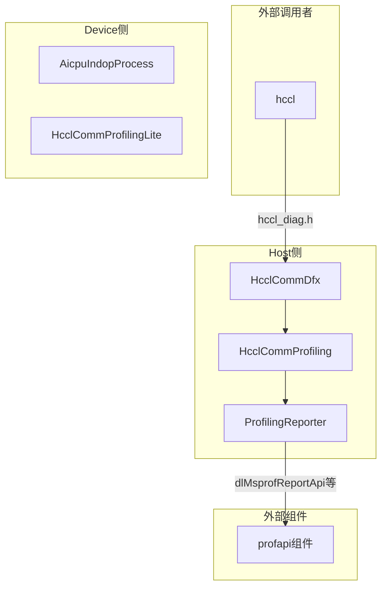
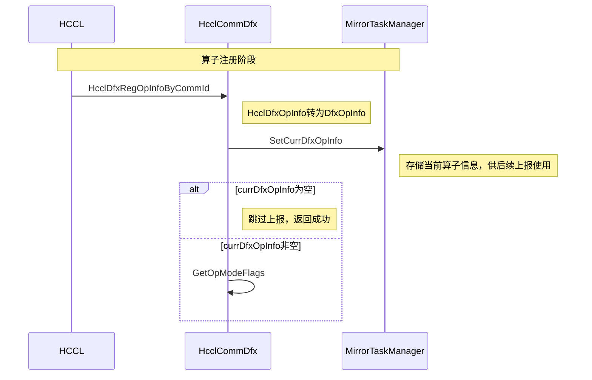
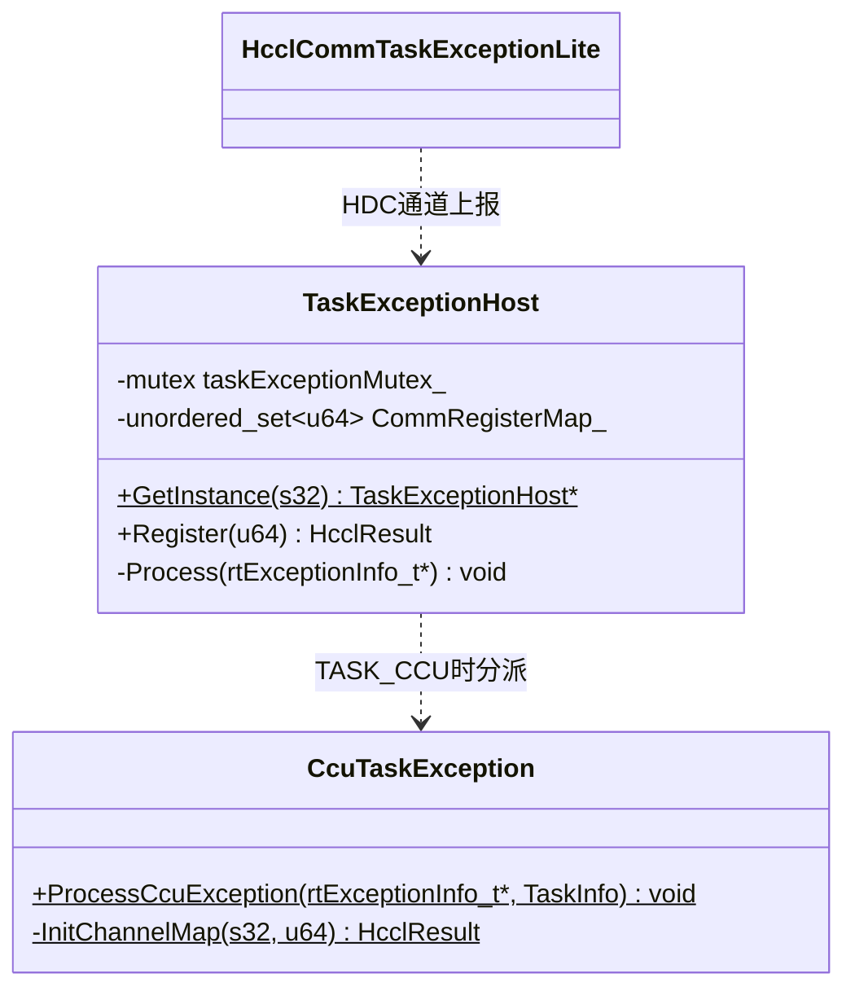

# Mermaid 图写作规范

本文档规定目录代码级文档中三类 Mermaid 图的写法，全部模式取自 hcomm 仓既有文档（taskException.md、profiling.md、cluster_monitor/README.md）。

## 1. 组件交互图（graph TB）

用于"目录描述"章节，展示模块内外组件的调用关系。

规则：
- subgraph 分组顺序：外部调用者 → 模块内（按侧别分） → 外部组件。
- 节点 ID 用 PascalCase 缩写（HCD、MTM、PHL），方括号内写全名。同名组件在两侧出现时加后缀（如 `hcomm_c_adpt_H` / `hcomm_c_adpt_D`）。
- 边上用 `|函数名|` 标注关键调用，多个函数用 `/` 分隔。
- 跨 subgraph 的边表达跨侧/跨模块交互，这是图的重点。

## 2. 时序图（sequenceDiagram）

用于"流程描述"章节，每流程一张。

规则：
- participant 少用 `as` 别名，保持类名可直接检索；同一类在图中只出现一个 participant。
- **涉及跨模块交互的流程，外部模块/组件的类（含回调注册对象、上报目标）作为 participant 画进图**——进出本模块的消息都要有发出者/接收者，不省略外部一端。
- 自调用 `A->>A:` 表内部处理，Note right 标注要点（分支条件、常量值、副作用）。
- `alt/else` 表分支、`loop` 表循环、`rect rgb(...)` 可选做阶段底色分块（cluster_monitor 风格）。
- 消息名用真实函数名，参数太长可省略只留函数名。
- 阶段划分用 `Note over A,B: 阶段名` 横幅。

## 3. 类图（classDiagram）

用于"数据描述"章节。

规则：
- 类框三段：类名 / 成员变量 / 方法。`-` 私有、`+` 公有、`$` 后缀表静态。
- 方法行格式：`方法名(参数类型列表) 返回值`，参数只写类型不写参数名（或简写）。
- **泛型用 `~` 转义**：`vector~CcuErrorInfo~`，不能写 `vector<CcuErrorInfo>`（会破坏语法）。
- 关系：`..>` 依赖（虚线）、`o--` 组合持有、`-->` 使用。线上写短语，**含用途与交互机制**（`生成`、`读取寄存器`、`TASK_CCU时分派`、`异常回调`）。
- **外部组件类（hccp组件、profapi组件等）画为独立类框**，作为依赖终点，中文"组件"后缀保留；本模块对外提供的回调/被周边调用的入口同样画关系线（方向：外部类 → 本模块类），不只画本模块依赖外部的单向关系。

## 易错点清单（渲染失败高发区）

1. 尖括号 `<>` 必须转义为 `~`（classDiagram 泛型）。
2. 节点 label 含 `()` `/` 等符号时，graph 节点用引号包裹：`A["函数(带括号)"]`。
3. `end` 是 Mermaid 关键字，subgraph/alt/loop 块内的 Note 或 label 不能以 `end` 开头产生歧义。
4. sequenceDiagram 的 participant 别名含空格必须用 `as` 完整写。
5. 中文标点（，：）在边标签里可用，但不能用在节点 ID 上。
6. classDiagram 方法行内不能出现中文括号。
7. 图写完必须自查：每个类名/函数名能在源码中 grep 到。
