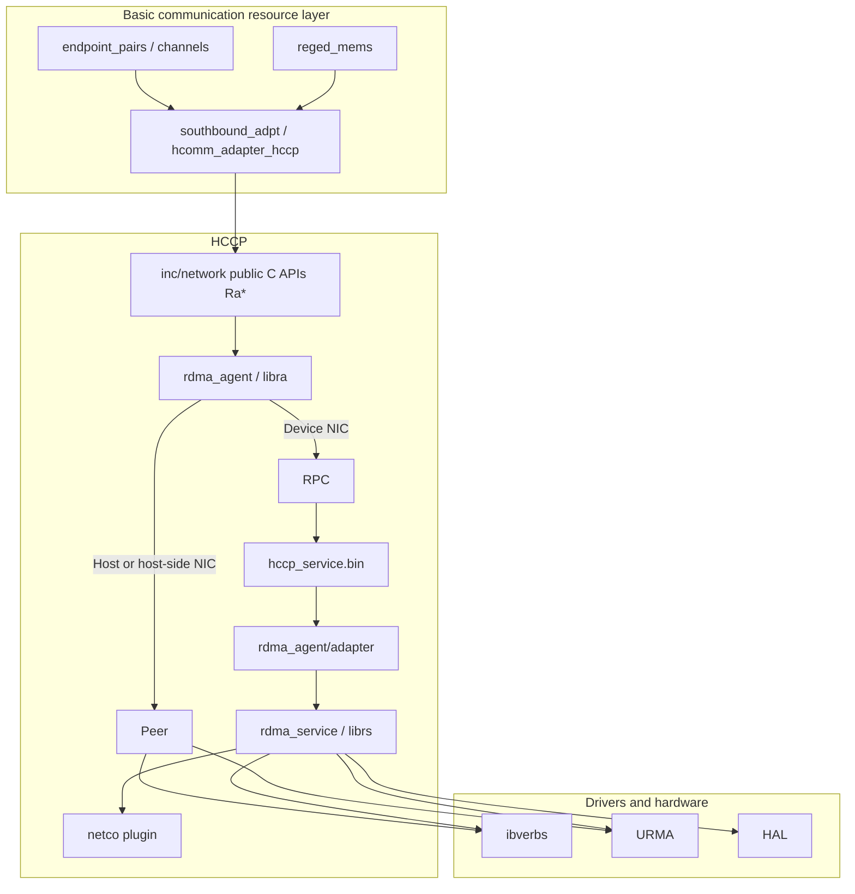
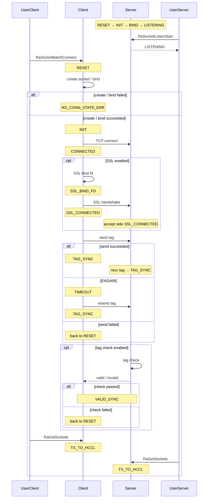

# HCCP

HCCP (Huawei Collective Communication Adaptive Protocol) is an internal submodule of HCOMM under `src/base_comm/resources/`. It provides high-performance communication between network devices, hides Host / Device and NIC deployment differences, and exposes Socket, RoCE (v2), and UB through one set of C APIs. Endpoint, Channel, communication memory, and CCU use these APIs to create network resources, establish links, and submit data-plane work requests when needed.

HCCP headers live in the module-internal `inc/network/` path and are included directly by the basic communication resource layer. The stable upward interfaces are L3-res / L3-prim in the [Architecture overview](../architecture-brief.md).

## Responsibility

HCCP handles network-protocol resource creation and link establishment in the basic communication model. It maps to the communication device, communication channel, and communication memory in [Architecture overview section 2.3](../architecture-brief.md):

| Basic communication concept | Entity in HCCP | RoCE API | UB API |
|-----------------------------|----------------|----------|--------|
| Communication device (Endpoint) | RDMA device (rdev) or UB context (ctx), addressed by IP or EID | `RaRdevInit` / `RaRdevInitV2`, `RaGetIfaddrs` | `RaCtxInit`, `RaGetDevEidInfoList` |
| Communication channel (Channel) | RoCE QP or UB Jetty; peer info is exchanged over Socket before link establishment | `RaQpCreate`, `RaQpCreateWithAttrs`, `RaTypicalQpCreate` + `RaTypicalQpModify`, `RaAiQpCreate`, `RaQpConnectAsync` | `RaCtxQpCreate`, `RaCtxQpImport` |
| Communication memory (CommMem) | RoCE MR, or UB local memory registration / remote memory import | `RaMrReg`, `RaRegisterMr` | `RaCtxLmemRegister`, `RaCtxRmemImport` |
| Sync Notify | Device Notify base address and its MR | `RaGetNotifyBaseAddr`, `RaGetNotifyMrInfo` | — |

The module also provides:

- **Socket control plane**: listen, batch link establishment, send/recv (`RaSocketSend` / `RaSocketRecv`), whitelist, epoll, and async send/recv. Socket exchanges QP / MR / Jetty information and carries control messages.
- **Data-plane submission**: the `RaSendWr` family and UB `RaBatchSendWr`. Write / Read / Notify primitives of collective operators live in `primitives/` and use these resources through an established Channel.
- **Connectivity checks**: RoCE / UB Ping started by `RaPingInit`.
- **Module plugins**:
  - **netco**: works with the switch side to maintain table entries between compute nodes and switches.
  - **CCU**: lets the collective communication acceleration unit query memory and dispatch commands.
- **Observability**: port status, CQE / CR errors, async events, Jetty, debug config, and snapshot save/restore.

When the network port is on a Device, the Host process forwards requests over RPC to device-side `hccp_service.bin`. When the network port is on the Host or a Host NIC, requests complete in-process.

## Protocol layers

### Software layering



Call flow from top to bottom:

1. Endpoint, Channel, and communication memory call `Ra*` through `hcomm_adapter_hccp`.
2. `rdma_agent` (`libra`) selects the path by `RaInitConfig.nicPosition`.
3. Requests for a device NIC go over RPC to the device process `hccp_service.bin`, whose adapter dispatches them to `rdma_service` (`librs`).
4. Host / host-side NICs use the Peer path and complete Socket and verbs operations, and Socket and URMA operations, in-process.
5. `rdma_service` calls ibverbs or URMA according to the chip protocol.

### Protocol and API families

Public headers are grouped into five families by `@ingroup`. They map to the network protocols in [Architecture overview section 1.2](../architecture-brief.md) as follows.

| API family | Headers | Protocols covered | Capabilities |
|------------|---------|-------------------|--------------|
| init | `hccp.h`, `hccp_ctx.h`, `hccp_tlv.h`, `hccp_ping.h` | Common | Process init; create/destroy Socket / rdev / ctx / Ping; query NICs and EIDs; attach module plugins |
| socket | `hccp.h`, `hccp_async.h` | TCP | Listen, batch connect/disconnect, send/recv, whitelist, accept credit, epoll |
| rdma | `hccp.h`, `hccp_async_ctx.h`, `hccp_nda.h` | RoCE | QP / CQ / SRQ, MR, WR submit and CQ poll, Notify, QoS and timeout, NDA queues |
| urma | `hccp_ctx.h`, `hccp_ctx_tp.h`, `hccp_ctx_data_plane.h`, `hccp_async_ctx.h` | UB | EID, Token, local/remote memory, Jetty and JFC, TP query and attributes, batch send |
| common | `hccp.h`, `hccp_opcode.h` | Common | API version, capability query, async request results, secure random, snapshot, debug config, error codes |

Remote access under memory semantics imports peer memory locally through `RaCtxRmemImport`.

HCCS is handled by the HCCS bus implementation inside Endpoint. HCCP protocol branches cover RoCE and UB.

### Sync and async

Sync APIs finish on the calling thread. Async APIs return a `reqHandle`; results come from `RaGetAsyncReqResult`:

- Socket: `hccp_async.h` (batch link establishment, listen, close, send/recv)
- UB: `hccp_async_ctx.h` (memory registration, Jetty create/import, EID and TP query)

On the device NIC path, when `RaInitConfig.enableHdcAsync` is true, HCCP opens an extra RPC session for async requests.

## Functional breakdown

### Socket

`RaSocketInit` binds a device and local IP and returns a `socketHandle`. After that you can:

- Manage listening with `RaSocketListenStart` / `RaSocketListenStop`; `ListenPhase` distinguishes failures at fd create, bind, and listen.
- Complete batch link establishment with `RaSocketBatchConnect` / `RaSocketBatchAbort` / `RaGetSockets`. Connections can use different tags so HCCL can identify connection groups.
- Send/recv per fd with `RaSocketSend` / `RaSocketRecv`. The caller continues when send is incomplete or `SOCK_EAGAIN` is returned.
- Maintain the server whitelist with `RaSocketWhiteListAdd` / `RaSocketWhiteListDel`; `RaSocketAcceptCreditAdd` adds accept credit.
- Wait for events with `RaEpollCtlAdd` and `RaCreateEventHandle` / `RaWaitEventHandle`; register a receive callback with `RaSetTcpRecvCallback`.

`RaQpConnectAsync` exchanges QP and MR over a connected Socket and completes QP link establishment. The Socket layer can query whether TLS is enabled (`RaGetTlsEnable`).

#### Link establishment state machine

The client advances through `enum RsConnState` (defined in `rs_inner.h`) in `RsSocketConnectAsync`. The listen side uses `INIT` / `BIND` / `LISTENING` on `listenInfo`. `RS_CONN_STATE_MAX` is the enum upper bound and is not a runtime state.

All `RsConnState` values:

| State | Meaning |
|-------|---------|
| `RS_CONN_STATE_RESET` | Initial / failure fallback; socket not created yet |
| `RS_CONN_STATE_INIT` | fd created (and bound if needed); pending `connect` |
| `RS_CONN_STATE_BIND` | Listen side has bound |
| `RS_CONN_STATE_LISTENING` | Listen side is listening |
| `RS_CONN_STATE_CONNECTED` | TCP is connected |
| `RS_CONN_STATE_SSL_BIND_FD` | SSL is bound to the fd |
| `RS_CONN_STATE_SSL_CONNECTED` | SSL handshake is complete |
| `RS_CONN_STATE_TAG_SYNC` | Client has sent the tag; server has received the tag |
| `RS_CONN_STATE_VALID_SYNC` | Tag check passed |
| `RS_CONN_STATE_TX_TO_HCCL` | Handed back to the upper layer through `RaGetSockets` |
| `RS_CONN_STATE_TIMEOUT` | Tag send hit `EAGAIN`; pending retry |
| `RS_CONN_STATE_ERR` | Link establishment failed in the `RESET` phase |
| `RS_CONN_STATE_MAX` | Enum upper bound; not a runtime state |

Link establishment sequence diagram (with SSL and tag; skip SSL steps when SSL is off; skip tag check when `tagChkDis` is set):



### RoCE

`RaRdevInit` / `RaRdevInitV2` enable an RDMA device by physical device and IP. Initialization starts the RDMA Lite thread by default. `RdevInitInfo` can disable that thread. This capability is supported only on Atlas A3 products and Atlas A2 products.

Resources and data plane:

- QP: `RaQpCreate`, `RaQpCreateWithAttrs`, `RaTypicalQpCreate`, `RaNormalQpCreate`, `RaAiQpCreate`, and loopback `RaLoopbackQpCreate`; destroy with the matching `RaQpDestroy` APIs.
- Link establishment and state: `RaQpConnectAsync`, `RaTypicalQpModify`, `RaQpBatchModify`, `RaGetQpStatus`.
- CQ / SRQ: `RaCqCreate`, `RaTypicalCqCreate`, `RaCreateSrq`, `RaPollCq`.
- Memory: `RaMrReg`, `RaRegisterMr`.
- Send: `RaSendWr`, `RaSendWrV2`, `RaSendWrlist`, `RaRecvWrlist`.
- Attributes: QoS, timeout, retry count, load balancing, and TSQP depth (async GDR scenarios).

`RaNdaGetDirectFlag` queries the NDA direct path (PCIe or UB). `RaNdaCqCreate` / `RaNdaQpCreate` create CQ / QP with queue buffer descriptors so the caller can access the queues directly.

### UB

`RaCtxInit` creates a UB context and starts the Lite thread by default. Addressing uses `HccpEid` (16 bytes; can represent an IPv4-mapped address). `RaGetEidByIp` / `RaGetIpByEid` convert between IP and EID.

| Step | API | Role |
|------|-----|------|
| Memory | `RaCtxTokenIdAlloc`, `RaCtxLmemRegister`, `RaCtxRmemImport` | Allocate Token, register local memory, import remote memory |
| Completion queue | `RaCtxCqCreate` | Create JFC / CQ |
| Channel | `RaCtxQpCreate`, `RaCtxQpImport` | Create Jetty, import peer Jetty |
| Transport layer | `RaCtxGetTpInfoList`, `RaCtxGetTpAttr`, `RaCtxSetTpAttr` | Query and set TP by CTP / RTP / UTP / UBoE |

### TLV plugin channel

TLV is a plugin channel and is used only for device NICs. After `RaTlvInit`, `RaTlvRequest` sends and receives by module type and dispatches requests to the matching plugin:

- `TLV_MODULE_TYPE_NSLB`: device-side `rdma_service/tlv` dynamically loads `libnet_co.so` to maintain table entries with the switch.
- `TLV_MODULE_TYPE_CCU`: `MSG_TYPE_CCU_INIT`, `MSG_TYPE_CCU_GET_MEM_INFO`, `MSG_TYPE_CCU_DISPATCH_CMD`, and so on, called by `resources/ccu` through the adapter layer.

#### Supported scenarios

- **NSLB**: Supported only on Atlas A3 products and Atlas A2 products.
- **CCU**: Supported on Ascend 950 products and later product generations.

### Ping and observability

`PingQpAttr` describes both RDMA QP and UB Jetty. The flow is `RaPingInit` → `RaPingTargetAdd` → `RaPingTaskStart` → `RaPingGetResults` → `RaPingTaskStop` → `RaPingDeinit`.

Observability APIs include `RaRdevGetPortStatus`, `RaRdevGetAttr`, `RaGetCqeErrInfo`, `RaRdevGetCqeErrInfoList`, `RaCtxGetAsyncEvents`, `RaCtxGetCrErrInfoList`, `RaCtxGetAuxInfo`, `RaCtxGetJettyContext`, `RaGetHccnCfg`, `RaSetDebugConfig`, and `RaSaveSnapshot` / `RaRestoreSnapshot`.

Error code ranges are defined in `hccp_opcode.h`: init from `128001`, RoCE / UB from `128101`, and Socket from `128201`.

## Code path

```text
src/base_comm/resources/hccp/
├── inc/network/                 # Upward C APIs: hccp.h, hccp_ctx.h, hccp_async.h, hccp_ping.h, hccp_tlv.h, hccp_nda.h
├── inc/private/network/         # Messages, opcodes, and error codes between RA and RS
├── common/                      # HAL dynamic loading, logging, and file ops
├── rdma_agent/                  # libra; built for Host / Device
│   ├── client/                  # Ra* entry; dispatches to HDC (Host-Device Communication) or Peer by nicPosition
│   ├── hdc/                     # HDC client, including sync and async sessions
│   ├── peer/                    # Host or Host NIC path
│   └── adapter/                 # Device-side HDC service, linked into hccp_service.bin
├── rdma_service/                # librs; built for Host / Device
│   ├── rs_socket.c / rs_rdma.c  # TCP Socket and RoCE verbs
│   ├── rs_ping.c                # RoCE Ping
│   ├── ctx/                     # UB: Jetty, JFC, TP, URMA / CCU dynamic loading
│   └── tlv/                     # Device-side TLV, NSLB and CCU
├── hccp_service/                # main and arg parsing for device process hccp_service.bin
├── netco/                       # Device-side libnet_co; compute-node-switch connectivity and table sync
├── external_depends/            # Headers for ibverbs/hns, URMA, CCU, net_adapt, RDMA Lite, and so on
└── stub_tsd/                    # Device-side TSD (Train service daemon) event client stub
```

The build entry is `src/base_comm/resources/hccp/CMakeLists.txt`:

| Build artifact | Runs on | Description |
|----------------|---------|-------------|
| `libra` (`rdma_agent/client`) | Host and Device | Sole upward entry library |
| `librs` | Host and Device | Protocol implementation; packaged into cann-hccd-compat |
| `rs_device` | Device | Same sources as `librs`, with extra `CUSTOM_INTERFACE` |
| `hccp_service.bin` | Device | Links `ra_adp` and `rs_device`; accepts Host requests over HDC |
| `libnet_co.so` | Device | Used by NSLB; `dlopen`'d by `librs` at TLV init |

Both Host and Device build `rdma_agent` and `rdma_service`.
`hccp_service.bin` and `netco` are enabled only on the Device side.

## Software architecture constraints

| Constraint | Description |
|------------|-------------|
| **All interfaces are module-internal** | These module interfaces are designed for internal collaboration of the project core logic and are not intended for external applications. We reserve the right to modify, refactor, or remove them at any time, without special notice in the release notes. Depending on these interfaces directly may cause your application to break across version upgrades. |

## Appendix

- RoCEv2: RDMA over Converged Ethernet version 2. See [InfiniBand Trade Association](https://infinibandta.org/).
- UB: Unified Bus. See [UnifiedBus Community](https://www.unifiedbus.com/zh).
