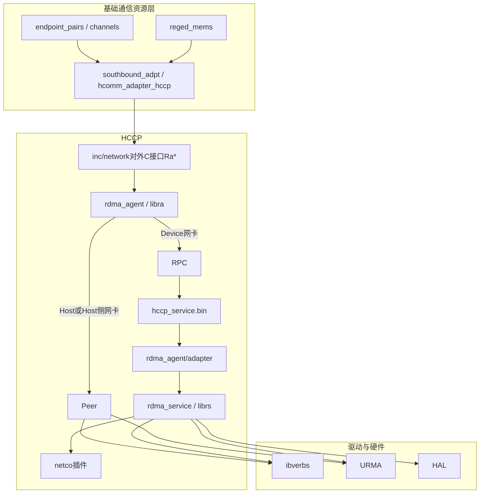
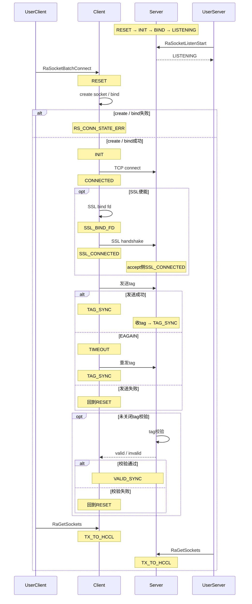

# HCCP

HCCP（Huawei Collective Communication adaptive Protocol，华为集合通信适配协议）是HCOMM的内部子模块，位于`src/base_comm/resources/`。它为网络设备间提供高性能通信服务，屏蔽Host / Device与不同网卡形态的部署差异，并把Socket、RoCE（v2）与UB收成一套C接口，供Endpoint、Channel、通信内存和CCU创建网络资源、完成建链，并在需要时下发数据面工作请求。

HCCP头文件位于模块内部`inc/network/`，由基础通信资源层直接包含。对上稳定接口是[架构简介](../architecture-brief.md)中的L3-res / L3-prim。

## 职责

HCCP承担基础通信模型里与网络协议相关的资源创建与建链，对应[架构简介2.3节](../architecture-brief.md)中的通信设备、通信通道和通信内存：

| 基础通信概念 | HCCP中的实体 | RoCE接口 | UB接口 |
|--------------|---------------|-----------|---------|
| 通信设备（Endpoint） | RDMA设备（rdev）或UB上下文（ctx），地址为IP或EID | `RaRdevInit` / `RaRdevInitV2`、`RaGetIfaddrs` | `RaCtxInit`、`RaGetDevEidInfoList` |
| 通信通道（Channel） | RoCE QP，或UB Jetty；建链前经Socket交换对端信息 | `RaQpCreate`、`RaQpCreateWithAttrs`、`RaTypicalQpCreate` + `RaTypicalQpModify`、`RaAiQpCreate`、`RaQpConnectAsync` | `RaCtxQpCreate`、`RaCtxQpImport` |
| 通信内存（CommMem） | RoCE MR，或UB本地内存注册/远端内存导入 | `RaMrReg`、`RaRegisterMr` | `RaCtxLmemRegister`、`RaCtxRmemImport` |
| 同步Notify | 设备Notify基址及其MR | `RaGetNotifyBaseAddr`、`RaGetNotifyMrInfo` | — |

在此之上，模块还提供：

- **Socket控制面**：监听、批量建链、收发（`RaSocketSend` / `RaSocketRecv`）、白名单、epoll与异步收发。Socket用于交换QP / MR / Jetty信息，也承载控制消息。
- **数据面提交**：`RaSendWr`系列，以及UB的`RaBatchSendWr`。集合通信算子的Write / Read / Notify原语在`primitives/`，经已建好的Channel使用这些资源。
- **连通性检测**：`RaPingInit`起的RoCE / UB Ping。
- **模块插件**：
  - **netco**：与交换侧协同，维护计算节点与交换机之间的表项。
  - **CCU**：供集合通信加速单元查询内存、下发命令。
- **维测**：端口状态、CQE / CR错误、异步事件、Jetty、调试配置，以及快照保存与恢复。

网口在Device设备上时，Host进程经RPC把请求交给设备侧`hccp_service.bin`。网口在Host或Host网卡上时，请求在本进程内完成。

## 协议层次

### 软件分层



调用关系自上而下：

1. Endpoint、Channel、通信内存通过`hcomm_adapter_hccp`调用`Ra*`。
2. `rdma_agent`（`libra`）按`RaInitConfig.nicPosition`选择路径。
3. 设备网卡的请求经RPC分发到设备进程`hccp_service.bin`，由其adapter分发到`rdma_service`（`librs`）。
4. Host / Host侧网卡执行Peer路径，在本进程内完成Socket与verbs操作，以及Socket与URMA操作。
5. `rdma_service`按芯片协议调用ibverbs或URMA。

### 协议与接口族

公共头文件按`@ingroup`分成五族，与[架构简介1.2节](../architecture-brief.md)中的网络协议对应如下。

| 接口族 | 头文件 | 覆盖协议 | 能力 |
|--------|--------|----------|------|
| init | `hccp.h`、`hccp_ctx.h`、`hccp_tlv.h`、`hccp_ping.h` | 公共 | 进程初始化、Socket / rdev / ctx / Ping的创建与销毁、网口与EID查询、模块插件接入 |
| socket | `hccp.h`、`hccp_async.h` | TCP | 监听、批量连接与断开、收发、白名单、连接额度、epoll |
| rdma | `hccp.h`、`hccp_async_ctx.h`、`hccp_nda.h` | RoCE | QP / CQ / SRQ、MR、WR下发与CQ轮询、Notify、QoS与超时、NDA队列 |
| urma | `hccp_ctx.h`、`hccp_ctx_tp.h`、`hccp_ctx_data_plane.h`、`hccp_async_ctx.h` | UB | EID、Token、本地/远端内存、Jetty与JFC、TP查询与属性、批量发送 |
| common | `hccp.h`、`hccp_opcode.h` | 公共 | 接口版本、能力查询、异步请求结果、安全随机数、快照、调试配置、错误码 |

内存语义下的远端访问通过`RaCtxRmemImport`把对端内存导入本端。

HCCS由Endpoint中的HCCS总线承接。HCCP的协议分支覆盖RoCE与UB。

### 同步与异步

同步接口在调用线程内同步完成。异步接口返回`reqHandle`，由`RaGetAsyncReqResult`取结果：

- Socket：`hccp_async.h`（批量建链、监听、关闭、收发）
- UB：`hccp_async_ctx.h`（内存注册、Jetty创建与导入、EID与TP查询）

设备网卡路径上，`RaInitConfig.enableHdcAsync`为真时额外建立一条RPC会话承载异步请求。

## 功能划分

### Socket

`RaSocketInit`绑定设备与本地IP，得到`socketHandle`。之后可以：

- `RaSocketListenStart` / `RaSocketListenStop`管理监听；`ListenPhase`区分创建fd、bind、listen失败阶段。
- `RaSocketBatchConnect` / `RaSocketBatchAbort` / `RaGetSockets`完成批量建链。连接可使用不同tag，供HCCL识别连接分组。
- `RaSocketSend` / `RaSocketRecv`按fd收发。发送未完成或收到`SOCK_EAGAIN`时由调用方续传。
- `RaSocketWhiteListAdd` / `RaSocketWhiteListDel`维护服务端白名单；`RaSocketAcceptCreditAdd`为accept补充额度。
- `RaEpollCtlAdd`与`RaCreateEventHandle` / `RaWaitEventHandle`提供事件等待；`RaSetTcpRecvCallback`注册接收回调。

`RaQpConnectAsync`经已连接Socket交换QP与MR，完成QP建链。Socket层可查询TLS是否启用（`RaGetTlsEnable`）。

#### 建链状态机

客户端由`RsSocketConnectAsync`按`enum RsConnState`（定义于`rs_inner.h`）推进；监听侧在`listenInfo`上使用其中的`INIT` / `BIND` / `LISTENING`。枚举含`RS_CONN_STATE_MAX`作为上界，不参与运行时迁移。

`RsConnState`全部取值：

| 状态 | 含义 |
|------|------|
| `RS_CONN_STATE_RESET` | 初始/失败回退，待创建socket |
| `RS_CONN_STATE_INIT` | 已创建（及按需bind）fd，待`connect` |
| `RS_CONN_STATE_BIND` | 监听侧已bind |
| `RS_CONN_STATE_LISTENING` | 监听侧已listen |
| `RS_CONN_STATE_CONNECTED` | TCP已连通 |
| `RS_CONN_STATE_SSL_BIND_FD` | SSL已绑定fd |
| `RS_CONN_STATE_SSL_CONNECTED` | SSL握手完成 |
| `RS_CONN_STATE_TAG_SYNC` | 客户端已发送tag；服务端已收到tag |
| `RS_CONN_STATE_VALID_SYNC` | tag校验通过 |
| `RS_CONN_STATE_TX_TO_HCCL` | 已通过`RaGetSockets`交还给上层 |
| `RS_CONN_STATE_TIMEOUT` | tag发送遇`EAGAIN`，待重试 |
| `RS_CONN_STATE_ERR` | 在`RESET`阶段建链失败 |
| `RS_CONN_STATE_MAX` | 枚举上界，非运行时状态 |

建链时序图（含SSL与tag；无SSL时跳过SSL步骤，`tagChkDis`时跳过tag校验）：



### RoCE

`RaRdevInit` / `RaRdevInitV2`按物理设备与IP启用RDMA设备。初始化默认拉起RDMA Lite线程，`RdevInitInfo`可关闭该线程，该功能仅支持Atlas A3系列产品、Atlas A2系列产品。

资源与数据面：

- QP：`RaQpCreate`、`RaQpCreateWithAttrs`、`RaTypicalQpCreate`、`RaNormalQpCreate`、`RaAiQpCreate`、环回`RaLoopbackQpCreate`；销毁为对应的`RaQpDestroy`系列接口。
- 建链与状态：`RaQpConnectAsync`、`RaTypicalQpModify`、`RaQpBatchModify`、`RaGetQpStatus`。
- CQ / SRQ：`RaCqCreate`、`RaTypicalCqCreate`、`RaCreateSrq`、`RaPollCq`。
- 内存：`RaMrReg`、`RaRegisterMr`。
- 发送：`RaSendWr`、`RaSendWrV2`、`RaSendWrlist`、`RaRecvWrlist`。
- 属性：QoS、超时、重试次数、负载均衡、TSQP深度（异步GDR场景）。

`RaNdaGetDirectFlag`查询NDA直通方式（PCIe或UB）。`RaNdaCqCreate` / `RaNdaQpCreate`创建带队列缓冲描述的CQ / QP，供调用方直接访问队列。

### UB

`RaCtxInit`创建UB上下文并默认启动Lite线程。地址使用`HccpEid`（16字节，可表示IPv4映射地址）。`RaGetEidByIp` / `RaGetIpByEid`实现IP与EID互查。

| 步骤 | 接口 | 作用 |
|------|------|------|
| 内存 | `RaCtxTokenIdAlloc`、`RaCtxLmemRegister`、`RaCtxRmemImport` | 分配Token，注册本地内存，导入远端内存 |
| 完成队列 | `RaCtxCqCreate` | 创建JFC / CQ |
| 通道 | `RaCtxQpCreate`、`RaCtxQpImport` | 创建Jetty，导入对端Jetty |
| 传输层 | `RaCtxGetTpInfoList`、`RaCtxGetTpAttr`、`RaCtxSetTpAttr` | 按CTP / RTP / UTP / UBoE查询并设置TP |

### TLV插件通道

TLV是插件通道，仅用于设备网卡。`RaTlvInit`之后，`RaTlvRequest`按模块类型收发，将请求分发给对应插件：

- `TLV_MODULE_TYPE_NSLB`：设备侧`rdma_service/tlv`动态加载`libnet_co.so`，维护与交换机之间的表项。
- `TLV_MODULE_TYPE_CCU`：`MSG_TYPE_CCU_INIT`、`MSG_TYPE_CCU_GET_MEM_INFO`、`MSG_TYPE_CCU_DISPATCH_CMD`等，由`resources/ccu`经适配层调用。

#### 支持场景

- **NSLB**：仅支持Atlas A3系列产品、Atlas A2系列产品。
- **CCU**：支持Ascend 950产品及其之后代际的产品。

### Ping与维测

Ping的`PingQpAttr`同时描述RDMA QP与UB Jetty。流程为`RaPingInit` → `RaPingTargetAdd` → `RaPingTaskStart` → `RaPingGetResults` → `RaPingTaskStop` → `RaPingDeinit`。

维测接口包括`RaRdevGetPortStatus`、`RaGetCqeErrInfo`、`RaRdevGetCqeErrInfoList`、`RaCtxGetAsyncEvents`、`RaCtxGetCrErrInfoList`、`RaCtxGetAuxInfo`、`RaCtxGetJettyContext`、`RaGetHccnCfg`、`RaSetDebugConfig`，以及`RaSaveSnapshot` / `RaRestoreSnapshot`。

错误码分段定义在`hccp_opcode.h`：初始化`128001`起、RoCE / UB`128101`起、Socket`128201`起。

## 代码路径

```text
src/base_comm/resources/hccp/
├── inc/network/                 # 对上C接口：hccp.h、hccp_ctx.h、hccp_async.h、hccp_ping.h、hccp_tlv.h、hccp_nda.h
├── inc/private/network/         # RA与RS之间的消息、opcode、错误码
├── common/                      # HAL动态加载、日志与文件操作
├── rdma_agent/                  # libra，Host / Device均编译
│   ├── client/                  # Ra*入口，按nicPosition分发到HDC（Host-Device Communication）或Peer
│   ├── hdc/                     # HDC客户端，含同步与async会话
│   ├── peer/                    # Host或Host网卡路径
│   └── adapter/                 # 设备侧HDC服务，链接进hccp_service.bin
├── rdma_service/                # librs；Host / Device均编译
│   ├── rs_socket.c / rs_rdma.c  # TCP Socket与RoCE verbs
│   ├── rs_ping.c                # RoCE Ping
│   ├── ctx/                     # UB：Jetty、JFC、TP、URMA / CCU动态加载
│   └── tlv/                     # 设备侧TLV，NSLB与CCU
├── hccp_service/                # 设备进程hccp_service.bin的main与参数解析
├── netco/                       # 设备侧libnet_co，计算节点与交换机的连接及表同步
├── external_depends/            # ibverbs/hns、URMA、CCU、net_adapt、RDMA Lite等头文件
└── stub_tsd/                    # 设备侧TSD（Train service daemon）事件客户端桩
```

构建入口是`src/base_comm/resources/hccp/CMakeLists.txt`：

| 构建产物 | 运行位置 | 说明 |
|----------|----------|------|
| `libra`（`rdma_agent/client`） | Host与Device | 对上唯一入口库 |
| `librs` | Host与Device | 协议实现；打包进cann-hccd-compat |
| `rs_device` | Device | 与`librs`同源，额外定义`CUSTOM_INTERFACE` |
| `hccp_service.bin` | Device | 链接`ra_adp`与`rs_device`，经HDC接受Host请求 |
| `libnet_co.so` | Device | NSLB使用，由`librs`在TLV初始化时`dlopen` |

Host与Device都编译`rdma_agent`和`rdma_service`。
`hccp_service.bin`、`netco`只在Device侧启用。

## 软件架构约束

| 约束 | 说明 |
|------|------|
| **所有接口为模块内部接口** | 此模块接口为项目核心逻辑内部协同设计，并非为外部应用准备。我们保留随时修改、重构或删除的准备，不会在版本日志中进行特殊说明。直接依赖这些接口可能会导致您的应用在版本升级中异常。 |

## 附录

- RoCEv2：RDMA over Converged Ethernet version 2，参考文档见《[InfiniBand Trade Association](https://infinibandta.org/)》。
- UB：Unified Bus（灵衢总线），参考文档见《[灵衢社区](https://www.unifiedbus.com/zh)》。
