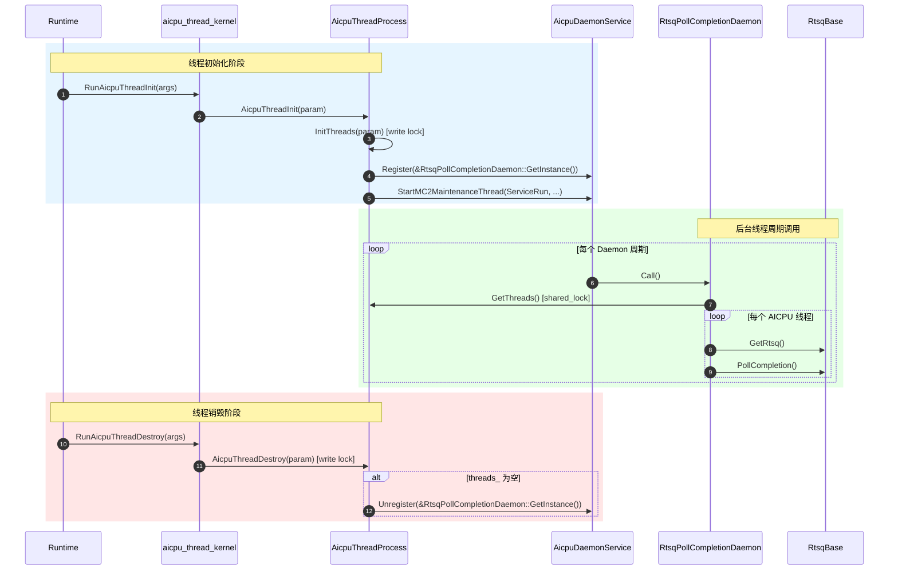

# AICPU Thread Device 模块说明

---

## 功能描述

本模块位于 `base_comm/resources/comm_engine_res/threads/device/`（L3 层），提供 AICPU 设备侧线程的生命周期管理、后台守护，以及 DPU 线程 device 侧实体与队列名片投递功能。

核心能力：

1. **线程生命周期管理**（`AicpuThreadProcess`）：管理 AICPU 线程的初始化、销毁、补充通知，维护全局线程列表及读写锁。
2. **线程入口接口**（`aicpu_thread_kernel.h`）：声明 `extern "C"` 可见的线程入口函数，供 runtime 调用。
3. **RTSQ 完成轮询守护**（`RtsqPollCompletionDaemon`）：后台线程周期性轮询所有 AICPU 线程的 RTSQ 完成事件，推进 CI。
4. **DPU 线程 device 侧实体与队列名片投递**（`CpuDeviceThread` + `cpu_device_thread_registry`）：在 device 侧为 DPU 线程构建实体并按句柄登记，接收 host 侧投递的队列名片（SQ/CQ 描述与 notify 寻址）及 notify 地址更新；实体持有 SQ 提交器、CQ 描述与 notify 寻址，供 AICPU 编排侧按句柄提交 SQE、CQ 守护按句柄取 CQ。

---

## 目录描述

```text
device/
├── CMakeLists.txt                              # 将模块源文件加入 ccl_kernel 目标
├── aicpu_thread_kernel.h                       # extern "C" 线程入口声明（RunAicpuThreadInit 等）
├── aicpu_thread_kernel.cc                      # 线程入口实现，委托给 AicpuThreadProcess
├── aicpu_thread_process.h                      # 线程管理类声明（静态方法 + 静态成员）
├── aicpu_thread_process.cc                     # 线程管理实现（Init/Destroy/BackgroundThread，DPU 线程建实体与销毁分支）
├── aicpu_rtsq_poll_daemon.h                    # RTSQ 轮询守护类声明（单例，继承 Hccl::DaemonFunc）
├── aicpu_rtsq_poll_daemon.cc                   # Call() 实现：遍历线程 → PollCompletion
├── cpu_device_thread.h                         # DPU 线程 device 侧实体声明（CpuDeviceThread、MakeCpuDeviceThread）
├── cpu_device_thread.cc                        # 实体实现：Thread 协议面转 SQE 提交，名片/notify 回填
├── cpu_device_thread_registry.h                # handle → 实体登记表声明（Register/Find/Erase/Clear）
├── cpu_device_thread_registry.cc               # 登记表实现：全局 unordered_map + mutex
├── cpu_device_queue_namecard_restore_kernel.h  # 队列名片投递 kernel 入口声明（RunDpuQueueNamecardRestore）
├── cpu_device_queue_namecard_restore_kernel.cc # 名片投递实现：校验 SQ/CQ 描述，按句柄回填实体
├── cpu_device_notify_addr_update_kernel.h      # notify 地址更新 kernel 入口声明（RunCpuThreadNotifyAddrUpdate）
├── cpu_device_notify_addr_update_kernel.cc     # notify 地址更新实现：按句柄回填实体 notify 寻址
└── thread_entity_utils.h                       # ThreadEntity 解包与 ABI 校验（magic/version/size）
```

**目录特征**：

- 位于 `base_comm/resources/comm_engine_res/threads/device/`，隶属 L3 层；
- `AicpuThreadProcess` 的静态线程列表 `threads_` 被 `RtsqPollCompletionDaemon` 遍历；
- 依赖外部：`aicpu_daemon_service.h`（守护服务）、`stream_lite.h`（RTSQ 访问）、`daemon_func.h`（基类）；
- `cpu_device_thread_registry` 提供 handle → 实体反查（handle 即实体在 device 侧的地址，device 侧对 `Thread*` 做 `dynamic_cast` 不可靠，故用显式登记表）：DPU 线程实体由 L2 侧线程创建流程建立并登记（L2 建），销毁恒走本模块 `AicpuThreadProcess::AicpuThreadDestroy` 按句柄幂等摘除（L3 销）；队列名片（SQ/CQ 描述）留在实体自身，登记表只负责找到实体；
- 依赖外部（DPU 实体）：`cpu_device_sq_submitter.h`（SQ 提交器）、`dpu_sync_layout.h`（host/device 两侧共用的参数块布局契约，位于 `../cpu_thread/`）。

---

## 接口描述

### AicpuThreadProcess

| 接口 | 说明 |
|------|------|
| `static HcclResult InitThreads(ThreadMgrAicpuParam* param)` | 创建并注册 AICPU 线程，向入参中的 `HcommThreadEntity` 指针数组回填 `compatThreadHandle`。 |
| `static HcclResult AicpuThreadInit(ThreadMgrAicpuParam* param)` | 线程初始化入口（设设备、初始化线程、启动后台线程）。 |
| `static HcclResult AicpuThreadDestroy(ThreadMgrAicpuParam* param)` | 按入参中的 `HcommThreadEntity` 指针数组读取 `compatThreadHandle` 并销毁指定线程，线程列表清空时停止后台线程。 |
| `static HcclResult AicpuThreadSupplementNotify(ThreadMgrAicpuParam* param)` | 补充通知线程。 |
| `static const std::vector<std::shared_ptr<hccl::Thread>>& GetThreads()` | 获取当前已注册的线程列表（需持读锁）。 |
| `static std::shared_mutex& GetMutex()` | 获取线程列表读写锁。 |

### aicpu_thread_kernel.h（extern "C" 入口）

| 接口 | 说明 |
|------|------|
| `RunAicpuIndOpThreadInit(void* args)` | 独立算子线程初始化入口。 |
| `RunAicpuThreadInit(void* args)` | AICPU 线程初始化入口，委托 `AicpuThreadProcess::AicpuThreadInit`。 |
| `RunAicpuThreadDestroy(void* args)` | AICPU 线程销毁入口，委托 `AicpuThreadProcess::AicpuThreadDestroy`。 |
| `RunAicpuThreadSupplementNotify(void* args)` | 补充通知入口，委托 `AicpuThreadProcess::AicpuThreadSupplementNotify`。 |

### RtsqPollCompletionDaemon

| 接口 | 说明 |
|------|------|
| `static RtsqPollCompletionDaemon& GetInstance()` | 获取单例引用。 |
| `void Call() override` | 守护周期调用入口：遍历 `AicpuThreadProcess::GetThreads()`，对每个线程的 RTSQ 执行 `PollCompletion()`。 |

### Daemon 注册与注销

| 时机 | 调用方 | 操作 |
|------|--------|------|
| 线程初始化 | `AicpuThreadProcess::InitBackGroundThread()` | `AicpuDaemonService::Register(&RtsqPollCompletionDaemon::GetInstance())` |
| 最后一个线程销毁 | `AicpuThreadProcess::StopBackGroundThread()` | `AicpuDaemonService::Unregister(&RtsqPollCompletionDaemon::GetInstance())` |

注册后，`AicpuDaemonService::ServiceRun` 在后台线程中周期性调用 `Call()`。后台线程由 `StartMC2MaintenanceThread`（runtime 弱符号）启动，多个 Daemon 共享同一个后台线程。

### cpu_device_thread.h（DPU 线程 device 侧实体）

`CpuDeviceThread` 是 DPU 线程在 device 侧的实体，host 侧对应物是薄壳 `CpuThread`，两侧由下发参数块的 `threadType` 配对；Thread 协议面取值口径与 host 侧 `CpuThread` 保持一致（无设备流/notify 直操作）。

| 接口 | 说明 |
|------|------|
| `HcclResult MakeCpuDeviceThread(ThreadType threadType, const char* commId, int32_t deviceLogicId, uint32_t deviceType, bool& isCpuDeviceThread, std::shared_ptr<hccl::Thread>& outThread)` | 按参数块 `threadType` 分流：非 `THREAD_TYPE_CPU` 返回成功且 `isCpuDeviceThread == false`，调用方走 `AicpuTsThread` 原路；是则构建实体并登记进登记表，`outThread` 必定非空；构建失败直接上抛，退回原路会造出错类型的实体。 |
| `void SetQueueNamecard(const QueueDescriptor& sqDesc, const QueueDescriptor& cqDesc, uint32_t notifyNum, uint64_t notifyHostAddr, uint64_t notifyDevAddr)` | 队列名片回填：初始化 SQ 提交器、保存 CQ 描述与 notify 寻址，成功才置 `namecardReady_`；SQ 提交器初始化失败时名片不置就绪。 |
| `void UpdateNotifyInfo(uint32_t notifyNum, uint64_t notifyHostAddr, uint64_t notifyDevAddr)` | notify 扩容后回填新的容量与 host/device 侧 notify 寻址。 |

### cpu_device_thread_registry.h（handle → 实体登记表）

`handle` 即实体在 device 侧的地址；队列名片留在实体自身，本表只负责按句柄找到实体。

| 接口 | 说明 |
|------|------|
| `void RegisterCpuDeviceThread(ThreadHandle handle, std::shared_ptr<hccl::CpuDeviceThread> entity)` | 按句柄登记实体；句柄重复登记报错不覆盖。 |
| `std::shared_ptr<hccl::CpuDeviceThread> FindCpuDeviceThread(ThreadHandle handle)` | 按句柄反查实体，命中返回实体（持有一份引用，调用期间不会被销毁侧抽走），未登记返回 `nullptr`。 |
| `bool EraseCpuDeviceThread(ThreadHandle handle)` | 按句柄摘除登记，返回 true 表示该句柄确为已登记的 DPU 线程（销毁方据此跳过 AICPU 线程容器的查找）。 |
| `void ClearCpuDeviceThread()` | 清空登记表（当前由 UT 清理使用）。 |

### device kernel 入口（extern "C"，host 侧按名下发）

由 host 侧 `AicpuThreadLaunchMgr::CpuQueueNamecardLaunch`/`CpuNotifyAddrUpdateLaunch` 经 `AicpuAclKernelLaunch` 按名取函数句柄下发并同步等待。

| 接口 | 说明 |
|------|------|
| `uint32_t RunDpuQueueNamecardRestore(void* args)` | 队列名片投递入口（参数块 `DpuQueueNamecardParam`）：校验 SQ/CQ 描述与句柄后按 `threadHandle` 反查实体，回填名片（`SetQueueNamecard`）；实体未登记（线程销毁与投递竞争）仅告警并返回成功。 |
| `uint32_t RunCpuThreadNotifyAddrUpdate(void* args)` | notify 地址更新入口（参数块 `CpuThreadNotifyAddrUpdateParam`）：校验句柄/容量/地址非零后按 `threadHandle` 反查实体，回填新 notify 寻址（`UpdateNotifyInfo`）；实体未登记报错。 |

---

## 调用周期



---

## 使用限制

| 类别 | 约束 |
|------|------|
| **平台依赖** | 仅 `DEV_TYPE_950` / `DEV_TYPE_960` 设备启用后台线程（`AicpuThreadInit` 中判断设备类型）。 |
| **线程模型** | Daemon `Call()` 在 `StartMC2MaintenanceThread` 启动的后台线程中执行，与数据面线程分离。 |
| **并发安全** | `AicpuThreadProcess::mutex_`（`shared_mutex`）保护 `threads_` 列表；`Call()` 中持读锁遍历，`Init/Destroy` 中持写锁修改。 |
| **后台线程启停** | `InitBackGroundThread` 由 `daemonFuncRegistered_` 守护，幂等；`StopBackGroundThread` 在最后一个线程销毁时注销 Daemon，但不停止后台线程本身（背景线程由 runtime 管理）。 |
| **层级归属** | L3（`base_comm`），与 L2 层 `CollRtsqPollCompletionDaemon` 功能对称，区别在于遍历线程的来源不同（`AicpuThreadProcess` vs `CollCommAicpuMgr`）。 |
| **依赖方向** | 依赖 `aicpu_daemon_service.h`、`stream_lite.h`、`daemon_func.h`，均为 L3 层或更底层，符合分层依赖方向约束。 |
| **DPU 实体资源** | `CpuDeviceThread` 不持有设备流资源（无 `StreamLite`/`pImpl_`/`Rtsq`），构造即置 `fakeDeviceRes_`，资源注册与任务下发按该标志统一拦截跳过，与 GE 保序桩线程共用同一口径（见 `thread.h` 的 `SetFakeDeviceRes`）；`InitThreads` 中的 DFX 注册按 `IsFakeDeviceRes()` 跳过。 |
| **DPU 本地原语** | 单参 `LocalNotifyRecord(notifyId)`/`LocalNotifyWait(notifyId)` 与 `LocalReduce` 不支持，返回 `HCCL_E_NOT_SUPPORT`；跨线程 notify、带超时 notify 等待、通道级原语与本地拷贝经 SQ 提交器转 SQE 下发 DPU。 |
| **DPU 名片时序** | `IsNamecardReady()` 为 false 表示队列 kernel 尚未拉起，消费侧须空转；SQ 提交器初始化失败时名片不置就绪，无恢复路径。 |
| **DPU 队列描述校验** | `RunDpuQueueNamecardRestore` 要求 CQ 深度恒为单槽（`DPU_CQ_DEPTH = 1`）、SQ/CQ `elemSize` 与 `DPU_SQE_SIZE`/`DPU_CQE_SIZE`（均为 64）一致、SQ `depth` 非零且为 2 的幂，违者投递失败。 |
| **DPU kernel 入口对齐** | 两个 device kernel 入口由 host 侧按名解析下发（不在 host 侧链接符号），入口名须与 `ccl_kernel.ini` 的 section 名、`.map` 白名单三处一致，缺一只在 Release 运行期报「函数解析失败」。 |
