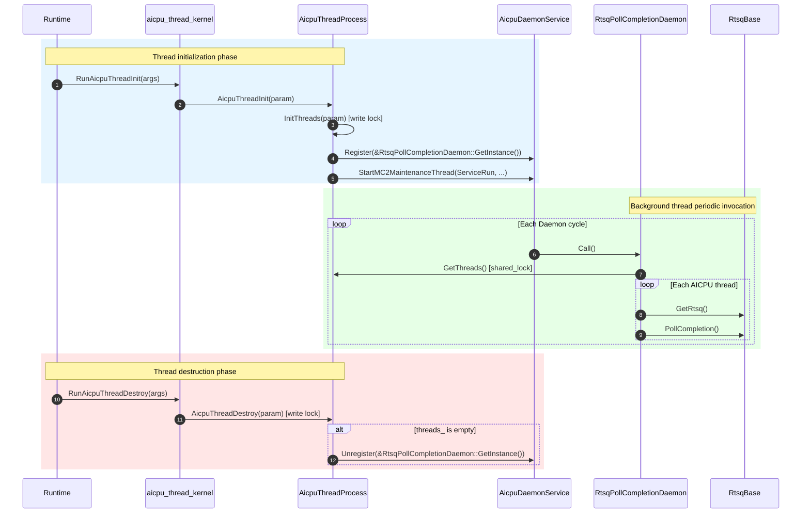

# AICPU Thread Device Module Description

---

## Function Description

This module is located at `base_comm/resources/comm_engine_res/threads/device/` (L3 layer), providing AICPU device-side thread lifecycle management, background daemon functionality, and DPU thread device-side entity with queue namecard delivery.

Core capabilities:

1. **Thread lifecycle management** (`AicpuThreadProcess`): Manages AICPU thread initialization, destruction, and supplementary notification; maintains the global thread list and read-write lock.
2. **Thread entry interfaces** (`aicpu_thread_kernel.h`): Declares `extern "C"` visible thread entry functions for runtime invocation.
3. **RTSQ completion polling daemon** (`RtsqPollCompletionDaemon`): A background thread periodically polls all AICPU threads' RTSQ completion events to advance CI.
4. **DPU thread device-side entity and queue namecard delivery** (`CpuDeviceThread` + `cpu_device_thread_registry`): Builds and registers the device-side entity for DPU threads by handle, and receives the queue namecard (SQ/CQ descriptors and notify addressing) and notify address updates delivered from the host side; the entity holds the SQ submitter, CQ descriptor and notify addressing, so the AICPU orchestration side submits SQEs by handle and the CQ daemon fetches the CQ by handle.

---

## Directory Description

```text
device/
├── CMakeLists.txt                              # Adds module source files to the ccl_kernel target
├── aicpu_thread_kernel.h                       # extern "C" thread entry declarations (RunAicpuThreadInit, etc.)
├── aicpu_thread_kernel.cc                      # Thread entry implementation, delegates to AicpuThreadProcess
├── aicpu_thread_process.h                      # Thread management class declaration (static methods + static members)
├── aicpu_thread_process.cc                     # Thread management implementation (Init/Destroy/BackgroundThread, DPU thread entity creation and destruction branches)
├── aicpu_rtsq_poll_daemon.h                    # RTSQ polling daemon class declaration (singleton, inherits Hccl::DaemonFunc)
├── aicpu_rtsq_poll_daemon.cc                   # Call() implementation: iterate threads → PollCompletion
├── cpu_device_thread.h                         # DPU thread device-side entity declaration (CpuDeviceThread, MakeCpuDeviceThread)
├── cpu_device_thread.cc                        # Entity implementation: Thread protocol methods submit SQEs; namecard/notify backfill
├── cpu_device_thread_registry.h                # handle → entity registry declaration (Register/Find/Erase/Clear)
├── cpu_device_thread_registry.cc               # Registry implementation: global unordered_map + mutex
├── cpu_device_queue_namecard_restore_kernel.h  # Queue namecard delivery kernel entry declaration (RunDpuQueueNamecardRestore)
├── cpu_device_queue_namecard_restore_kernel.cc # Namecard delivery implementation: validates SQ/CQ descriptors, backfills entity by handle
├── cpu_device_notify_addr_update_kernel.h      # Notify address update kernel entry declaration (RunCpuThreadNotifyAddrUpdate)
├── cpu_device_notify_addr_update_kernel.cc     # Notify address update implementation: backfills entity notify addressing by handle
└── thread_entity_utils.h                       # ThreadEntity unwrapping and ABI validation (magic/version/size)
```

**Directory features**:

- Located in `base_comm/resources/comm_engine_res/threads/device/`, belongs to the L3 layer;
- `AicpuThreadProcess`'s static thread list `threads_` is iterated by `RtsqPollCompletionDaemon`;
- External dependencies: `aicpu_daemon_service.h` (daemon service), `stream_lite.h` (RTSQ access), `daemon_func.h` (base class);
- `cpu_device_thread_registry` provides handle → entity reverse lookup (the handle is the entity's device-side address; `dynamic_cast` on `Thread*` is unreliable on the device side, hence this explicit registry): the DPU thread entity is created and registered by the L2-side thread creation flow (created at L2), and destruction always goes through this module's `AicpuThreadProcess::AicpuThreadDestroy`, which erases the entry by handle idempotently (destroyed at L3); the queue namecard (SQ/CQ descriptors) stays on the entity itself — the registry only locates the entity;
- External dependencies (DPU entity): `cpu_device_sq_submitter.h` (SQ submitter), `dpu_sync_layout.h` (param-block layout contract shared by the host/device sides, located at `../cpu_thread/`).

---

## Interface Description

### AicpuThreadProcess

| Interface | Description |
|-----------|-------------|
| `static HcclResult InitThreads(ThreadMgrAicpuParam* param)` | Creates and registers AICPU threads and fills `compatThreadHandle` in the input `HcommThreadEntity` pointer array. |
| `static HcclResult AicpuThreadInit(ThreadMgrAicpuParam* param)` | Thread initialization entry (sets device, initializes threads, starts background thread). |
| `static HcclResult AicpuThreadDestroy(ThreadMgrAicpuParam* param)` | Reads `compatThreadHandle` from the input `HcommThreadEntity` pointer array and destroys specified threads; stops background thread when thread list is empty. |
| `static HcclResult AicpuThreadSupplementNotify(ThreadMgrAicpuParam* param)` | Supplementary notification for threads. |
| `static const std::vector<std::shared_ptr<hccl::Thread>>& GetThreads()` | Returns the currently registered thread list (requires read lock). |
| `static std::shared_mutex& GetMutex()` | Returns the thread list read-write lock. |

### aicpu_thread_kernel.h (extern "C" entry points)

| Interface | Description |
|-----------|-------------|
| `RunAicpuIndOpThreadInit(void* args)` | Independent operator thread initialization entry. |
| `RunAicpuThreadInit(void* args)` | AICPU thread initialization entry, delegates to `AicpuThreadProcess::AicpuThreadInit`. |
| `RunAicpuThreadDestroy(void* args)` | AICPU thread destruction entry, delegates to `AicpuThreadProcess::AicpuThreadDestroy`. |
| `RunAicpuThreadSupplementNotify(void* args)` | Supplementary notification entry, delegates to `AicpuThreadProcess::AicpuThreadSupplementNotify`. |

### RtsqPollCompletionDaemon

| Interface | Description |
|-----------|-------------|
| `static RtsqPollCompletionDaemon& GetInstance()` | Returns the singleton reference. |
| `void Call() override` | Daemon cycle entry point: iterates `AicpuThreadProcess::GetThreads()`, calls `PollCompletion()` on each thread's RTSQ. |

### Daemon Registration and Unregistration

| Timing | Caller | Operation |
|--------|--------|-----------|
| Thread initialization | `AicpuThreadProcess::InitBackGroundThread()` | `AicpuDaemonService::Register(&RtsqPollCompletionDaemon::GetInstance())` |
| Last thread destruction | `AicpuThreadProcess::StopBackGroundThread()` | `AicpuDaemonService::Unregister(&RtsqPollCompletionDaemon::GetInstance())` |

After registration, `AicpuDaemonService::ServiceRun` periodically calls `Call()` in a background thread. The background thread is started by `StartMC2MaintenanceThread` (runtime weak symbol), shared across multiple Daemons.

### cpu_device_thread.h (DPU thread device-side entity)

`CpuDeviceThread` is the device-side entity of a DPU thread; its host-side counterpart is the thin-shell `CpuThread`, and the two sides are paired by the `threadType` in the delivered param block. The Thread protocol surface keeps the same value conventions as the host-side `CpuThread` (no device stream / direct notify operations).

| Interface | Description |
|-----------|-------------|
| `HcclResult MakeCpuDeviceThread(ThreadType threadType, const char* commId, int32_t deviceLogicId, uint32_t deviceType, bool& isCpuDeviceThread, std::shared_ptr<hccl::Thread>& outThread)` | Routes by the param block's `threadType`: for non-`THREAD_TYPE_CPU`, returns success with `isCpuDeviceThread == false` and the caller follows the original `AicpuTsThread` path; otherwise builds the entity and registers it into the registry, with `outThread` guaranteed non-null; build failures must be propagated directly — falling back to the original path would create an entity of the wrong type. |
| `void SetQueueNamecard(const QueueDescriptor& sqDesc, const QueueDescriptor& cqDesc, uint32_t notifyNum, uint64_t notifyHostAddr, uint64_t notifyDevAddr)` | Queue namecard backfill: initializes the SQ submitter, saves the CQ descriptor and notify addressing, and marks `namecardReady_` only on success; if SQ submitter initialization fails, the namecard is not marked ready. |
| `void UpdateNotifyInfo(uint32_t notifyNum, uint64_t notifyHostAddr, uint64_t notifyDevAddr)` | Backfills the new capacity and host/device-side notify addressing after notify expansion. |

### cpu_device_thread_registry.h (handle → entity registry)

The `handle` is the entity's device-side address; the queue namecard stays on the entity itself — this registry only locates the entity by handle.

| Interface | Description |
|-----------|-------------|
| `void RegisterCpuDeviceThread(ThreadHandle handle, std::shared_ptr<hccl::CpuDeviceThread> entity)` | Registers the entity by handle; duplicate registration of the same handle logs an error without overwriting. |
| `std::shared_ptr<hccl::CpuDeviceThread> FindCpuDeviceThread(ThreadHandle handle)` | Looks up the entity by handle: returns the entity on hit (holding a reference so it cannot be pulled away by the destroying side during the call), or `nullptr` if not registered. |
| `bool EraseCpuDeviceThread(ThreadHandle handle)` | Removes the registration by handle; returning true means the handle was indeed a registered DPU thread (the destroyer skips the AICPU thread container lookup accordingly). |
| `void ClearCpuDeviceThread()` | Clears the registry (currently used by UT cleanup). |

### Device kernel entries (extern "C", launched by name from the host side)

Launched by the host side (`AicpuThreadLaunchMgr::CpuQueueNamecardLaunch`/`CpuNotifyAddrUpdateLaunch`) via `AicpuAclKernelLaunch`, resolving the function handle by name and synchronizing until completion.

| Interface | Description |
|-----------|-------------|
| `uint32_t RunDpuQueueNamecardRestore(void* args)` | Queue namecard delivery entry (param block `DpuQueueNamecardParam`): validates the SQ/CQ descriptors and the handle, looks up the entity by `threadHandle`, and backfills the namecard (`SetQueueNamecard`); an unregistered entity (race between thread destruction and delivery) only logs a warning and returns success. |
| `uint32_t RunCpuThreadNotifyAddrUpdate(void* args)` | Notify address update entry (param block `CpuThreadNotifyAddrUpdateParam`): validates that handle/capacity/addresses are non-zero, looks up the entity by `threadHandle`, and backfills the new notify addressing (`UpdateNotifyInfo`); an unregistered entity is an error. |

---

## Call Cycle



---

## Usage Constraints

| Category | Constraint |
|----------|------------|
| **Platform dependency** | Background thread only enabled on `DEV_TYPE_950` / `DEV_TYPE_960` devices (checked in `AicpuThreadInit`). |
| **Threading model** | Daemon `Call()` executes in the background thread started by `StartMC2MaintenanceThread`, separated from data-plane threads. |
| **Concurrency safety** | `AicpuThreadProcess::mutex_` (`shared_mutex`) protects `threads_`; `Call()` holds read lock during iteration, `Init/Destroy` hold write lock during modification. |
| **Background thread start/stop** | `InitBackGroundThread` is guarded by `daemonFuncRegistered_`, idempotent; `StopBackGroundThread` unregisters the Daemon when the last thread is destroyed, but does not stop the background thread itself (managed by runtime). |
| **Layer attribution** | L3 (`base_comm`), symmetric with the L2-layer `CollRtsqPollCompletionDaemon`; the difference is the source of thread enumeration (`AicpuThreadProcess` vs `CollCommAicpuMgr`). |
| **Dependency direction** | Depends on `aicpu_daemon_service.h`, `stream_lite.h`, `daemon_func.h`, all at L3 layer or lower, complying with layered dependency direction constraints. |
| **DPU entity resources** | `CpuDeviceThread` holds no device stream resources (no `StreamLite`/`pImpl_`/`Rtsq`); the constructor sets `fakeDeviceRes_` immediately, and resource registration and task submission are uniformly intercepted and skipped by this flag, sharing the same policy as GE ordering stub threads (see `SetFakeDeviceRes` in `thread.h`); DFX registration in `InitThreads` is skipped via `IsFakeDeviceRes()`. |
| **DPU local primitives** | Single-argument `LocalNotifyRecord(notifyId)`/`LocalNotifyWait(notifyId)` and `LocalReduce` are unsupported and return `HCCL_E_NOT_SUPPORT`; cross-thread notify, notify wait with timeout, channel-level primitives and local copy are converted to SQEs and submitted to the DPU via the SQ submitter. |
| **DPU namecard timing** | `IsNamecardReady()` returning false means the queue kernel has not been launched yet and consumers must spin idle; if SQ submitter initialization fails, the namecard is not marked ready, with no recovery path. |
| **DPU queue descriptor validation** | `RunDpuQueueNamecardRestore` requires the CQ depth to be the constant single slot (`DPU_CQ_DEPTH = 1`), SQ/CQ `elemSize` to match `DPU_SQE_SIZE`/`DPU_CQE_SIZE` (both 64), and SQ `depth` to be non-zero and a power of two; violations fail the delivery. |
| **DPU kernel entry alignment** | The two device kernel entries are resolved by name on the host side (the symbols are not linked on the host side); the entry names must match the `ccl_kernel.ini` section names and the `.map` whitelist in all three places — any mismatch only reports "function resolution failure" at Release runtime. |
