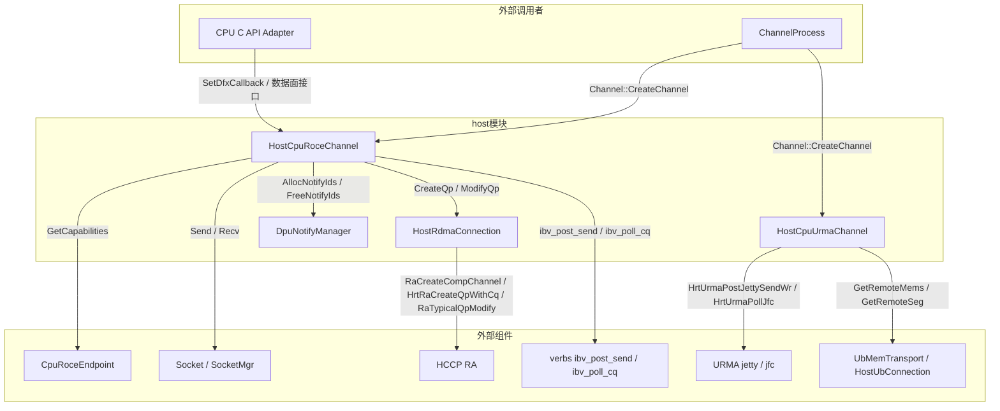
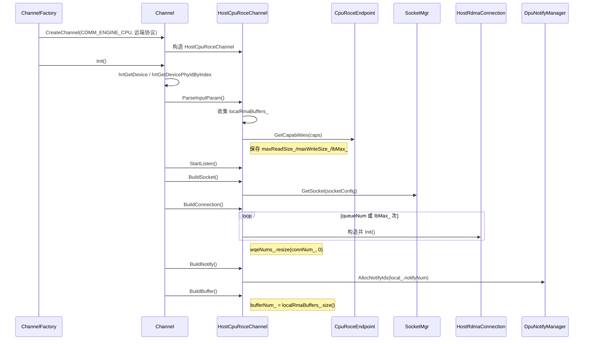
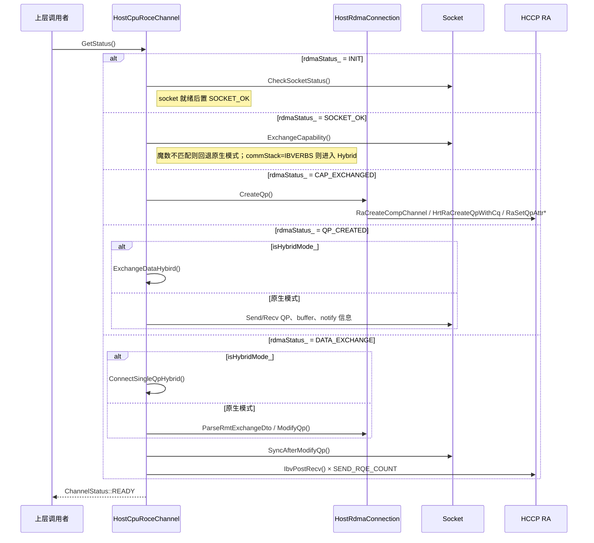
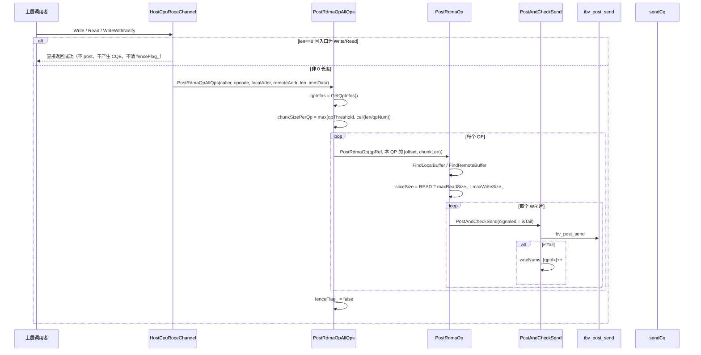
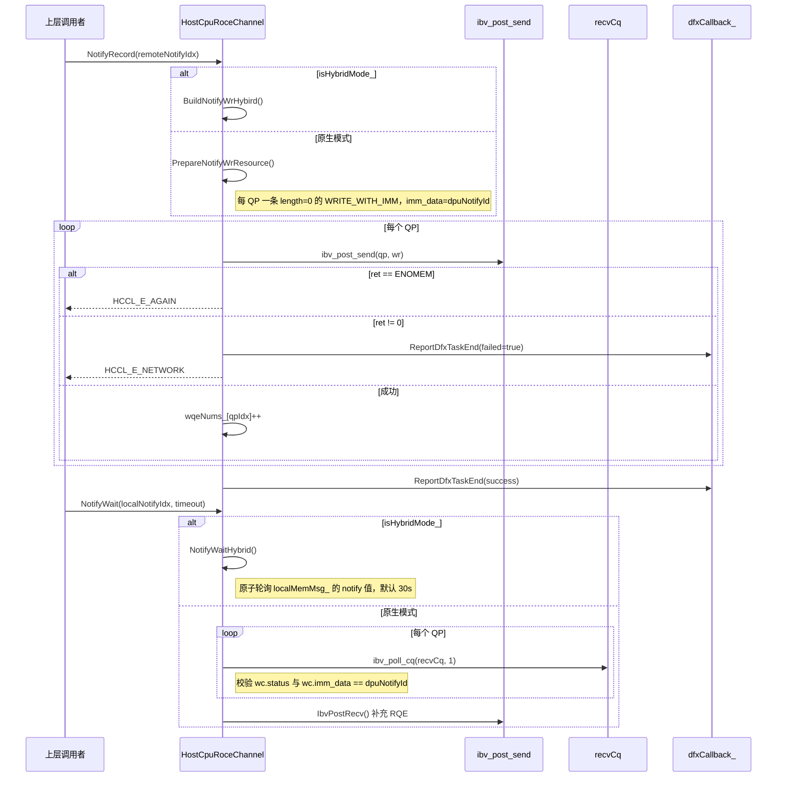
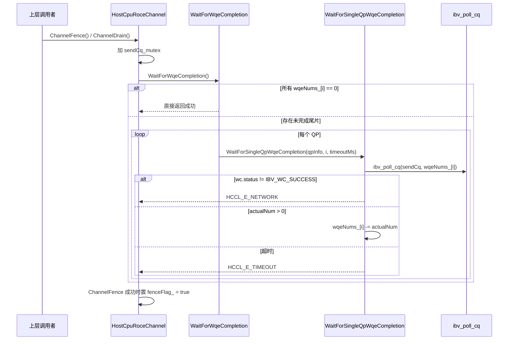
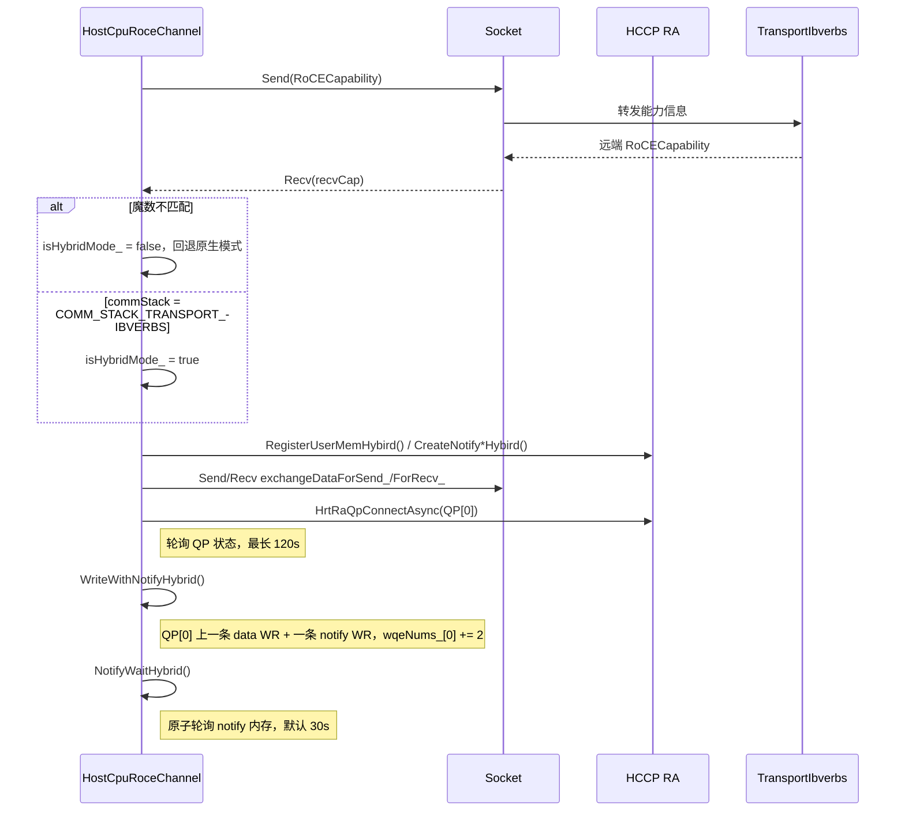
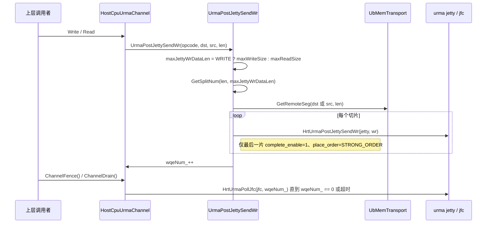
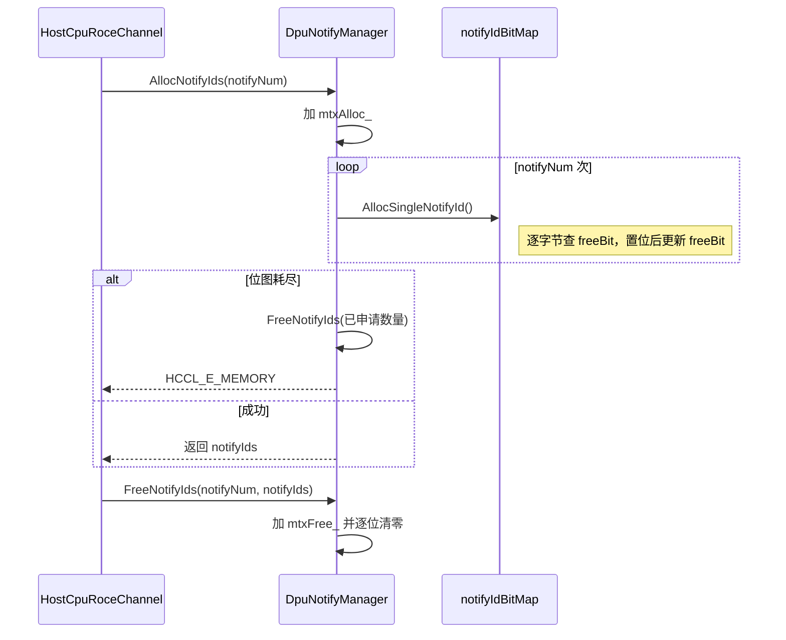
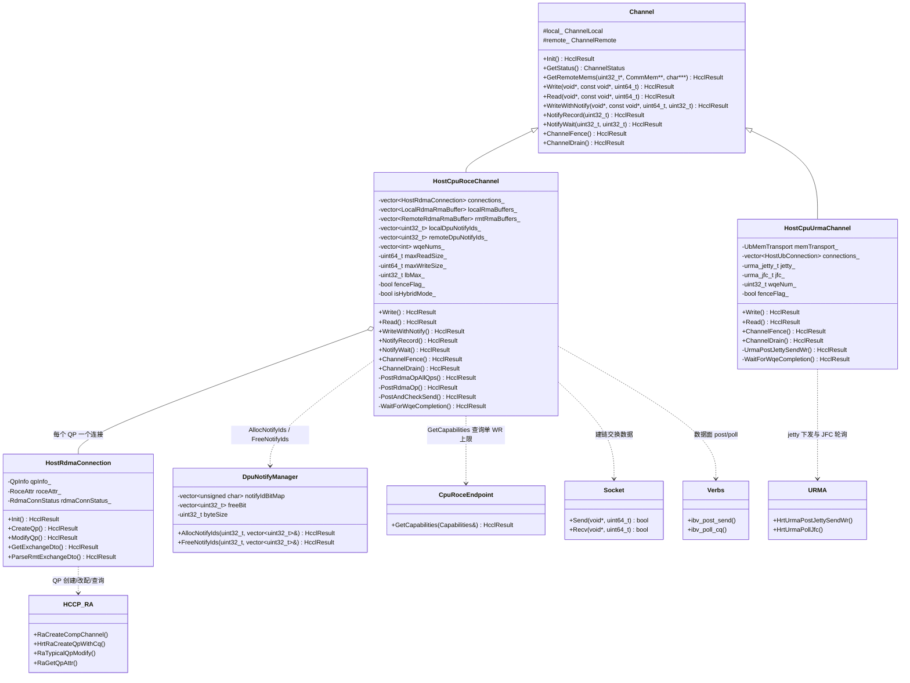

# host 模块代码解析

## 功能描述

host模块是HCOMM基础通信层（`src/base_comm`）的 **Host CPU侧通道实现**，位于`src/base_comm/resources/endpoint_pairs/channels/host/`，负责在Host CPU上建立RoCE（RDMA over Converged Ethernet）与URMA（Unified Remote Memory Access）通道，并向通道框架提供读写、通知与完成等待能力。

**分侧职责**

- 本模块仅运行在Host侧，由CPU执行；Device侧通道实现位于同级的`aicpu/`、`aiv/`等目录，不在本模块范围内。
- RoCE通道基于verbs接口（`ibv_post_send`/`ibv_poll_cq`）完成数据面搬运；QP的创建、改配与QoS设置由HCCP RA（RDMA Agent）接口完成。
- URMA通道基于URMA jetty完成数据面搬运，建链与远端内存查询复用`UbMemTransport`。

**使用场景**

- 上层通过`CommEngine = COMM_ENGINE_CPU`创建通道时，由`Channel::CreateChannel`按远端协议分派（源码：`src/base_comm/resources/endpoint_pairs/channels/channel.cc:461-487`）：`COMM_PROTOCOL_ROCE`创建`HostCpuRoceChannel`，`COMM_PROTOCOL_UB_CTP`/`COMM_PROTOCOL_UBC_TP`创建`HostCpuUrmaChannel`。
- 通信域管理、算子与通信库通过`Channel`虚接口发起建链（`Init`/`GetStatus`）和数据面操作（`Write`/`Read`/`WriteWithNotify`/`NotifyRecord`/`NotifyWait`/`ChannelFence`/`ChannelDrain`）。
- HIXL等需要交换全部用户内存的场景通过`channelDesc.exchangeAllMems = true`使用RoCE通道，此时本端内存句柄从Endpoint全量获取。

**与周边模块的关系**

- 依赖Endpoint：`CpuRoceEndpoint::GetCapabilities`提供`maxReadSize`/`maxWriteSize`/`lbMax`（源码：`src/base_comm/resources/endpoints/cpu_roce_endpoint.cc:183-193`，能力最终来自`RaRdevGetAttr`）。
- 依赖Socket与SocketMgr：建链阶段交换QP、内存、notify描述，并完成QP改配后的同步握手。
- 依赖HCCP RA：`RaCreateCompChannel`、`HrtRaCreateQpWithCq`、`RaSetQpAttrQos`、`RaSetQpAttrTimeout`、`RaSetQpAttrRetryCnt`、`RaGetQpAttr`、`RaTypicalQpModify`、`RaSetQpLbValue`、`HrtRaQpConnectAsync`。
- 依赖verbs与URMA：RoCE数据面使用`ibv_post_send`/`ibv_poll_cq`；URMA数据面使用`HrtUrmaPostJettySendWr`/`HrtUrmaPollJfc`。
- 被调用：`Channel::CreateChannel`由通道处理流程调用（源码：`src/base_comm/resources/endpoint_pairs/channels/channel_process.cc:100`）；`SetDfxCallback`由C API适配层调用（源码：`src/base_comm/primitives/api_c_adpt/cpu_primitives_c_adpt.cc:913`）。

**核心能力**

1. 建立Host RoCE通道并推进建链状态机（socket状态、能力协商、QP创建、信息交换、QP改配）。
2. 按QP-first两级切片实现`Write`/`Read`：先按QP划分数据，再按硬件单WR上限逐片单次下发。
3. 实现`WriteWithNotify`：每个QP的尾片使用`IBV_WR_RDMA_WRITE_WITH_IMM`，保证对端每个QP收到一个通知。
4. 实现`NotifyRecord`/`NotifyWait`：基于DPU notify id与CQE的`imm_data`完成通知记录与等待。
5. 实现`ChannelFence`/`ChannelDrain`：按`wqeNums_`等待尾片CQE。
6. 支持混合模式（Hybrid）：与`TransportIbverbs`通过`RoCECapability`协商，切换为Notify内存轮询语义。
7. 实现Host URMA通道的`Write`/`Read`/`ChannelFence`/`ChannelDrain`与按URMA单WR上限切片。
8. 通过`DpuNotifyManager`位图池化分配/回收DPU notify id。
9. 通过`SetDfxCallback`/`ReportDfxTaskEnd`上报数据面任务耗时。

## 目录描述

**目录树**

```text
host/
├── CMakeLists.txt                     # 源文件清单与 include 目录配置
├── exchange_data_format.h             # Hybrid 能力协商结构（RoCECapability）与交换数据格式
├── exchange_rdma_conn_dto.h           # QP 属性交换 DTO（qpn/psn/gid/feature）
├── host_cpu_roce_channel.h            # Host RoCE 通道类声明
├── host_cpu_roce_channel.cc           # RoCE 建链、数据面、通知、DFX 实现
├── host_rdma_connection.h             # 单 QP 连接类声明（QP 属性、RoceAttr）
├── host_rdma_connection.cc            # QP 创建/改配/销毁与远端 QP 属性交换
├── host_cpu_urma_channel.h            # Host URMA 通道类声明
├── host_cpu_urma_channel.cc           # URMA 建链、jetty 读写、完成等待
└── dpu_notify/
    ├── dpu_notify_manager.h           # DPU notify id 位图管理器声明
    └── dpu_notify_manager.cc          # notify id 分配/回收实现
```

**文件间关系表**

| 文件 | 功能 | 依赖关系 |
|------|------|---------|
| `host_cpu_roce_channel.h/.cc` | Host RoCE通道：建链状态机、QP管理、数据面读写、通知、Fence/Drain、DFX | 依赖`host_rdma_connection.h`管理每QP连接；依赖`exchange_data_format.h`的`RoCECapability`完成Hybrid协商；依赖`exchange_rdma_conn_dto.h`交换QP属性；依赖`dpu_notify/dpu_notify_manager.h`分配notify id |
| `host_rdma_connection.h/.cc` | 单QP连接：创建comp channel/CQ/QP、设置QoS/重试、交换与改配QP属性、销毁QP | 依赖HCCP RA接口；依赖`exchange_rdma_conn_dto.h`的`ExchangeRdmaConnDto`序列化远端QP属性 |
| `host_cpu_urma_channel.h/.cc` | Host URMA通道：UB连接构建、jetty读写切片、JFC完成等待 | 依赖`HostUbConnection`（`host_ub_connection.h`）与`UbMemTransport`；依赖`devBaseAttr_`的单WR上限 |
| `dpu_notify/dpu_notify_manager.h/.cc` | DPU notify id位图池：批量申请/回收 | 被`HostCpuRoceChannel`通过`GetDpuNotifyManager()`使用；实例由`NotifyMgrProc`持有（源码：`src/base_comm/resources/comm_engine_res/notify_mgr_proc.h:40`） |
| `exchange_data_format.h` | Hybrid能力协商与交换数据格式定义 | 被`host_cpu_roce_channel.cc`引用；字段布局需与对端`TransportIbverbs`保持一致 |
| `exchange_rdma_conn_dto.h` | QP属性交换DTO | 被`host_rdma_connection.cc`序列化/反序列化 |

**组件交互图**



## 流程描述

### 通道创建与初始化（`Channel::Init`）

`Channel::Init`是基类提供的模板方法，按固定顺序调用子类覆写点（源码：`src/base_comm/resources/endpoint_pairs/channels/channel.cc:122-140`）。Host RoCE与URMA通道均复用该流程，差异在各覆写点内。



`HostCpuUrmaChannel`在同一模板下的差异：`BuildConnection`初始化URMA函数库、查询`HccpRaGetDevBaseAttr`、按`UB_CTP`/`UBC_TP`创建`HostUbConnection`；`BuildBuffer`创建`UbMemTransport`（源码：`src/base_comm/resources/endpoint_pairs/channels/host/host_cpu_urma_channel.cc:60-128`）。

### RoCE建链状态推进（`HostCpuRoceChannel::GetStatus`）

建链由调用方轮询`GetStatus`推进，`rdmaStatus_`每次调用向前推进一个状态（源码：`src/base_comm/resources/endpoint_pairs/channels/host/host_cpu_roce_channel.cc:269-321`）。



**关键分支**

- 原生模式交换数据包长度上限`MAX_EXCHANGE_DATA_SIZE = 64MB`，对端声明为0或超限时返回`HCCL_E_PARA`（源码：`src/base_comm/resources/endpoint_pairs/channels/host/host_cpu_roce_channel.cc:901-907`）。
- 对端buffer数量上限`MAX_BUFFER_NUM`，超限返回`HCCL_E_PARA`（源码：`src/base_comm/resources/endpoint_pairs/channels/host/host_cpu_roce_channel.cc:1071-1075`）。
- 两端`connNum_`、`queueNum`必须一致，否则返回`HCCL_E_ROCE_CONNECT`（源码：`src/base_comm/resources/endpoint_pairs/channels/host/host_cpu_roce_channel.cc:1105-1118`）。

### QP-first两级切片读写（`Write`/`Read`/`WriteWithNotify`）

数据面入口统一走`PostRdmaOpAllQps`，第一级按QP划分数据，第二级在每个QP内按硬件单WR上限逐片单次下发（源码：`src/base_comm/resources/endpoint_pairs/channels/host/host_cpu_roce_channel.cc:674-701`、`703-762`）。



**切片与标志规则**

- 第一级：`chunkSizePerQp = max(qpThreshold, ceil(len/qpNum))`；分配不到数据的QP仍需下发一个空WR，保证每个QP都有CQE（源码：`src/base_comm/resources/endpoint_pairs/channels/host/host_cpu_roce_channel.cc:681-695`）。
- 第二级：`wrNum = (len == 0) ? 1 : DivCeil(len, sliceSize)`；尾片使用入口传入的`opcode`，中间片统一为普通`IBV_WR_RDMA_WRITE`/`IBV_WR_RDMA_READ`（源码：`src/base_comm/resources/endpoint_pairs/channels/host/host_cpu_roce_channel.cc:734-758`）。
- 标志位：尾片固定`IBV_SEND_SIGNALED | IBV_SEND_FENCE`；`fenceFlag_`为true时首片额外加`IBV_SEND_FENCE`；中间片无标志（源码：`src/base_comm/resources/endpoint_pairs/channels/host/host_cpu_roce_channel.cc:744-748`）。
- CQE契约：只有尾片产生CQE，`PostAndCheckSend`仅在`signaled == true`时累加`wqeNums_`（源码：`src/base_comm/resources/endpoint_pairs/channels/host/host_cpu_roce_channel.cc:637-672`）。
- `len == 0`：通道已初始化（`maxReadSize_`/`maxWriteSize_`非0）时`Write`/`Read`直接返回成功，不产生WR/CQE，也不清`fenceFlag_`；上限为0时返回`HCCL_E_INTERNAL`（源码：`src/base_comm/resources/endpoint_pairs/channels/host/host_cpu_roce_channel.cc:764-794`）；`WriteWithNotify`的`len == 0`仍按每QP空WR下发。

### 通知记录与等待（`NotifyRecord`/`NotifyWait`）



- `NotifyRecord`的WR为`IBV_WR_RDMA_WRITE_WITH_IMM`，`send_flags = IBV_SEND_SIGNALED`，`imm_data`为远端DPU notify id（源码：`src/base_comm/resources/endpoint_pairs/channels/host/host_cpu_roce_channel.cc:385-440`（`NotifyRecord`本体）、`...:1358-1374`（Hybrid 模式 `BuildNotifyWrHybird`）；原生模式 WR 构造见 `...:1661-1702`（`PrepareNotifyWrResource`））。
- `NotifyWait`原生模式按QP轮询`recvCq`，CQE的`imm_data`必须等于`dpuNotifyId`；超时时间在`timeout > 5`时减5秒（源码：`src/base_comm/resources/endpoint_pairs/channels/host/host_cpu_roce_channel.cc:440-544`）。

### 完成等待（`ChannelFence`/`ChannelDrain`）



- `ChannelDrain`只等待并返回`WaitForWqeCompletion`的结果（源码：`src/base_comm/resources/endpoint_pairs/channels/host/host_cpu_roce_channel.cc:812-824`）。
- `WaitForWqeCompletion`的超时取`ExecTimeOut`减5秒（源码：`src/base_comm/resources/endpoint_pairs/channels/host/host_cpu_roce_channel.cc:1742-1765`）。

### Hybrid模式建链与数据面



- 能力协商结构`RoCECapability`使用魔数`EXCHANGE_DATA_MAGIC = 0x48434C52`、版本`ROCE_CAPABILITY_VERSION = 1`（源码：`src/base_comm/resources/endpoint_pairs/channels/host/exchange_data_format.h:22-24`、`45-125`）。
- Hybrid模式仅使用`connections_[0]`（单QP）；`WriteWithNotifyHybrid`一次下发data+notify两条WR（源码：`src/base_comm/resources/endpoint_pairs/channels/host/host_cpu_roce_channel.cc:1377-1452`）。

### URMA数据面（`HostCpuUrmaChannel::Write`/`Read`）



- URMA切片上限来自`devBaseAttr_.maxWriteSize`/`maxReadSize`；`len == 0`或上限为0返回`HCCL_E_PARA`（源码：`src/base_comm/resources/endpoint_pairs/channels/host/host_cpu_urma_channel.cc:255-268`）。
- `ChannelFence`在`wqeNum_ == 0`时直接返回成功，否则等待完成后置`fenceFlag_ = true`（源码：`src/base_comm/resources/endpoint_pairs/channels/host/host_cpu_urma_channel.cc:172-189`）。
- URMA数据面只使用`connections_[0]`的jetty与CQ（源码：`src/base_comm/resources/endpoint_pairs/channels/host/host_cpu_urma_channel.cc:203-244`、`312-358`）。

### DPU notify id分配与回收（`DpuNotifyManager`）



## 数据描述

**核心类图**



**关键数据结构**

| 结构 | 位置 | 说明 |
|------|------|------|
| `Hccl::QpInfo` | `src/legacy/ascend950/unified_platform/external_system/orion_adapter_hccp.h:156` | QP句柄、CQ、QP属性与QoS字段；Host RoCE通道的数据面寻址与轮询依据 |
| `HostRdmaConnection::QpAttrDto` | `src/base_comm/resources/endpoint_pairs/channels/host/host_rdma_connection.h:29-42` | 交换用的QP属性：`qpn`/`psn`/`gid_idx`/`gid`/`feature`；`IsValid`要求`qpn`与`psn`非`UINT32_MAX` |
| `HostRdmaConnection::RoceAttr` | `src/base_comm/resources/endpoint_pairs/channels/host/host_rdma_connection.h:44-52` | 通道级RoCE配置：`queueNum`/`retryCnt`/`retryInterval`/`tc`/`sl`/`sqDepth`/`scqDepth` |
| `RoCECapability` | `src/base_comm/resources/endpoint_pairs/channels/host/exchange_data_format.h:45-125` | Hybrid能力协商结构：魔数、版本、`commStack`、`syncMode`、`nicDeploy`；`__attribute__((packed))`保证跨模块二进制兼容 |
| `ExchangeRdmaConnDto` | `src/base_comm/resources/endpoint_pairs/channels/host/exchange_rdma_conn_dto.h:20-41` | QP属性序列化DTO：`qpn_`/`psn_`/`gid_idx_`/`gid_`/`feature_` |
| `ExchangeDataFmt` | `src/base_comm/resources/endpoint_pairs/channels/host/exchange_data_format.h:127-133` | 基础交换格式：`qpn`/`psn`/`gid`/`gidIdx` |
| `ChannelLocal` / `ChannelRemote` | `src/base_comm/resources/endpoint_pairs/channels/channel.h:109-164` | 通道本端/对端端点、socket、notify、远端内存缓存 |
| `hccl::MemMsg` | `src/legacy/ascend910/platform/inc/private_types.h:23-43` | Hybrid交换数据成员：描述远端buffer与notify的`addr`/`len`/`lkey`/`notifyId` |

## 接口描述

**对外接口总表**

| 接口 | 所属类或头文件 | 调用方 | 一句话功能 |
|------|----------------|--------|-----------|
| `Channel::CreateChannel` | `../channel.cc` | 通道处理流程 | 按引擎与远端协议创建Host RoCE/URMA通道 |
| `HostCpuRoceChannel::GetStatus` | `host_cpu_roce_channel.h` | 通道框架/上层 | 推进并查询RoCE建链状态 |
| `HostCpuRoceChannel::Write` | `host_cpu_roce_channel.h` | 上层通信库 | QP-first两级切片写 |
| `HostCpuRoceChannel::Read` | `host_cpu_roce_channel.h` | 上层通信库 | QP-first两级切片读 |
| `HostCpuRoceChannel::WriteWithNotify` | `host_cpu_roce_channel.h` | 上层通信库 | 写数据并在每QP尾片携带立即数通知 |
| `HostCpuRoceChannel::NotifyRecord` | `host_cpu_roce_channel.h` | 上层通信库 | 向对端记录DPU notify |
| `HostCpuRoceChannel::NotifyWait` | `host_cpu_roce_channel.h` | 上层通信库 | 等待本地DPU notify |
| `HostCpuRoceChannel::ChannelFence`/`ChannelDrain` | `host_cpu_roce_channel.h` | 上层通信库 | 等待已计数尾片CQE |
| `HostCpuRoceChannel::GetRemoteMems` | `host_cpu_roce_channel.h` | 通道框架/上层 | 查询对端内存缓存 |
| `HostCpuRoceChannel::SetDfxCallback` | `host_cpu_roce_channel.h` | C API适配层 | 注册数据面耗时回调 |
| `HostCpuUrmaChannel::Write`/`Read` | `host_cpu_urma_channel.h` | 上层通信库 | URMA jetty读写 |
| `HostCpuUrmaChannel::ChannelFence`/`ChannelDrain` | `host_cpu_urma_channel.h` | 上层通信库 | 等待URMA JFC完成 |
| `DpuNotifyManager::AllocNotifyIds`/`FreeNotifyIds` | `dpu_notify/dpu_notify_manager.h` | Host RoCE通道 | DPU notify id批量分配/回收 |

### HostCpuRoceChannel

| 接口 | 类型 | 参数 | 返回值 | 功能说明 |
|------|------|------|--------|---------|
| `GetStatus` | 公有（对外） | 无 | `ChannelStatus` | 将`GetStatus(ChannelStatus&)`的内部错误码转为通道状态；`FAILED`用于异常 |
| `GetStatus(ChannelStatus&)` | 公有（对外） | [out] `status` | `HcclResult` | 建链状态机入口，按`rdmaStatus_`推进一个状态并返回当前通道状态 |
| `Read` | 公有（对外） | [out] `dst`、[in] `src`、[in] `len` | `HcclResult` | `len==0`且通道已初始化时直接成功（上限为0返回`HCCL_E_INTERNAL`）；否则按`maxReadSize_`两级切片下发READ |
| `Write` | 公有（对外） | [in] `dst`、[in] `src`、[in] `len` | `HcclResult` | `len==0`且通道已初始化时直接成功（上限为0返回`HCCL_E_INTERNAL`）；否则按`maxWriteSize_`两级切片下发WRITE |
| `WriteWithNotify` | 公有（对外） | [in] `dst`、[in] `src`、[in] `len`、[in] `remoteNotifyIdx` | `HcclResult` | 每QP尾片使用`WRITE_WITH_IMM`；`len==0`且`src`/`dst`非空时按每QP空WR下发（空指针返回`HCCL_E_PTR`） |
| `NotifyRecord` | 公有（对外） | [in] `remoteNotifyIdx` | `HcclResult` | 每个QP下发length=0的`WRITE_WITH_IMM`；`ENOMEM`返回`HCCL_E_AGAIN` |
| `NotifyWait` | 公有（对外） | [in] `localNotifyIdx`、[in] `timeout` | `HcclResult` | 原生模式轮询`recvCq`校验`imm_data`；Hybrid模式委托`NotifyWaitHybrid` |
| `ChannelFence` | 公有（对外） | 无 | `HcclResult` | 等待尾片CQE，成功后置`fenceFlag_ = true` |
| `ChannelDrain` | 公有（对外） | 无 | `HcclResult` | 等待尾片CQE，不修改`fenceFlag_` |
| `GetNotifyNum` | 公有（对外） | [out] `notifyNum` | `HcclResult` | 返回`local_.notifyNum` |
| `GetRemoteMems` | 公有（对外） | [out] `memNum`、[out] `remoteMem`、[out] `memInfos` | `HcclResult` | 通过`RemoteMemCache`查询对端内存并缓存 |
| `Clean`/`Resume` | 公有（对外） | 无 | `HcclResult` | 当前为空实现，直接返回成功 |
| `GetHcclBuffer` | 公有（对外） | [out] `addr`、[out] `size` | `HcclResult` | 返回第0个远端buffer的地址与大小 |
| `GetStatus`/`ProcessStatus`/`Describe` | 公有（对外） | 见上/无 | `HcclResult`/`std::string` | 状态转换、状态判定与调试描述 |
| `SetDfxCallback` | 公有（对外） | [in] `callback` | `HcclResult` | 保存DFX回调，后续`ReportDfxTaskEnd`调用 |
| `PostRdmaOpAllQps` | 私有 | [in] `caller`、`opcode`、`localAddr`、`remoteAddr`、`len`、`immData` | `HcclResult` | 第一级按QP划分数据并逐QP调用`PostRdmaOp` |
| `PostRdmaOp` | 私有 | [in] `caller`、`opcode`、`qpRef`、`localAddr`、`remoteAddr`、`len`、`immData` | `HcclResult` | 第二级按`maxReadSize_`/`maxWriteSize_`切片并逐WR下发；`qpRef`复用`PostRdmaOpAllQps`已取的QP句柄，避免每QP重复`GetQpInfos()` |
| `PostAndCheckSend` | 私有 | [in] `qp`、`qpIdx`、`caller`、`wr`、`signaled` | `HcclResult` | 封装`ibv_post_send`；仅在`signaled`为true时累加`wqeNums_` |
| `BuildRdmaWr` | 私有 | [in] `caller`、`opcode`、`localAddr`、`remoteAddr`、`len`、`localIdx`、`rmtIdx`、`sendFlags`、`immData`、[out] `wr`、[out] `sg` | 无 | 填充单个`ibv_send_wr`与`ibv_sge` |
| `WaitForWqeCompletion`/`WaitForSingleQpWqeCompletion` | 私有 | 见实现 | `HcclResult` | 按`wqeNums_`轮询每个QP的`sendCq` |
| `FindLocalBuffer`/`FindRemoteBuffer` | 私有 | [in] `addr`、`len`、[out] `targetIdx` | `HcclResult` | 在已注册/远端buffer中定位整段地址范围 |
| `IbvPostRecv` | 私有 | 无 | `HcclResult` | 为每个QP补充一个128B的`ibv_post_recv` |

### HostRdmaConnection

| 接口 | 类型 | 参数 | 返回值 | 功能说明 |
|------|------|------|--------|---------|
| `Init` | 公有 | 无 | `HcclResult` | 校验设备类型并确定QP模式；状态从`CLOSED`进入`INIT` |
| `CreateQp` | 公有 | 无 | `HcclResult` | 创建comp channel、CQ、QP并设置QoS/超时/重试；状态进入`QP_CREATED` |
| `GetExchangeDto` | 公有 | [out] `serial` | `HcclResult` | 读取本地QP属性并序列化为`ExchangeRdmaConnDto` |
| `ParseRmtExchangeDto` | 公有 | [in] `rmtDto` | `HcclResult` | 解析对端QP属性到`rmtQpAttr_` |
| `ModifyQp` | 公有 | 无 | `HcclResult` | 调用`RaTypicalQpModify`完成QP改配；必要时设置`RaSetQpLbValue` |
| `GetQpInfo`/`SetLbValue`/`SetUdpSport`/`SetRoceAttr`/`GetRoceAttr` | 公有 | 见头文件 | 引用/无 | 纯参数存取与配置设置（从略） |
| `Describe` | 公有 | 无 | `std::string` | 输出连接状态描述 |

### HostCpuUrmaChannel

| 接口 | 类型 | 参数 | 返回值 | 功能说明 |
|------|------|------|--------|---------|
| `Write` | 公有（对外） | [in] `dst`（远端目的）、[in] `src`（本端源）、[in] `len` | `HcclResult` | 调用`UrmaPostJettySendWr`按单WR上限切片下发WRITE |
| `Read` | 公有（对外） | [out] `dst`（本端接收）、[in] `src`（远端源）、[in] `len` | `HcclResult` | 调用`UrmaPostJettySendWr`按单WR上限切片下发READ |
| `ChannelFence` | 公有（对外） | 无 | `HcclResult` | `wqeNum_==0`直接成功；否则等待完成并置`fenceFlag_ = true` |
| `ChannelDrain` | 公有（对外） | 无 | `HcclResult` | 等待所有URMA完成 |
| `GetRemoteMems` | 公有（对外） | [out] `memNum`、`remoteMem`、`memInfos` | `HcclResult` | 委托`UbMemTransport::GetRemoteMems` |
| `GetStatus` | 公有（对外） | 无 | `ChannelStatus` | 由`UbMemTransport`状态转换 |
| `Clean`/`Resume` | 公有（对外） | 无 | `HcclResult` | 返回`HCCL_E_NOT_SUPPORT` |
| `GetNotifyNum` | 公有（对外） | [out] `notifyNum` | `HcclResult` | 当前未使用，返回成功 |
| `UrmaPostJettySendWr` | 私有 | [in] `opcode`、`dst`、`src`、`len` | `HcclResult` | 构造URMA WR并按`devBaseAttr_`上限切片下发 |
| `GetSplitNum` | 私有 | [in] `len`、`maxJettyWrDataLen`、[out] `splitNum` | `HcclResult` | `len==0`或上限为0返回`HCCL_E_PARA` |
| `GetLocSeg`/`GetLocalAndRemoteSeg` | 私有 | 见实现 | `HcclResult` | 在本地/远端buffer中定位URMA target segment |
| `WaitForWqeCompletion` | 私有 | 无 | `HcclResult` | 轮询JFC，校验WR状态并扣减`wqeNum_` |

### DpuNotifyManager

| 接口 | 类型 | 参数 | 返回值 | 功能说明 |
|------|------|------|--------|---------|
| `AllocNotifyIds` | 公有 | [in] `notifyNum`、[out] `notifyIds` | `HcclResult` | 批量分配notify id；位图耗尽时回滚已申请并返回`HCCL_E_MEMORY` |
| `FreeNotifyIds` | 公有 | [in] `notifyNum`、[in] `notifyIds` | `HcclResult` | 批量回收notify id；数量超过`notifyIds`长度返回`HCCL_E_PARA` |

## 使用限制

**支持的场景**

| 场景 | 引擎 | 协议 | 通道实现 | 说明 |
|------|------|------|---------|------|
| Host RoCE原生模式 | `COMM_ENGINE_CPU` | `COMM_PROTOCOL_ROCE` | `HostCpuRoceChannel` | 基于verbs的QP读写，支持多QP |
| Host RoCE全内存交换 | `COMM_ENGINE_CPU` | `COMM_PROTOCOL_ROCE` | `HostCpuRoceChannel` | `exchangeAllMems = true`时从Endpoint获取全部内存句柄 |
| Host RoCE Hybrid模式 | `COMM_ENGINE_CPU` | `COMM_PROTOCOL_ROCE` | `HostCpuRoceChannel` | 与`TransportIbverbs`协商，单QP，Notify内存轮询 |
| Host URMA | `COMM_ENGINE_CPU` | `COMM_PROTOCOL_UB_CTP`/`COMM_PROTOCOL_UBC_TP` | `HostCpuUrmaChannel` | 单连接jetty读写 |
| Device侧通道 | `COMM_ENGINE_AICPU`/`COMM_ENGINE_AIV`等 | 见各协议 | 不在本模块 | 位于同级`aicpu/`、`aiv/`目录 |

**规格约束**

1. **单WR上限**：Read使用`maxReadSize_`，Write/WRITE_WITH_IMM使用`maxWriteSize_`；两者来自`CpuRoceEndpoint::GetCapabilities`（最终由`RaRdevGetAttr`查询），任一为0时`ParseInputParam`返回`HCCL_E_PARA`（源码：`src/base_comm/resources/endpoint_pairs/channels/host/host_cpu_roce_channel.cc:146-151`）。
2. **QP数量**：`lbMax_ > 0`且`queueNum == 1`时按`lbMax_`建立连接，否则按`queueNum`建立；`wqeNums_`初始化为`connNum_`个0（源码：`src/base_comm/resources/endpoint_pairs/channels/host/host_cpu_roce_channel.cc:190-227`）。
3. **第一级切片**：`chunkSizePerQp = max(qpThreshold, ceil(len/qpNum))`，分配到0长度的QP仍下发空WR（源码：`src/base_comm/resources/endpoint_pairs/channels/host/host_cpu_roce_channel.cc:681-695`）。
4. **第二级切片**：`wrNum = DivCeil(len, sliceSize)`；`len == 0`时`wrNum = 1`（源码：`src/base_comm/resources/endpoint_pairs/channels/host/host_cpu_roce_channel.cc:734-737`）。
5. **尾片标志**：尾片固定`IBV_SEND_SIGNALED | IBV_SEND_FENCE`；强制保序时（`fenceFlag_ == true`）首片额外加`IBV_SEND_FENCE`；中间片无标志（源码：`src/base_comm/resources/endpoint_pairs/channels/host/host_cpu_roce_channel.cc:744-748`）。
6. **CQE记账**：`wqeNums_`只统计会产生CQE的尾片WR；`ChannelFence`/`ChannelDrain`按该计数轮询`sendCq`（源码：`src/base_comm/resources/endpoint_pairs/channels/host/host_cpu_roce_channel.cc:637-672`、`1742-1793`、`796-824`）。
7. **零长度语义**：`Write`/`Read`的`len == 0`在通道已初始化（`maxReadSize_`/`maxWriteSize_`非0）时为no-op（不post、不产生CQE、不清`fenceFlag_`），上限为0时返回`HCCL_E_INTERNAL`；`WriteWithNotify`的`len == 0`仍按每QP空WR下发（源码：`src/base_comm/resources/endpoint_pairs/channels/host/host_cpu_roce_channel.cc:764-794`、`570-613`）。
8. **交换数据上限**：`MAX_EXCHANGE_DATA_SIZE = 64MB`；对端buffer数量上限为`MAX_BUFFER_NUM`；对端`connNum_`、`queueNum`必须与本端一致（源码：`src/base_comm/resources/endpoint_pairs/channels/host/host_cpu_roce_channel.cc:901-907`、`1071-1075`、`1105-1118`）。
9. **URMA切片**：单WR上限为`devBaseAttr_.maxWriteSize`/`maxReadSize`；`len == 0`或上限为0返回`HCCL_E_PARA`；仅最后一片`complete_enable = 1`且`place_order = STRONG_ORDER`（源码：`src/base_comm/resources/endpoint_pairs/channels/host/host_cpu_urma_channel.cc:193-268`）。
10. **URMA单连接**：数据面固定使用`connections_[0]`的jetty与CQ（源码：`src/base_comm/resources/endpoint_pairs/channels/host/host_cpu_urma_channel.cc:203-244`、`312-358`）。
11. **Hybrid单QP**：`WriteWithNotifyHybrid`仅使用`qpInfo[0]`，一次下发data+notify两条WR，`wqeNums_[0] += 2`（源码：`src/base_comm/resources/endpoint_pairs/channels/host/host_cpu_roce_channel.cc:1377-1452`）。
12. **通知超时**：原生`NotifyWait`在`timeout > 5`时减5秒；Hybrid默认超时为`DEFAULT_NOTIFY_WAIT_TIMEOUT_S = 30`秒（源码：`src/base_comm/resources/endpoint_pairs/channels/host/host_cpu_roce_channel.cc:41-43`、`470-473`、`1454-1490`）。
13. **DPU notify池**：`DpuNotifyManager`使用位图管理notify id，分配失败会回滚本次已申请项（源码：`src/base_comm/resources/endpoint_pairs/channels/host/dpu_notify/dpu_notify_manager.cc:53-84`）。

**已知限制**

1. `HostCpuRoceChannel::Clean`/`Resume`当前为空实现（直接返回成功），不支持通道资源清理与恢复（源码：`src/base_comm/resources/endpoint_pairs/channels/host/host_cpu_roce_channel.cc:323-325`）。
2. `HostCpuUrmaChannel::Clean`/`Resume`返回`HCCL_E_NOT_SUPPORT`（源码：`src/base_comm/resources/endpoint_pairs/channels/host/host_cpu_urma_channel.cc:148-158`）。
3. Hybrid模式仅支持单QP，不支持多QP扩展（源码：`src/base_comm/resources/endpoint_pairs/channels/host/host_cpu_roce_channel.cc:1377-1452`）。
4. `Channel`基类声明不支持多线程并发访问，调用方需串行化（源码：`src/base_comm/resources/endpoint_pairs/channels/channel.h:180`）。
5. 逐WR下发引入部分下发失败状态：已下发的非尾片WR不产生CQE且不计入`wqeNums_`，失败后`ChannelDrain`/`ChannelFence`无法等待这些WR完成，需上层按错误路径终止。
6. RoCE建链状态机由调用方轮询`GetStatus`推进，模块内无后台线程代为推进（源码：`src/base_comm/resources/endpoint_pairs/channels/host/host_cpu_roce_channel.cc:269-321`）。
