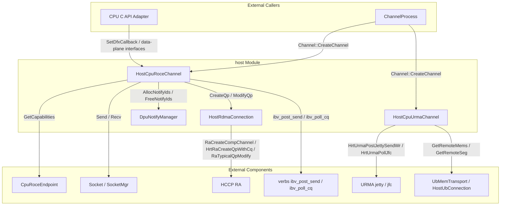
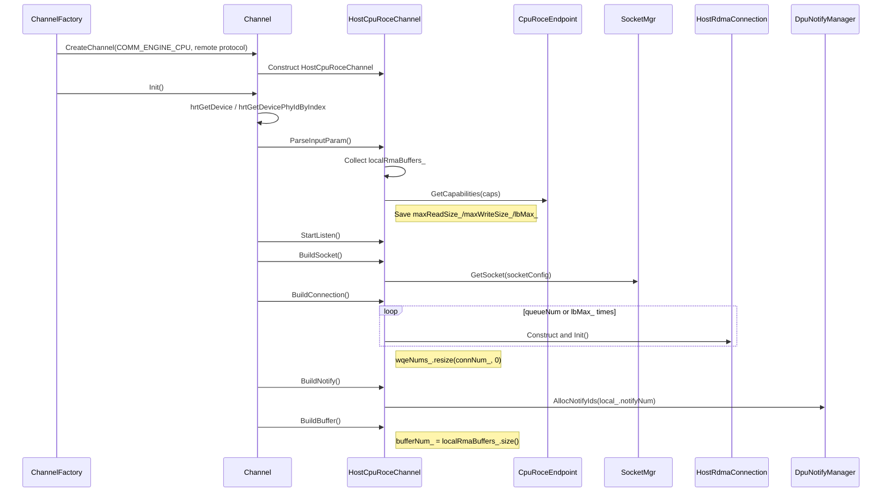
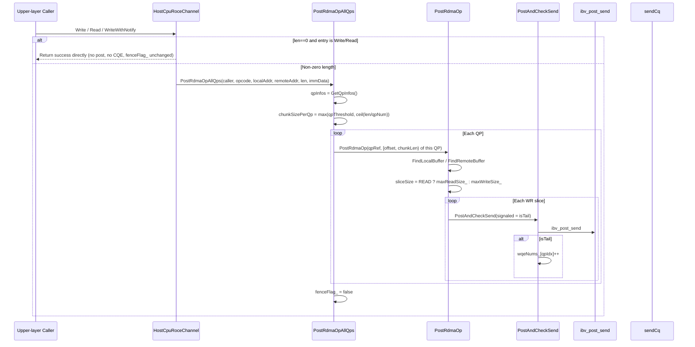
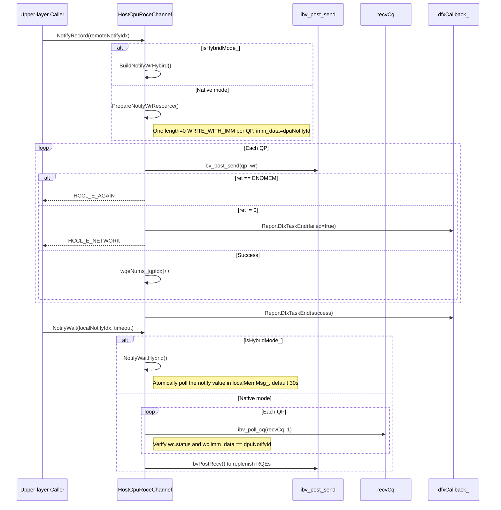
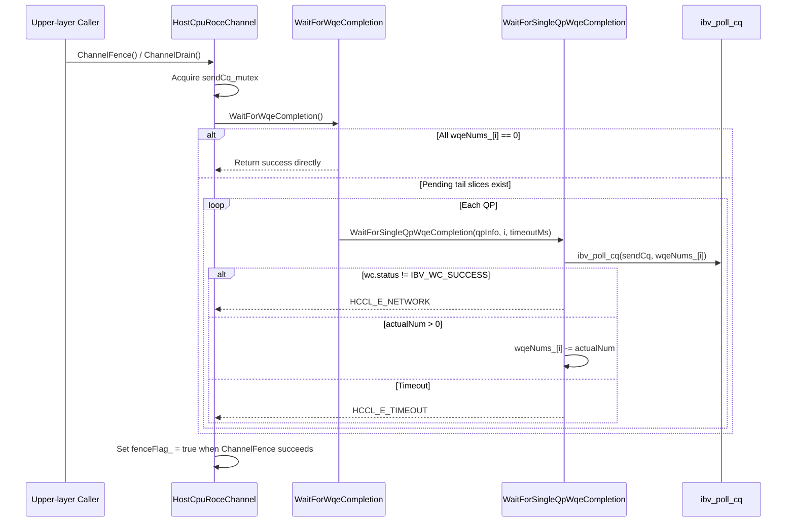
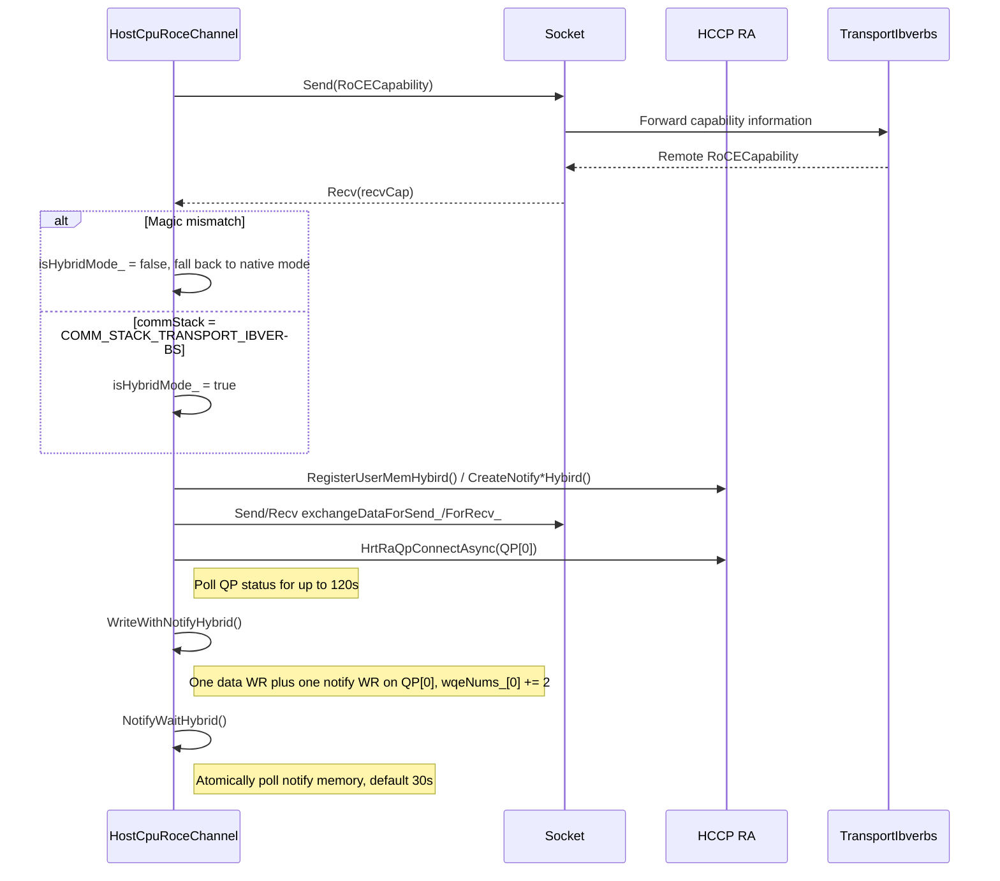
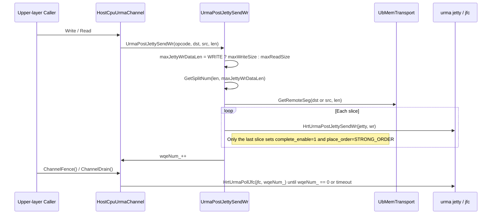
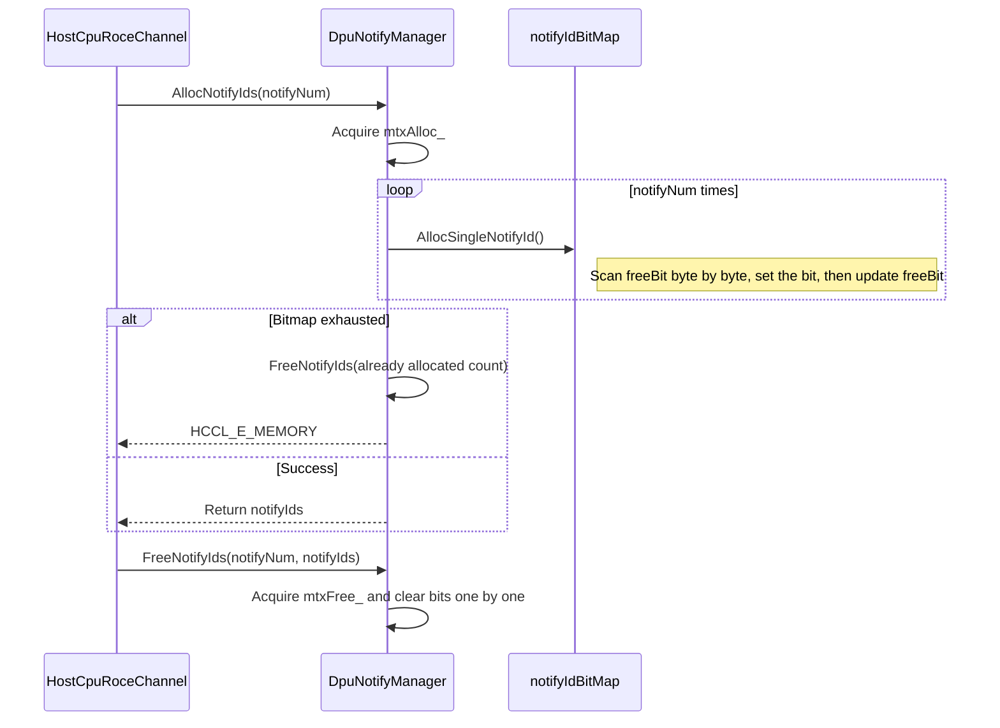
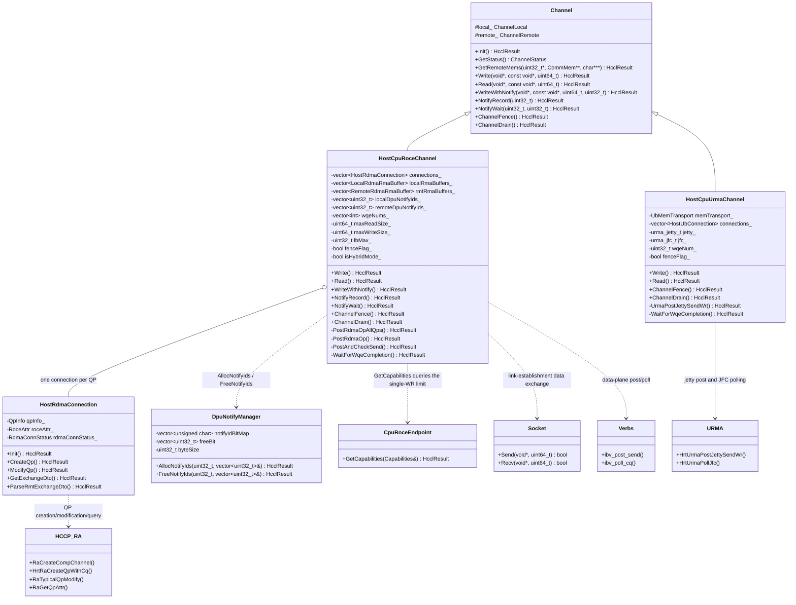

# host Module Code Analysis

## Feature Description

The host module is the **Host CPU side channel implementation** of the HCOMM base communication layer (`src/base_comm`). It is located in `src/base_comm/resources/endpoint_pairs/channels/host/` and is responsible for establishing RoCE (RDMA over Converged Ethernet) and URMA (Unified Remote Memory Access) channels on the Host CPU, and for providing read, write, notification, and completion-wait capabilities to the channel framework.

**Responsibilities by side**

- This module runs only on the Host side and is executed by the CPU. Device-side channel implementations are located in sibling directories such as `aicpu/` and `aiv/` and are outside the scope of this module.
- The RoCE channel uses the verbs interface (`ibv_post_send`/`ibv_poll_cq`) for data-plane transfer; QP creation, modification, and QoS configuration are performed through HCCP RA (RDMA Agent) interfaces.
- The URMA channel uses URMA jetty for data-plane transfer, and reuses `UbMemTransport` for link establishment and remote memory lookup.

**Usage scenarios**

- When the upper layer creates a channel with `CommEngine = COMM_ENGINE_CPU`, `Channel::CreateChannel` dispatches by remote protocol (source: `src/base_comm/resources/endpoint_pairs/channels/channel.cc:461-487`): `COMM_PROTOCOL_ROCE` creates `HostCpuRoceChannel`, and `COMM_PROTOCOL_UB_CTP`/`COMM_PROTOCOL_UBC_TP` creates `HostCpuUrmaChannel`.
- The communicator manager, operators, and communication libraries initiate link establishment (`Init`/`GetStatus`) and data-plane operations (`Write`/`Read`/`WriteWithNotify`/`NotifyRecord`/`NotifyWait`/`ChannelFence`/`ChannelDrain`) through the `Channel` virtual interface.
- Scenarios such as HIXL that need to exchange all user memory use the RoCE channel with `channelDesc.exchangeAllMems = true`; in this case local memory handles are obtained from the Endpoint in full.

**Relationships with surrounding modules**

- Depends on the Endpoint: `CpuRoceEndpoint::GetCapabilities` provides `maxReadSize`/`maxWriteSize`/`lbMax` (source: `src/base_comm/resources/endpoints/cpu_roce_endpoint.cc:183-193`; the capabilities ultimately come from `RaRdevGetAttr`).
- Depends on Socket and SocketMgr: exchanges QP, memory, and notify descriptions during link establishment, and completes the synchronization handshake after QP modification.
- Depends on HCCP RA: `RaCreateCompChannel`, `HrtRaCreateQpWithCq`, `RaSetQpAttrQos`, `RaSetQpAttrTimeout`, `RaSetQpAttrRetryCnt`, `RaGetQpAttr`, `RaTypicalQpModify`, `RaSetQpLbValue`, `HrtRaQpConnectAsync`.
- Depends on verbs and URMA: the RoCE data plane uses `ibv_post_send`/`ibv_poll_cq`; the URMA data plane uses `HrtUrmaPostJettySendWr`/`HrtUrmaPollJfc`.
- Called by: `Channel::CreateChannel` is invoked by the channel processing flow (source: `src/base_comm/resources/endpoint_pairs/channels/channel_process.cc:100`); `SetDfxCallback` is invoked by the C API adapter (source: `src/base_comm/primitives/api_c_adpt/cpu_primitives_c_adpt.cc:913`).

**Core capabilities**

1. Establish Host RoCE channels and advance the link-establishment state machine (socket status, capability negotiation, QP creation, information exchange, QP modification).
2. Implement `Write`/`Read` with QP-first two-level slicing: first partition data by QP, then post each hardware single-WR chunk individually.
3. Implement `WriteWithNotify`: the tail slice of each QP uses `IBV_WR_RDMA_WRITE_WITH_IMM`, ensuring that each peer QP receives one notification.
4. Implement `NotifyRecord`/`NotifyWait`: record and wait for notifications based on DPU notify IDs and the CQE `imm_data`.
5. Implement `ChannelFence`/`ChannelDrain`: wait for tail-slice CQEs according to `wqeNums_`.
6. Support Hybrid mode: negotiate with `TransportIbverbs` through `RoCECapability` and switch to the notify-memory polling semantics.
7. Implement `Write`/`Read`/`ChannelFence`/`ChannelDrain` for the Host URMA channel, with slicing by the URMA single-WR limit.
8. Allocate and release DPU notify IDs through the bitmap pool in `DpuNotifyManager`.
9. Report data-plane task duration through `SetDfxCallback`/`ReportDfxTaskEnd`.

## Directory Description

**Directory tree**

```text
host/
├── CMakeLists.txt                     # Source file list and include directory configuration
├── exchange_data_format.h             # Hybrid capability negotiation structure (RoCECapability) and exchange data format
├── exchange_rdma_conn_dto.h           # QP attribute exchange DTO (qpn/psn/gid/feature)
├── host_cpu_roce_channel.h            # Host RoCE channel class declaration
├── host_cpu_roce_channel.cc           # RoCE link establishment, data plane, notifications, DFX
├── host_rdma_connection.h             # Single-QP connection class declaration (QP attributes, RoceAttr)
├── host_rdma_connection.cc            # QP creation/modification/destruction and remote QP attribute exchange
├── host_cpu_urma_channel.h            # Host URMA channel class declaration
├── host_cpu_urma_channel.cc           # URMA link establishment, jetty read/write, completion wait
└── dpu_notify/
    ├── dpu_notify_manager.h           # DPU notify ID bitmap manager declaration
    └── dpu_notify_manager.cc          # Notify ID allocation/release implementation
```

**File relationships**

| File | Function | Dependencies |
|------|----------|--------------|
| `host_cpu_roce_channel.h/.cc` | Host RoCE channel: link-establishment state machine, QP management, data-plane read/write, notifications, Fence/Drain, DFX | Depends on `host_rdma_connection.h` for per-QP connections; depends on `RoCECapability` in `exchange_data_format.h` for Hybrid negotiation; depends on `exchange_rdma_conn_dto.h` for QP attribute exchange; depends on `dpu_notify/dpu_notify_manager.h` for notify ID allocation |
| `host_rdma_connection.h/.cc` | Single-QP connection: creates comp channel/CQ/QP, configures QoS/retry, exchanges and modifies QP attributes, destroys QP | Depends on HCCP RA interfaces; depends on `ExchangeRdmaConnDto` in `exchange_rdma_conn_dto.h` to serialize remote QP attributes |
| `host_cpu_urma_channel.h/.cc` | Host URMA channel: UB connection construction, jetty read/write slicing, JFC completion wait | Depends on `HostUbConnection` (`host_ub_connection.h`) and `UbMemTransport`; depends on the single-WR limit in `devBaseAttr_` |
| `dpu_notify/dpu_notify_manager.h/.cc` | DPU notify ID bitmap pool: batch allocation/release | Used by `HostCpuRoceChannel` through `GetDpuNotifyManager()`; the instance is held by `NotifyMgrProc` (source: `src/base_comm/resources/comm_engine_res/notify_mgr_proc.h:40`) |
| `exchange_data_format.h` | Hybrid capability negotiation and exchange data format definitions | Referenced by `host_cpu_roce_channel.cc`; the field layout must match the peer `TransportIbverbs` |
| `exchange_rdma_conn_dto.h` | QP attribute exchange DTO | Serialized/deserialized by `host_rdma_connection.cc` |

**Component interaction diagram**



## Flow Description

### Channel Creation and Initialization (`Channel::Init`)

`Channel::Init` is a template method provided by the base class; it invokes subclass override points in a fixed order (source: `src/base_comm/resources/endpoint_pairs/channels/channel.cc:122-140`). Both the Host RoCE and URMA channels reuse this flow, with differences inside the individual override points.



The difference of `HostCpuUrmaChannel` under the same template: `BuildConnection` initializes the URMA function library, queries `HccpRaGetDevBaseAttr`, and creates a `HostUbConnection` according to `UB_CTP`/`UBC_TP`; `BuildBuffer` creates `UbMemTransport` (source: `src/base_comm/resources/endpoint_pairs/channels/host/host_cpu_urma_channel.cc:60-128`).

### RoCE Link-Establishment State Progression (`HostCpuRoceChannel::GetStatus`)

Link establishment is advanced by the caller polling `GetStatus`; each call advances `rdmaStatus_` by one state (source: `src/base_comm/resources/endpoint_pairs/channels/host/host_cpu_roce_channel.cc:269-321`).

```mermaid
sequenceDiagram
    participant UP as Upper-layer Caller
    participant HR as HostCpuRoceChannel
    participant HC as HostRdmaConnection
    participant SK as Socket
    participant RA as HCCP RA

    UP->>HR: GetStatus()
    alt rdmaStatus_ = INIT
        HR->>SK: CheckSocketStatus()
        Note right of HR: Set SOCKET_OK after the socket is ready
    else rdmaStatus_ = SOCKET_OK
        HR->>SK: ExchangeCapability()
        Note right of HR: Fall back to native mode on magic mismatch; enter Hybrid when commStack=IBVERBS
    else rdmaStatus_ = CAP_EXCHANGED
        HR->>HC: CreateQp()
        HC->>RA: RaCreateCompChannel / HrtRaCreateQpWithCq / RaSetQpAttr*
    else rdmaStatus_ = QP_CREATED
        alt isHybridMode_
            HR->>HR: ExchangeDataHybird()
        else Native mode
            HR->>SK: Send/Recv QP, buffer, and notify information
        end
    else rdmaStatus_ = DATA_EXCHANGE
        alt isHybridMode_
            HR->>HR: ConnectSingleQpHybrid()
        else Native mode
            HR->>HC: ParseRmtExchangeDto / ModifyQp()
        end
        HR->>SK: SyncAfterModifyQp()
        HR->>RA: IbvPostRecv() × SEND_RQE_COUNT
    end
    HR-->>UP: ChannelStatus::READY
```

**Key branches**

- The maximum length of the exchange data packet in native mode is `MAX_EXCHANGE_DATA_SIZE = 64MB`; if the peer declares 0 or an over-limit length, `HCCL_E_PARA` is returned (source: `src/base_comm/resources/endpoint_pairs/channels/host/host_cpu_roce_channel.cc:901-907`).
- The maximum number of peer buffers is `MAX_BUFFER_NUM`; exceeding it returns `HCCL_E_PARA` (source: `src/base_comm/resources/endpoint_pairs/channels/host/host_cpu_roce_channel.cc:1071-1075`).
- The `connNum_` and `queueNum` of both ends must match; otherwise `HCCL_E_ROCE_CONNECT` is returned (source: `src/base_comm/resources/endpoint_pairs/channels/host/host_cpu_roce_channel.cc:1105-1118`).

### QP-First Two-Level Sliced Read/Write (`Write`/`Read`/`WriteWithNotify`)

The data-plane entry points all go through `PostRdmaOpAllQps`: the first level partitions data by QP, and the second level posts each hardware single-WR chunk individually within each QP (source: `src/base_comm/resources/endpoint_pairs/channels/host/host_cpu_roce_channel.cc:674-701`, `703-762`).



**Slicing and flag rules**

- First level: `chunkSizePerQp = max(qpThreshold, ceil(len/qpNum))`; a QP that receives no data still posts an empty WR so that every QP has a CQE (source: `src/base_comm/resources/endpoint_pairs/channels/host/host_cpu_roce_channel.cc:681-695`).
- Second level: `wrNum = (len == 0) ? 1 : DivCeil(len, sliceSize)`; the tail slice uses the `opcode` passed to the entry point, while intermediate slices uniformly use ordinary `IBV_WR_RDMA_WRITE`/`IBV_WR_RDMA_READ` (source: `src/base_comm/resources/endpoint_pairs/channels/host/host_cpu_roce_channel.cc:734-758`).
- Flags: the tail slice always uses `IBV_SEND_SIGNALED | IBV_SEND_FENCE`; when `fenceFlag_` is true, the first slice additionally sets `IBV_SEND_FENCE`; intermediate slices have no flags (source: `src/base_comm/resources/endpoint_pairs/channels/host/host_cpu_roce_channel.cc:744-748`).
- CQE contract: only the tail slice generates a CQE, and `PostAndCheckSend` increments `wqeNums_` only when `signaled == true` (source: `src/base_comm/resources/endpoint_pairs/channels/host/host_cpu_roce_channel.cc:637-672`).
- `len == 0`: when the channel is initialized (`maxReadSize_`/`maxWriteSize_` non-zero), `Write`/`Read` return success directly without generating WRs/CQEs or clearing `fenceFlag_`; a zero limit returns `HCCL_E_INTERNAL` (source: `src/base_comm/resources/endpoint_pairs/channels/host/host_cpu_roce_channel.cc:764-794`); for `WriteWithNotify`, `len == 0` still posts an empty WR per QP.

### Notification Record and Wait (`NotifyRecord`/`NotifyWait`)



- The `NotifyRecord` WR is `IBV_WR_RDMA_WRITE_WITH_IMM` with `send_flags = IBV_SEND_SIGNALED`, and `imm_data` is the remote DPU notify ID (source: `src/base_comm/resources/endpoint_pairs/channels/host/host_cpu_roce_channel.cc:385-440` (`NotifyRecord` body), `...:1358-1374` (Hybrid mode `BuildNotifyWrHybird`); the native-mode WR is built in `...:1661-1702` (`PrepareNotifyWrResource`)).
- In native mode, `NotifyWait` polls `recvCq` per QP, and the CQE `imm_data` must equal `dpuNotifyId`; the timeout is reduced by 5 seconds when `timeout > 5` (source: `src/base_comm/resources/endpoint_pairs/channels/host/host_cpu_roce_channel.cc:440-544`).

### Completion Wait (`ChannelFence`/`ChannelDrain`)



- `ChannelDrain` only waits for and returns the result of `WaitForWqeCompletion` (source: `src/base_comm/resources/endpoint_pairs/channels/host/host_cpu_roce_channel.cc:812-824`).
- The timeout of `WaitForWqeCompletion` is `ExecTimeOut` minus 5 seconds (source: `src/base_comm/resources/endpoint_pairs/channels/host/host_cpu_roce_channel.cc:1742-1765`).

### Hybrid Mode Link Establishment and Data Plane



- The capability negotiation structure `RoCECapability` uses the magic value `EXCHANGE_DATA_MAGIC = 0x48434C52` and version `ROCE_CAPABILITY_VERSION = 1` (source: `src/base_comm/resources/endpoint_pairs/channels/host/exchange_data_format.h:22-24`, `45-125`).
- Hybrid mode uses only `connections_[0]` (single QP); `WriteWithNotifyHybrid` posts two WRs (data + notify) in one call (source: `src/base_comm/resources/endpoint_pairs/channels/host/host_cpu_roce_channel.cc:1377-1452`).

### URMA Data Plane (`HostCpuUrmaChannel::Write`/`Read`)



- The URMA slice limit comes from `devBaseAttr_.maxWriteSize`/`maxReadSize`; `len == 0` or a zero limit returns `HCCL_E_PARA` (source: `src/base_comm/resources/endpoint_pairs/channels/host/host_cpu_urma_channel.cc:255-268`).
- `ChannelFence` returns success directly when `wqeNum_ == 0`; otherwise it waits for completion and then sets `fenceFlag_ = true` (source: `src/base_comm/resources/endpoint_pairs/channels/host/host_cpu_urma_channel.cc:172-189`).
- The URMA data plane uses only the jetty and CQ of `connections_[0]` (source: `src/base_comm/resources/endpoint_pairs/channels/host/host_cpu_urma_channel.cc:203-244`, `312-358`).

### DPU Notify ID Allocation and Release (`DpuNotifyManager`)



## Data Description

**Core class diagram**



**Key data structures**

| Structure | Location | Description |
|-----------|----------|-------------|
| `Hccl::QpInfo` | `src/legacy/ascend950/unified_platform/external_system/orion_adapter_hccp.h:156` | QP handle, CQs, QP attributes, and QoS fields; the basis for data-plane addressing and polling in the Host RoCE channel |
| `HostRdmaConnection::QpAttrDto` | `src/base_comm/resources/endpoint_pairs/channels/host/host_rdma_connection.h:29-42` | QP attributes for exchange: `qpn`/`psn`/`gid_idx`/`gid`/`feature`; `IsValid` requires `qpn` and `psn` to be not `UINT32_MAX` |
| `HostRdmaConnection::RoceAttr` | `src/base_comm/resources/endpoint_pairs/channels/host/host_rdma_connection.h:44-52` | Channel-level RoCE configuration: `queueNum`/`retryCnt`/`retryInterval`/`tc`/`sl`/`sqDepth`/`scqDepth` |
| `RoCECapability` | `src/base_comm/resources/endpoint_pairs/channels/host/exchange_data_format.h:45-125` | Hybrid capability negotiation structure: magic, version, `commStack`, `syncMode`, `nicDeploy`; `__attribute__((packed))` ensures cross-module binary compatibility |
| `ExchangeRdmaConnDto` | `src/base_comm/resources/endpoint_pairs/channels/host/exchange_rdma_conn_dto.h:20-41` | QP attribute serialization DTO: `qpn_`/`psn_`/`gid_idx_`/`gid_`/`feature_` |
| `ExchangeDataFmt` | `src/base_comm/resources/endpoint_pairs/channels/host/exchange_data_format.h:127-133` | Basic exchange format: `qpn`/`psn`/`gid`/`gidIdx` |
| `ChannelLocal` / `ChannelRemote` | `src/base_comm/resources/endpoint_pairs/channels/channel.h:109-164` | Channel local/remote endpoints, socket, notify, and remote memory cache |
| `hccl::MemMsg` | `src/legacy/ascend910/platform/inc/private_types.h:23-43` | Hybrid exchange data member: describes the `addr`/`len`/`lkey`/`notifyId` of a remote buffer or notify |

## Interface Description

**External interface summary**

| Interface | Class or Header | Caller | One-line Function |
|-----------|-----------------|--------|-------------------|
| `Channel::CreateChannel` | `src/base_comm/resources/endpoint_pairs/channels/channel.cc` | Channel processing flow | Creates a Host RoCE/URMA channel by engine and remote protocol |
| `HostCpuRoceChannel::GetStatus` | `host_cpu_roce_channel.h` | Channel framework/upper layer | Advances and queries the RoCE link-establishment state |
| `HostCpuRoceChannel::Write` | `host_cpu_roce_channel.h` | Upper-layer communication library | QP-first two-level sliced write |
| `HostCpuRoceChannel::Read` | `host_cpu_roce_channel.h` | Upper-layer communication library | QP-first two-level sliced read |
| `HostCpuRoceChannel::WriteWithNotify` | `host_cpu_roce_channel.h` | Upper-layer communication library | Writes data and carries an immediate notification on each QP tail slice |
| `HostCpuRoceChannel::NotifyRecord` | `host_cpu_roce_channel.h` | Upper-layer communication library | Records a DPU notification to the peer |
| `HostCpuRoceChannel::NotifyWait` | `host_cpu_roce_channel.h` | Upper-layer communication library | Waits for a local DPU notification |
| `HostCpuRoceChannel::ChannelFence`/`ChannelDrain` | `host_cpu_roce_channel.h` | Upper-layer communication library | Waits for counted tail-slice CQEs |
| `HostCpuRoceChannel::GetRemoteMems` | `host_cpu_roce_channel.h` | Channel framework/upper layer | Queries the remote memory cache |
| `HostCpuRoceChannel::SetDfxCallback` | `host_cpu_roce_channel.h` | C API adapter | Registers the data-plane duration callback |
| `HostCpuUrmaChannel::Write`/`Read` | `host_cpu_urma_channel.h` | Upper-layer communication library | URMA jetty read/write |
| `HostCpuUrmaChannel::ChannelFence`/`ChannelDrain` | `host_cpu_urma_channel.h` | Upper-layer communication library | Waits for URMA JFC completion |
| `DpuNotifyManager::AllocNotifyIds`/`FreeNotifyIds` | `dpu_notify/dpu_notify_manager.h` | Host RoCE channel | Batch allocation/release of DPU notify IDs |

### HostCpuRoceChannel

| Interface | Type | Parameters | Return Value | Description |
|-----------|------|------------|--------------|-------------|
| `GetStatus` | public (external) | None | `ChannelStatus` | Converts internal errors from `GetStatus(ChannelStatus&)` into channel status; `FAILED` indicates an exception |
| `GetStatus(ChannelStatus&)` | public (external) | [out] `status` | `HcclResult` | Entry of the link-establishment state machine; advances one state according to `rdmaStatus_` and returns the current channel status |
| `Read` | public (external) | [out] `dst`, [in] `src`, [in] `len` | `HcclResult` | Returns success directly when `len==0` and the channel is initialized (a zero limit returns `HCCL_E_INTERNAL`); otherwise posts READ with two-level slicing by `maxReadSize_` |
| `Write` | public (external) | [in] `dst`, [in] `src`, [in] `len` | `HcclResult` | Returns success directly when `len==0` and the channel is initialized (a zero limit returns `HCCL_E_INTERNAL`); otherwise posts WRITE with two-level slicing by `maxWriteSize_` |
| `WriteWithNotify` | public (external) | [in] `dst`, [in] `src`, [in] `len`, [in] `remoteNotifyIdx` | `HcclResult` | Uses `WRITE_WITH_IMM` for each QP tail slice; with `len==0`, posts empty WRs per QP provided `src`/`dst` are non-null (null pointers return `HCCL_E_PTR`) |
| `NotifyRecord` | public (external) | [in] `remoteNotifyIdx` | `HcclResult` | Posts a length=0 `WRITE_WITH_IMM` per QP; `ENOMEM` returns `HCCL_E_AGAIN` |
| `NotifyWait` | public (external) | [in] `localNotifyIdx`, [in] `timeout` | `HcclResult` | Polls `recvCq` and verifies `imm_data` in native mode; delegates to `NotifyWaitHybrid` in Hybrid mode |
| `ChannelFence` | public (external) | None | `HcclResult` | Waits for tail-slice CQEs and sets `fenceFlag_ = true` on success |
| `ChannelDrain` | public (external) | None | `HcclResult` | Waits for tail-slice CQEs without modifying `fenceFlag_` |
| `GetNotifyNum` | public (external) | [out] `notifyNum` | `HcclResult` | Returns `local_.notifyNum` |
| `GetRemoteMems` | public (external) | [out] `memNum`, [out] `remoteMem`, [out] `memInfos` | `HcclResult` | Queries and caches remote memory through `RemoteMemCache` |
| `Clean`/`Resume` | public (external) | None | `HcclResult` | Currently empty implementations that return success directly |
| `GetHcclBuffer` | public (external) | [out] `addr`, [out] `size` | `HcclResult` | Returns the address and size of the 0th remote buffer |
| `GetStatus`/`ProcessStatus`/`Describe` | public (external) | See above / none | `HcclResult`/`std::string` | Status conversion, status decision, and debug description |
| `SetDfxCallback` | public (external) | [in] `callback` | `HcclResult` | Stores the DFX callback for later `ReportDfxTaskEnd` calls |
| `PostRdmaOpAllQps` | private | [in] `caller`, `opcode`, `localAddr`, `remoteAddr`, `len`, `immData` | `HcclResult` | First level: partitions data by QP and calls `PostRdmaOp` for each QP |
| `PostRdmaOp` | private | [in] `caller`, `opcode`, `qpRef`, `localAddr`, `remoteAddr`, `len`, `immData` | `HcclResult` | Second level: slices by `maxReadSize_`/`maxWriteSize_` and posts WRs one by one; `qpRef` reuses the QP handle obtained by `PostRdmaOpAllQps` to avoid repeated `GetQpInfos()` per QP |
| `PostAndCheckSend` | private | [in] `qp`, `qpIdx`, `caller`, `wr`, `signaled` | `HcclResult` | Wraps `ibv_post_send`; increments `wqeNums_` only when `signaled` is true |
| `BuildRdmaWr` | private | [in] `caller`, `opcode`, `localAddr`, `remoteAddr`, `len`, `localIdx`, `rmtIdx`, `sendFlags`, `immData`, [out] `wr`, [out] `sg` | None | Fills one `ibv_send_wr` and `ibv_sge` |
| `WaitForWqeCompletion`/`WaitForSingleQpWqeCompletion` | private | See implementation | `HcclResult` | Polls the `sendCq` of each QP according to `wqeNums_` |
| `FindLocalBuffer`/`FindRemoteBuffer` | private | [in] `addr`, `len`, [out] `targetIdx` | `HcclResult` | Locates the whole address range within registered/remote buffers |
| `IbvPostRecv` | private | None | `HcclResult` | Posts one 128B `ibv_post_recv` for each QP |

### HostRdmaConnection

| Interface | Type | Parameters | Return Value | Description |
|-----------|------|------------|--------------|-------------|
| `Init` | public | None | `HcclResult` | Verifies the device type and determines the QP mode; moves the state from `CLOSED` to `INIT` |
| `CreateQp` | public | None | `HcclResult` | Creates comp channels, CQs, and QPs, and configures QoS/timeout/retry; moves the state to `QP_CREATED` |
| `GetExchangeDto` | public | [out] `serial` | `HcclResult` | Reads local QP attributes and serializes them into `ExchangeRdmaConnDto` |
| `ParseRmtExchangeDto` | public | [in] `rmtDto` | `HcclResult` | Parses peer QP attributes into `rmtQpAttr_` |
| `ModifyQp` | public | None | `HcclResult` | Calls `RaTypicalQpModify` to modify the QP; sets `RaSetQpLbValue` when needed |
| `GetQpInfo`/`SetLbValue`/`SetUdpSport`/`SetRoceAttr`/`GetRoceAttr` | public | See header | Reference/none | Pure parameter access and configuration setters (omitted for brevity) |
| `Describe` | public | None | `std::string` | Outputs the connection status description |

### HostCpuUrmaChannel

| Interface | Type | Parameters | Return Value | Description |
|-----------|------|------------|--------------|-------------|
| `Write` | public (external) | [in] `dst` (remote destination), [in] `src` (local source), [in] `len` | `HcclResult` | Calls `UrmaPostJettySendWr` and posts WRITE slices by the single-WR limit |
| `Read` | public (external) | [out] `dst` (local receive buffer), [in] `src` (remote source), [in] `len` | `HcclResult` | Calls `UrmaPostJettySendWr` and posts READ slices by the single-WR limit |
| `ChannelFence` | public (external) | None | `HcclResult` | Returns success when `wqeNum_==0`; otherwise waits and sets `fenceFlag_ = true` |
| `ChannelDrain` | public (external) | None | `HcclResult` | Waits for all URMA completions |
| `GetRemoteMems` | public (external) | [out] `memNum`, `remoteMem`, `memInfos` | `HcclResult` | Delegates to `UbMemTransport::GetRemoteMems` |
| `GetStatus` | public (external) | None | `ChannelStatus` | Converts the `UbMemTransport` status |
| `Clean`/`Resume` | public (external) | None | `HcclResult` | Returns `HCCL_E_NOT_SUPPORT` |
| `GetNotifyNum` | public (external) | [out] `notifyNum` | `HcclResult` | Currently unused; returns success |
| `UrmaPostJettySendWr` | private | [in] `opcode`, `dst`, `src`, `len` | `HcclResult` | Builds URMA WRs and slices by `devBaseAttr_` |
| `GetSplitNum` | private | [in] `len`, `maxJettyWrDataLen`, [out] `splitNum` | `HcclResult` | Returns `HCCL_E_PARA` when `len==0` or the limit is 0 |
| `GetLocSeg`/`GetLocalAndRemoteSeg` | private | See implementation | `HcclResult` | Locates URMA target segments in local/remote buffers |
| `WaitForWqeCompletion` | private | None | `HcclResult` | Polls the JFC, verifies WR status, and decrements `wqeNum_` |

### DpuNotifyManager

| Interface | Type | Parameters | Return Value | Description |
|-----------|------|------------|--------------|-------------|
| `AllocNotifyIds` | public | [in] `notifyNum`, [out] `notifyIds` | `HcclResult` | Batch-allocates notify IDs; rolls back allocated entries and returns `HCCL_E_MEMORY` when the bitmap is exhausted |
| `FreeNotifyIds` | public | [in] `notifyNum`, [in] `notifyIds` | `HcclResult` | Batch-releases notify IDs; returns `HCCL_E_PARA` when the count exceeds the length of `notifyIds` |

## Usage Limitations

**Supported scenarios**

| Scenario | Engine | Protocol | Channel Implementation | Description |
|----------|--------|----------|------------------------|-------------|
| Host RoCE native mode | `COMM_ENGINE_CPU` | `COMM_PROTOCOL_ROCE` | `HostCpuRoceChannel` | Verbs-based QP read/write with multi-QP support |
| Host RoCE full memory exchange | `COMM_ENGINE_CPU` | `COMM_PROTOCOL_ROCE` | `HostCpuRoceChannel` | Obtains all memory handles from the Endpoint when `exchangeAllMems = true` |
| Host RoCE Hybrid mode | `COMM_ENGINE_CPU` | `COMM_PROTOCOL_ROCE` | `HostCpuRoceChannel` | Negotiates with `TransportIbverbs`; single QP; notify-memory polling |
| Host URMA | `COMM_ENGINE_CPU` | `COMM_PROTOCOL_UB_CTP`/`COMM_PROTOCOL_UBC_TP` | `HostCpuUrmaChannel` | Single-connection jetty read/write |
| Device-side channel | `COMM_ENGINE_AICPU`/`COMM_ENGINE_AIV`, etc. | See each protocol | Not in this module | Located in sibling `aicpu/` and `aiv/` directories |

**Constraint specifications**

1. **Single-WR limit**: Read uses `maxReadSize_`, while Write/WRITE_WITH_IMM uses `maxWriteSize_`; both come from `CpuRoceEndpoint::GetCapabilities` (ultimately queried through `RaRdevGetAttr`). If either is 0, `ParseInputParam` returns `HCCL_E_PARA` (source: `src/base_comm/resources/endpoint_pairs/channels/host/host_cpu_roce_channel.cc:146-151`).
2. **QP count**: when `lbMax_ > 0` and `queueNum == 1`, connections are created according to `lbMax_`; otherwise according to `queueNum`. `wqeNums_` is initialized to `connNum_` zeros (source: `src/base_comm/resources/endpoint_pairs/channels/host/host_cpu_roce_channel.cc:190-227`).
3. **First-level slicing**: `chunkSizePerQp = max(qpThreshold, ceil(len/qpNum))`; a QP assigned zero length still posts an empty WR (source: `src/base_comm/resources/endpoint_pairs/channels/host/host_cpu_roce_channel.cc:681-695`).
4. **Second-level slicing**: `wrNum = DivCeil(len, sliceSize)`; when `len == 0`, `wrNum = 1` (source: `src/base_comm/resources/endpoint_pairs/channels/host/host_cpu_roce_channel.cc:734-737`).
5. **Tail-slice flags**: the tail slice always uses `IBV_SEND_SIGNALED | IBV_SEND_FENCE`; when strict ordering is required (`fenceFlag_ == true`), the first slice additionally sets `IBV_SEND_FENCE`; intermediate slices have no flags (source: `src/base_comm/resources/endpoint_pairs/channels/host/host_cpu_roce_channel.cc:744-748`).
6. **CQE accounting**: `wqeNums_` counts only tail-slice WRs that generate CQEs; `ChannelFence`/`ChannelDrain` poll `sendCq` according to this count (source: `src/base_comm/resources/endpoint_pairs/channels/host/host_cpu_roce_channel.cc:637-672`, `1742-1793`, `796-824`).
7. **Zero-length semantics**: when the channel is initialized (`maxReadSize_`/`maxWriteSize_` non-zero), `Write`/`Read` with `len == 0` are no-ops (no post, no CQE, `fenceFlag_` unchanged); a zero limit returns `HCCL_E_INTERNAL`; `WriteWithNotify` with `len == 0` still posts an empty WR per QP (source: `src/base_comm/resources/endpoint_pairs/channels/host/host_cpu_roce_channel.cc:764-794`, `570-613`).
8. **Exchange data limits**: `MAX_EXCHANGE_DATA_SIZE = 64MB`; the maximum number of peer buffers is `MAX_BUFFER_NUM`; the peer `connNum_` and `queueNum` must match the local values (source: `src/base_comm/resources/endpoint_pairs/channels/host/host_cpu_roce_channel.cc:901-907`, `1071-1075`, `1105-1118`).
9. **URMA slicing**: the single-WR limit is `devBaseAttr_.maxWriteSize`/`maxReadSize`; `len == 0` or a zero limit returns `HCCL_E_PARA`; only the last slice sets `complete_enable = 1` and `place_order = STRONG_ORDER` (source: `src/base_comm/resources/endpoint_pairs/channels/host/host_cpu_urma_channel.cc:193-268`).
10. **URMA single connection**: the data plane always uses the jetty and CQ of `connections_[0]` (source: `src/base_comm/resources/endpoint_pairs/channels/host/host_cpu_urma_channel.cc:203-244`, `312-358`).
11. **Hybrid single QP**: `WriteWithNotifyHybrid` uses only `qpInfo[0]` and posts two WRs (data + notify) in one call, with `wqeNums_[0] += 2` (source: `src/base_comm/resources/endpoint_pairs/channels/host/host_cpu_roce_channel.cc:1377-1452`).
12. **Notification timeout**: native `NotifyWait` subtracts 5 seconds when `timeout > 5`; the Hybrid default timeout is `DEFAULT_NOTIFY_WAIT_TIMEOUT_S = 30` seconds (source: `src/base_comm/resources/endpoint_pairs/channels/host/host_cpu_roce_channel.cc:41-43`, `470-473`, `1454-1490`).
13. **DPU notify pool**: `DpuNotifyManager` manages notify IDs with a bitmap and rolls back the allocations of the current request on failure (source: `src/base_comm/resources/endpoint_pairs/channels/host/dpu_notify/dpu_notify_manager.cc:53-84`).

**Known limitations**

1. `HostCpuRoceChannel::Clean`/`Resume` are currently empty implementations (return success directly) and do not support channel resource cleanup or recovery (source: `src/base_comm/resources/endpoint_pairs/channels/host/host_cpu_roce_channel.cc:323-325`).
2. `HostCpuUrmaChannel::Clean`/`Resume` return `HCCL_E_NOT_SUPPORT` (source: `src/base_comm/resources/endpoint_pairs/channels/host/host_cpu_urma_channel.cc:148-158`).
3. Hybrid mode supports only a single QP and does not support multi-QP expansion (source: `src/base_comm/resources/endpoint_pairs/channels/host/host_cpu_roce_channel.cc:1377-1452`).
4. The `Channel` base class declares that concurrent multi-threaded access is not supported; callers must serialize access (source: `src/base_comm/resources/endpoint_pairs/channels/channel.h:180`).
5. Per-WR posting introduces a partial-post failure state: non-tail WRs already posted do not generate CQEs and are not counted in `wqeNums_`; after a failure, `ChannelDrain`/`ChannelFence` cannot wait for those WRs to complete, so the upper layer must terminate on the error path.
6. The RoCE link-establishment state machine is advanced by the caller polling `GetStatus`; there is no background thread inside the module (source: `src/base_comm/resources/endpoint_pairs/channels/host/host_cpu_roce_channel.cc:269-321`).
