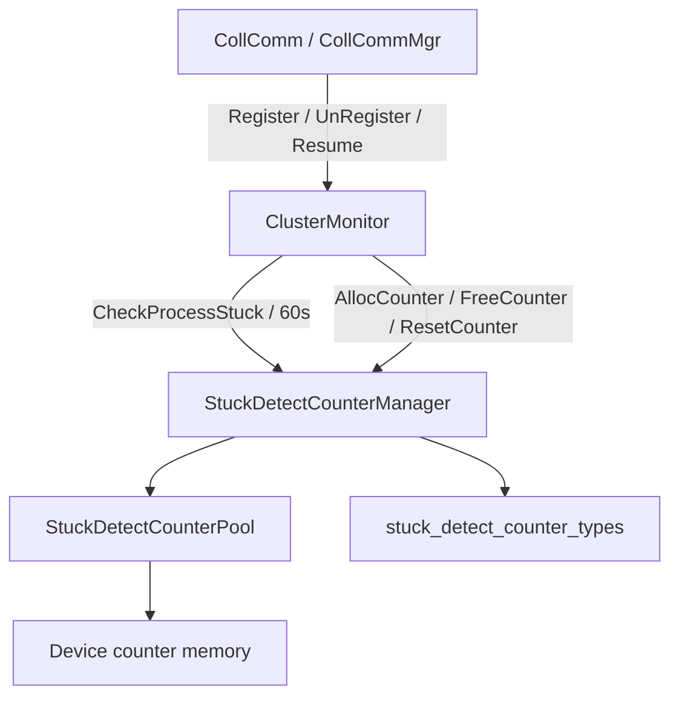
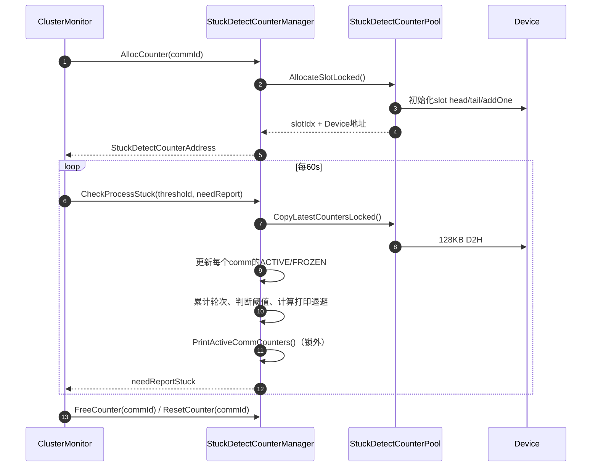
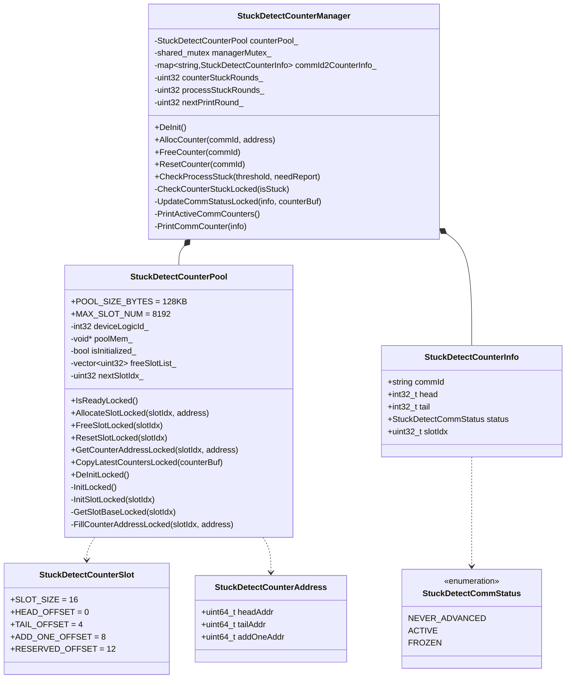
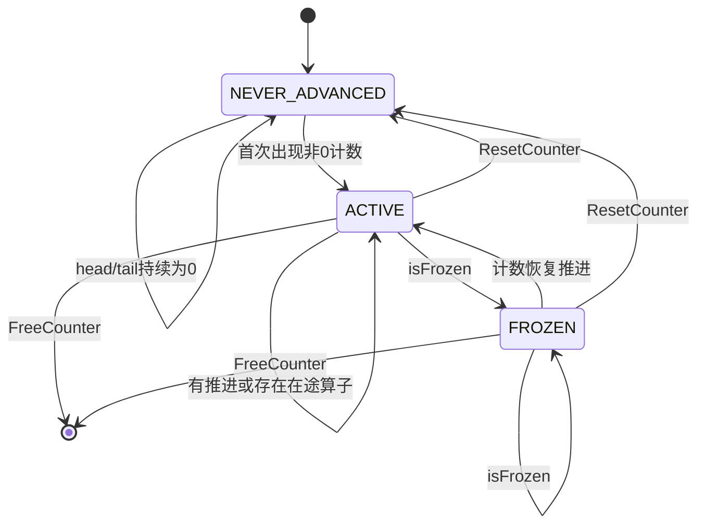

# StuckDetectCounter进程卡住检测模块

## 功能描述

`stuck_detect_counter`位于`coll_communicator_mgr/dfx/cluster_monitor`，为每个Device维护一个卡住检测计数池，并向`ClusterMonitor`提供：

- 通信域计数slot的分配、回收和重置
- head/tail计数器的Device地址
- 通信域级状态判定：`NEVER_ADVANCED`、`ACTIVE`、`FROZEN`
- 进程级卡住轮次、上报阈值和打印退避

`ClusterMonitor`仍负责60秒调度触发、STUCK广播和本地OK恢复；本模块不感知`ClusterUIDType`、`ClusterMonitorStatus`，也不负责对端广播。

## 配置方法

通过环境变量`HCCL_DFS_CONFIG`的`stuck_detection`配置项控制：

```bash
export HCCL_DFS_CONFIG="stuck_detection:on"
```

| 配置项 | 取值范围 | 默认值 | 说明 |
|---|---|---|---|
| `stuck_detection` | `on`/`off`（区分大小写） | `on` | 关闭后`ClusterMonitor`不执行卡住检测，C API返回全0地址；非法值抛出`InvalidParamsException`。 |

检测由`ClusterMonitor`按`STUCK_CHECK_INTERVAL=60s`节流触发；上报阈值为`max(2, execTimeout/3*2/60)`轮。`cluster_heartbeat`关闭时不会建立心跳链路、不会向对端广播；但`ClusterMonitor`监控线程仍可能启动或复用，C API仍可能返回有效地址并参与本地检测。

## 目录描述

```text
stuck_detect_counter/
|-- CMakeLists.txt
|-- stuck_detect_counter_types.h       # slot/address/info类型与状态枚举
|-- stuck_detect_counter_pool.h/.cc    # 128KB Device计数池、slot分配和D2H读取
`-- stuck_detect_counter_manager.h/.cc # commId映射、状态机、阈值和打印退避
```

前三个为目录内文件，后两个为外部调用方：

| 文件/外部组件 | 关系与职责 |
|---|---|
| `StuckDetectCounterManager` | 模块入口；持有计数池和commId状态映射，负责状态机、阈值和打印退避。 |
| `StuckDetectCounterPool` | Manager的设备内存资源层；只负责slot分配/回收、地址计算和整池D2H。 |
| `stuck_detect_counter_types.h` | 定义slot布局、地址结构、计数信息和通信域状态枚举。 |
| `ClusterMonitor` | 上游调用方；按60秒节流调用`CheckProcessStuck`，负责STUCK广播和本地OK恢复。 |
| `CollComm`/`CollCommMgr` | 注册、注销和Resume路径；分别触发计数slot的分配、释放和重置。 |

外部依赖：`adapter_rts_common.h`（`hrtMalloc`/`hrtFree`/`hrtMemSyncCopy`）、`log.h`。



## 流程描述



注册流程会预分配计数slot；若未预分配，对外C API首次调用时会按需分配。

## 数据描述

每个slot固定16B，Device地址按`slotBase = poolMem_ + slotIdx * SLOT_SIZE`计算：

| 字段 | 偏移 | 说明 |
|---|---:|---|
| head | 0 | 算子执行前自增的head计数器 |
| tail | 4 | 算子执行后自增的tail计数器 |
| addOne | 8 | 常量1，供计数归约使用 |
| reserved | 12 | 保留字段，保证16B对齐 |

`headAddr = slotBase + HEAD_OFFSET`，`tailAddr = slotBase + TAIL_OFFSET`，`addOneAddr = slotBase + ADD_ONE_OFFSET`。





其中`isFrozen = (newHead == prevHead) && (newHead == prevTail) && (newHead == newTail)`。当前语义保持与910一致：满足`isFrozen`时进入`FROZEN`；进程内至少一个`FROZEN`且没有`ACTIVE`时判定进程卡住。`NEVER_ADVANCED`不计入`hasActiveComm`，因此`FROZEN + NEVER_ADVANCED`组合会判为进程卡住。该语义的已知限制见[使用限制](#使用限制)。

## 接口描述

| 接口 | 说明 |
|---|---|
| `AllocCounter(commId, address)` | 为通信域分配/复用slot，返回Device地址。 |
| `FreeCounter(commId)` | 回收slot，并打印该通信域最终计数。 |
| `ResetCounter(commId)` | Resume时清零slot计数和host侧状态。 |
| `CheckProcessStuck(threshold, needReport)` | 读取计数、更新状态、累计轮次、执行打印退避；`threshold`由`ClusterMonitor`传入。 |
| `DeInit()` | 打印仍存活的通信域并释放计数池和映射；幂等。 |
| `PrintActiveCommCounters()` | 私有接口，锁外打印所有存活通信域计数。 |

## 使用限制

| 类别 | 约束 |
|---|---|
| **通信域范围** | 仅服务于V2通信域；注册流程会预分配计数slot，对外C API也可按需分配。`rankSize == 1`的通信域不会注册到`ClusterMonitor`，纯单rank进程不会启动检测线程；若同设备已有其他多rank通信域启动线程，懒分配计数可能被该线程采样，但不保证。不能仅凭C API返回有效地址认为检测已开启。 |
| **开关** | 由`HCCL_DFS_CONFIG`的`stuck_detection:on/off`控制，默认开启；检测关闭时C API返回全0地址。`cluster_heartbeat`关闭时不会建立心跳链路、不会向对端广播，但`ClusterMonitor`监控线程仍可能启动或复用，C API仍可能返回有效地址并参与本地检测。 |
| **计数池** | 固定128KB，共8192个16B slot；池耗尽或分配失败返回`HCCL_E_MEMORY`。 |
| **状态语义** | 当前与910一致：`head == tail`且当前采样与上一轮均不推进时进入`FROZEN`；`head != tail`的在途卡死不会进入`FROZEN`。空闲通信域可能误报，在途卡死可能漏报。 |
| **锁与拷贝** | `CheckProcessStuck`在manager排他锁内执行整池同步D2H（128KB），期间阻塞注册、销毁和Resume；通信域注销时`FreeCounter`也在同一排他锁内对同一计数池执行一次整池D2H，只刷新即将析构的通信域；进程退出走`DeInit()`→`PrintActiveCommCounters()`的路径不做D2H，打印的仍是host缓存值。`resize`已用`EXCEPTION_CATCH`防护，失败返回`HCCL_E_MEMORY`。 |
| **上报与打印** | 上报阈值为`max(2, execTimeout/3*2/60)`轮；连续达到阈值后向`ClusterMonitor`返回`needReportStuck=true`，打印采用指数退避。检测失败不重置轮次；未卡住时重置轮次和打印退避。 |
| **恢复** | 本模块只返回`needReportStuck`，不负责广播；`ClusterMonitor`恢复时当前仅本地置OK，不向对端广播。 |
| **地址生命周期** | 返回地址仅在通信域存活期间有效；slot回收后可能被其他通信域复用。 |

## 相关文档

- [ClusterMonitor集群心跳检测](../README.md)
- [HcclStuckDetectGetCounterAddr API](../../../../../docs/zh/api_ref/comm_opdev/control_plane_api/comms_domain_resource_mgmt/HcclStuckDetectGetCounterAddr.md)
