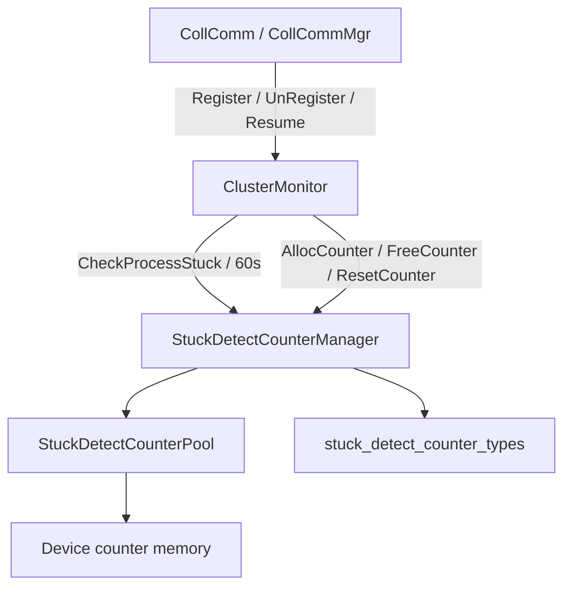
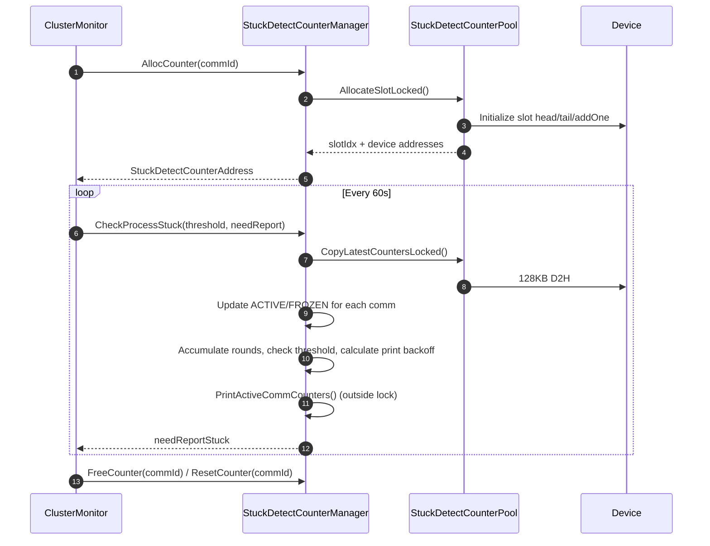
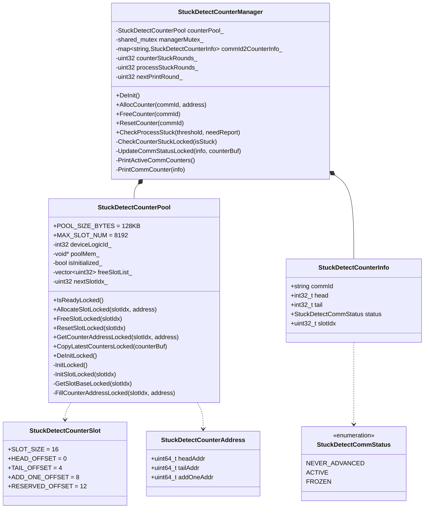
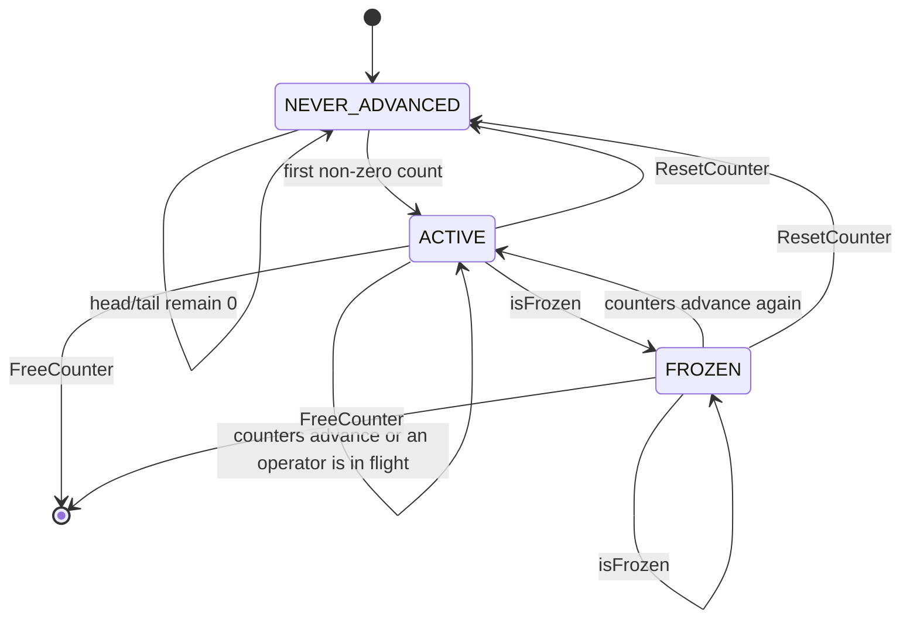

# StuckDetectCounter Process Stuck Detection Module

## Overview

`stuck_detect_counter`, located under `coll_communicator_mgr/dfx/cluster_monitor`, maintains a stuck-detection counter pool for each device and provides the following to `ClusterMonitor`:

- Allocation, release, and reset of per-communicator counter slots
- Device addresses of the head/tail counters
- Per-communicator state: `NEVER_ADVANCED`, `ACTIVE`, `FROZEN`
- Process-level stuck rounds, reporting threshold, and print backoff

`ClusterMonitor` still owns the 60-second scheduling trigger, STUCK broadcasting, and local OK recovery. This module does not depend on `ClusterUIDType` or `ClusterMonitorStatus`, and does not handle peer broadcast.

## Configuration

The feature is controlled by the `stuck_detection` item in `HCCL_DFS_CONFIG`:

```bash
export HCCL_DFS_CONFIG="stuck_detection:on"
```

| Item | Value | Default | Description |
|---|---|---|---|
| `stuck_detection` | `on`/`off` (case-sensitive) | `on` | When disabled, `ClusterMonitor` skips stuck detection and the C API returns all-zero addresses. Invalid values throw `InvalidParamsException`. |

`ClusterMonitor` throttles checks at `STUCK_CHECK_INTERVAL=60s`. The reporting threshold is `max(2, execTimeout/3*2/60)` rounds. When `cluster_heartbeat` is disabled, heartbeat links are not established and events are not broadcast to peers; however, the `ClusterMonitor` background thread may still start or be reused, and the C API may still return valid addresses and participate in local detection.

## Directory Layout

```text
stuck_detect_counter/
|-- CMakeLists.txt
|-- stuck_detect_counter_types.h       # slot/address/info types and status enum
|-- stuck_detect_counter_pool.h/.cc    # 128KB device counter pool, slot allocation, D2H read
`-- stuck_detect_counter_manager.h/.cc # commId mapping, state machine, threshold, print backoff
```

The first three entries are files in this directory; the last two are external callers:

| File/External Component | Relationship and responsibility |
|---|---|
| `StuckDetectCounterManager` | Module entry; owns the counter pool and commId state map, state machine, threshold, and print backoff. |
| `StuckDetectCounterPool` | Device-memory resource layer; handles slot allocation/release, address calculation, and whole-pool D2H. |
| `stuck_detect_counter_types.h` | Defines slot layout, address structures, counter information, and communicator status enum. |
| `ClusterMonitor` | Upstream caller; invokes `CheckProcessStuck` every 60 seconds, broadcasts STUCK, and restores OK locally. |
| `CollComm`/`CollCommMgr` | Registration, deregistration, and Resume paths; trigger counter slot allocation, release, and reset. |

External dependencies: `adapter_rts_common.h` (`hrtMalloc`/`hrtFree`/`hrtMemSyncCopy`) and `log.h`.



## Flow



The registration path pre-allocates a counter slot. If it was not pre-allocated, the public C API allocates one on first use.

## Data Model

Each slot is fixed at 16 bytes. The device address is calculated as `slotBase = poolMem_ + slotIdx * SLOT_SIZE`:

| Field | Offset | Description |
|---|---:|---|
| head | 0 | Head counter incremented before an operator is executed |
| tail | 4 | Tail counter incremented after an operator is executed |
| addOne | 8 | Constant 1 used by counter reduction |
| reserved | 12 | Reserved field for 16-byte alignment |

`headAddr = slotBase + HEAD_OFFSET`, `tailAddr = slotBase + TAIL_OFFSET`, and `addOneAddr = slotBase + ADD_ONE_OFFSET`.





`isFrozen = (newHead == prevHead) && (newHead == prevTail) && (newHead == newTail)`. The current semantics remain aligned with 910: when `isFrozen` is true, the communicator enters `FROZEN`; a process is stuck when at least one communicator is `FROZEN` and none is `ACTIVE`. `NEVER_ADVANCED` is not counted as `hasActiveComm`, so a `FROZEN + NEVER_ADVANCED` combination is reported as stuck. Known limitations are listed under [Limitations](#limitations).

## Interfaces

| Interface | Description |
|---|---|
| `AllocCounter(commId, address)` | Allocate or reuse a slot and return device addresses. |
| `FreeCounter(commId)` | Release the slot and print the final counters for the communicator. |
| `ResetCounter(commId)` | Reset slot counters and host-side state during Resume. |
| `CheckProcessStuck(threshold, needReport)` | Read counters, update states, accumulate rounds, and perform print backoff; `threshold` is passed by `ClusterMonitor`. |
| `DeInit()` | Print live communicators and release the counter pool and mappings; idempotent. |
| `PrintActiveCommCounters()` | Private helper that prints all live communicator counters outside the manager lock. |

## Limitations

| Category | Constraint |
|---|---|
| **Communicator scope** | Only V2 communicators are supported. The registration path pre-allocates a counter slot, and the public C API can also allocate one on demand. A communicator with `rankSize == 1` is not registered with `ClusterMonitor`, and a pure single-rank process does not start the detection thread. If another multi-rank communicator on the same device has already started the thread, counters allocated on demand for the single-rank communicator may be sampled by that thread, but this is not guaranteed. Do not use valid C API addresses as evidence that detection is enabled. |
| **Switch** | Controlled by `stuck_detection:on/off` in `HCCL_DFS_CONFIG` and enabled by default. When disabled, the C API returns all-zero addresses. When `cluster_heartbeat` is off, heartbeat links are not established and events are not broadcast to peers; however, the `ClusterMonitor` background thread may still start or be reused, and the C API may still return valid addresses and participate in local detection. |
| **Counter pool** | Fixed at 128KB with 8192 16-byte slots; pool exhaustion or allocation failure returns `HCCL_E_MEMORY`. |
| **State semantics** | Currently aligned with 910: `FROZEN` is entered when `head == tail` and neither the current nor the previous sample advances. An in-flight stuck communicator (`head != tail`) does not enter `FROZEN`. Idle communicators may be misreported and in-flight stuck tasks may be missed. |
| **Locking and copy** | `CheckProcessStuck` performs a synchronous whole-pool D2H copy (128KB) under the manager exclusive lock, blocking registration, destruction, and Resume. `resize` is protected by `EXCEPTION_CATCH` and returns `HCCL_E_MEMORY` on failure. |
| **Reporting and printing** | The reporting threshold is `max(2, execTimeout/3*2/60)` rounds. After consecutive rounds reach the threshold, `needReportStuck=true` is returned to `ClusterMonitor`; printing uses exponential backoff. Detection failures do not reset rounds; non-stuck results reset rounds and print backoff. |
| **Recovery** | This module only returns `needReportStuck` and does not broadcast. On recovery, `ClusterMonitor` currently sets OK locally only and does not broadcast it to peers. |
| **Address lifetime** | Returned addresses are valid only while the communicator is alive; slots may be reused by other communicators after release. |

## Related Documents

- [ClusterMonitor Cluster Heartbeat Detection](../README_en.md)
- [HcclStuckDetectGetCounterAddr API](../../../../../docs/en/api_ref/comm_opdev/control_plane_api/comms_domain_resource_mgmt/HcclStuckDetectGetCounterAddr.md)
