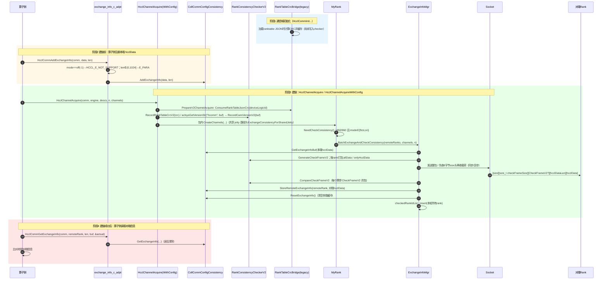
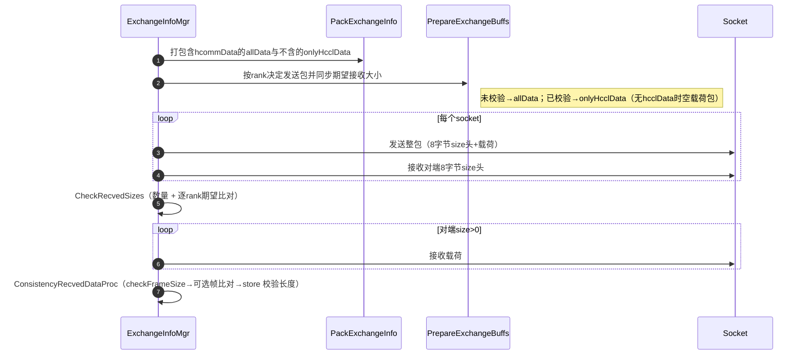
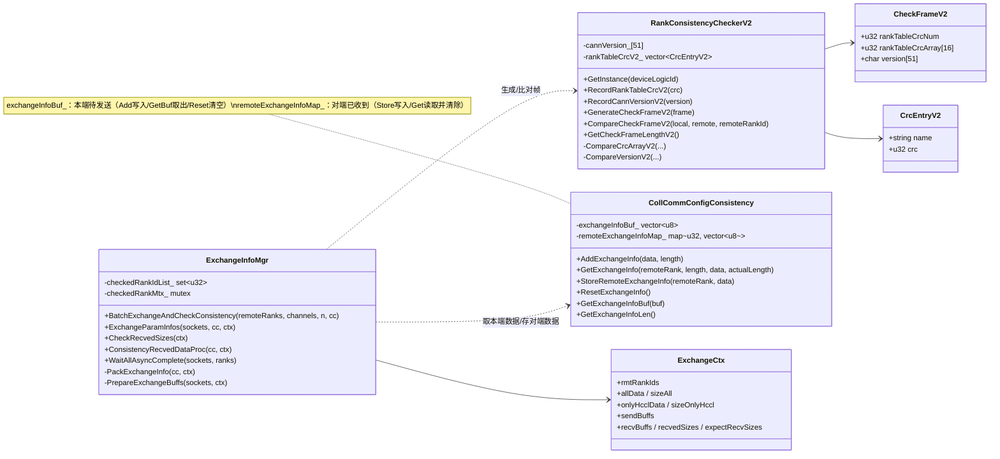

# InconsistentCheck 参数一致性校验功能说明

---

## 功能描述

`inconsistentCheck` 是 `coll_communicator_mgr/dfx` 路径下的参数一致性校验模块。通信域初始化完成后，算子侧在建链时调用 `HcclChannelAcquire` / `HcclChannelAcquireWithConfig`，本模块在此期间对两端 rank 的参数做端到端校验，并在 rank 之间交换校验信息。校验对象分两类：

- **hcomm 侧参数**：ranktable CRC 与 CANN 版本（hcomm 包版本），由 `RankConsistencyCheckerV2` 记录并封装为 `CheckFrameV2` 参与交换比对；
- **hccl 侧参数**：算子侧通过 `HcclCommAddExchangeInfo` 注册的**本端** `hcclData` 随帧发送；收到的**对端** `hcclData` 经校验后暂存，建链成功后由 `HcclCommGetExchangeInfo` 按 remoteRank 读取（读后清除）。

它是发现"参数/版本不一致"类问题（EI0005 / EI0008）的主要手段。

核心能力：

1. **hcomm 侧参数记录（hcommData）**：记录 ranktable CRC 与 CANN 版本（hcomm 包版本）。其中 ranktable CRC 在通信域初始化加载 ranktable 时由 `RankTableCrcBridge` 计算并缓存，直到建链阶段（`HcclChannelAcquire` 内的 `PrepareV2ChannelAcquire`）才与 CANN 版本一起写入本模块的 checker。
2. **CheckFrameV2 生成与比对**：比对 ranktable CRC 数组与 CANN 版本；不一致时上报 EI0005（参数冲突）/ EI0008（版本不一致）。
3. **hccl 侧参数交换（hcclData）**：算子侧通过 `HcclCommAddExchangeInfo` 注册本端参数，建链时随帧交换，`HcclCommGetExchangeInfo` 读取对端参数（读后清除）。
4. **已校验 rank 跳过 hcommData**：是否携带 `CheckFrameV2` 按建链轮次决定——轮次开始时对端 rank 未在 `checkedRankIdList_` 中则携带（同一轮内指向同一未校验对端的多个 socket 均携带并各自校验）；本轮结束后该轮所有对端 rank 记入 `checkedRankIdList_`，后续轮次只交换 hcclData。

适用设备：仅 `DEV_TYPE_950` / `DEV_TYPE_960`（由 `MyRank::NeedCheckConsistency` 门控）。

---

## 目录描述

```text
inconsistentCheck/
├── CMakeLists.txt                      # 两个 .cc 仅编入 hcomm 目标，并加入本目录 include
├── coll_comm_config_consistency.h/.cc  # 交换信息缓冲管理（本端待发 exchangeInfoBuf_ + 对端已收 remoteExchangeInfoMap_）
└── rank_consistency_checker_v2.h/.cc   # CheckFrameV2 生成与比对（ranktable CRC + CANN 版本）
```

**目录特征**：

- 本模块不直接持有 socket：交换动作由 `resource_mgr/local/my_rank/exchange_info_mgr.{h,cc}`（`ExchangeInfoMgr`）执行，本模块只负责"数据"与"比对"。
- 编译归属：仅 `hcomm`（host 侧）；`hccl_v2`、`ccl_kernel` 不再编译本模块。
- 依赖方向：本模块 → legacy `EnvConfig`（`DfsConfig`）、legacy ascend950 `BinaryStream`、Socket 层；对外接口声明在 `pkg_inc/hccl/hccl_res_expt.h`。

---

## 模块组成与职责分工

| 组件 | 位置 | 职责 |
|------|------|------|
| `RankConsistencyCheckerV2` | 本目录 | 按 device 单例；记录 ranktable CRC / CANN 版本；生成 / 比对 `CheckFrameV2` |
| `CollCommConfigConsistency` | 本目录 | `MyRank` 成员；两个缓冲独立管理：`exchangeInfoBuf_` 暂存**本端**待交换 hcclData，`remoteExchangeInfoMap_` 保存交换到的**对端** hcclData（key=remoteRank） |
| `ExchangeInfoMgr` | `resource_mgr/local/my_rank` | 交换执行者：拼包、收发、按 rank 决定发送计划、解包入库、维护已校验 rank 集合 |
| `MyRank::NeedCheckConsistency` | `resource_mgr/local/my_rank` | 校验门控：设备类型 950/960 且 `rankConsistentState` 为 first/on |
| `exchange_info_c_adpt` | `api_c_adpt` | 对外 C API 适配（`HcclCommAdd/Get/ResetExchangeInfo`） |

---

## 流程描述（Mermaid时序图）

### 整体流程：初始化缓存 → 注册 → 建链交换 → 读取



### 单轮交换（`ExchangeParamInfos`）内部时序



---

## 数据描述（Mermaid类图）



---

## 接口描述

### 包间接口（算子侧 C API，声明于 `pkg_inc/hccl/hccl_res_expt.h`）

> **说明**：以下接口仅供 HCOMM 与 HCCL 等包间内部使用（声明于 `pkg_inc`），不对外呈现给最终客户。

| 接口 | 说明 |
|------|------|
| `HcclCommAddExchangeInfo(comm, data, length)` | 建链前注册本端待交换信息；`length ∈ (0, 1024]`，越界返回 `HCCL_E_PARA`；`inconsistent_check=off` 时返回 `HCCL_E_NOT_SUPPORT`；每次建链前只能调用一次，交换信息在 `HcclChannelAcquire` 执行后自动清空 |
| `HcclCommGetExchangeInfo(comm, remoteRank, length, data, actualLength)` | 建链成功后读取对端交换信息；**读后清除**，不可重复读取；无数据时 `actualLength=0` 且返回成功 |
| `HcclCommResetExchangeInfo(comm)` | 重置本端交换信息缓冲 |

### 模块内部接口

| 类 | 接口 | 说明 |
|----|------|------|
| `RankConsistencyCheckerV2` | `GetInstance(deviceLogicId)` | 按 device 单例（上限 `MAX_MODULE_DEVICE_NUM=65`）；非法 device 退化为 0 号实例并告警 |
| | `RecordRankTableCrcV2(crc)` / `RecordCannVersionV2(version)` | 记录 hcommData（ranktable CRC / hcomm 包版本） |
| | `GenerateCheckFrameV2(frame)` | 生成本端 `CheckFrameV2`（memset 清零 + 拷贝 CRC/版本） |
| | `CompareCheckFrameV2(local, remote, rank)` | 比对 CRC 数组与版本；不一致返回 `HCCL_E_INTERNAL` 并上报 EI0005 / EI0008 |
| | `GetCheckFrameLengthV2()` | 返回 `sizeof(CheckFrameV2)` |
| `CollCommConfigConsistency` | `AddExchangeInfo` / `GetExchangeInfoBuf` / `GetExchangeInfoLen` / `ResetExchangeInfo` | **本端** hcclData 管理：`AddExchangeInfo` 写入 `exchangeInfoBuf_`；`GetExchangeInfoBuf` 供 `PackExchangeInfo` 取出本端数据打包；`GetExchangeInfoLen` 提供本端长度用于对端长度校验；`ResetExchangeInfo` 每轮交换后清空本端缓冲 |
| | `StoreRemoteExchangeInfo` / `GetExchangeInfo` | **对端** hcclData 管理：`StoreRemoteExchangeInfo` 校验对端数据长度与本端一致后写入 `remoteExchangeInfoMap_`（两端均为空时不存储）；`GetExchangeInfo` 供算子侧按 remoteRank 读取且读后清除 |
| `MyRank` | `NeedCheckConsistency(bool&)` | 门控：设备类型 + `rankConsistentState` |
| | `BatchExchangeAndCheckConsistency(channelDescs, channelHandles, n)` | 交换入口：由对外接口 `HcclChannelAcquire`（非共享路径）/ `HcclChannelAcquireWithConfig`（共享 jetty 路径）触发，包内分别经 `MyRank::CreateChannels` / `ExchangeConsistencyForSharedJetty` 调用 |
| | `GetCollCommConfigConsistency()` | 获取本 rank 的交换信息缓冲 |

### 交换协议（报文格式）

```text
[uint64_t size][size_t checkFrameSize][CheckFrameV2(可选)][size_t hcclDataLen][hcclData]
```

- `size`：载荷长度（不含自身 8 字节）；`0` 表示无载荷（当前实现不再发送 0；`CheckRecvedSizes` 会先按期望值拒绝 0，接收循环中的跳过分支为防御性保留）。
- 每个 socket 每轮**始终发送一个完整数据包**（跳过帧的 rank 仍发完整包，无 hcclData 时为空载荷包）；接收侧**先收 8 字节 size 头、再按 size 收载荷**。两端收发步骤一致，不因本地状态不对称而死等。
- `checkFrameSize=sizeof(CheckFrameV2)` 时携带 `CheckFrameV2`：按轮次决定——轮次开始时对端 rank 未在 `checkedRankIdList_` 中则携带（同一轮内同一未校验对端的多个 socket 均携带、各自校验）；该轮结束后对应 rank 标记为已校验，后续轮次只交换 hcclData（`checkFrameSize=0`）。
- 已校验且无 hcclData 的 rank 发送 `checkFrameSize=0、hcclDataLen=0` 的空载荷包，对端解包后跳过存储。
- 载荷上限（不含前置 size 头）：`PACKED_SIZE_MAX = sizeof(size_t) + sizeof(CheckFrameV2) + sizeof(size_t) + 1024`，超限返回 `HCCL_E_PARA`。
- 本端数据来源：`PackExchangeInfo` 经 `GetExchangeInfoBuf` 取出本端 hcclData 打包；对端数据去向：`ConsistencyRecvedDataProc` 解包后经 `StoreRemoteExchangeInfo` 校验长度并入库。
- 接收侧校验：size 头数量与 rank 一致且逐 rank 等于期望值；携带 `CheckFrameV2` 时其大小必须等于本端 `sizeof(CheckFrameV2)`；载荷内 hcclData 长度必须等于本端 `GetExchangeInfoLen()`。

---

## 配置项

`HCCL_DFS_CONFIG` 中 `inconsistent_check` 三档（常量定义于 `legacy/ascend950/framework/env_config/env_func.h`）：

| 取值 | 常量 | 语义 |
|------|------|------|
| `off`(-1) | `RANK_CONSISTENT_STATE_OFF` | 完全不做校验；`HcclCommAddExchangeInfo` 返回 `HCCL_E_NOT_SUPPORT`，建链时不交换 |
| `first`(0) | `RANK_CONSISTENT_STATE_FIRST` | 首算子校验（默认值） |
| `on`(1) | `RANK_CONSISTENT_STATE_ON` | 每次算子校验 |

> **说明**：`first` / `on` 的差异仅体现在 hccl 侧参数（`HcclCommAddExchangeInfo` 注册的 hcclData）的校验频次（首算子 / 每次算子）上。hcomm 侧参数（ranktable CRC 与 CANN 版本，即 `CheckFrameV2`）在通信域创建后即已确定、不再变更，因此不区分 `first` / `on`：在同一通信域内仅首个涉及该对端 rank 的建链轮次会携带 `CheckFrameV2`（同一轮内该对端的多个 socket 各自校验一次），后续轮次不再交换（由 `ExchangeInfoMgr::checkedRankIdList_` 保证）。

---

## 使用限制（支持场景与约束规格）

### 支持场景

1. **设备范围**：仅 `DEV_TYPE_950` / `DEV_TYPE_960`；其他设备 `NeedCheckConsistency` 直接返回不校验。
2. **两端对称**：交换信息长度需两端一致（对端载荷内长度与本端 `GetExchangeInfoLen()` 比对），不对称返回 `HCCL_E_PARA`。

### 约束规格

| 类别 | 约束 |
|------|------|
| **平台依赖** | 仅 `DEV_TYPE_950` / `DEV_TYPE_960` 设备启用（由 `MyRank::NeedCheckConsistency` 门控）；依赖 legacy `EnvConfig`（`DfsConfig`）、`RankTableCrcBridge`、`BinaryStream`、Socket 层与 `aclsysGetVersionStr`。 |
| **线程模型** | `ExchangeInfoMgr::checkedRankIdList_` 由 `checkedRankMtx_` 保护；交换流程假定同一 `MyRank` 的建链串行（并发 Acquire 需上层保证）。 |
| **共享 jetty 复用范围** | 复用仅发生在同一通信域内（`SharedJettyChannelPool` 以 `MyRank*` 索引，相同 `sharedQueueTag` + endpoint pair）；不同通信域使用不同 Endpoint/Jetty，`checkedRankIdList_` 作用域与之匹配。 |
| **数据规格** | hcclData ∈ (0, 1024] 字节；单包上限 `PACKED_SIZE_MAX = sizeof(size_t) + sizeof(CheckFrameV2) + sizeof(size_t) + 1024`，超限返回 `HCCL_E_PARA`。 |
| **生命周期** | 本端缓冲 `exchangeInfoBuf_` 每轮交换后由 `ResetExchangeInfo` 清空；对端数据 `remoteExchangeInfoMap_` 由 `GetExchangeInfo` 按 remoteRank 读后清除，两者独立；`RankConsistencyCheckerV2` 按 `deviceLogicId` 单例（静态数组，上限 `MAX_MODULE_DEVICE_NUM=65`），记录内容随进程生命周期保留。 |
| **超时控制** | 异步等待使用 `EnvConfig::GetSocketConfig().GetLinkTimeOut()`（`HCCL_CONNECT_TIMEOUT`），超时返回 `HCCL_E_TIMEOUT`。 |
| **错误码** | `HCCL_E_PARA`（长度/size 不匹配、超限）、`HCCL_E_INTERNAL`（帧比对不一致、socket 为空、recvBuff 异常为空）、`HCCL_E_NOT_SUPPORT`（off 模式下 Add）、`HCCL_E_RUNTIME`（deviceLogicId 刷新失败、设备未设置）、`HCCL_E_TIMEOUT`（等待超时）、`HCCL_E_MEMORY`（内存拷贝失败）。 |
| **依赖方向** | 本模块位于 L2（`coll_communicator_mgr`），依赖同层/下层设施（见"平台依赖"），不反向依赖上层；交换动作由同层 `ExchangeInfoMgr` 执行，本模块不持有 socket。 |

---

## 补充说明

1. **ranktable CRC 的来源与记录时机**：CRC 不在本模块计算，且"计算缓存"与"记录到 checker"发生在不同阶段——① 通信域初始化阶段加载 ranktable JSON 时，`param_check_v2` 调用 `RankTableCrcBridge::RecordRankTableJsonCrc` 计算并缓存；② 建链阶段（算子侧调用 `HcclChannelAcquire`/`HcclChannelAcquireWithConfig`）的 `PrepareV2ChannelAcquire` 中，`ConsumeRankTableJsonCrc` 取出后写入 `RankConsistencyCheckerV2`。因此 CRC 的语义是"本进程本次加载的 ranktable 内容"。
2. **CANN 版本来源与比对范围**：`aclsysGetVersionStr("hcomm", buf)` 取 hcomm 包版本（version.info 中的 `Version=`，单段字符串），当前流程不单独获取 cann-hccl 版本。`GetVersionErrMessage` 保留了按 `_` 拆分 `hcomm版本_hccl版本` 的兼容逻辑（继承自 legacy 检查器，其版本串由 hcomm / hccl 两个包的 version.info 拼接），但此处记录值为单段：拆分出的 hccl 段恒为 `empty`，版本不一致只会归因到 Toolkit (cann-hcomm)；纯 cann-hccl 版本差异（hcomm 版本相同）不会触发 EI0008。
3. **两端校验状态不对称的设计处理**：若一端进程重启并重建通信域（`checkedRankIdList_` 清空），或仅一端调用过 `HcclCommAddExchangeInfo`，两端收发计划可能不一致。为此协议规定每个 socket 每轮**始终发送一个完整数据包**（跳过帧的 rank 仍发完整包，无 hcclData 时为空载荷包），接收侧**先收 8 字节 size 头、再按 size 收载荷**，并按各 rank 期望大小校验；不一致显式返回 `HCCL_E_PARA`，不会出现一端发送、另一端不收发导致的死等。
