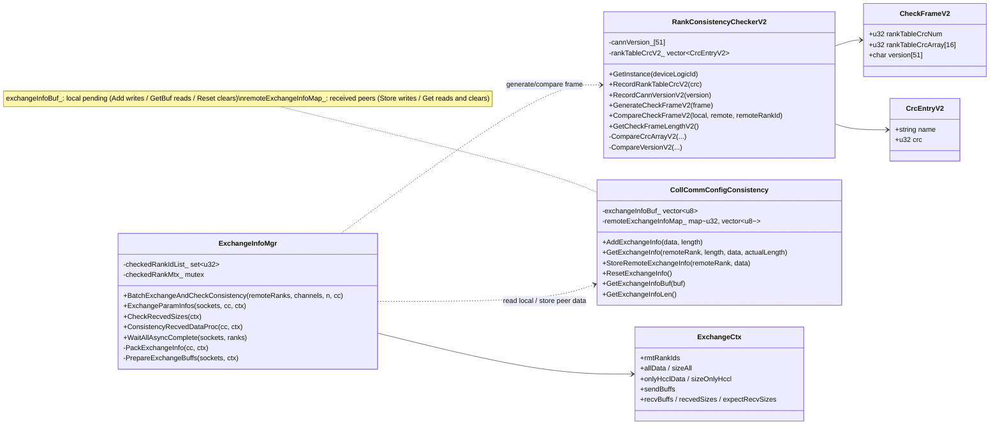

# InconsistentCheck Parameter Consistency Check

---

## Overview

`inconsistentCheck` is the parameter-consistency-check module under `coll_communicator_mgr/dfx`. After communication-domain initialization completes, the operator side calls `HcclChannelAcquire` / `HcclChannelAcquireWithConfig` during channel acquisition; this module then performs end-to-end parameter consistency verification between the two ranks and exchanges verification information. Two categories of parameters are checked:

- **hcomm-side parameters**: ranktable CRC and CANN version (hcomm package version), recorded by `RankConsistencyCheckerV2` and packed into `CheckFrameV2` for exchange/comparison;
- **hccl-side parameters**: the **local** `hcclData` registered by the operator via `HcclCommAddExchangeInfo` is sent with the frame; the received **peer** `hcclData` is validated and buffered, then read back per remoteRank via `HcclCommGetExchangeInfo` (read-and-clear) after successful acquisition.

It is the main mechanism for detecting parameter/version inconsistencies (EI0005 / EI0008).

Core capabilities:

1. **hcomm-side parameter recording (hcommData)**: records ranktable CRC and CANN version (hcomm package version). The ranktable CRC is computed and cached by `RankTableCrcBridge` when the ranktable is loaded during communication-domain initialization; it is not written into this module's checker until the acquisition phase (`PrepareV2ChannelAcquire` inside `HcclChannelAcquire`), together with the CANN version.
2. **CheckFrameV2 generation and comparison**: compares ranktable CRC arrays and CANN versions; reports EI0005 (parameter conflict) / EI0008 (version mismatch) on differences.
3. **hccl-side parameter exchange (hcclData)**: the operator side registers local parameters via `HcclCommAddExchangeInfo`; they are exchanged with the frame during channel acquisition and read by `HcclCommGetExchangeInfo` (read-and-clear).
4. **Checked ranks skip hcommData**: whether `CheckFrameV2` is carried is decided per acquisition round — a peer rank not yet in `checkedRankIdList_` at the start of the round carries it (multiple sockets to the same unchecked peer in one round each carry and compare the frame); after the round, all peer ranks of that round are recorded in `checkedRankIdList_`, and subsequent rounds exchange only hcclData.

Supported devices: `DEV_TYPE_950` / `DEV_TYPE_960` only (gated by `MyRank::NeedCheckConsistency`).

---

## Directory Layout

```text
inconsistentCheck/
├── CMakeLists.txt                      # both .cc files are compiled into hcomm only; this dir is added to includes
├── coll_comm_config_consistency.h/.cc  # exchange-info buffers (local pending: exchangeInfoBuf_; received peers: remoteExchangeInfoMap_)
└── rank_consistency_checker_v2.h/.cc   # CheckFrameV2 generation/comparison (ranktable CRC + CANN version)
```

**Characteristics**:

- The module does not own sockets: the exchange itself is executed by `ExchangeInfoMgr` (`resource_mgr/local/my_rank/exchange_info_mgr.{h,cc}`); this module only owns "data" and "comparison".
- Build target: `hcomm` (host side) only; `hccl_v2` / `ccl_kernel` no longer compile this module.
- Dependencies: legacy `EnvConfig` (`DfsConfig`), legacy ascend950 `BinaryStream`, the Socket layer; external APIs are declared in `pkg_inc/hccl/hccl_res_expt.h`.

---

## Components and Responsibilities

| Component | Location | Responsibility |
|-----------|----------|----------------|
| `RankConsistencyCheckerV2` | this directory | Per-device singleton; records ranktable CRC / CANN version; generates and compares `CheckFrameV2` |
| `CollCommConfigConsistency` | this directory | Member of `MyRank`; two independent buffers: `exchangeInfoBuf_` holds **local** pending hcclData, `remoteExchangeInfoMap_` holds received **peer** hcclData (key = remoteRank) |
| `ExchangeInfoMgr` | `resource_mgr/local/my_rank` | Exchange executor: packing, send/recv, per-rank send plan, unpacking/storing, checked-rank set |
| `MyRank::NeedCheckConsistency` | `resource_mgr/local/my_rank` | Gating: device type 950/960 and `rankConsistentState` in {first, on} |
| `exchange_info_c_adpt` | `api_c_adpt` | C API adapters (`HcclCommAdd/Get/ResetExchangeInfo`) |

---

## Flow (Mermaid Sequence Diagrams)

### End-to-end: cache → register → exchange → read

```mermaid
sequenceDiagram
    autonumber
    participant Op as Operator side
    participant API as exchange_info_c_adpt
    participant Acq as HcclChannelAcquire(WithConfig)
    participant CC as CollCommConfigConsistency
    participant RC as RankConsistencyCheckerV2
    participant RT as RankTableCrcBridge(legacy)
    participant MyR as MyRank
    participant EM as ExchangeInfoMgr
    participant Sock as Socket
    participant Peer as Peer rank

    rect rgb(230, 245, 255)
    Note over RT: Phase 1: Communication-domain initialization (HcclCommInit...)
    RT->>RT: Compute/cache CRC when loading ranktable JSON (not yet recorded into checker)
    end

    rect rgb(255, 248, 230)
    Note over Op, CC: Phase 2: Before acquisition — operator registers local hcclData
    Op->>API: HcclCommAddExchangeInfo(comm, data, len)
    API->>API: mode==off(-1)→HCCL_E_NOT_SUPPORT; len∉(0,1024]→E_PARA
    API->>CC: AddExchangeInfo(data, len)
    end

    rect rgb(230, 255, 230)
    Note over Acq, Sock: Phase 3: Channel acquisition — HcclChannelAcquire / HcclChannelAcquireWithConfig
    Op->>Acq: HcclChannelAcquire(comm, engine, descs, n, channels)
    Acq->>RT: PrepareV2ChannelAcquire: ConsumeRankTableJsonCrc(deviceLogicId)
    Acq->>RC: RecordRankTableCrcV2(crc) / aclsysGetVersionStr("hcomm", buf) → RecordCannVersionV2(buf)
    Acq->>MyR: in-package CreateChannels(...) (shared-jetty path uses ExchangeConsistencyForSharedJetty)
    MyR->>MyR: NeedCheckConsistency(): 950/960 and mode∈{first,on}
    MyR->>EM: BatchExchangeAndCheckConsistency(remoteRanks, channels, n)
    EM->>CC: GetExchangeInfoBuf(local hcclData)
    EM->>RC: GenerateCheckFrameV2; pack allData / onlyHcclData per rank
    EM->>Sock: Send whole packet / recv 8-byte size header then payload (sync/async)
    Sock-->>Peer: [size][size_t checkFrameSize][CheckFrameV2?][hcclDataLen][hcclData]
    EM->>RC: CompareCheckFrameV2 (for every packet carrying CheckFrameV2)
    EM->>CC: StoreRemoteExchangeInfo(remoteRank, peer hcclData)
    EM->>CC: ResetExchangeInfo() (clear local buffer)
    EM->>EM: checkedRankIdList_.insert(all ranks of this round)
    end

    rect rgb(255, 230, 230)
    Note over Op, CC: Phase 4: After successful acquisition — operator reads peer information
    Op->>API: HcclCommGetExchangeInfo(comm, remoteRank, len, buf, &actual)
    API->>CC: GetExchangeInfo(...) (read-and-clear)
    Op->>Op: Compare/verify peer information
    end
```

### One exchange round (`ExchangeParamInfos`)

```mermaid
sequenceDiagram
    autonumber
    participant EM as ExchangeInfoMgr
    participant Pack as PackExchangeInfo
    participant Plan as PrepareExchangeBuffs
    participant Sock as Socket

    EM->>Pack: Pack allData (with hcommData) and onlyHcclData (without)
    EM->>Plan: Decide send buffer per rank and set expected recv size
    Note right of Plan: unchecked→allData; checked→onlyHcclData (empty-payload packet if no hcclData)
    loop each socket
        EM->>Sock: Send whole packet (8-byte size header + payload)
        EM->>Sock: Recv peer 8-byte size header
    end
    EM->>EM: CheckRecvedSizes (count + per-rank expectation)
    loop peer size > 0
        EM->>Sock: Recv payload
    end
    EM->>EM: ConsistencyRecvedDataProc (checkFrameSize→optional frame compare→store validates length)
```

---

## Data Model (Mermaid Class Diagram)



---

## Interfaces

### Inter-package interfaces (operator-side C APIs, declared in `pkg_inc/hccl/hccl_res_expt.h`)

> **Note**: these APIs are for internal use between packages (HCOMM, HCCL, ...) only. They are declared in `pkg_inc` and are not exposed to end customers.

| API | Description |
|-----|-------------|
| `HcclCommAddExchangeInfo(comm, data, length)` | Registers local information before channel acquisition; `length ∈ (0, 1024]`, out-of-range returns `HCCL_E_PARA`; returns `HCCL_E_NOT_SUPPORT` when `inconsistent_check=off`; callable only once before each acquisition, cleared automatically after `HcclChannelAcquire` |
| `HcclCommGetExchangeInfo(comm, remoteRank, length, data, actualLength)` | Reads peer information after successful acquisition; **read-and-clear**, not repeatable; returns success with `actualLength=0` when no data exists |
| `HcclCommResetExchangeInfo(comm)` | Resets the local exchange-info buffer |

### Internal interfaces

| Class | Interface | Description |
|-------|-----------|-------------|
| `RankConsistencyCheckerV2` | `GetInstance(deviceLogicId)` | Per-device singleton (max `MAX_MODULE_DEVICE_NUM=65`); invalid device falls back to instance 0 with a warning |
| | `RecordRankTableCrcV2(crc)` / `RecordCannVersionV2(version)` | Records hcommData (ranktable CRC / hcomm package version) |
| | `GenerateCheckFrameV2(frame)` | Builds local `CheckFrameV2` (memset + copy CRC/version) |
| | `CompareCheckFrameV2(local, remote, rank)` | Compares CRC array and version; returns `HCCL_E_INTERNAL` and reports EI0005 / EI0008 on mismatch |
| | `GetCheckFrameLengthV2()` | Returns `sizeof(CheckFrameV2)` |
| `CollCommConfigConsistency` | `AddExchangeInfo` / `GetExchangeInfoBuf` / `GetExchangeInfoLen` / `ResetExchangeInfo` | **Local** hcclData management: `AddExchangeInfo` writes `exchangeInfoBuf_`; `GetExchangeInfoBuf` lets `PackExchangeInfo` fetch local data for packing; `GetExchangeInfoLen` provides the local length for peer-length validation; `ResetExchangeInfo` clears the local buffer after each round |
| | `StoreRemoteExchangeInfo` / `GetExchangeInfo` | **Peer** hcclData management: `StoreRemoteExchangeInfo` validates the peer data length against the local one and then writes `remoteExchangeInfoMap_` (not stored when both sides are empty); `GetExchangeInfo` lets the operator read per remoteRank and clears that entry |
| `MyRank` | `NeedCheckConsistency(bool&)` | Gating: device type + `rankConsistentState` |
| | `BatchExchangeAndCheckConsistency(channelDescs, channelHandles, n)` | Exchange entry: triggered by the external APIs `HcclChannelAcquire` (non-shared path) / `HcclChannelAcquireWithConfig` (shared-jetty path); in-package callers are `MyRank::CreateChannels` / `ExchangeConsistencyForSharedJetty` |
| | `GetCollCommConfigConsistency()` | Returns this rank's exchange-info buffer |

### Wire format

```text
[uint64_t size][size_t checkFrameSize][CheckFrameV2(optional)][size_t hcclDataLen][hcclData]
```

- `size`: payload length excluding the 8-byte header itself; `0` means no payload (no longer sent by the current implementation; `CheckRecvedSizes` rejects it against the expected value first, and the skip branch in the receive loop is kept as a defensive fallback).
- Every socket **always sends a complete packet** each round (a rank that skips the frame still sends a complete packet, which is an empty-payload packet when it has no hcclData); the receiver **reads the 8-byte size header first, then the payload** according to it. Both sides thus perform identical I/O steps and never hang due to asymmetric local state.
- `checkFrameSize=sizeof(CheckFrameV2)` carries `CheckFrameV2`: decided per round — carried when the peer rank is not yet in `checkedRankIdList_` at the start of the round (multiple sockets to the same unchecked peer in one round each carry and compare it); after the round the rank is marked checked and later rounds exchange only hcclData (`checkFrameSize=0`).
- A checked rank without hcclData sends an empty-payload packet with `checkFrameSize=0, hcclDataLen=0`; the peer skips storing it after unpacking.
- Payload limit (excluding the size header): `PACKED_SIZE_MAX = sizeof(size_t) + sizeof(CheckFrameV2) + sizeof(size_t) + 1024`; exceeding it returns `HCCL_E_PARA`.
- Local data source: `PackExchangeInfo` fetches local hcclData via `GetExchangeInfoBuf` and packs it; peer data sink: `ConsistencyRecvedDataProc` unpacks it and stores it via `StoreRemoteExchangeInfo`, which validates the length.
- Receiver-side checks: the number of size headers matches the rank list and each equals its expected value; when `CheckFrameV2` is carried, its size must equal the local `sizeof(CheckFrameV2)`; the hcclData length inside the payload must equal the local `GetExchangeInfoLen()`.

---

## Configuration

`inconsistent_check` in `HCCL_DFS_CONFIG` has three modes (constants defined in `legacy/ascend950/framework/env_config/env_func.h`):

| Value | Constant | Semantics |
|-------|----------|-----------|
| `off`(-1) | `RANK_CONSISTENT_STATE_OFF` | No check at all; `HcclCommAddExchangeInfo` returns `HCCL_E_NOT_SUPPORT`; no exchange during acquisition |
| `first`(0) | `RANK_CONSISTENT_STATE_FIRST` | Check on the first operator (default) |
| `on`(1) | `RANK_CONSISTENT_STATE_ON` | Check on every operator |

> **Note**: The difference between `first` and `on` applies only to the check frequency of hccl-side parameters (hcclData registered via `HcclCommAddExchangeInfo`): first operator vs. every operator. hcomm-side parameters (ranktable CRC and CANN version, i.e., `CheckFrameV2`) are fixed once the communication domain is created and never change afterwards, so they do not distinguish `first` from `on`: within the same communication domain, `CheckFrameV2` is carried only in the first acquisition round involving a peer rank (each socket to that peer in the round compares once); later rounds skip the exchange (guaranteed by `ExchangeInfoMgr::checkedRankIdList_`).

---

## Usage Constraints

### Supported scenarios

1. **Devices**: `DEV_TYPE_950` / `DEV_TYPE_960` only; other devices skip the check in `NeedCheckConsistency`.
2. **Symmetry**: exchange-info lengths must match on both sides (peer payload length vs local `GetExchangeInfoLen()`); asymmetry returns `HCCL_E_PARA`.

### Constraints

| Category | Constraint |
|----------|------------|
| **Platform dependency** | Enabled only on `DEV_TYPE_950` / `DEV_TYPE_960` (gated by `MyRank::NeedCheckConsistency`); depends on legacy `EnvConfig` (`DfsConfig`), `RankTableCrcBridge`, `BinaryStream`, the Socket layer and `aclsysGetVersionStr`. |
| **Threading** | `ExchangeInfoMgr::checkedRankIdList_` is protected by `checkedRankMtx_`; the exchange flow assumes serialized acquisition for the same `MyRank` (concurrent `HcclChannelAcquire` must be serialized by the caller). |
| **Shared-jetty reuse scope** | Reuse happens only within the same communication domain (`SharedJettyChannelPool` is indexed by `MyRank*`, same `sharedQueueTag` + endpoint pair); different domains use different endpoints/jetties, and the scope of `checkedRankIdList_` matches this. |
| **Data specs** | hcclData ∈ (0, 1024] bytes; packet limit `PACKED_SIZE_MAX = sizeof(size_t) + sizeof(CheckFrameV2) + sizeof(size_t) + 1024`, exceeding it returns `HCCL_E_PARA`. |
| **Lifecycle** | The local buffer `exchangeInfoBuf_` is cleared by `ResetExchangeInfo` after each round; peer data `remoteExchangeInfoMap_` is cleared per remoteRank on `GetExchangeInfo` (read-and-clear); the two are independent. `RankConsistencyCheckerV2` is a per-`deviceLogicId` singleton (static array, max `MAX_MODULE_DEVICE_NUM=65`) whose records live for the process lifetime. |
| **Timeout control** | Async waits use `EnvConfig::GetSocketConfig().GetLinkTimeOut()` (`HCCL_CONNECT_TIMEOUT`); timeout returns `HCCL_E_TIMEOUT`. |
| **Error codes** | `HCCL_E_PARA` (length/size mismatch, over limit), `HCCL_E_INTERNAL` (frame mismatch, null socket, unexpected empty recvBuff), `HCCL_E_NOT_SUPPORT` (Add in off mode), `HCCL_E_RUNTIME` (deviceLogicId refresh failure, device not set), `HCCL_E_TIMEOUT` (wait timeout), `HCCL_E_MEMORY` (memory copy failure). |
| **Dependency direction** | This module sits at L2 (`coll_communicator_mgr`) and depends on same/lower-layer facilities (see "Platform dependency"); it is not depended on by lower layers. The exchange itself is performed by the same-layer `ExchangeInfoMgr`; this module owns no sockets. |

---

## Design Notes (Information Not Evident from Code)

1. **Where the ranktable CRC comes from and when it is recorded**: the CRC is not computed by this module, and "compute/cache" and "record into the checker" happen in different phases — ① during communication-domain initialization, `param_check_v2` calls `RankTableCrcBridge::RecordRankTableJsonCrc` while loading the ranktable JSON to compute and cache the CRC; ② during channel acquisition (`HcclChannelAcquire` / `HcclChannelAcquireWithConfig`), `PrepareV2ChannelAcquire` consumes it via `ConsumeRankTableJsonCrc` and records it into `RankConsistencyCheckerV2`. Its semantics are therefore "the ranktable content loaded by this process".
2. **CANN version source and comparison scope**: `aclsysGetVersionStr("hcomm", buf)` returns the hcomm package version (the `Version=` field of its version.info, a single-segment string); the current flow does not fetch the cann-hccl version separately. `GetVersionErrMessage` keeps the `_`-split compatibility logic (`hcommVersion_hcclVersion`, inherited from the legacy checker whose string was composed from both packages' version.info files), but the value recorded here is single-segment: the split hccl part is always `empty`, so a version mismatch is always attributed to Toolkit (cann-hcomm); a pure cann-hccl difference (same hcomm version) does not trigger EI0008.
3. **Design handling of asymmetric check states**: if one side restarts and rebuilds its communication domain (`checkedRankIdList_` cleared), or only one side called `HcclCommAddExchangeInfo`, the two sides' send/recv plans may differ. The protocol therefore requires every socket to **always send a complete packet** (a rank that skips the frame still sends a complete packet, which is an empty-payload packet when it has no hcclData) and the receiver to **read the 8-byte size header first, then the payload**; the header is validated against the per-rank expected size, and a mismatch fails fast with `HCCL_E_PARA` instead of leaving one side waiting forever.
