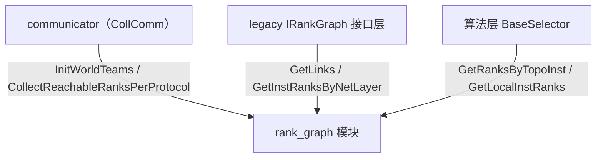
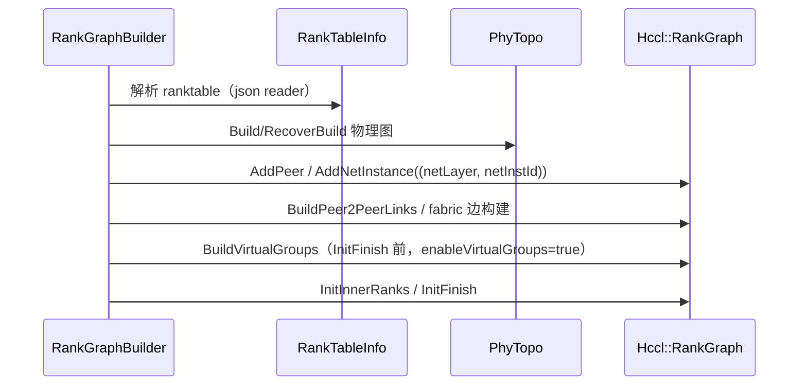
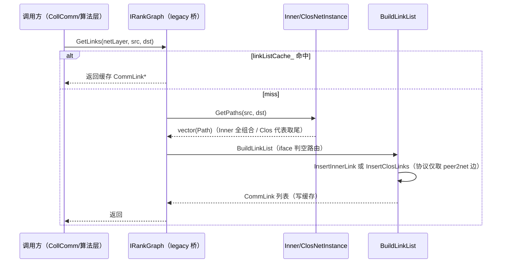
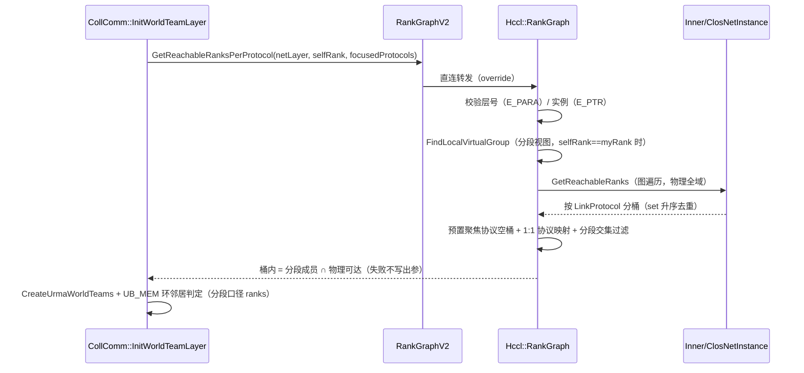

# rank_graph 模块代码解析

## 功能描述

rank_graph 是 HCCM（集合通信域管理）的拓扑查询与图模型模块（L2 层），将 rank table 自述清单与物理拓扑探测（PhyTopo）聚合为运行态图模型，对外提供分层成员查询、链路查询（GetLinks）、端点查询与批量可达性收集。

- **Host 侧职责**：图模型构建（rank_graph_builder 聚合 ranktable 与 PhyTopo）、拓扑查询（成员/链路/端点三类）、WorldTeam 预制的批量可达性收集（本模块对 communicator 的核心供给）。
- **使用场景**：通信域初始化（InitFullMode）时构建图模型；WorldTeam 预制逐层批量收集可达成员；算法层（BaseSelector）经成员/拓扑实例查询选型；对外 API（HcclRankGraphGetLinks 等）供算子开发者查询拓扑。
- **与周边模块的关系**：上游消费 rank_info_detect 的 rank table 与 phy_topo_builder 的物理探测；被 communicator（CollComm::InitWorldTeams）、legacy 接口层（IRankGraph）与算法层（BaseSelector）调用。

核心能力：

1. 聚合建图：ranktable 自述 + PhyTopo 物理图 → RankGraph（(netLayer, netInstId) 二级键）。
2. 链路查询：GetLinks 带 linkListCache_ 缓存，miss 时经 GetPaths + BuildLinkList 物化。
3. 批量可达性收集：单次图遍历替代逐 peer 物化（Inner 全组合并集 / Clos 代表链路取尾），虚拟分段视图激活时限段过滤。
4. 虚拟分组视图：BuildVirtualGroups 对不连续 rank 层切段，成员查询返回分段口径，链路查询保持物理语义。
5. 零拷贝校验：HasLevel 替代按值 GetLevels 深拷贝（错误码与日志保持）。

## 目录描述

```text
rank_graph/
├── CMakeLists.txt              # 构建脚本：v2 源码挂载与 include 前插
├── hccl_rankgraph.h            # 对外 C 结构（GraphDeviceInfo 等，extern "C"）
├── rank_graph.h/.cc            # hccl::RankGraphV1：老拓扑体系（RankTable_t 平铺查询表）
├── rank_graph_base.h           # hccl::RankGraph 接口基类（虚接口 + 默认 NOT_SUPPORT）
├── rank_graph_v2.h/.cc         # hccl::RankGraphV2：薄适配层（组合 Hccl::RankGraph + pImpl）
├── rank_graph.md/_en.md        # 本文档（中英双语）
├── common/                     # 图数据结构与只读访问器
│   ├── conn_interface.h/.cc    # ConnInterface（端口组/地址/位置）
│   ├── graph.h                 # Graph 邻接表模板 + GetOutEdges/FindEdges 只读访问器
│   └── rank_table_report_macro.h # rank table 上报宏
├── json/                       # JSON 解析（ranktable/rootinfo/topo 三族 reader + SIMD 快速解析）
│   ├── json_api.h/.cc          # 解析入口
│   ├── common/                 # 解析工具
│   ├── ranktable/              # rank table 读取（fast parser + 各字段 reader）
│   ├── rootinfo/               # root info 读取
│   └── topo/                   # topo info 读取
├── phy_topo/                   # PhyTopo 单例：按 netLayer 存物理图
├── phy_topo_builder/           # 物理拓扑构建
├── rank_graph/                 # 图模型核心
│   ├── rank_gph.h              # Hccl::RankGraph 类声明（含虚拟分组视图）
│   ├── rank_graph.cc           # Hccl::RankGraph 实现（查询/分段/批量收集）
│   ├── net_instance.h/.cc      # NetInstance 基类 + Inner/Clos 实现 + Peer/Fabric/Link
│   └── link_data_adapter.h     # 链路数据适配
├── rank_graph_builder/         # 聚合构建
│   ├── rank_graph_builder.h/.cc # RankGraphBuilder（Build/RecoverBuild）
│   ├── rank_graph_builder_bridge.h/.cc # 跨库桥（legacy ↔ hcomm 注册）
│   ├── rank_graph_builder_provider.cc  # 桥实现绑定
│   ├── detour_rules.h/.cc      # 绕行规则
│   ├── detour_service.h/.cc    # 绕行服务
│   └── updater_for_64_plus_1.h/.cc # 64+1 扩容更新
├── rank_table_info/            # rank table 数据结构（RankTableInfo/NewRankInfo/RankLevelInfo/AddressInfo/ControlPlane 等）
└── topo_info/                  # 拓扑信息类型（TopoInfo/EdgeInfo/PeerInfo）
```

文件间关系表：

| 文件/组件 | 依赖 | 依赖内容 |
|---|---|---|
| rank_graph_v2.h/.cc | rank_graph_base.h、rank_gph.h | 继承基类；组合 Hccl::RankGraph 与 pImpl（IRankGraph） |
| rank_gph.h/.cc（Hccl::RankGraph） | net_instance.h、common/graph.h | 持有 peers/netInsts/虚拟分组视图；经 NetInstance 收集 |
| net_instance.h/.cc | common/graph.h、common/conn_interface.h | vGraph 邻接表；Link/ConnInterface 承载端口与协议 |
| rank_graph_builder.cc | rank_table_info/、phy_topo/、rank_gph.h | 聚合 ranktable 与 PhyTopo 建 RankGraph |
| rank_table_info/ | json/ranktable/ | 结构体由 JSON reader 反序列化填充 |
| hccl::RankGraphV1 | rank_graph_base.h | 老体系独立实现（不经 Hccl::RankGraph） |

组件交互图：



## 流程描述

图模型构建流程：



链路查询流程（GetLinks，缓存优先）：



批量可达性收集流程（WorldTeam 预制）：



## 数据描述

```mermaid
classDiagram
    class hccl_RankGraph {
        <<interface, rank_graph_base.h>>
        +GetLinks(netLayer, src, dst) HcclResult
        +GetInstRanksByNetLayer(netLayer, rankList, rankNum) HcclResult
        +GetReachableRanksPerProtocol(netLayer, selfRank, protocols, reachableRanks) HcclResult
    }
    class hccl_RankGraphV1 {
        <<rank_graph.h>>
        -rankTable_ RankTable_t
        -rankPairInfo_ map~tuple, vector~CommLink~~
    }
    class hccl_RankGraphV2 {
        <<rank_graph_v2.h>>
        -rankGraph_ Hccl_RankGraph 指针
        +GetReachableRanksPerProtocol() 覆写直连
    }
    class Hccl_RankGraph {
        <<rank_gph.h>>
        -peers_ map~RankId, Peer~
        -netInsts_ vector~map~string, NetInstance~~
        -virtualGroups_ 分段视图
        +BuildVirtualGroups() HcclResult
        +GetReachableRanksPerProtocol(netLayer, RankId, ...) HcclResult
        +HasLevel(RankId, netLayer) bool
    }
    class NetInstance {
        <<net_instance.h, 抽象>>
        #vGraph Graph
        #peers unordered_map~RankId, Peer~
        #fabrics vector~Fabric~
        +GetReachableRanks(src, reachableByProtocol)* void
    }
    class InnerNetInstance {
        +GetReachableRanks() 直达边+fabric 全组合
        +CollectDirectEdgeReachableRanks()
        +CollectFabricReachableRanks()
    }
    class ClosNetInstance {
        +GetReachableRanks() 代表链路取尾
    }
    class Graph~T~ {
        <<common/graph.h>>
        -edges 两级邻接 vector
        +GetOutEdges(nodeId) 只读指针
        +FindEdges(src, dst) 只读指针
    }
    class NetInstance_Link {
        -sourceIface_ / targetIface_ ConnInterface
        -linkProtocols_ set~LinkProtocol~
        +GetLinkProtocols() const 引用
    }
    class RankGraphBuilder {
        <<rank_graph_builder.cc>>
        +Build(ranktable, topoPath, myRank)
        +RecoverBuild(..., enableVirtualGroups)
    }
    hccl_RankGraph <|-- hccl_RankGraphV1
    hccl_RankGraph <|-- hccl_RankGraphV2
    hccl_RankGraphV2 *-- Hccl_RankGraph : rankGraph_ 组合
    Hccl_RankGraph o-- NetInstance : netInsts_ 按层持有
    NetInstance <|-- InnerNetInstance
    NetInstance <|-- ClosNetInstance
    NetInstance *-- Graph~T~ : vGraph
    NetInstance *-- NetInstance_Link : 边
    RankGraphBuilder ..> Hccl_RankGraph : 构建
```



## 接口描述

对外接口总表：

| 接口 | 所属类 | 一句话说明 |
|---|---|---|
| GetLinks | hccl::RankGraph | 逐对链路查询（缓存优先，供 CollComm/算法层） |
| GetInstRanksByNetLayer | hccl::RankGraph | 层成员查询（分段口径，供 WorldTeam 环邻居判定） |
| GetReachableRanksPerProtocol | hccl::RankGraph | 批量可达性收集（WorldTeam 预制核心） |
| GetNetLayers / GetLocalInstRanks / GetLocalInstSize | hccl::RankGraph | 层枚举与成员查询（算法层） |
| GetRanksByTopoInst / GetTopoInstsByLayer | hccl::RankGraph | 拓扑实例成员查询（算法层，分段交集） |
| HasLevel | Hccl::RankGraph | 成员关系零拷贝校验 |
| Build / RecoverBuild | RankGraphBuilder | 图模型构建（经 bridge 供 legacy 调用） |

按类完整表（Hccl::RankGraph 批量收集核心）：

| 接口 | 类型 | 说明 |
|---|---|---|
| GetReachableRanksPerProtocol(netLayer, selfRank, focusedProtocols, reachableRanks) | 公有 | 校验层（E_PARA）与实例（E_PTR）→ 图遍历 → 预置聚焦协议空桶 → 协议映射过滤 → 分段交集过滤（视图存在且 selfRank==myRank 时）；失败不写出参。 |
| GetReachableRanks(srcRankId, reachableByProtocol) | 公有（NetInstance 纯虚） | 单次图遍历收集可达 rank 按 LinkProtocol 分桶；Inner 直达边 + fabric 全组合并集；Clos 代表链路（桶内末条）端口配对。 |
| HasLevel(rankId, netLayer) | 公有 | netLayers_ 集合查询，替代按值 GetLevels 深拷贝。 |
| BuildVirtualGroups() | 公有 | InitFinish 前调用；层内 rank 数值不连续时切段建 virtualGroups_ 视图（跳过最低层）。 |
| FindLocalVirtualGroup(netLayer, ranks) | 公有 | 取 myRank 所在分段；无视图返回 nullptr（物理口径）。 |

hccl::RankGraph::GetReachableRanksPerProtocol（默认实现，rank_graph_base.h）：返回 HCCL_E_NOT_SUPPORT——WorldTeam 预制链路（InitFullMode）恒为 RankGraphV2 必实现，默认仅作非 V2 链路 fail-fast 防御。

## 使用限制

支持的场景：

| 场景 | 说明 |
|---|---|
| 通信域初始化 | InitFullMode 构建 RankGraphV2 并预制 WorldTeam。 |
| 故障快照恢复 | RecoverBuild 按快照策略重建分段视图。 |
| 拓扑查询 | 算法层与对外 API 的成员/链路/端点查询。 |

规格约束：

1. WorldTeam 预制链路恒为 RankGraphV2（InitFullMode 硬编码），批量接口非 SUCCESS 由调用方按硬失败处理（无降级路径）。
2. 虚拟分组视图仅对 myRank 有效（FindLocalVirtualGroup 绑定 myRank_）；GetReachableRanksPerProtocol 以 selfRank==myRank 为过滤前提，非本人查询保持物理口径。
3. PEER2NET 边契约：sLink（peer→Fabric）的 targetIface 为空（net_instance.h Link 注释）、dLink（Fabric→peer）的 sourceIface 为空（构造见 rank_graph_builder.cc 构建处 peer2netLink/net2peerLink 第四参）；批量配对语义依赖该契约，契约外畸形构图不背书。
4. graph.h 本批已迁 namespace hccl，legacy 侧改名为 graph_legacy950.h（guard GROUP_LEGACY950_H），全仓唯一 graph.h 为本模块版本，不再存在同名同 guard 镜像。
5. Link::GetLinkProtocols 返回 const 引用：符号仅本仓包内消费（host+aicpu 全量重编同包发布）；mangled name 不变，调用约定由 sret 变为寄存器返回。
6. net_instance.cc / rank_graph.cc 存量均超 500 行：新增代码为所在类方法实现，与老路径同文件对照检视，拆分计划另立独立重构任务。
