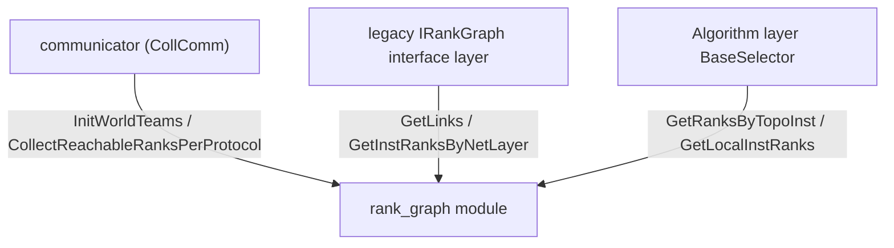
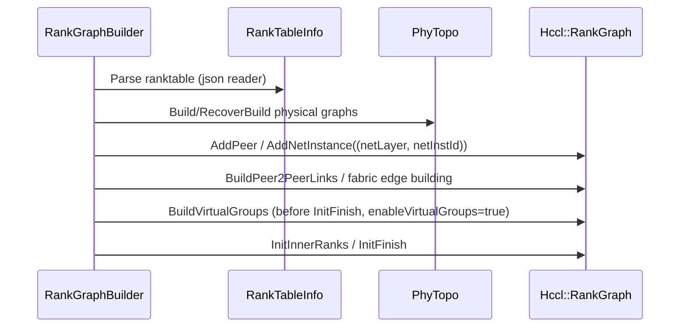
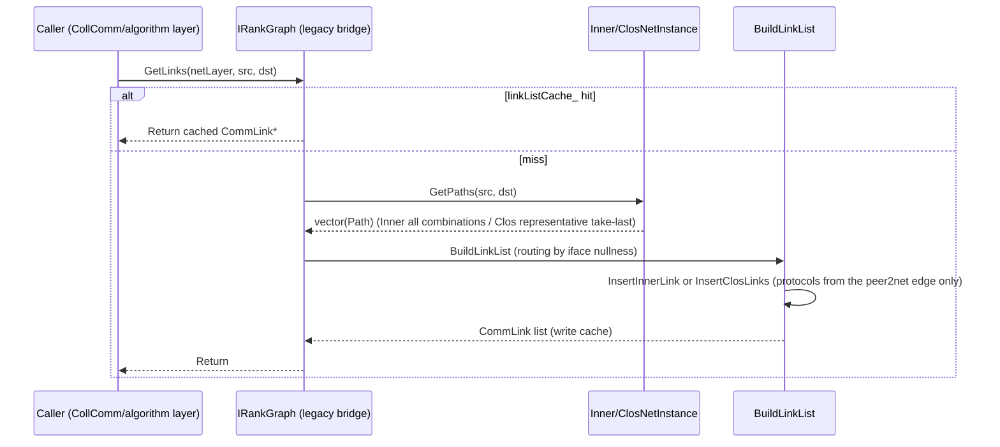
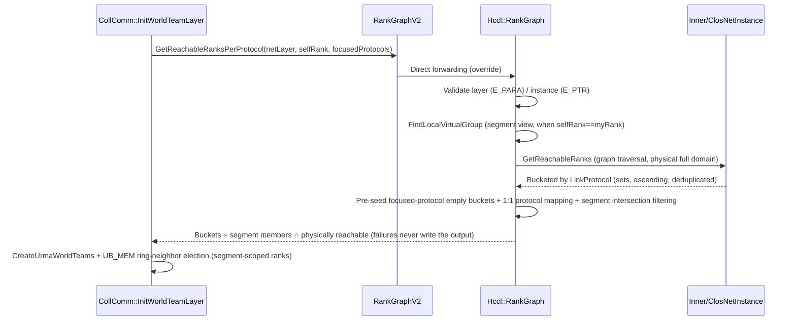
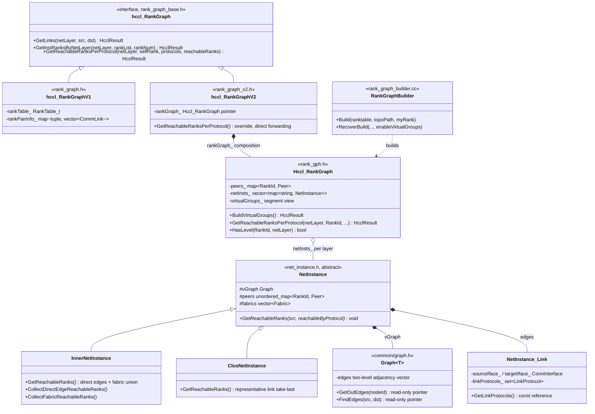

# rank_graph Module Code Analysis

## Feature Description

rank_graph is the topology query and graph model module of HCCM (Collective Communication Domain Management, L2 layer). It aggregates the rank table self-descriptive manifest and the physical topology detection (PhyTopo) into a runtime graph model, and provides layered membership queries, link queries (GetLinks), endpoint queries, and batch reachability collection.

- **Host-side responsibilities**: graph model building (rank_graph_builder aggregates the ranktable with PhyTopo), topology queries (membership/link/endpoint), and batch reachability collection for WorldTeam prebuilding (the module's core supply to communicator).
- **Usage scenarios**: graph model building during communication domain initialization (InitFullMode); per-layer batch reachability collection for WorldTeam prebuilding; algorithm-layer (BaseSelector) topology selection via membership/topo-instance queries; external APIs (HcclRankGraphGetLinks, etc.) for operator developers.
- **Relationship with neighboring modules**: consumes rank tables from rank_info_detect and physical detection from phy_topo_builder upstream; called by communicator (CollComm::InitWorldTeams), the legacy interface layer (IRankGraph), and the algorithm layer (BaseSelector).

Core capabilities:

1. Aggregated graph building: ranktable self-description + PhyTopo physical graphs → RankGraph ((netLayer, netInstId) two-level key).
2. Link queries: GetLinks with linkListCache_ caching; on miss, materialization via GetPaths + BuildLinkList.
3. Batch reachability collection: a single graph traversal replaces per-peer materialization (Inner union of all combinations / Clos representative-link take-last), with segment filtering when the virtual grouping view is active.
4. Virtual grouping view: BuildVirtualGroups cuts layers with non-contiguous ranks into segments; membership queries return the segment view while link queries keep physical semantics.
5. Zero-copy validation: HasLevel replaces by-value GetLevels deep copies (error codes and logs unchanged).

## Directory Description

```text
rank_graph/
├── CMakeLists.txt              # Build script: v2 source registration and include prepend
├── hccl_rankgraph.h            # External C structures (GraphDeviceInfo, etc., extern "C")
├── rank_graph.h/.cc            # hccl::RankGraphV1: legacy topology system (RankTable_t flat query tables)
├── rank_graph_base.h           # hccl::RankGraph interface base (virtual interfaces + default NOT_SUPPORT)
├── rank_graph_v2.h/.cc         # hccl::RankGraphV2: thin adapter (composes Hccl::RankGraph + pImpl)
├── rank_graph.md/_en.md        # This document (Chinese/English pair)
├── common/                     # Graph data structure and read-only accessors
│   ├── conn_interface.h/.cc    # ConnInterface (port groups/addresses/positions)
│   ├── graph.h                 # Graph adjacency-list template + GetOutEdges/FindEdges read-only accessors
│   └── rank_table_report_macro.h # Rank table reporting macros
├── json/                       # JSON parsing (ranktable/rootinfo/topo reader families + SIMD fast parser)
│   ├── json_api.h/.cc          # Parsing entry
│   ├── common/                 # Parsing utilities
│   ├── ranktable/              # Rank table reading (fast parser + per-field readers)
│   ├── rootinfo/               # Root info reading
│   └── topo/                   # Topo info reading
├── phy_topo/                   # PhyTopo singleton: per-netLayer physical graphs
├── phy_topo_builder/           # Physical topology building
├── rank_graph/                 # Graph model core
│   ├── rank_gph.h              # Hccl::RankGraph class declaration (with virtual grouping view)
│   ├── rank_graph.cc           # Hccl::RankGraph implementation (queries/segments/batch collection)
│   ├── net_instance.h/.cc      # NetInstance base + Inner/Clos implementations + Peer/Fabric/Link
│   └── link_data_adapter.h     # Link data adaptation
├── rank_graph_builder/         # Aggregated building
│   ├── rank_graph_builder.h/.cc # RankGraphBuilder (Build/RecoverBuild)
│   ├── rank_graph_builder_bridge.h/.cc # Cross-library bridge (legacy ↔ hcomm registration)
│   ├── rank_graph_builder_provider.cc  # Bridge implementation binding
│   ├── detour_rules.h/.cc      # Detour rules
│   ├── detour_service.h/.cc    # Detour service
│   └── updater_for_64_plus_1.h/.cc # 64+1 expansion updater
├── rank_table_info/            # Rank table data structures (RankTableInfo/NewRankInfo/RankLevelInfo/AddressInfo/ControlPlane, etc.)
└── topo_info/                  # Topology information types (TopoInfo/EdgeInfo/PeerInfo)
```

File relationship table:

| File/Component | Depends On | Dependency Content |
|---|---|---|
| rank_graph_v2.h/.cc | rank_graph_base.h, rank_gph.h | Inherits the base; composes Hccl::RankGraph and pImpl (IRankGraph) |
| rank_gph.h/.cc (Hccl::RankGraph) | net_instance.h, common/graph.h | Holds peers/netInsts/virtual grouping view; collects via NetInstance |
| net_instance.h/.cc | common/graph.h, common/conn_interface.h | vGraph adjacency list; Link/ConnInterface carry ports and protocols |
| rank_graph_builder.cc | rank_table_info/, phy_topo/, rank_gph.h | Aggregates the ranktable and PhyTopo to build RankGraph |
| rank_table_info/ | json/ranktable/ | Structures populated by JSON readers |
| hccl::RankGraphV1 | rank_graph_base.h | Standalone legacy implementation (not via Hccl::RankGraph) |

Component interaction diagram:



## Process Description

Graph model building process:



Link query process (GetLinks, cache first):



Batch reachability collection process (WorldTeam prebuild):



## Data Description



## Interface Description

External interface index:

| Interface | Owner Class | One-line Description |
|---|---|---|
| GetLinks | hccl::RankGraph | Per-pair link query (cache first, for CollComm/algorithm layer) |
| GetInstRanksByNetLayer | hccl::RankGraph | Layer membership query (segment view, for WorldTeam ring-neighbor election) |
| GetReachableRanksPerProtocol | hccl::RankGraph | Batch reachability collection (WorldTeam prebuild core) |
| GetNetLayers / GetLocalInstRanks / GetLocalInstSize | hccl::RankGraph | Layer enumeration and membership queries (algorithm layer) |
| GetRanksByTopoInst / GetTopoInstsByLayer | hccl::RankGraph | Topo-instance membership queries (algorithm layer, segment intersection) |
| HasLevel | Hccl::RankGraph | Zero-copy membership check |
| Build / RecoverBuild | RankGraphBuilder | Graph model building (via bridge for legacy callers) |

Per-class table (Hccl::RankGraph batch-collection core):

| Interface | Type | Description |
|---|---|---|
| GetReachableRanksPerProtocol(netLayer, selfRank, focusedProtocols, reachableRanks) | public | Validates the layer (E_PARA) and instance (E_PTR) → graph traversal → pre-seeds focused-protocol empty buckets → protocol mapping filter → segment intersection filter (when a view exists and selfRank==myRank); failures never write the output. |
| GetReachableRanks(srcRankId, reachableByProtocol) | public (NetInstance pure virtual) | Collects reachable ranks in a single graph traversal, bucketed by LinkProtocol; Inner: direct edges + union of all fabric combinations; Clos: representative links (last in bucket) with port pairing. |
| HasLevel(rankId, netLayer) | public | netLayers_ set lookup, replacing by-value GetLevels deep copies. |
| BuildVirtualGroups() | public | Called before InitFinish; cuts layers with non-contiguous ranks into segments to build the virtualGroups_ view (lowest layer skipped). |
| FindLocalVirtualGroup(netLayer, ranks) | public | Returns the segment containing myRank; returns nullptr when no view exists (physical semantics). |

hccl::RankGraph::GetReachableRanksPerProtocol (default implementation, rank_graph_base.h): returns HCCL_E_NOT_SUPPORT — the WorldTeam prebuild path (InitFullMode) is always RankGraphV2 which must implement it; the default serves only as fail-fast defense for non-V2 paths.

## Usage Constraints

Supported scenarios:

| Scenario | Description |
|---|---|
| Communication domain initialization | InitFullMode builds RankGraphV2 and prebuilds WorldTeams. |
| Fault snapshot recovery | RecoverBuild rebuilds the segment view per the snapshot policy. |
| Topology queries | Membership/link/endpoint queries for the algorithm layer and external APIs. |

Specification constraints:

1. The WorldTeam prebuild path is always RankGraphV2 (hard-coded in InitFullMode); non-SUCCESS results from the batch interface are treated as hard failures by the caller (no fallback path).
2. The virtual grouping view is valid only for myRank (FindLocalVirtualGroup binds to myRank_); GetReachableRanksPerProtocol filters only when selfRank == myRank — queries for other ranks keep physical semantics.
3. PEER2NET edge contract: the sLink (peer→Fabric) targetIface is null (net_instance.h Link comment), and the dLink (Fabric→peer) sourceIface is null (see the peer2netLink/net2peerLink construction with a null fourth parameter in rank_graph_builder.cc); batch pairing semantics rely on this contract, and malformed graphs outside the contract are not endorsed.
4. graph.h was migrated to namespace hccl in this batch; the legacy side was renamed to graph_legacy950.h (guard GROUP_LEGACY950_H), so the sole graph.h in the repository is this module's version — the former same-name same-guard mirror no longer exists.
5. Link::GetLinkProtocols returns a const reference: the symbol is consumed only within this repository's package (host + aicpu fully rebuilt and released in the same package); the mangled name is unchanged, and the calling convention changes from sret to register return.
6. net_instance.cc / rank_graph.cc both exceed the 500-line guideline from before this PR: new code consists of methods of the resident classes for same-file side-by-side review against the legacy path; the split plan is tracked as a separate refactoring task.
