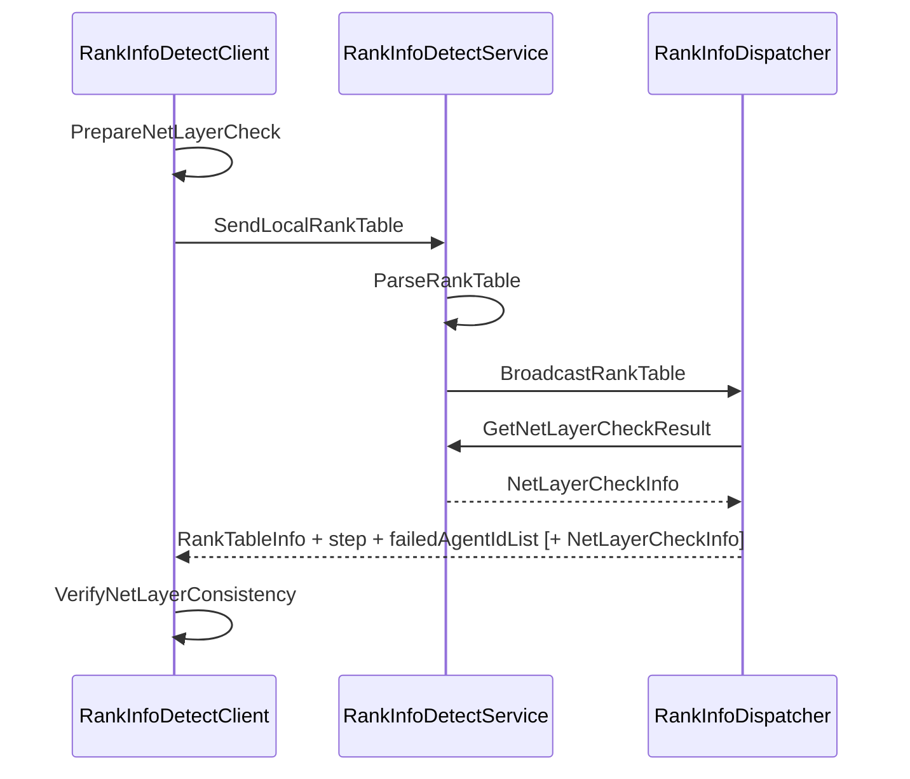

# RootInfo建域选层校验协议

本文说明`rank_info_detect`在普通RootInfo建域时使用的选层尾帧、与旧端的兼容行为，以及校验失败时的广播流程。

## 功能描述

普通RootInfo建域时，每个rank根据本地拓扑解析选层配置。只要有一个rank显式选层，root就要在建域过程中确认所有成员支持校验，且最终允许的层集合一致。各rank比较的是有效层掩码，例如`0,2`和`2,0`都得到`0x05`。

## 目录描述

| 文件 | 在选层协议中的职责 |
| --- | --- |
| `root_handle_v2.h` | 定义`NetLayerCheckInfo`、尾帧编解码和掩码一致性检查。 |
| `rank_info_detect_client.cc` | 计算并发送本地报告，接收并校验root的应答。 |
| `rank_info_detect_service.cc` | 按rank ID保存报告，汇总各rank的校验结果。 |
| `rank_info_dispatcher.cc` | 将汇总结果按需附在全局rank表之后，向已连接成员广播。 |

## 流程描述

1. 客户端从本rank的拓扑计算候选层，解析出有效层掩码。V1客户端在本地rank表和`step`后追加报告，报告中包含本地解析结果。
2. 服务端按rank ID记录报告。即使某个选层尾帧解析失败，也先记录错误并继续收集，以便其他成员收到同一失败结果。
3. 若所有报告均成功且使用默认配置，root允许各rank的候选层不同，广播时省略尾帧。若有显式选层或发生校验错误，则在全局rank表、`step`和`failedAgentIdList`后追加汇总尾帧。
4. 客户端读取应答。若汇总结果为失败，则返回广播的错误码；若汇总结果为显式选层成功，则检查本地掩码是否与汇总掩码一致。

## 数据描述

V1尾帧由五个连续的`u32`组成，共20字节，字段按下表顺序写入。

| 字段 | 含义 |
| --- | --- |
| `MAGIC` | 固定标记`0x4e4c5331`。 |
| `version` | V1在线上取值为1。解码空尾部时，内存中的版本为0。 |
| `explicitSelection` | 成员使用默认配置时为0，显式选层时为1。成功汇总时，只要有成员显式选层，该值就是1。 |
| `layers` | 低8位对应真实层号0至7。显式选层校验成功时，汇总值为各rank共同的有效掩码。 |
| `result` | 上行报告携带本地结果，应答携带全域结果。合法值为`HCCL_SUCCESS`、`HCCL_E_PARA`、`HCCL_E_NOT_SUPPORT`。 |

## 接口描述

| 接口 | 输入与结果 |
| --- | --- |
| `RankInfoDetectClient::PrepareNetLayerCheck` | 从本rank的`rankLevelInfos`构造候选掩码，将选层解析结果存入本地报告。 |
| `NetLayerCheckInfo::Serialize` / `Deserialize` | 将尾帧写入或从`BinaryStream`读出。解码时先识别标记与版本，再校验V1的长度和字段。 |
| `RankInfoDetectService::GetNetLayerCheckResult` | 汇总已收集的报告。显式选层要求报告数等于成员数，每个成员均支持V1，且有效掩码相同、非零。 |
| `RankInfoDetectClient::VerifyNetLayerConsistency` | 检查root的结果；显式选层未获确认或汇总掩码与本地不符时，建域返回错误。 |

## 使用限制

| 场景 | 处理结果 |
| --- | --- |
| 收到无尾帧应答，例如对端是旧root | 客户端使用默认配置时返回本地校验结果；显式选层时返回`HCCL_E_NOT_SUPPORT`。 |
| 有成员显式选层，另一个成员上报的消息没有尾帧 | root无法确认旧端的有效层，向成员广播`HCCL_E_NOT_SUPPORT`。 |
| 各成员均支持V1，但有效掩码不同，例如`0x05`与`0x04` | root广播`HCCL_E_PARA`。 |
| 收到非空尾帧 | 未知版本返回`HCCL_E_NOT_SUPPORT`。截断的帧头、错误标记、V1长度或字段非法均返回`HCCL_E_PARA`。 |
