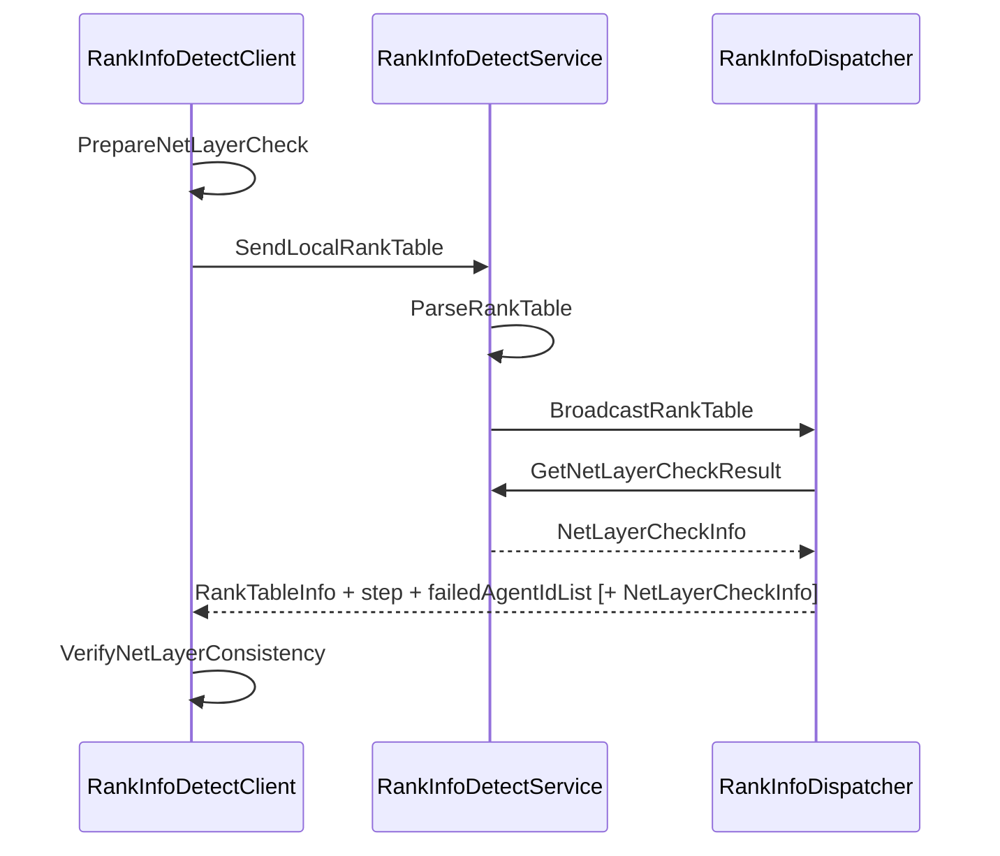

# RootInfo Layer Selection Verification Protocol

This document describes the layer selection trailer used by `rank_info_detect` during ordinary RootInfo communicator initialization, compatibility with older peers, and how the root broadcasts verification failures.

## Feature Description

During ordinary RootInfo communicator initialization, each rank resolves its layer selection against its local topology. If any rank selects layers explicitly, the root checks that every member supports verification and that all members allow the same set of layers. The comparison uses the effective bitmask. For example, both `0,2` and `2,0` resolve to `0x05`.

## Directory Description

| File | Role in the layer selection protocol |
| --- | --- |
| `root_handle_v2.h` | Defines `NetLayerCheckInfo`, trailer serialization and parsing, and the mask consistency check. |
| `rank_info_detect_client.cc` | Prepares and sends the local report, then receives and verifies the root's reply. |
| `rank_info_detect_service.cc` | Stores reports by rank ID and computes the result for the communicator. |
| `rank_info_dispatcher.cc` | Appends the result to the global rank table when required and broadcasts the reply to connected members. |

## Flow Description

1. The client determines the candidate layers from its rank's topology and resolves the effective mask. A V1 client appends its report, including the local result, after the local rank table and `step`.
2. The service records each report by rank ID. If a selection trailer fails to parse, the service records the error and continues collecting reports so that the other members can receive the same failure.
3. When all reports succeed and use defaults, candidate layers may differ across ranks and the root omits the reply trailer. For explicit selection or a verification error, it appends the summary trailer after the global rank table, `step` and `failedAgentIdList`.
4. The client returns the broadcast error code if verification failed. If the root confirms an explicit selection, the client checks its local mask against the summary mask.

## Data Description

The V1 trailer contains five consecutive `u32` values, totaling 20 bytes, in the order shown below.

| Field | Meaning |
| --- | --- |
| `MAGIC` | Fixed marker `0x4e4c5331`. |
| `version` | V1 has wire value 1. Decoding an empty trailer sets the in-memory version to 0. |
| `explicitSelection` | A member reports 0 for defaults and 1 for explicit selection. In a successful summary, this is 1 if any member selected layers explicitly. |
| `layers` | The low eight bits represent layer IDs 0 through 7. After successful explicit selection, the summary contains the effective mask shared by all ranks. |
| `result` | The report carries the local result and the reply carries the communicator-wide result. Valid values are `HCCL_SUCCESS`, `HCCL_E_PARA` and `HCCL_E_NOT_SUPPORT`. |

## Interface Description

| Interface | Input and result |
| --- | --- |
| `RankInfoDetectClient::PrepareNetLayerCheck` | Builds the candidate mask from the local rank's `rankLevelInfos` and stores the selection result in the local report. |
| `NetLayerCheckInfo::Serialize` / `Deserialize` | Writes the trailer to or reads it from a `BinaryStream`. Parsing checks the marker and version before validating the V1 length and fields. |
| `RankInfoDetectService::GetNetLayerCheckResult` | Summarizes the collected reports. Explicit selection requires one report per member, V1 support on every member and matching nonzero effective masks. |
| `RankInfoDetectClient::VerifyNetLayerConsistency` | Checks the root's result. Initialization returns an error if an explicit selection is unconfirmed or the summary mask differs from the local mask. |

## Usage Limitations

| Scenario | Outcome |
| --- | --- |
| The reply has no trailer, as with an older root | A client using defaults returns its local verification result. A client using explicit selection returns `HCCL_E_NOT_SUPPORT`. |
| One member selects layers explicitly and another sends a report without a trailer | The root cannot verify the older member's effective layers and broadcasts `HCCL_E_NOT_SUPPORT`. |
| All members support V1 but their effective masks differ, for example `0x05` and `0x04` | The root broadcasts `HCCL_E_PARA`. |
| A nonempty trailer arrives | An unknown version returns `HCCL_E_NOT_SUPPORT`. A truncated header, an incorrect marker, or invalid V1 length or fields return `HCCL_E_PARA`. |
