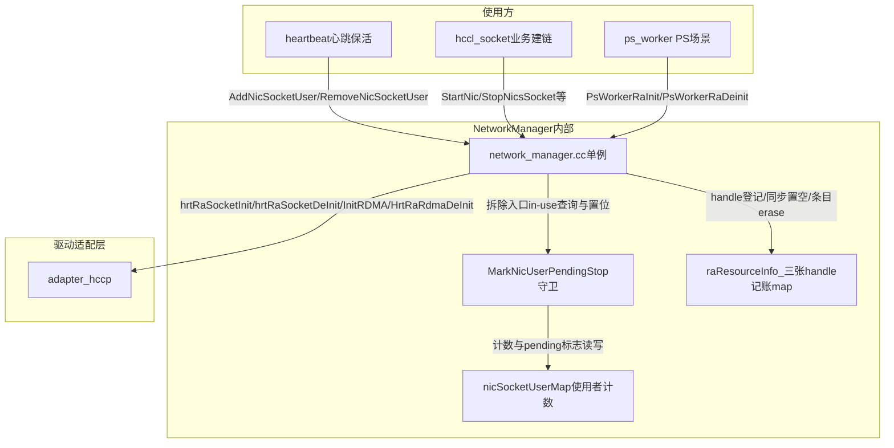
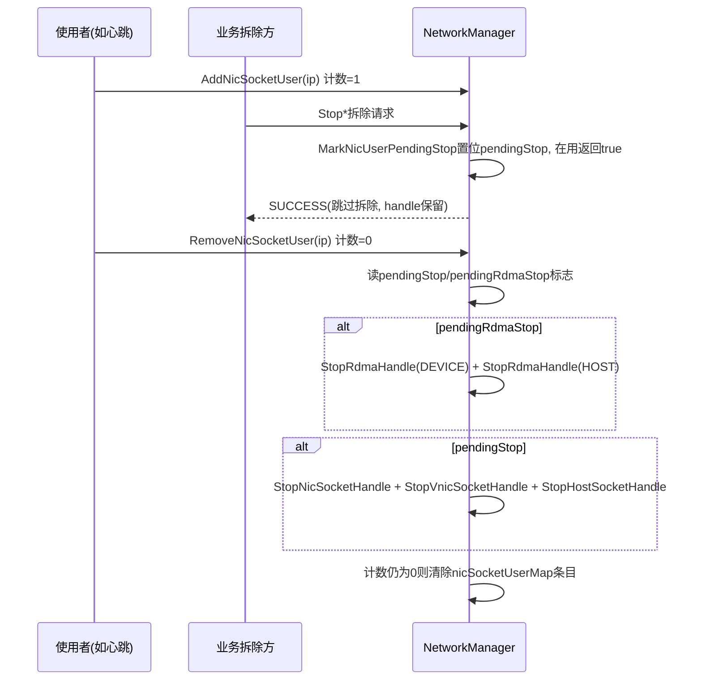
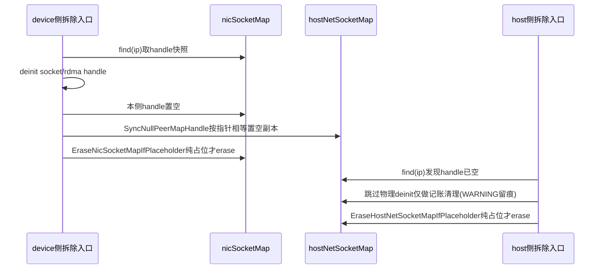
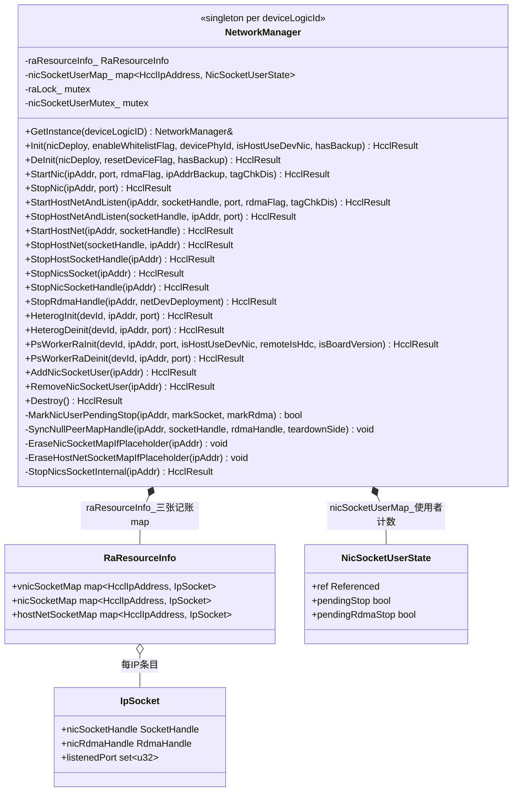

# NetworkManager 模块代码解析

## 功能描述

NetworkManager模块负责NIC/VNIC/HOST三类socket与RDMA（Remote Direct Memory Access）资源的生命周期管理，是RA资源在host侧的唯一记账与拆解入口。模块以`deviceLogicId`为键提供单例实例，向上承接心跳保活、业务建链、PS（Parameter Server）场景等使用方的ra资源初始化与销毁请求，向下封装`hrtRaSocketInit`、`InitRDMA`等驱动接口。

核心能力：

- **资源初始化**：按部署形态（DEVICE/HOST/VNIC）创建socket与rdma handle，并维护`nicSocketMap`、`vnicSocketMap`、`hostNetSocketMap`三张IP到handle的记账map
- **使用者计数**：提供`AddNicSocketUser`/`RemoveNicSocketUser`配对接口，登记每个IP的在用使用者，持有期间该IP的handle不会被拆除
- **in-use守卫**：各拆除函数入口先查询使用者计数，仍被持有时跳过拆除并置位pending标志
- **延迟拆除**：被守卫拦下的拆除请求由最后一个使用者注销时统一补拆，保证在用handle不被强拆
- **双map一致性**：同一handle可能被双写进两张map（值拷贝插入），任一侧deinit后同步置空另一侧副本，防止对失效handle二次deinit

## 目录描述

```text
network_manager/
├── CMakeLists.txt               # 构建脚本
├── network_manager.h            # 兼容占位头文件（实际声明在platform/inc/network_manager_pub.h）
├── network_manager.cc           # NetworkManager类实现（初始化/拆除/守卫/延迟拆除）
├── network_manager.md           # 本文档（中文）
└── network_manager_en.md        # 本文档（英文）
```

### 文件间关系

| 文件 | 功能 | 依赖关系 |
|------|------|----------|
| `network_manager.h` | 仅包含公共头与空命名空间占位，保证既有include路径兼容 | 无逻辑 |
| `network_manager.cc` | 全部实现：ra资源初始化、按IP记账、使用者计数、in-use守卫、延迟拆除 | 依赖`network_manager_pub.h`（类声明）、`adapter_hccp.h`（驱动接口）、`hccl_plf.map`（跨库导出白名单） |

### NetworkManager文件交互



## 流程描述

### 使用者登记与注销

- `AddNicSocketUser(ipAddr)`：计数加一。持有期间该IP的socket与rdma handle不会被任何拆除路径强制释放。须与`RemoveNicSocketUser`严格配对，且在同一个`deviceLogicId`实例下调用。
- `RemoveNicSocketUser(ipAddr)`：计数减一。非最后一个使用者直接返回；最后一个使用者注销时按pending标志补拆，完成后清除计数条目。
- 计数下溢防护：`Unref`返回负值说明调用方未严格配对，此时`Clear`复位计数使条目可在本轮正常清除（负计数会使erase条件`Count()==0`永不满足，条目永久残留且守卫失效）。

### in-use守卫

拆除类函数（`StopNicSocketHandle`、`StopHostSocketHandle`、`StopRdmaHandle`、`StopNicsSocket`、`StopNic`、`StopHostNet`、`StopHostNetAndListen`、`HeterogDeinit`、`PsWorkerRaDeinit`及批量销毁路径）入口统一走`MarkNicUserPendingStop(ipAddr, markSocket, markRdma)`：

- 查询与置位在同一把`nicSocketUserMutex_`内完成，避免间隙内最后一个使用者释放导致置位落空、延迟拆除丢失
- 在用（`ref.Count() > 0`）时按调用方语义置位`pendingStop`/`pendingRdmaStop`并返回true，调用方跳过拆除直接返回SUCCESS，条目保留在map中供延迟拆除路径查询
- 不在用时返回false，调用方继续执行真实拆除

### 延迟拆除时序



要点：

- 计数条目保留至延迟拆除完成后再移除。若先erase再拆除，拆除期间新用户Add后守卫将查不到条目而强拆在用handle
- 延迟拆除阶段rdma按`nicSocketMap`与`hostNetSocketMap`双侧各拆一次（两侧可能各持真实handle），socket按`nicSocketMap`、`vnicSocketMap`、`hostNetSocketMap`三侧各拆一次；单侧失败只记录不中断，返回值保留首个非SUCCESS
- 延迟拆除入口`RemoveNicSocketUser`对map的访问采用逐site锁内存活判断+紧跟Stop*调用的方式（`IsSocketMapHandleAlive`）：判断在`raLock_`内find，对本函数调用的双map拆除站点消除无锁解引用悬垂读（其erase均持`raLock_`；其余无锁写站点如`HeterogInit`的insert/失败回滚erase仍属遗留竞争，见使用限制），且前序Stop*的跨map同步置空对后续判断可见——一次性前置快照会因过期多调一次拆除，而`StopHostSocketHandle`的入口init校验先于幂等分支会直接报错
- 拆除完成后若期间有新用户接入（计数非0）则保留条目，由其释放时再处理

### 双map同步置空时序



要点：

- 同步置空逐指针比较，相等才置空：双部署下两侧可能各持独立handle，不相等的副本不受影响
- host侧拆除入口识别到map条目存在但handle已被置空（同handle已被其他拆除路径释放）时，跳过物理listen stop与deinit及`CheckSocketInfo`校验，仅做记账清理（引用计数递减、条目移除）并打WARNING留痕

## 数据描述

### 核心类



`IpSocket`与`RaResourceInfo`定义在`pub_inc/hccl_common.h`，为跨模块公共数据结构；`NicSocketUserState`为模块内私有记账结构。

### 同handle双写场景

以下路径会把同一handle同时记录进两张map：

- `InitRdmaHandle`：同一rdma handle写入`nicSocketMap`与`hostNetSocketMap`
- `StartHostNetAndListen`：整条`IpSocket`值拷贝insert进`nicSocketMap`（另含`hostNetSocketMap`的正式条目）
- `PsWorkerRaInit`：同一socket handle双写进`nicSocketMap`与`hostNetSocketMap`
- `HeterogInit`：同一socket handle值拷贝双写进`nicSocketMap`与`hostNetSocketMap`，`HeterogStartListen`同步写入两侧listenedPort

双写是值拷贝语义：两张map内的handle是同一指针的两个副本，任一侧deinit后另一侧副本即成悬空指针，须按"双map同步置空时序"处理。

## 接口描述

**对外接口总表**

| 接口 | 说明 |
|------|------|
| `GetInstance` | 按`deviceLogicId`获取单例实例 |
| `Init`/`DeInit` | 网卡ra资源初始化/反初始化（含白名单感知） |
| `InitV2`/`DeInitV2` | 重构版初始化/反初始化入口 |
| `StartNic`/`StopNic` | device侧nic socket初始化/拆除（port为`0xFFFFFFFF`时只初始化不监听） |
| `StartVnic`/`StopVnic` | vnic socket初始化/拆除 |
| `StartHostNet`/`StopHostNet` | host侧socket初始化/拆除 |
| `StartHostNetAndListen`/`StopHostNetAndListen` | host侧socket初始化并监听/拆除 |
| `CreateNicSocketHandle`/`StopNicSocketHandle` | device侧socket handle创建/拆除 |
| `CreateRdmaHandle`/`StopRdmaHandle` | rdma handle创建/拆除（按部署形态DEVICE/HOST） |
| `InitRdmaHandle` | rdma初始化（同handle双写双map记账） |
| `CreateHostSocketHandle`/`StopHostSocketHandle` | host侧socket handle创建/拆除 |
| `CreateVnicSocketHandle`/`StopVnicSocketHandle` | vnic socket handle创建/拆除 |
| `HeterogInit`/`HeterogDeinit` | 异构场景host侧socket初始化/拆除 |
| `HeterogStartListen`/`HeterogStopListen` | 异构场景监听启停 |
| `PsWorkerRaInit`/`PsWorkerRaDeinit` | PS场景ra资源初始化/拆除 |
| `AddNicSocketUser`/`RemoveNicSocketUser` | 使用者计数登记/注销（in-use守卫与延迟拆除触发） |
| `Destroy` | 进程退出兜底：批量销毁三张记账map |
| `GetRaResourceInfo` | 导出ra资源记账快照 |
| `GetRdmaHandleByIpAddr`/`GetNicHandleByIpAddr` | 按IP查询rdma/socket handle |
| `HcclIpAddressConvertHcclAddr` | `HcclIpAddress`到`HcclAddress`地址转换 |
| `GetNotifyType`/`GetNetworkMode` | rdma通知类型/网络模式查询 |
| `GetRdmaLiteStatus` | rdmalite开关状态查询 |
| `OccupyIp`/`GetNicIp` | IP占用登记/nic IP列表查询 |
| `PingMeshRaPingInit`/`PingMeshRaPingDeinit` | pingmesh场景ra初始化/反初始化 |

### NetworkManager

以下为拆除/守卫链路的核心接口详表（主流程必经）；初始化类接口的参数语义与总表一致，辅助查询类接口从略。

| 接口 | 类型 | 参数 | 返回值 | 说明 |
|------|------|------|--------|------|
| `StartNic` | 公有（对外） | `ipAddr`：本端IP；`port`：入参传端口或`0xFFFFFFFF`，出参返回实际监听端口；`rdmaFlag`：是否同时初始化rdma；`ipAddrBackup`：备网卡IP；`tagChkDis`：是否关闭标签校验 | `HcclResult` | 初始化device侧socket（含可选rdma），必要时启动监听并登记`nicSocketMap` |
| `StopNic` | 公有（对外） | `ipAddr`：本端IP；`port`：监听端口 | `HcclResult` | 拆除device侧nic：先停监听（引用计数守卫），监听清零后走`StopNicsSocketInternal`拆除socket与rdma，纯占位条目移除 |
| `StopNicsSocket` | 公有（对外） | `ipAddr`：本端IP | `HcclResult` | 按IP拆除device侧socket与rdma handle，成功后同步置空对侧副本并移除本侧纯占位条目 |
| `StopNicSocketHandle` | 公有（对外） | `ipAddr`：本端IP | `HcclResult` | 仅拆除device侧socket handle（不动rdma），双map同步置空+纯占位清理 |
| `StopRdmaHandle` | 公有（对外） | `ipAddr`：本端IP；`netDevDeployment`：部署形态DEVICE/HOST | `HcclResult` | 按部署形态拆除对应map的rdma handle，同步置空对侧副本；host条目仍持有socket handle时保留 |
| `StopHostNet` | 公有（对外） | `socketHandle`：建链返回的handle；`ipAddr`：本端IP | `HcclResult` | 拆除host侧socket（传入比对型：入参handle与map条目配对校验） |
| `StopHostNetAndListen` | 公有（对外） | `socketHandle`：建链返回的handle；`ipAddr`：本端IP；`port`：监听端口 | `HcclResult` | 拆除host侧socket并停监听（引用计数守卫） |
| `StopHostSocketHandle` | 公有（对外） | `ipAddr`：本端IP | `HcclResult` | 按IP拆除host侧全部监听与socket（取值型：从map取handle） |
| `AddNicSocketUser` | 公有（对外） | `ipAddr`：本端IP | `HcclResult` | 使用者计数加一，持有期间该IP handle不被强拆 |
| `RemoveNicSocketUser` | 公有（对外） | `ipAddr`：本端IP | `HcclResult` | 使用者计数减一；最后一个使用者注销时按pending标志触发延迟拆除（逐site锁内存活判断后拆除） |
| `Destroy` | 公有（对外） | 无 | `HcclResult` | 进程退出兜底：批量拆除三张map全部条目（in-use条目置位pending交由延迟拆除），并对未拆除条目打WARNING |
| `MarkNicUserPendingStop` | 私有 | `ipAddr`：本端IP；`markSocket`：置位socket的pending标志；`markRdma`：置位rdma的pending标志 | `bool` | in-use守卫：在用返回true并置位pending标志，不在用返回false |
| `SyncNullPeerMapHandle` | 私有 | `ipAddr`：本端IP；`socketHandle`/`rdmaHandle`：已deinit的handle值；`teardownSide`：拆除侧 | `void` | 将另一侧map内与入参相等的handle副本置空（逐指针比较），须已持有`raLock_` |
| `EraseNicSocketMapIfPlaceholder` | 私有 | `ipAddr`：本端IP | `void` | `nicSocketMap`纯占位（socket与rdma均空）才erase，须已持有`raLock_` |
| `EraseHostNetSocketMapIfPlaceholder` | 私有 | `ipAddr`：本端IP | `void` | 置空host条目socket handle后，rdma也空才erase`hostNetSocketMap`条目，须已持有`raLock_` |
| `StopNicsSocketInternal` | 私有 | `ipAddr`：本端IP | `HcclResult` | `StopNicsSocket`的不持锁实现，供已持`raLock_`的调用方复用，不erase条目（批量遍历安全） |
| `IsSocketMapHandleAlive` | 私有 | `socketMap`：目标map；`ipAddr`：本端IP；`rdmaFlag`：查rdma还是socket handle | `bool` | `raLock_`内find判断指定map条目handle是否存活，供延迟拆除分site顺序检查 |

## 使用限制

### 支持的场景

| 场景 | 使用接口 | 说明 |
|------|----------|------|
| 心跳保活 | `AddNicSocketUser`/`RemoveNicSocketUser` | 持有期间跳过强拆，注销时延迟补拆 |
| 业务建链（device侧） | `StartNic`/`StopNic` | 含可选rdma初始化与监听启停 |
| 业务建链（host侧） | `StartHostNetAndListen`/`StopHostNetAndListen`、`StartHostNet`/`StopHostNet` | 同handle双写`nicSocketMap`（值拷贝） |
| PS场景 | `PsWorkerRaInit`/`PsWorkerRaDeinit` | 同socket handle双写双map |
| 异构训练 | `HeterogInit`/`HeterogDeinit`、`HeterogStartListen`/`HeterogStopListen` | host用device网卡场景 |
| 进程退出兜底 | `Destroy` | 批量销毁三张map，未拆条目WARNING留痕 |

### 规格约束

- 单例按`deviceLogicId`区分：同一`deviceLogicId`下的Add/Remove与Start/Stop须在同一实例上调用，跨实例调用无法命中记账条目
- `AddNicSocketUser`/`RemoveNicSocketUser`须严格配对：下溢时`Clear`复位可自愈，但依赖下溢防护属于异常路径，不应作为常规手段
- `raLock_`并发模型：host侧入口（`StopHostNet`/`StopHostNetAndListen`/`StopHostSocketHandle`/`StopAllHostNicSockets`）、device侧入口（`StopNicsSocket`/`StopNicSocketHandle`/`StopRdmaHandle`/`StopNic`/`HeterogDeinit`/`HeterogStopListen`/`PsWorkerRaDeinit`）、批量遍历入口（`StopAllDeviceNicSockets`/`Destroy`前置清理）均持`raLock_`访问双map，使各拆除入口之间的跨map同步置空与并发erase互斥；`RemoveNicSocketUser`以逐site锁内存活判断+紧跟Stop*调用的方式访问（见`IsSocketMapHandleAlive`），不全程持锁。与`nicSocketUserMutex_`的加锁顺序固定为`raLock_`→`nicSocketUserMutex_`，禁止反向持锁；已持`raLock_`的上下文须改调`StopNicsSocketInternal`/`HeterogStopListenInternal`，避免对非递归`std::mutex`重入加锁造成自死锁。保护范围限于拆除侧：初始化/建链路径（`StartNic`/`StartHostNet`/`StartHostNetAndListen`/`InitRdmaHandle`/`PsWorkerRaInit`）未持`raLock_`，与拆除入口并发访问双map仍存在数据竞争；`HeterogInit`对双map的insert与失败回滚erase同样未持`raLock_`，`IsSocketMapHandleAlive`的持锁find与其并发仍可能命中失效节点；vnic路径（`StopVnic`/`StopVnicSocketHandle`/`StopAllDeviceVnicSockets`）不触碰双map，仅读写`vnicSocketMap`且未持`raLock_`，与`RemoveNicSocketUser`经`IsSocketMapHandleAlive`的持锁find并发存在数据竞争；以上均属遗留风险待后续重构收编
- 纯占位erase准则：`nicSocketMap`中仅当该IP的socket与rdma handle均已为空（纯占位）时才允许erase条目，双部署场景下该条目可能还持有Device侧未拆的handle，无条件erase会使延迟拆除查不到条目而泄漏。`hostNetSocketMap`同理：host条目的rdma handle未拆时保留条目作为`StopRdmaHandle(HOST)`与延迟拆除的记账入口
- `Destroy`/`StopAllHostNicSockets`等批量销毁路径对in-use条目跳过强拆并整体保留，统一交由最后一个使用者延迟拆除
- host侧迟到拆除幂等性依赖条目保留：device侧拆除后host侧纯占位条目仍保留（不提前erase对侧），供`StopHostNet`/`StopHostSocketHandle`等迟到入口做幂等记账清理，条目清理由host侧下一个拆除入口或`Destroy`兜底完成

### UT参考

使用者计数、in-use守卫、延迟拆除与双map一致性的用例见`test/ut/misc/ut_adapter.cc`中`Ut_NetworkManager_*`系列，均为直接构造内部状态、无需设备依赖的纯逻辑用例。
