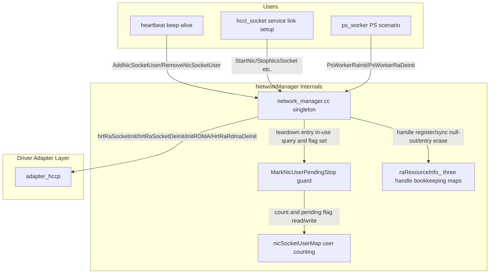
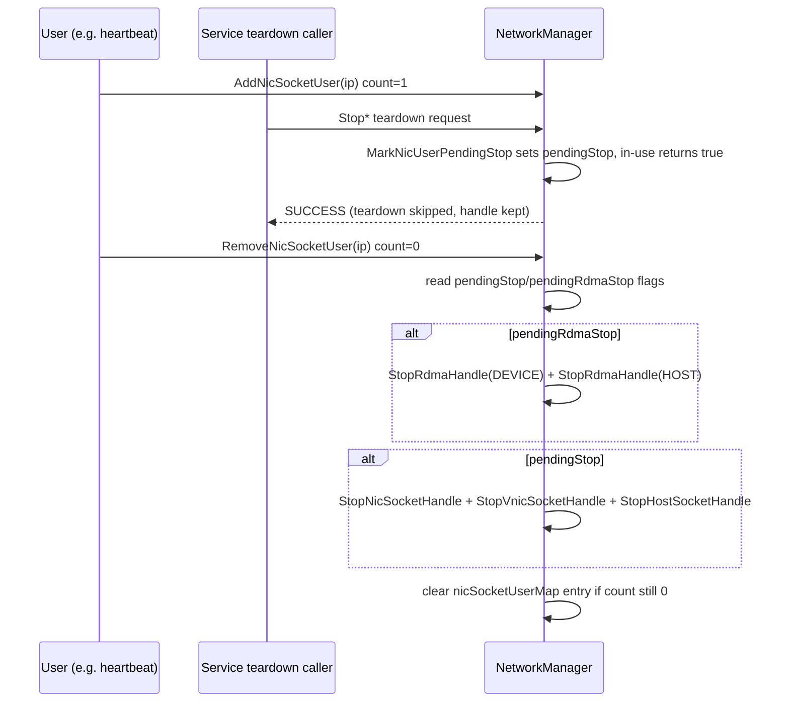
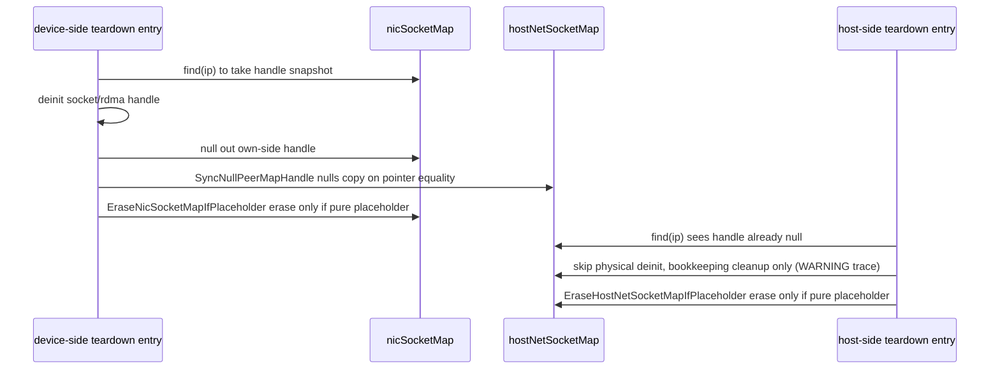
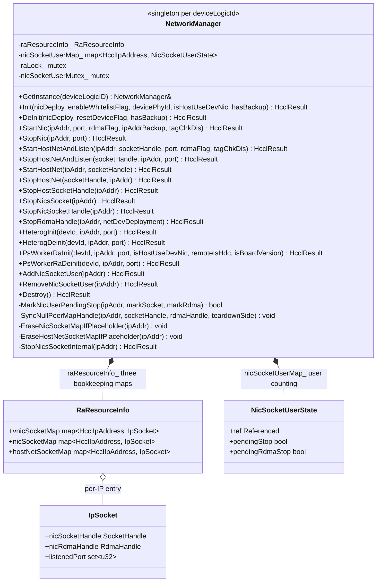

# NetworkManager Module Code Analysis

## Feature Description

The NetworkManager module manages the lifecycle of NIC/VNIC/HOST sockets and RDMA (Remote Direct Memory Access) resources. It is the single bookkeeping and teardown entry of RA resources on the host side. The module provides singleton instances keyed by `deviceLogicId`. It serves ra resource initialization and destruction requests from users such as heartbeat keep-alive, service link setup, and PS (Parameter Server) scenarios, and wraps driver interfaces such as `hrtRaSocketInit` and `InitRDMA` downward.

Core capabilities:

- **Resource initialization**: Creates socket and rdma handles by deployment type (DEVICE/HOST/VNIC), and maintains three bookkeeping maps from IP to handle: `nicSocketMap`, `vnicSocketMap`, and `hostNetSocketMap`
- **User counting**: Provides the paired interfaces `AddNicSocketUser`/`RemoveNicSocketUser` to register in-use users per IP. While held, the handles of that IP will not be torn down
- **In-use guard**: Teardown functions query the user count at entry. If still held, teardown is skipped and pending flags are set
- **Deferred teardown**: Teardown requests blocked by the guard are compensated by the last user at its deregistration, ensuring in-use handles are never forcibly released
- **Dual-map consistency**: The same handle may be written into two maps (value-copy insert). After either side deinits it, the copy in the other map is set to null in sync, preventing a second deinit of a stale handle

## Directory Description

```text
network_manager/
├── CMakeLists.txt               # build script
├── network_manager.h            # compatibility placeholder header (actual declaration in platform/inc/network_manager_pub.h)
├── network_manager.cc           # NetworkManager class implementation (init/teardown/guard/deferred teardown)
├── network_manager.md           # this document (Chinese)
└── network_manager_en.md        # this document (English)
```

### File Relationships

| File | Function | Dependencies |
|------|----------|--------------|
| `network_manager.h` | Contains only the public header and an empty namespace placeholder, keeping existing include paths compatible | No logic |
| `network_manager.cc` | All implementation: ra resource initialization, per-IP bookkeeping, user counting, in-use guard, deferred teardown | Depends on `network_manager_pub.h` (class declaration), `adapter_hccp.h` (driver interfaces), `hccl_plf.map` (cross-library export whitelist) |

### NetworkManager File Interaction



## Flow Description

### User Registration and Deregistration

- `AddNicSocketUser(ipAddr)`: Increments the count. While held, the socket and rdma handles of that IP will not be forcibly released by any teardown path. It must be strictly paired with `RemoveNicSocketUser` and called on the same `deviceLogicId` instance.
- `RemoveNicSocketUser(ipAddr)`: Decrements the count. Non-last users return directly; the last user triggers deferred teardown per the pending flags at deregistration, and the count entry is cleared after completion.
- Count underflow protection: A negative `Unref` return means the caller did not pair strictly. `Clear` resets the count so the entry can still be cleared in this round (a negative count would make the erase condition `Count()==0` never satisfied, leaving the entry permanently resident and the guard ineffective).

### In-use Guard

Teardown functions (`StopNicSocketHandle`, `StopHostSocketHandle`, `StopRdmaHandle`, `StopNicsSocket`, `StopNic`, `StopHostNet`, `StopHostNetAndListen`, `HeterogDeinit`, `PsWorkerRaDeinit`, and bulk destroy paths) all go through `MarkNicUserPendingStop(ipAddr, markSocket, markRdma)` at entry:

- Query and flag-set complete within the same `nicSocketUserMutex_`, avoiding a gap where the last user releases and the flag set is missed, losing the deferred teardown
- When in use (`ref.Count() > 0`), it sets `pendingStop`/`pendingRdmaStop` per the caller's semantics and returns true; the caller skips teardown and returns SUCCESS directly, keeping the entry in the map for the deferred teardown path to query
- When not in use, it returns false and the caller proceeds with the real teardown

### Deferred Teardown Sequence



Key points:

- The count entry is kept until deferred teardown completes. If erased before teardown, a new user calling Add during teardown would find no entry and the guard would forcibly release an in-use handle
- In the deferred phase, rdma is torn down on both the `nicSocketMap` and `hostNetSocketMap` sides (each may hold a real handle); sockets are torn down on all three sides: `nicSocketMap`, `vnicSocketMap`, and `hostNetSocketMap`. A single-side failure is logged without interruption, and the first non-SUCCESS return value is preserved
- The deferred teardown entry `RemoveNicSocketUser` accesses the maps via per-site liveness checks under the lock immediately followed by the Stop* call (`IsSocketMapHandleAlive`): the check finds under `raLock_`, eliminating lock-free dangling dereferences for the dual-map teardown sites it calls (their erase paths all hold `raLock_`; remaining unlocked writers such as the insert/failure-rollback erase of `HeterogInit` are legacy races, see Specification Constraints), and the cross-map sync null-out of preceding Stop* calls is visible to subsequent checks — an upfront one-shot snapshot would be stale and cause one extra teardown call, while the init check at the `StopHostSocketHandle` entry precedes the idempotent branch and fails outright
- After teardown, if a new user has joined (count non-zero), the entry is kept and handled at that user's release

### Dual-map Synchronized Null-out Sequence



Key points:

- The synchronized null-out compares pointers one by one and nulls only on equality: in dual deployment the two sides may each hold an independent handle, and unequal copies are unaffected
- When a host-side teardown entry detects that the map entry exists but the handle has been nulled out (already released by another teardown path), it skips the physical listen stop, the deinit, and the `CheckSocketInfo` validation, performing only bookkeeping cleanup (decrementing reference counts, removing entries) with a WARNING trace

## Data Description

### Core Classes



`IpSocket` and `RaResourceInfo` are defined in `pub_inc/hccl_common.h` as cross-module public data structures; `NicSocketUserState` is a private bookkeeping structure inside the module.

### Same-handle Dual-write Scenarios

The following paths write the same handle into two maps:

- `InitRdmaHandle`: writes the same rdma handle into `nicSocketMap` and `hostNetSocketMap`
- `StartHostNetAndListen`: value-copies the whole `IpSocket` into `nicSocketMap` (in addition to the formal entry in `hostNetSocketMap`)
- `PsWorkerRaInit`: writes the same socket handle into `nicSocketMap` and `hostNetSocketMap`
- `HeterogInit`: value-copies the same socket handle into both `nicSocketMap` and `hostNetSocketMap`; `HeterogStartListen` writes the listenedPort into both maps in sync

Dual-write is a value-copy semantic: the handles in the two maps are two copies of the same pointer. After either side deinits, the copy in the other map becomes a stale pointer and must be handled per the "Dual-map Synchronized Null-out Sequence".

## Interface Description

**External interface summary**

| Interface | Description |
|------|------|
| `GetInstance` | Gets the singleton instance by `deviceLogicId` |
| `Init`/`DeInit` | NIC ra resource initialization/deinitialization (with whitelist awareness) |
| `InitV2`/`DeInitV2` | Refactored initialization/deinitialization entries |
| `StartNic`/`StopNic` | Device-side NIC socket init/teardown (port `0xFFFFFFFF` means init only without listening) |
| `StartVnic`/`StopVnic` | VNIC socket init/teardown |
| `StartHostNet`/`StopHostNet` | Host-side socket init/teardown |
| `StartHostNetAndListen`/`StopHostNetAndListen` | Host-side socket init-with-listen/teardown |
| `CreateNicSocketHandle`/`StopNicSocketHandle` | Device-side socket handle create/teardown |
| `CreateRdmaHandle`/`StopRdmaHandle` | Rdma handle create/teardown (by deployment DEVICE/HOST) |
| `InitRdmaHandle` | Rdma initialization (same-handle dual-write dual-map bookkeeping) |
| `CreateHostSocketHandle`/`StopHostSocketHandle` | Host-side socket handle create/teardown |
| `CreateVnicSocketHandle`/`StopVnicSocketHandle` | VNIC socket handle create/teardown |
| `HeterogInit`/`HeterogDeinit` | Heterogeneous-scenario host-side socket init/teardown |
| `HeterogStartListen`/`HeterogStopListen` | Heterogeneous-scenario listen start/stop |
| `PsWorkerRaInit`/`PsWorkerRaDeinit` | PS-scenario ra resource init/teardown |
| `AddNicSocketUser`/`RemoveNicSocketUser` | User count register/deregister (in-use guard and deferred teardown trigger) |
| `Destroy` | Process-exit fallback: bulk destroy of the three bookkeeping maps |
| `GetRaResourceInfo` | Exports the ra resource bookkeeping snapshot |
| `GetRdmaHandleByIpAddr`/`GetNicHandleByIpAddr` | Queries rdma/socket handle by IP |
| `HcclIpAddressConvertHcclAddr` | Address conversion from `HcclIpAddress` to `HcclAddress` |
| `GetNotifyType`/`GetNetworkMode` | Rdma notify type / network mode query |
| `GetRdmaLiteStatus` | Rdmalite switch status query |
| `OccupyIp`/`GetNicIp` | IP occupation register / NIC IP list query |
| `PingMeshRaPingInit`/`PingMeshRaPingDeinit` | Pingmesh-scenario ra init/deinit |

### NetworkManager

The following is the detailed table of core interfaces on the teardown/guard chain (required by the main flow); initialization interfaces share the parameter semantics of the summary table, and auxiliary query interfaces are omitted.

| Interface | Type | Parameters | Return | Description |
|------|------|------|--------|------|
| `StartNic` | public (external) | `ipAddr`: local IP; `port`: pass a port or `0xFFFFFFFF` on input, returns the actual listen port on output; `rdmaFlag`: whether to also initialize rdma; `ipAddrBackup`: backup NIC IP; `tagChkDis`: whether to disable tag checking | `HcclResult` | Initializes the device-side socket (with optional rdma), starts listening when necessary, and registers in `nicSocketMap` |
| `StopNic` | public (external) | `ipAddr`: local IP; `port`: listen port | `HcclResult` | Tears down the device-side NIC: stops listening first (reference-count guarded), then tears down socket and rdma via `StopNicsSocketInternal` once listening is zeroed, removing the pure placeholder entry |
| `StopNicsSocket` | public (external) | `ipAddr`: local IP | `HcclResult` | Tears down the device-side socket and rdma handles by IP; on success nulls the peer copies in sync and removes the own-side pure placeholder entry |
| `StopNicSocketHandle` | public (external) | `ipAddr`: local IP | `HcclResult` | Tears down only the device-side socket handle (rdma untouched), with dual-map synchronized null-out + placeholder cleanup |
| `StopRdmaHandle` | public (external) | `ipAddr`: local IP; `netDevDeployment`: deployment DEVICE/HOST | `HcclResult` | Tears down the rdma handle of the corresponding map by deployment, nulling the peer copy in sync; the host entry is kept while it still holds a socket handle |
| `StopHostNet` | public (external) | `socketHandle`: handle returned at link setup; `ipAddr`: local IP | `HcclResult` | Tears down the host-side socket (pass-in-comparison: the input handle is validated against the map entry) |
| `StopHostNetAndListen` | public (external) | `socketHandle`: handle returned at link setup; `ipAddr`: local IP; `port`: listen port | `HcclResult` | Tears down the host-side socket and stops listening (reference-count guarded) |
| `StopHostSocketHandle` | public (external) | `ipAddr`: local IP | `HcclResult` | Tears down all listening and the socket of the host side by IP (value-fetching: takes the handle from the map) |
| `AddNicSocketUser` | public (external) | `ipAddr`: local IP | `HcclResult` | Increments the user count; while held, the handles of that IP are not forcibly released |
| `RemoveNicSocketUser` | public (external) | `ipAddr`: local IP | `HcclResult` | Decrements the user count; the last user triggers deferred teardown per the pending flags (per-site liveness check under the lock, then teardown) |
| `Destroy` | public (external) | none | `HcclResult` | Process-exit fallback: bulk teardown of all entries in the three maps (in-use entries get pending flags set for deferred teardown), with a WARNING for entries not torn down |
| `MarkNicUserPendingStop` | private | `ipAddr`: local IP; `markSocket`: set the socket pending flag; `markRdma`: set the rdma pending flag | `bool` | In-use guard: returns true with pending flags set when in use, false otherwise |
| `SyncNullPeerMapHandle` | private | `ipAddr`: local IP; `socketHandle`/`rdmaHandle`: deinit-ed handle values; `teardownSide`: teardown side | `void` | Nulls the handle copies equal to the inputs in the other map (pointer-by-pointer comparison); caller must already hold `raLock_` |
| `EraseNicSocketMapIfPlaceholder` | private | `ipAddr`: local IP | `void` | Erases the `nicSocketMap` entry only when it is a pure placeholder (both socket and rdma null); caller must already hold `raLock_` |
| `EraseHostNetSocketMapIfPlaceholder` | private | `ipAddr`: local IP | `void` | Nulls the host entry's socket handle, then erases the `hostNetSocketMap` entry only if rdma is also null; caller must already hold `raLock_` |
| `StopNicsSocketInternal` | private | `ipAddr`: local IP | `HcclResult` | The lock-free implementation of `StopNicsSocket`, for reuse by callers already holding `raLock_`; does not erase entries (safe for batch iteration) |
| `IsSocketMapHandleAlive` | private | `socketMap`: target map; `ipAddr`: local IP; `rdmaFlag`: check the rdma or socket handle | `bool` | Finds under `raLock_` whether the handle of the entry in the given map is alive, for per-site sequential checks in deferred teardown |

## Usage Limitations

### Supported Scenarios

| Scenario | Interfaces | Description |
|------|------|------|
| Heartbeat keep-alive | `AddNicSocketUser`/`RemoveNicSocketUser` | Skips forced teardown while held; deferred compensation at deregistration |
| Service link setup (device side) | `StartNic`/`StopNic` | Includes optional rdma initialization and listen start/stop |
| Service link setup (host side) | `StartHostNetAndListen`/`StopHostNetAndListen`, `StartHostNet`/`StopHostNet` | Same-handle dual-write into `nicSocketMap` (value copy) |
| PS scenario | `PsWorkerRaInit`/`PsWorkerRaDeinit` | Same socket handle dual-written into both maps |
| Heterogeneous training | `HeterogInit`/`HeterogDeinit`, `HeterogStartListen`/`HeterogStopListen` | Host using device NIC |
| Process-exit fallback | `Destroy` | Bulk destroy of the three maps, WARNING trace for entries not torn down |

### Constraint Specifications

- Singletons are keyed by `deviceLogicId`: Add/Remove and Start/Stop under the same `deviceLogicId` must be called on the same instance; cross-instance calls cannot hit the bookkeeping entry
- `AddNicSocketUser`/`RemoveNicSocketUser` must be strictly paired: underflow can self-heal via `Clear` reset, but relying on underflow protection is an abnormal path and must not be a regular practice
- `raLock_` concurrency model: the host-side entries (`StopHostNet`/`StopHostNetAndListen`/`StopHostSocketHandle`/`StopAllHostNicSockets`), the device-side entries (`StopNicsSocket`/`StopNicSocketHandle`/`StopRdmaHandle`/`StopNic`/`HeterogDeinit`/`HeterogStopListen`/`PsWorkerRaDeinit`), and the batch-iteration entries (`StopAllDeviceNicSockets`/`Destroy` pre-cleanup) all hold `raLock_` when accessing the dual maps, making cross-map sync null-outs and concurrent erases mutually exclusive among teardown entries; `RemoveNicSocketUser` accesses via per-site liveness checks under the lock immediately followed by the Stop* call (see `IsSocketMapHandleAlive`), not holding the lock throughout. The lock order versus `nicSocketUserMutex_` is fixed as `raLock_` -> `nicSocketUserMutex_`, with reverse locking forbidden; contexts already holding `raLock_` must call `StopNicsSocketInternal`/`HeterogStopListenInternal` instead, avoiding self-deadlock from re-locking a non-recursive `std::mutex`. The protection scope is limited to the teardown side: the initialization/link-setup paths (`StartNic`/`StartHostNet`/`StartHostNetAndListen`/`InitRdmaHandle`/`PsWorkerRaInit`) do not hold `raLock_`; concurrent access to the dual maps with teardown entries still poses a data race; the insert and failure-rollback erase of the dual maps in `HeterogInit` likewise do not hold `raLock_`, and the locked find of `IsSocketMapHandleAlive` racing with them may still hit an invalidated node; the vnic paths (`StopVnic`/`StopVnicSocketHandle`/`StopAllDeviceVnicSockets`) do not touch the dual maps but only read and write `vnicSocketMap` without holding `raLock_`, racing with the locked find of `RemoveNicSocketUser` via `IsSocketMapHandleAlive`; all of the above are legacy risks to be addressed by future refactoring
- Placeholder-only erase rule: an entry in `nicSocketMap` may be erased only when both the socket and rdma handles of that IP are null (pure placeholder). In dual-deployment scenarios the entry may still hold a Device-side handle not yet torn down; unconditional erasing makes the deferred path unable to find the entry, leaking the handle. The same applies to `hostNetSocketMap`: when the rdma handle of a host entry is not yet torn down, the entry is kept as the bookkeeping entry for `StopRdmaHandle(HOST)` and the deferred teardown
- Bulk destroy paths such as `Destroy`/`StopAllHostNicSockets` skip and keep in-use entries instead of forcibly tearing them down, uniformly deferred to the last user
- Host-side late-teardown idempotency relies on entry retention: after device-side teardown, the host-side pure placeholder entry is retained (the peer side is not erased prematurely) for late entries such as `StopHostNet`/`StopHostSocketHandle` to perform idempotent bookkeeping cleanup; entry cleanup is completed by the next host-side teardown entry or the `Destroy` fallback

### UT Reference

Test cases for user counting, in-use guard, deferred teardown, and dual-map consistency are located in the `Ut_NetworkManager_*` series in `test/ut/misc/ut_adapter.cc`. They are pure logic cases that construct internal state directly without device dependency.
