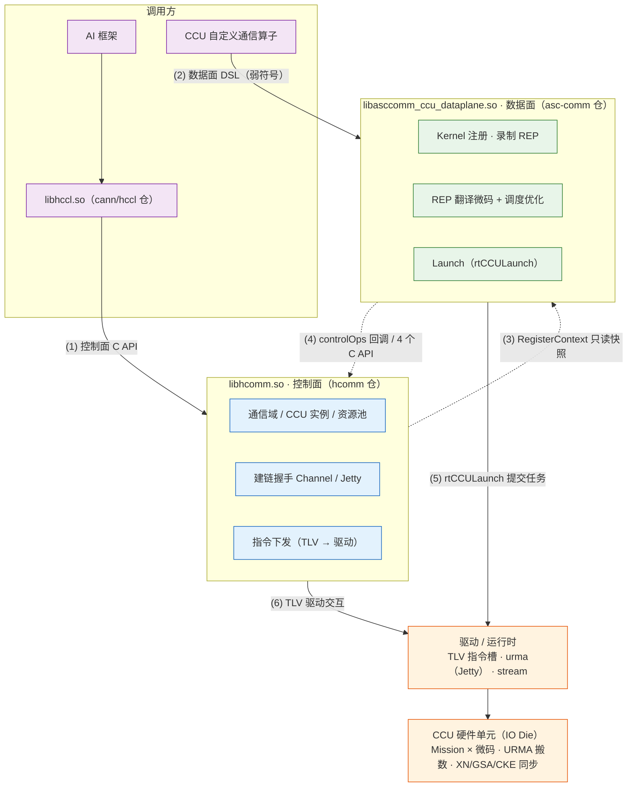

# HCOMM CCU 数据面 SO 拆分架构图

HCOMM 将 CCU（Collective Communication Unit）能力拆分为**控制面**（本仓 hcomm，产出 `libhcomm.so`）与**数据面**（asc-comm 仓，产出 `libasccomm_ccu_dataplane.so`）两个独立 SO，通过 POD ABI 契约层交互，可独立编译、独立版本演进。

## 架构图（Mermaid 渲染版）



## 简版架构图（文本版，适配终端/纯文本场景）

```text
         AI 框架 ──► libhccl.so〔dlsym 加载 hcomm〕                 CCU 自定义通信算子

           控制面 C API                                           数据面 DSL（弱符号）
                 │                                                          │
                 ▼                                                          ▼

╭─────────────────────────────────╮                       ╭───────────────────────────────────╮
│                                 │                       │                                   │
│     libhcomm.so  ·  控制面      │                       │    libasccomm_ccu_dataplane.so    │
│          〔 hcomm 仓〕          │                       │     〔 asc-comm 仓 〕· 数据面     │
│                                 │  ◄═══  POD ABI  ═══►  │                                   │
│·  通信域 / CCU 实例 / 资源池    │ RegisterContext 快照  │·  Kernel 注册 · 录制 REP          │
│·  建链握手  Channel / Jetty     │   + controlOps 回调   │·  REP 翻译微码 + 调度优化         │
│·  指令下发  TLV → 驱动          │                       │·  Launch（rtCCULaunch）           │
│                                 │                       │                                   │
╰─────────────────────────────────╯                       ╰───────────────────────────────────╯

                 │                                                          │
          (6) TLV                                                   (5) rtCCULaunch
                 ▼                                                          ▼

╭─────────────────────────────────────────────────────────────────────────────────────────────╮
│                驱 动 / 运 行 时 层：TLV 指令槽  ·  urma（Jetty）  ·  stream                 │
╰─────────────────────────────────────────────────────────────────────────────────────────────╯
                                               ▼

╭─────────────────────────────────────────────────────────────────────────────────────────────╮
│          CCU 硬件单元（IO Die）：Mission × 微码  ·  URMA 搬数  ·  XN/GSA/CKE 同步           │
╰─────────────────────────────────────────────────────────────────────────────────────────────╯
```

一句话流程：算子经数据面 DSL 注册 Kernel（录制 REP → 翻译微码）→ 控制面经 POD ABI 交付资源快照并提供回调（建链、指令下发）→ 数据面 `rtCCULaunch` 提交任务 → CCU 硬件执行微码搬数。

## 完整架构图

```text
┌────────────────────────────────────────────────────────────────────────────────────────────────────────────────────┐
│ 调用方:  AI框架 ──► libhccl.so〔cann/hccl仓, dlsym加载hcomm〕  //  CCU自定义通信算子开发者                         │
│          (custom_ccu_allreduce/allgather/broadcast... 样例链接数据面SO)                                            │
└────────────────────┬────────────────────────────────────────────────────────────────────┬──────────────────────────┘
   (1) 建通信域·绑CCU实例·资源预约                                                 (2) Kernel注册·下发(数据面DSL)
                    │                                                                            │
                    ▼                                                                            ▼
┌──────────────────────────────────────┐    ╔══════════════════════════╗    ┌────────────────────────────────────────┐
│libhcomm.so  〔hcomm 仓〕             │    ║跨 SO ABI 契约层          ║    │libasccomm_ccu_dataplane.so             │
│━━━━━ CCU 控制面 ━━━━━                │    ║(pkg_inc/hcomm/*.h)       ║    │〔asc-comm 仓〕━ CCU 数据面 ━           │
│coll_communicator_mgr 通信域/拓扑     │    ║                          ║    │primitives/  CcuXxx 原语实现            │
│  HcclCommAssignCcuIns                │──► ║──► 控制面交付数据面:     ║──► │  HcommCcuKernelRegisterStart/          │
│  HcclCommQueryCcuRegisterContext     │    ║  RegisterContextPod      ║    │  Register/End (弱符号入口)             │
│ccu_instance/  实例与资源预约         │    ║  (CCU2只读快照+代际句柄) ║    │resource/kernel/ Kernel录制             │
│  CcuInstanceMgr / CcuInstance        │    ║  LaunchContext/Channel/  ║    │  CcuKernel·Mgr·Registry                │
│  CcuResDescMgr 资源描述符            │    ║  InstructionLoad POD     ║    │resource/representation/ REP IR         │
│  CcuVarEventResMgr XN/CKE预约        │    ║                          ║    │  ~45种节点(算术/搬运/同步/             │
│ccu_transport/  建链握手              │◄── ║◄── 数据面回调控制面:     ║◄── │  控制流/循环)                          │
│  CcuTransport/Conn/Jetty             │    ║  controlOps 函数表7项    ║    │  + InsGenerator V1(A5)/V2(A6)          │
│ccu_device/  设备资源·驱动交互        │    ║  channelQuery/loadInstr  ║    │resource/microcode(+microcode_opt)      │
│  CcuComponent·CcuResBatchAlloc       │    ║  missionCtx/loopCtx/cke/ ║    │  32B定长微码·指令调度优化              │
│  CcuChannelCtxMgr V1/V2·PFE          │    ║  xn/gsa Query            ║    │resource/common/  资源快照              │
│  RegisterContextRegistry             │    ║  + hcomm侧4个C API       ║    │launch: GeneTaskParams                  │
│  (代际句柄防悬挂)                    │    ║                          ║    │  (dieId/missionId/args[13])            │
│对上层: include/hccl·hcomm            │    ║契约: 只传POD不传C++对象  ║    │  ──► rtCCULaunch(stream)               │
│  HcclComm*/HcommCcuIns* C API        │    ║  16B ABI头(magic/ver/    ║    │(链接 acl_rt / runtime)                 │
│                                      │    ║  size) + static_assert   ║    │                                        │
└──────────────────────────────────────┘    ╚══════════════════════════╝    └────────────────────────────────────────┘
                    │                                                                            │
                    ▼                                                                            ▼
                      (6) TLV驱动交互(指令/通道)                                (5) rtCCULaunch提交Mission任务
┌────────────────────────────────────────────────────────────────────────────────────────────────────────────────────┐
│ 驱动/运行时层:  runtime(rtCCULaunch) · ascend_hal(HccpRaTlvCcuCustomChannel TLV:                                   │
│   SET/GET_INSTRUCTION·CHANNEL·JETTY_CTX·MISSION_CTX·LOOP_CTX·GSA/XN/CKE) · urma(Jetty) · Socket(握手)              │
└──────────────────────────────────────────────────────────┬─────────────────────────────────────────────────────────┘
                                                           ▼
┌────────────────────────────────────────────────────────────────────────────────────────────────────────────────────┐
│ 硬件: Ascend IO Die 内 CCU 集合通信单元 —— Mission(硬件线程)×微码指令槽 · XN/GSA/CKE/MS 资源                       │
│       URMA 统一远端内存访问引擎搬运数据 (950PR/950DT, 高带宽低时延)                                                │
└────────────────────────────────────────────────────────────────────────────────────────────────────────────────────┘
```

## 运行时主流程

1. **建域与资源预约**：框架/HCCL → 控制面，建通信域，`HcclCommAssignCcuIns` / `HcommCcuInsCreate` 创建 CCU 实例，Variable(XN)/Event(CKE) 资源预约与 VA 映射。
2. **Kernel 注册录制**：算子 → 数据面，`HcommCcuKernelRegisterStart/Register/End`（弱符号，落在数据面 SO），执行用户 kernelFunc，`CcuXxx` 原语录制 REP 中间表示。
3. **交付快照**：控制面 → 数据面，`HcclCommQueryCcuRegisterContext` 交付 RegisterContext 只读快照（资源 range 视图 + die 元数据 + controlOps 函数表）。
4. **回调控制面**：数据面 → 控制面，经 controlOps 表 / 4 个 C API（`include/hcomm/hcomm_ccu_{res,channel,instruction,launch}_api.h`）查询 Channel POD、下发微码；翻译产物由控制面走 TLV 驱动接口写入硬件指令槽。
5. **任务提交**：数据面组 `CcuTaskParam(dieId/missionId/instStartId/args[13])` → `rtCCULaunch` 提交流。
6. **硬件执行**：CCU Mission 执行微码，URMA 引擎搬运数据，XN/GSA/CKE 完成同步。

## 构建期边界保障

| 机制 | 说明 |
|------|------|
| 双 SO 联合编译 | 本仓按候选路径查找 / FetchContent 拉取 asc-comm（`cmake/third_party/asccomm-ccu.cmake`），数据面 SO 随 hcomm 包交付；找不到则只构建控制面 |
| 源归属校验（双向） | `hcomm_check_source_ownership(hcomm/hccl_v2)` + asc-comm 侧对称校验，禁止跨仓引用源文件 |
| 链接期校验（双向） | 双方均 `-Wl,--no-undefined`，不允许无意识依赖对方符号 |
| 单源双头 | 资源仓库类型 `pub_inc/ccu_res_repo.h` ⇔ `internal/hcomm/resource/common/ccu_res_repository_local.h` 宏互斥定义 |
| POD 契约 | 跨 SO 只传 POD（16B ABI 头 magic/version/size + `static_assert` 锁布局），不传 C++ 对象 |

> 注：当前 dev_rename 分支为过渡态，libhcomm 内仍保留一套进程内旧实现（`src/base_comm/resources/ccu/{ccu_kernel,ccu_representation,ccu_microcode}` + `primitives/api_c_adpt/ccu`）作兼容，图中为目标拆分形态。

## 关键路径速查

```
hcomm 仓（控制面）
├── include/ccu/                      # DSL 头（Variable/Event/Buffer/Loop + ccu_res.h/ccu_launch.h 弱符号）
├── include/hcomm/hcomm_ccu_*_api.h   # 数据面调用的 4 个 C API
├── pkg_inc/hcomm/hcomm_ccu_*.h       # 跨 SO POD ABI（abi/common/res/control/channel/instruction/launch/dfx）
├── src/base_comm/resources/ccu/
│   ├── ccu_instance/                 # CcuInstanceMgr/CcuInstance/CcuResDescMgr/CcuVarEventResMgr
│   ├── ccu_transport/                # CcuTransport/CcuConnection/CcuJetty 建链握手
│   └── ccu_device/                   # CcuComponent/资源分配器/ChannelCtxMgr V1,V2/RegisterContextRegistry
└── cmake/third_party/asccomm-ccu.cmake  # 数据面 SO 联合编译与交付

asc-comm 仓（数据面）
├── src/ccu/hcomm/primitives/          # CcuXxx 原语实现 + Kernel 注册/Launch
├── src/ccu/hcomm/resource/kernel/     # CcuKernel/CcuKernelMgr/CcuKernelRegistry
├── src/ccu/hcomm/resource/representation/  # REP IR + InsGenerator V1(A5)/V2(A6) 翻译器
├── src/ccu/hcomm/resource/microcode(+_opt)/ # 32B 定长微码 + 指令调度优化
└── include/ccu/hcomm/                 # 数据面公共 DSL 头（安装供 CCU 算子开发者使用）
```
