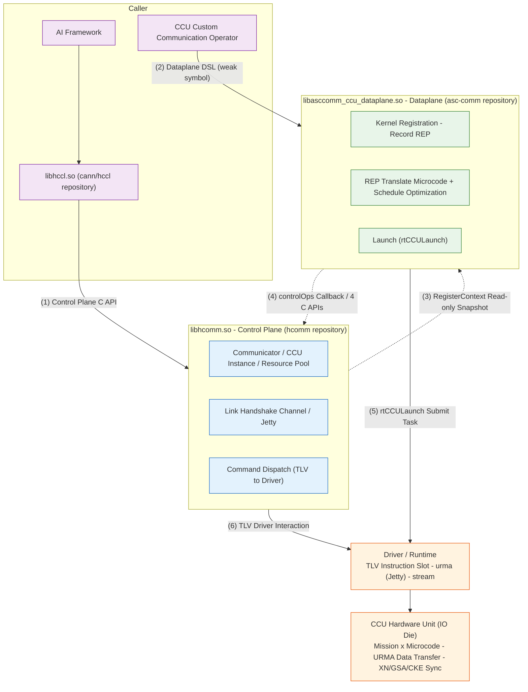

# HCOMM CCU Dataplane SO Split Architecture Diagram

HCOMM splits CCU (Collective Communication Unit) capabilities into the **control plane** (hcomm repository, producing `libhcomm.so`) and the **dataplane** (asc-comm repository, producing `libasccomm_ccu_dataplane.so`). These two independent SOs interact through a POD ABI contract layer and support independent compilation and independent version evolution.

## Architecture Diagram (Mermaid Rendered Version)



## Simplified Architecture Diagram (Text Version for Terminal/Plain Text)

```text
          AI Framework ──► libhccl.so [dlsym loads hcomm]                 CCU Custom Communication Operator

         Control Plane C API                                          Dataplane DSL (weak symbol)
                  │                                                          │
                  ▼                                                          ▼

╭─────────────────────────────────╮                       ╭───────────────────────────────────╮
│                                 │                       │                                   │
│     libhcomm.so  ·  Control     │                       │    libasccomm_ccu_dataplane.so    │
│            Plane                │                       │  [asc-comm repository] · Dataplane│
│      [hcomm repository]         │  ◄═══  POD ABI  ═══►  │                                   │
│                                 │ RegisterContext Snap  │·  Kernel Registration · Record REP│
│·  Communicator / CCU Instance   │   + controlOps Callback│·  REP Translate Microcode + Sched │
│·  Link Handshake Channel/Jetty  │                       │·  Launch (rtCCULaunch)             │
│·  Cmd Dispatch TLV to Driver    │                       │                                   │
│                                 │                       │                                   │
╰─────────────────────────────────╯                       ╰───────────────────────────────────╯

                  │                                                          │
           (6) TLV                                                   (5) rtCCULaunch
                  ▼                                                          ▼

╭─────────────────────────────────────────────────────────────────────────────────────────────╮
│            Driver / Runtime Layer: TLV Instruction Slot  ·  urma (Jetty)  ·  stream        │
╰─────────────────────────────────────────────────────────────────────────────────────────────╯
                                                ▼

╭─────────────────────────────────────────────────────────────────────────────────────────────╮
│     CCU Hardware Unit (IO Die): Mission x Microcode  ·  URMA Data Transfer  ·  XN/GSA/CKE │
╰─────────────────────────────────────────────────────────────────────────────────────────────╯
```

One-line flow: The operator registers a Kernel through the dataplane DSL (record REP → translate microcode) → The control plane delivers a resource snapshot and provides callbacks (link establishment, command dispatch) through the POD ABI → The dataplane `rtCCULaunch` submits the task → The CCU hardware executes microcode for data transfer.

## Complete Architecture Diagram

```text
┌────────────────────────────────────────────────────────────────────────────────────────────────────────────────────┐
│ Caller: AI Framework ──► libhccl.so [cann/hccl repo, dlsym loads hcomm] // CCU Custom Comm Operator Developer    │
│          (custom_ccu_allreduce/allgather/broadcast... sample links dataplane SO)                                   │
└────────────────────┬────────────────────────────────────────────────────────────────────┬──────────────────────────┘
   (1) Create communicator · bind CCU instance · reserve resources               (2) Kernel registration · dispatch (dataplane DSL)
                    │                                                                            │
                    ▼                                                                            ▼
┌──────────────────────────────────────┐    ╔══════════════════════════╗    ┌────────────────────────────────────────┐
│libhcomm.so  [hcomm repo]             │    ║Cross-SO ABI Contract     ║    │libasccomm_ccu_dataplane.so             │
│━━━━━ CCU Control Plane ━━━━━        │    ║Layer (pkg_inc/hcomm/*.h) ║    │[asc-comm repo] ━ CCU Dataplane ━      │
│coll_communicator_mgr Comm/Topology   │    ║                          ║    │primitives/  CcuXxx Primitive Impl      │
│  HcclCommAssignCcuIns                │──► ║──► Ctrl delivers to DP:  ║──► │  HcommCcuKernelRegisterStart/          │
│  HcclCommQueryCcuRegisterContext     │    ║  RegisterContextPod      ║    │  Register/End (weak symbol entry)      │
│ccu_instance/  Instance & Resource    │    ║  (CCU2 read-only snapshot║    │resource/kernel/ Kernel Recording       │
│  CcuInstanceMgr / CcuInstance        │    ║  + generation handle)    ║    │  CcuKernel·Mgr·Registry                │
│  CcuResDescMgr Resource Descriptor   │    ║  LaunchContext/Channel/  ║    │resource/representation/ REP IR         │
│  CcuVarEventResMgr XN/CKE Reserve    │    ║  InstructionLoad POD     ║    │  ~45 node types (arithmetic/transfer/  │
│ccu_transport/  Link Handshake        │◄── ║◄── DP callbacks to Ctrl: ║◄── │  sync/control flow/loop)               │
│  CcuTransport/Conn/Jetty             │    ║  controlOps func table 7 ║    │  + InsGenerator V1(A5)/V2(A6)          │
│ccu_device/  Device Resource · Driver  │    ║  channelQuery/loadInstr  ║    │resource/microcode(+microcode_opt)      │
│  CcuComponent·CcuResBatchAlloc       │    ║  missionCtx/loopCtx/cke/ ║    │  32B Fixed-length Microcode · Instr    │
│  CcuChannelCtxMgr V1/V2·PFE          │    ║  xn/gsa Query            ║    │  Schedule Optimization                 │
│  RegisterContextRegistry             │    ║  + hcomm-side 4 C APIs   ║    │resource/common/  Resource Snapshot     │
│  (generation handle prevents         │    ║                          ║    │launch: GeneTaskParams                  │
│   dangling references)               │    ║Contract: POD only, no   ║    │  (dieId/missionId/args[13])            │
│Upstream: include/hccl·hcomm          │    ║  C++ objects. 16B ABI   ║    │  ──► rtCCULaunch(stream)               │
│  HcclComm*/HcommCcuIns* C API        │    ║  header(magic/ver/size) ║    │(links acl_rt / runtime)                 │
│                                      │    ║  + static_assert         ║    │                                        │
└──────────────────────────────────────┘    ╚══════════════════════════╝    └────────────────────────────────────────┘
                    │                                                                            │
                    ▼                                                                            ▼
                      (6) TLV Driver Interaction (instruction/channel)          (5) rtCCULaunch Submits Mission Task
┌────────────────────────────────────────────────────────────────────────────────────────────────────────────────────┐
│ Driver/Runtime Layer: runtime(rtCCULaunch) · ascend_hal(HccpRaTlvCcuCustomChannel TLV:                            │
│   SET/GET_INSTRUCTION·CHANNEL·JETTY_CTX·MISSION_CTX·LOOP_CTX·GSA/XN/CKE) · urma(Jetty) · Socket(handshake)        │
└──────────────────────────────────────────────────────────┬─────────────────────────────────────────────────────────┘
                                                           ▼
┌────────────────────────────────────────────────────────────────────────────────────────────────────────────────────┐
│ Hardware: CCU Collective Communication Unit in Ascend IO Die —— Mission(hw thread)×microcode instr slot           │
│          XN/GSA/CKE/MS Resources · URMA Unified Remote Memory Access Engine for data transfer                      │
│          (950PR/950DT, high bandwidth low latency)                                                                 │
└────────────────────────────────────────────────────────────────────────────────────────────────────────────────────┘
```

## Runtime Main Flow

1. **Create communicator and reserve resources**: Framework/HCCL → control plane. Create communicator. `HcclCommAssignCcuIns` / `HcommCcuInsCreate` creates the CCU instance. Variable(XN)/Event(CKE) resource reservation and VA mapping.
2. **Kernel registration and recording**: Operator → dataplane. `HcommCcuKernelRegisterStart/Register/End` (weak symbols, resolved in dataplane SO) executes the user kernelFunc. `CcuXxx` primitives record the REP intermediate representation.
3. **Deliver snapshot**: Control plane → dataplane. `HcclCommQueryCcuRegisterContext` delivers the RegisterContext read-only snapshot (resource range view + die metadata + controlOps function table).
4. **Callback to control plane**: Dataplane → control plane. Query Channel POD and dispatch microcode through the controlOps table and 4 C APIs (`include/hcomm/hcomm_ccu_{res,channel,instruction,launch}_api.h`). The control plane writes translation output to hardware instruction slots through the TLV driver interface.
5. **Task submission**: The dataplane assembles `CcuTaskParam(dieId/missionId/instStartId/args[13])` and submits through `rtCCULaunch`.
6. **Hardware execution**: CCU Mission executes microcode. The URMA engine transfers data. XN/GSA/CKE completes synchronization.

## Build-Time Boundary Enforcement

| Mechanism | Description |
|-----------|-------------|
| Dual SO joint compilation | This repository searches candidate paths or uses FetchContent to pull asc-comm (`cmake/third_party/asccomm-ccu.cmake`). The dataplane SO ships with the hcomm package. If not found, only the control plane builds |
| Source ownership verification (bidirectional) | `hcomm_check_source_ownership(hcomm/hccl_v2)` + symmetric verification on the asc-comm side. Cross-repository source file references are prohibited |
| Link-time verification (bidirectional) | Both sides use `-Wl,--no-undefined`. Unintentional dependency on the other side's symbols is not allowed |
| Single source dual header | Resource repository type `pub_inc/ccu_res_repo.h` ⇔ `internal/hcomm/resource/common/ccu_res_repository_local.h` macro mutually exclusive definitions |
| POD contract | Only POD types cross the SO boundary (16B ABI header magic/version/size + `static_assert` locks layout). C++ objects are not passed |

> Note: The current dev_rename branch is a transitional state. libhcomm still retains an in-process legacy implementation (`src/base_comm/resources/ccu/{ccu_kernel,ccu_representation,ccu_microcode}` + `primitives/api_c_adpt/ccu`) for compatibility. The diagram shows the target split state.

## Key Path Quick Reference

```
hcomm repository (control plane)
├── include/ccu/                      # DSL headers (Variable/Event/Buffer/Loop + ccu_res.h/ccu_launch.h weak symbols)
├── include/hcomm/hcomm_ccu_*_api.h   # 4 C APIs called by the dataplane
├── pkg_inc/hcomm/hcomm_ccu_*.h       # Cross-SO POD ABI (abi/common/res/control/channel/instruction/launch/dfx)
├── src/base_comm/resources/ccu/
│   ├── ccu_instance/                 # CcuInstanceMgr/CcuInstance/CcuResDescMgr/CcuVarEventResMgr
│   ├── ccu_transport/                # CcuTransport/CcuConnection/CcuJetty link handshake
│   └── ccu_device/                   # CcuComponent/resource allocator/ChannelCtxMgr V1,V2/RegisterContextRegistry
└── cmake/third_party/asccomm-ccu.cmake  # Dataplane SO joint compilation and delivery

asc-comm repository (dataplane)
├── src/ccu/hcomm/primitives/          # CcuXxx primitive implementation + Kernel registration/Launch
├── src/ccu/hcomm/resource/kernel/     # CcuKernel/CcuKernelMgr/CcuKernelRegistry
├── src/ccu/hcomm/resource/representation/  # REP IR + InsGenerator V1(A5)/V2(A6) translator
├── src/ccu/hcomm/resource/microcode(+_opt)/ # 32B fixed-length microcode + instruction schedule optimization
└── include/ccu/hcomm/                 # Dataplane public DSL headers (installed for CCU operator developers)
```
