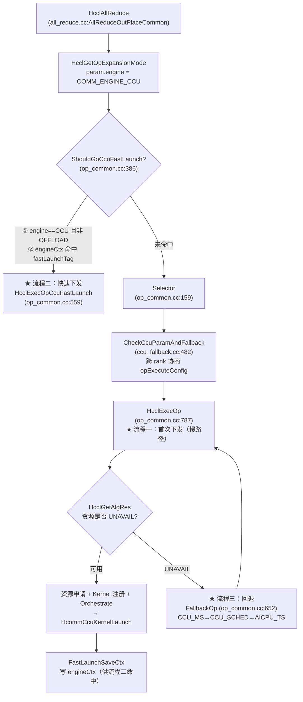
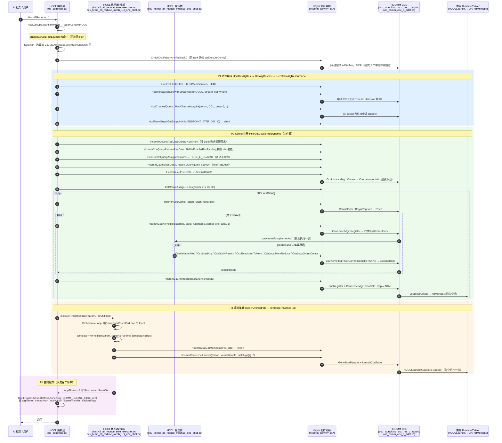
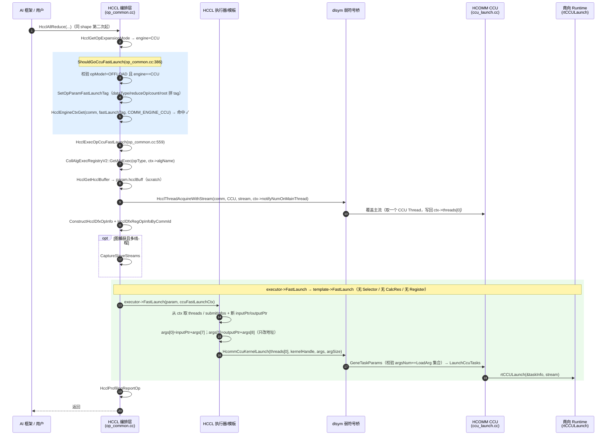
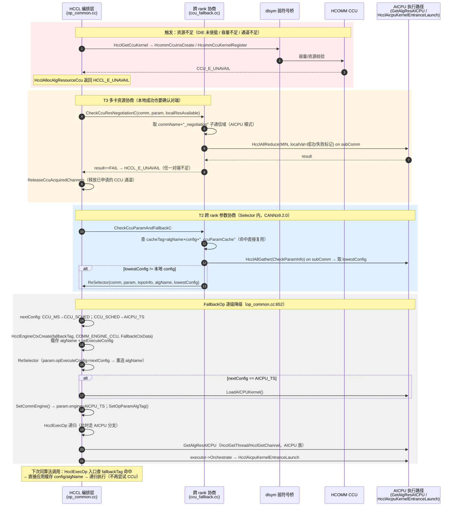

# CCU 模式北向接口调用时序（首次下发 / 快速下发 / 回退 AICPU）

> 范围：以 HCCL 仓（`cann/hccl`）AllReduce 为样本算子，梳理 CCU 模式的三种主要流程下 **HCCL → HCOMM 的 CCU 北向接口**（dlsym C ABI）调用时序。
>
> 术语：
> - **北向接口** = HCCL 调 HCOMM 的 C ABI 边界（`hccl/src/common/hcomm_dlsym/` 中的弱符号 + `dlsym`，HCOMM 侧 `HCOMM_WEAK_SYMBOL` 导出）。南向 = HCOMM 之下的 Runtime/Driver 边界（`rtCCULaunch` / TLV / `hrtMemcpy`），本文只作终点标注。
> - **CCU 三段式**：注册期「就地执行 kernelFunc 录制 rep」→ 翻译期「rep 翻成微码并装载指令空间」→ 发射期「只换 taskArgs 下发」。
>
> 代码基线：`hccl/` 与 `hcomm/` 与 `CheckerL2/` 同层目录。

---

## 0. 三条流程的判定入口（一张图）

三条流程的本质区别只有「走到哪一段、跳过哪一段」：

| 流程 | 入口 | 是否选算法 | 是否申请资源/注册 kernel | 运行期北向调用 |
|---|---|---|---|---|
| ① 首次下发 | `HcclExecOp` 慢路径 | 是（Selector） | 是（三件套 + 84 原语录制 + 翻译） | `HcommCcuKernelLaunch` |
| ② 快速下发 | `ShouldGoCcuFastLaunch` 命中 | 否（复用 ctx.algName） | 否（复用 ctx 的 thread/kernelHandle/cachedArgs） | `HcommCcuKernelLaunch` |
| ③ 回退 AICPU | 资源/协商失败 → `FallbackOp` | 是（ReSelector 降级重选） | **不再走 CCU**（改 AICPU 资源） | 无（转 AICPU 北向族） |

---

## 1. CCU 北向接口全景（调用时序图的「参与者」）

### 1.1 接口分类与符号/实现映射

| 类 | 北向符号（HCCL 侧声明文件） | HCOMM 侧实现 | 暴露时机 |
|---|---|---|---|
| **A. 通信域↔实例绑定** | `HcclCommQueryCcuIns` / `HcclCommQueryAssignedCcuIns` / `HcclCommAssignCcuIns` (`hccl_ccu_res_dl.h`) | `coll_comm_ccu_c_adpt.cc:67 / :109 / :148` | 资源申请期 |
| **B. 实例/资源族** | `HcommCcuInsResDescCreate` / `Destroy` / `SetNum` / `QueryNum`、`HcommCcuInsCreate` / `CreateDefault` / `Destroy` / `QueryResDesc`、`HcommCcuQueryRemainResDesc`、`HcommCcuKernelQueryResReq` (`ccu_res_dl.h`) | `ccu_res_c_adpt.cc` | 首算子资源申请期 |
| **B'. 实例/资源族（兼容旧包）** | `HcommCcuInsCreateLegacy`、`HcommCcuGetMemToken` | `ccu_res_c_adpt.cc:195`、`ccu_launch.cc:406` | 旧路径 / 每次下发 |
| **C. Kernel 生命周期（弱定义 W）** | `HcommCcuKernelRegisterStart` / `HcommCcuKernelRegister` / `HcommCcuKernelRegisterEnd` / `HcommCcuKernelLaunch` (`ccu_launch_dl.h`) | `ccu_launch.cc:47 / :77 / :120 / :293` | 注册期 / 每次下发 |
| **D. DSL 原语族（84~88 个）** | `CcuVariableAlloc` / `CcuLoadArg` / `CcuNotifyRecord` / `CcuNotifyWait` / `CcuWriteVariableWithNotify` / `CcuReadMemToMem` / `CcuLocalMemReduce` / `CcuLoopGroupCreate` / `CcuIf*` / `CcuWhile*` … (`ccu_primitives_impl_dl.h` ↔ `hcomm/include/ccu/ccu_primitives.hpp`) | `ccu_primitives_impl.cc` | **仅注册期**（kernelFunc 内） |
| **E. 线程/通道（既有桩 + CCU 分支）** | `HcclThreadAcquireWithStream` / `HcclChannelAcquire` / `HcclChannelQuery` / `HcclRankGraphGetEndpointInfo` | HCOMM base_comm thread/channel | 资源申请期（每次慢路径）/ 快速下发期（仅 thread） |
| **F. 辅助查询** | `HcommCcuGetTaskArgsNum`、`HcclGetCcuTaskInfo` | `ccu_launch.cc:138` | 可选 |

### 1.2 关键不变量

1. **注册期录 rep、发射期只换 args**：`HcommCcuKernelRegister` 内**同步回调** `kernelFunc`，函数体里逐条 `Ccu*` 原语不搬数、只把动作录成 rep 存进 `CcuKernel::res_`；`HcommCcuKernelRegisterEnd` 的 `Translate` 才把 rep 翻成微码并 `LoadInstruction`。
2. **原语作用于「当前注册 kernel」**：所有 `Ccu*` 实现 = `CcuKernelMgr::GetInstance(devId).GetCurrentKernel()->XXX()`，依赖 TLS 注册事务上下文。
3. **`HcommCcuKernelLaunch` 的 threadHandle 是 RTS Thread**：HCOMM 侧 `reinterpret_cast<hccl::Thread*>` 后 `GetStream()->ptr()` 取挂载的 `aclrtStream`。

---

## 2. 流程一：首次算子下发（慢路径）

### 2.1 时序图

### 2.2 关键步骤与北向接口清单

| 阶段 | HCCL 调用点 | 北向接口（dlsym） | HCOMM 实现 | 产物 |
|---|---|---|---|---|
| 算法选择 | `Selector`→`CheckCcuParamAndFallback` | （子通信域协商，非 CCU 主链路） | `ccu_fallback.cc:482` | `algName` + 最终 `opExecuteConfig` |
| 线程 | `HcclAllocAlgResourceCcu`→`HcclGetThread` | `HcclThreadAcquireWithStream(CCU)` | base_comm thread | `resCtxHost->threads[0]`（主流） |
| 通道 | `HcclGetChannelForCcu`→`CcuAcquireKernelChannels` | `HcclChannelQuery`、`HcclChannelAcquire`、`HcclRankGraphGetEndpointInfo` | base_comm channel | `kernelArg->channels[i]` + `kernelInfo.dieId` |
| 需求聚合 | `BuildAggregatedResReq` | `HcommCcuInsResDescCreate` / `SetNum` / `Destroy`，`HcommCcuQueryRemainResDesc` | `ccu_res_c_adpt.cc` | `reqDescs`（按 dieId） |
| 查实例 | `HcclGetCcuKernelDynamic` | `HcclCommQueryAssignedCcuIns`（首调 UNAVAIL） | `coll_comm_ccu_c_adpt.cc:109` | 走新建路径 |
| 建实例 | `CreateAndAssignNewCcuIns` | `HcommCcuInsResDescCreate/QueryNum/SetNum`、`HcommCcuInsCreate`、`HcclCommAssignCcuIns` | `ccu_res_c_adpt.cc:208`、`coll_comm_ccu_c_adpt.cc:148` | `insHandle` 绑定到 comm |
| 注册 | `RegisterCcuKernels` | `HcommCcuKernelRegisterStart` / `HcommCcuKernelRegister` / `HcommCcuKernelRegisterEnd` | `ccu_launch.cc:47/:77/:120` | `kernelHandle` + 微码已装载 |
| 录制 | （HCOMM 回调 kernelFunc） | `CcuVariableAlloc` / `CcuLoadArg` / `CcuNotify*` / `CcuReadMemToMem` / `CcuLocalMemReduce` / `CcuLoopGroupCreate` … | `ccu_primitives_impl.cc` | `CcuKernel::res_`（rep 序列） |
| 发射 | `template->KernelRun` | `HcommCcuGetMemToken`、`HcommCcuKernelLaunch` | `ccu_launch.cc:406/:293` | `rtCCULaunch`（南向） |
| 缓存 | `FastLaunchSaveCtx` | （非跨仓，`HcclEngineCtxCreate`） | — | `fastLaunchCtx` |

> **慢路径里的 CCU 资源回退点**：`HcclGetChannelForCcu` 的 `HcclChannelAcquire` 返回 `HCCL_E_UNAVAIL`，或 `HcclGetCcuKernelDynamic` 的容量判定/`HcommCcuInsCreate`/`HcommCcuKernelRegister` 返回 `CCU_E_UNAVAIL`，都会让 `HcclGetAlgRes` 返回 `HCCL_E_UNAVAIL` → 触发流程三。

---

## 3. 流程二：快速下发（快路径）

### 3.1 时序图

### 3.2 与流程一的关键差异

| 维度 | 首次下发 | 快速下发 |
|---|---|---|
| 判定 | 无 fastLaunchTag 命中 | `ShouldGoCcuFastLaunch` 命中 |
| 算法选择 | `Selector` + 跨 rank 协商 | 无（直接用 `CcuFastLaunchCtx::algName`） |
| 资源/注册 | `HcclGetAlgRes` 全量 + `HcommCcuKernelRegister*` | 无（复用 thread / kernelHandle / cachedArgs） |
| 北向接口 | 线程 + 通道 + 资源族 + 生命周期 + 原语 | **仅 `HcclThreadAcquireWithStream` + `HcommCcuKernelLaunch`** |
| 缓存写入 | `FastLaunchSaveCtx`（loopTimes==1 且非 OFFLOAD） | — |
| 缓存结构 | — | `CcuFastLaunchCtx{algName, threadNum, notifyNumOnMainThread, ccuKernelNum[], ThreadHandle[], CcuKernelSubmitInfo{handle, cachedArgs[48]}}`（`alg_param.h:407`） |

> `cachedArgs` 布局约定（以 one-shot 为例）：`[0]=inputAddr, [1]=outputAddr, [2]=token, [3..6]=goSize[0..3], [7]=inBuffBaseOff, [8]=outBuffBaseOff`。快路径只改 `[0]/[1]`，其余（token/goSize/offset）从缓存复用，这正是「同 shape 直发」的前提。

---

## 4. 流程三：CCU 回退 AICPU

回退有 **4 个触发点**，最终都收敛到 `FallbackOp`（逐级 `CCU_MS → CCU_SCHED → AICPU_TS`）。

### 4.1 触发点总览

| # | 触发位置 | 条件 | 处理 |
|---|---|---|---|
| T1 | `HcclGetAlgRes`（`op_common.cc:863`）返回 `HCCL_E_UNAVAIL` | 通道申请/kernel 注册/实例创建资源不足 | `HcclExecOp` 调 `FallbackOp` |
| T2 | `Selector` 内 `CheckCcuParamAndFallback`（`ccu_fallback.cc:482`） | 跨 rank 交换 `opExecuteConfig`，取最低公共值 < 本地 | `ReSelector(lowestConfig)` 直接降级重选 |
| T3 | `GetAlgResWithEngine` CCU 分支 `CheckCcuResNegotiation`（`ccu_fallback.cc:337`） | 本端资源 OK 但对端有 rank 不足（AllReduce MIN 协商失败） | `ReleaseCcuAcquiredChannels` → 返回 `HCCL_E_UNAVAIL` |
| T4 | HCOMM `CreateCcuInsByFixedResNum`（`coll_comm_ccu_c_adpt.cc:21`） | 旧路径 CCU_MS 实例资源不足 | 内部降级 CCU_MS→CCU_SCHED 重试一次 |

### 4.2 时序图（资源回退主链 T1 + 协商 T2/T3）

### 4.3 关键点

1. **降级是「配置级」的，不是「本算子实例内」的**：`FallbackOp` 先 `ReSelector` 用更低 `opExecuteConfig` **重新选算法**，再从头 `HcclExecOp`。CCU_MS 与 CCU_SCHED 是两套不同资源阈值/算法（MS 模式 LOOP/CCU_BUF/EVENT 阈值更大）。
2. **回退结果被缓存两处**：
   - `fallbackTag = algName + "_fallback"`，`FallbackCtxData{algName, opExecuteConfig}`（`FallbackOp` 写，`HcclExecOp` 入口读）→ 下次直接复用降级结论；
   - `cacheTag = algName + config + "_ccuParamCache"`（`CheckCcuParamAndFallback` 写/读）→ 跳过跨 rank 协商。
3. **协商用「子通信域」**：`CheckCcuParamAndFallback` / `CheckCcuResNegotiation` 都会懒建一个 `commName+"_negotiation"` 子通信域（`hcclOpExpansionMode=AICPU`），在其上跑 `HcclAllGather`/`HcclAllReduce`。因此回退过程中的「通信」本身**不再经过 CCU 北向接口**，避免回退逻辑与 CCU 资源耦合。
4. **回退后无 CCU 北向调用**：`param.engine` 变为 `AICPU_TS` 后，`HcclGetAlgRes`→`GetAlgResWithEngine` 走 `GetAlgResAICPU`，执行走 `HcclAicpuKernelEntranceLaunch`；CCU 三件套/原语/发射接口在该次调用中全部不再出现。
5. **单 die 未使能不是回退，而是跳过补齐**：`IsDieEnabledForPadding` 用 `HcommCcuQueryRemainResDesc` 探测，未使能（`CCU_E_UNAVAIL`）只跳过该 die 的 padding，避免冗余申请；只有真正容量不足才回退。

### 4.4 回退 AICPU 时逐项操作清单（按调用顺序）

> 目标：回答「一次 CCU 回退 AICPU 到底做了哪些事」。按**触发 → 回滚 → 降级重选 → 递归执行 → 记忆**五段拆解，每项标注调用点与接口。

#### 阶段 0：触发判定（回退的「因」）

| # | 触发点 | 代码位置 | 触发条件 | 与本端/对端关系 | 后续去向 |
|---|---|---|---|---|---|
| T1 | `HcclExecOp` 捕获 `HcclGetAlgRes` 返回 `HCCL_E_UNAVAIL` | `op_common.cc:863` | 通道申请 / kernel 注册 / 实例创建资源不足 | 本端 | `FallbackOp` |
| T2 | `Selector` 内 `CheckCcuParamAndFallback` | `ccu_fallback.cc:482`（`op_common.cc:225`） | 跨 rank 交换 `opExecuteConfig`，取到比本地更低的值 | 跨 rank 取最低 | 直接 `ReSelector`（**不经 `FallbackOp`**） |
| T3 | `GetAlgResWithEngine` CCU 分支 `CheckCcuResNegotiation` | `op_common.cc:1578` / `ccu_fallback.cc:337` | 本端资源 OK，但 `HcclAllReduce(MIN)` 协商发现**任一 rank** 不足 | 对端 | 释放本端通道 → 返回 UNAVAIL → 再由 T1 进 `FallbackOp` |
| T4 | hcomm 旧路径 `CreateCcuInsByFixedResNum` | `coll_comm_ccu_c_adpt.cc:21` | 固定资源方式建 CCU_MS 实例时资源不足 | 本端 | 内部 `CCU_MS→CCU_SCHED` 重试一次（**仍在 CCU 内**） |

> 注意 T2 与 T1/T3 的区别：**T2 是「选阶段降级」**（仅换 `opExecuteConfig` 与 `algName`，后面仍可能停留在 CCU），**T1/T3/T4 是「执行阶段回退」**。只有 `FallbackOp` 才可能一路降到 AICPU_TS。

#### 阶段 1：本端资源回滚（回退前先还账）

| 操作 | 接口/代码 | 说明 |
|---|---|---|
| 释放本次为 CCU kernel 新建的通道 | `ReleaseCcuAcquiredChannels`（`op_common.cc:1531`）→ `HcclChannelDestroy(comm, acquiredChannels[], n)` | 只释放 `resRequest.acquiredChannels`（`CcuAcquireKernelChannels` 记录的、本次 `HcclChannelAcquire` 新建的通道；已存在的复用通道不释放），释放后 `clear()` |
| 通道申请阶段即失败时的自动回滚 | `CcuAcquireKernelChannels` UNAVAIL 分支（`op_common.cc:2269-2273`） | 申请中失败当场 `ReleaseCcuAcquiredChannels`，不把脏状态带出去 |
| 协商失败时的回滚 | `GetAlgResWithEngine`（`op_common.cc:1581`） | `CheckCcuResNegotiation` 返回 UNAVAIL 后释放通道再返回 UNAVAIL |
| **不做的事** | — | 已创建的 `CcuInstance`、已注册的 `CcuKernel`/微码、主流 `Thread` 均**不主动销毁**（归 comm 持有，下次若再试 CCU 可复用；AICPU 路径不复用它们但也无需拆除） |

#### 阶段 2：`FallbackOp` 主体（`op_common.cc:652`）

| 步骤 | 操作 | 代码/接口 | 说明 |
|---|---|---|---|
| 1 | 计算 `nextConfig` | `FallbackOp:656-670` | `CCU_MS→CCU_SCHED`；`CCU_SCHED→AICPU_TS`；已在 AICPU_TS 或未知 → `HCCL_E_NOT_SUPPORT`（CANN<9.2.0 直接 `AICPU_TS`） |
| 2 | 申请回退结果缓存 | `HcclEngineCtxCreate(comm, fallbackTag, COMM_ENGINE_CCU, sizeof(FallbackCtxData))`（`:674`） | `fallbackTag = algName+"_fallback"`（`SetOpParamFallbackTag`，`:812`）；**注意 ctx 挂在 CCU 引擎下**，但内容是回退结论 |
| 3 | 降级重选 | `ReSelector(comm, param, topoInfo, algName, nextConfig)`（`:676`） | 见阶段 3 |
| 4 | 写回退后算法名 | `sprintf_s(ctxData->algName, algName)`（`:677`） | `FallbackCtxData{algName, opExecuteConfig}`（`op_common.h:36`） |
| 5 | 写回退后配置 | `ctxData->opExecuteConfig = param.opExecuteConfig`（`:682`） | 供下次顶层调用命中 |
| 6 | 用新配置继续执行 | `HcclExecOp(comm, param, topoInfo, algName, resPack)`（`:683`） | 递归，见阶段 4 |

#### 阶段 3：`ReSelector` 重选（`op_common.cc:687`）

| 步骤 | 操作 | 说明 |
|---|---|---|
| 1 | `param.opExecuteConfig = executeConfig` | 覆写为 `nextConfig` |
| 2 | **不重算拓扑** | 复用已算好的 `topoInfo`（与首次 `Selector` 的差别） |
| 3 | 重新选算法 | `SelectorEngine::Global()->Run(...)` 或 `ExecuteSelector::Run(...)`；候选引擎优先级由 `SelectorEngine::GetEnginePriority` 给出：`CCU_MS→{CCU_MS,CCU_SCHED,AICPU_TS,HOSTCPU}`、`CCU_SCHED→{CCU_SCHED,AICPU_TS,HOSTCPU}` |
| 4 | 更新引擎 | `SetCommEngine(param)`（`op_common.cc:3288`）：`AICPU_TS→COMM_ENGINE_AICPU_TS`、`CCU_MS/CCU_SCHED→COMM_ENGINE_CCU` |
| 5 | 按新引擎补加载物 | 落到 `AICPU_TS` → `LoadAICPUKernel()`（`load_kernel.cc:40`，内部防重复加载）；落到 `AIV` → `RegisterKernel()` |
| 6 | 更新 algTag | `SetOpParamAlgTag(param, algName)` |
| 7 | 返回 | `checkValidAlgName` 校验非空 |

#### 阶段 4：递归 `HcclExecOp` 走 AICPU 路径

| 步骤 | 操作 | 代码/接口 | 说明 |
|---|---|---|---|
| 1 | 入口查回退缓存 | `HcclEngineCtxGet(comm, fallbackTag, param.engine, ...)`（`:813`） | 本次递归 algName 已变，通常不命中；下次顶层调用命中 |
| 2 | 资源申请（AICPU 族） | `GetAlgResWithEngine` → `GetAlgResAICPU` → `HcclAllocAlgResourceAICPU`（`:1751`） | `HcclGetHcclBuffer`（scratch）、`HcclGetThread`→`HcclGetAicpuThread`（`HcclThreadAcquireWithConfig(COMM_ENGINE_AICPU)` + 展开流 Thread）、`HcclGetChannel` |
| 3 | ctx 序列化下发 | `Serialize()` + `HcclMemcpyCtxHostToDevice`（`:1735`） | `HcclEngineCtxCreate(AICPU_TS)` + `HcclEngineCtxCopy` |
| 4 | 执行 | `executor->Orchestrate` → `HcclAicpuKernelEntranceLaunch`（`:902`） | **此处不再出现任何 CCU 北向接口** |
| 5 | 缓存检查（AICPU 侧） | `HcclAivCacheCheckAndReplay` / `aicpuCacheEnable` | 与回退无关，走各自缓存 |

#### 阶段 5：记忆（避免下次再回退）

| 缓存 | 键 | 写入点 | 命中效果 |
|---|---|---|---|
| 回退结论 | `fallbackTag = algName+"_fallback"`（COMM_ENGINE_CCU） | `FallbackOp:674` | 下次顶层 `HcclExecOp` 入口（`:813`）命中 → 直接 `param.opExecuteConfig=缓存 config` + `SetCommEngine`（→AICPU_TS）+ `SetOpParamAlgTag(缓存 algName)` → 递归执行（**不再尝试 CCU 的三件套/资源申请**） |
| 跨 rank 参数协商结论 | `cacheTag = algName+"_"+config+"_ccuParamCache"`（COMM_ENGINE_CCU） | `ccu_fallback.cc:553` | 下次 `CheckCcuParamAndFallback` 命中 → config 相同则跳过协商；config 不同则直接应用缓存结论（`SetCommEngine`+`SetOpParamAlgTag`） |

#### 附：回退过程中「协商通信」本身走什么

`CheckCcuParamAndFallback` / `CheckCcuResNegotiation` 都会懒建 `commName+"_negotiation"` **子通信域**（`hcclOpExpansionMode=AICPU`，`ccu_fallback.cc:199`），并准备：

| 资源 | 操作 | 代码 |
|---|---|---|
| Stream | `aclrtCreateStream` | `ccu_fallback.cc:158` |
| Host/Device Buffer | `aclrtMallocHost` / `aclrtMalloc`（send/recv 各一） | `ccu_fallback.cc:162-181` |
| 子通信域 | `HcclCreateSubCommConfig`（rankIds 恒等映射） | `ccu_fallback.cc:213` |
| 常驻 worker | `CommWorkerMgr::GetInstance().Submit(comm, task)` 串行执行协商算子 | `ccu_fallback.cc:273` |
| 参数协商 | `HcclAllGather(CheckParamInfo)` → `CompareCcuParam` 取最低 config | `ccu_fallback.cc:408 / :433` |
| 资源协商 | `HcclAllReduce(MIN, 0x5a5a5a5a/0x0)` → `CompareNegotiationResult` | `ccu_fallback.cc:297 / :326` |
| 每次复用前清账 | `ClearNegotiationBuf`（memset host/device 收发 buffer） | `ccu_fallback.cc:136` |
| 生命周期 | `NegotiationCleanupCb`：`DESTROY_PRE` 释放（`Remove` worker → `CleanupNegotiationRes` → `HcclEngineCtxDestroy`），`RESUME_POST` 级联 `HcclCommResume` | `ccu_fallback.cc:96` |

> 因此回退链上的「通信」全部在 AICPU 子通信域内完成，**不经过 CCU 北向接口**，保证回退判定与 CCU 资源解耦。

#### 一句话总结

一次「CCU 回退 AICPU」= **释放本端脏通道** → **`FallbackOp` 建回退缓存 + `ReSelector` 降级重选（CCU_MS→CCU_SCHED→AICPU_TS）** → **递归 `HcclExecOp` 用 AICPU 引擎重新申请 thread/channel 并执行** → **把结论写进 `fallbackTag`/`cacheTag`**，使后续同算法调用**直接从 AICPU 起步**，不再重走 CCU。

---

## 5. 三流程北向接口调用对比

| 北向接口 | ① 首次下发 | ② 快速下发 | ③ 回退 AICPU |
|---|:---:|:---:|:---:|
| `HcclCommQueryAssignedCcuIns` | ✓ | — | ✓（失败即回退） |
| `HcclCommAssignCcuIns` | ✓ | — | —（回退后不走） |
| `HcommCcuInsResDescCreate/SetNum/QueryNum/Destroy` | ✓ | — | ✓（失败即回退） |
| `HcommCcuQueryRemainResDesc` | ✓（die 探测） | — | ✓（失败即回退） |
| `HcommCcuKernelQueryResReq` | （可选） | — | （可选） |
| `HcommCcuInsCreate` | ✓ | — | ✓（失败即回退） |
| `HcclThreadAcquireWithStream(CCU)` | ✓ | ✓ | — |
| `HcclChannelAcquire/HcclChannelQuery` | ✓ | — | — |
| `HcclRankGraphGetEndpointInfo` | ✓ | — | — |
| `HcommCcuKernelRegisterStart/Register/RegisterEnd` | ✓ | — | — |
| `Ccu*` DSL 原语（84~88） | ✓（回调录制） | — | — |
| `HcommCcuGetMemToken` | ✓ | —（复用 cachedArgs 的 token） | — |
| `HcommCcuKernelLaunch` | ✓ | ✓ | — |
| AICPU 北向族（`HcclThreadAcquire*`/`HcclGetChannel`/…） | — | — | ✓ |

---

## 6. 参考文件清单

**HCCL 仓**
- `src/ops/all_reduce/all_reduce.cc`（算子入口 / 快路径分叉）
- `src/ops/op_common/op_common.cc`（`Selector` / `HcclExecOp` / `HcclGetAlgRes` / `HcclAllocAlgResourceCcu` / `HcclGetChannelForCcu` / `HcclGetCcuKernel` / `ShouldGoCcuFastLaunch` / `HcclExecOpCcuFastLaunch` / `FallbackOp` / `ReSelector` / `SetCommEngine`）
- `src/ops/op_common/ccu_fallback.{h,cc}`（`CheckCcuResNegotiation` / `CheckCcuParamAndFallback`）
- `src/ops/op_common/inc/alg_param.h`（`CcuKernelSubmitInfo` / `CcuFastLaunchCtx`）
- `src/ops/all_reduce/algorithm/executor/ins_v2_all_reduce_sole_executor.cc`（`Orchestrate` / `OrchestrateLoop` / `FastLaunchSaveCtx` / `FastLaunch`）
- `src/ops/all_reduce/algorithm/template/ccu/ccu_temp_all_reduce_mesh_1D_one_shot.cc`（`CalcRes` / `KernelRun` / `FastLaunch`）
- `src/ops/all_reduce/algorithm/template/ccu/kernel/ccu_kernel_all_reduce_mesh1d_one_shot.{h,cc}`（算法体，注册期录制）
- `src/common/hcomm_dlsym/`（`ccu_launch_dl.*`、`ccu_res_dl.*`、`hccl_ccu_res_dl.*`、`ccu_primitives_impl_dl.*`）

**HCOMM 仓**
- `include/ccu/ccu_launch.h` / `ccu_primitives.hpp` / `ccu_res.h`（北向 CCU API）
- `src/base_comm/primitives/api_c_adpt/ccu/ccu_launch.cc`（`HcommCcuKernelRegister*` / `HcommCcuKernelLaunch` / `HcommCcuGetMemToken`）
- `src/base_comm/primitives/api_c_adpt/ccu/ccu_res_c_adpt.cc`（`HcommCcuInsCreate*`）
- `src/base_comm/primitives/api_c_adpt/ccu/ccu_primitives_impl.cc`（`Ccu*` 原语 C 适配）
- `src/coll_communicator_mgr/api_c_adpt/coll_comm_ccu_c_adpt.cc`（`HcclCommQuery/AssignCcuIns`）
- `src/base_comm/resources/ccu/ccu_instance/`、`ccu_kernel/`、`ccu_representation/`（实例 / Kernel / rep→微码翻译）

**相关既有文档（CheckerL2）**
- `ccu_allreduce_call_flow.md`（AllReduce CCU 端到端流程）
- `ccu_dataplane_architecture.md`（控制面/数据面 SO 拆分）
- `docs/CCU北向劫持四方案对比与选型.md`（hccl→hcomm CCU 调用时序与打桩对象）
