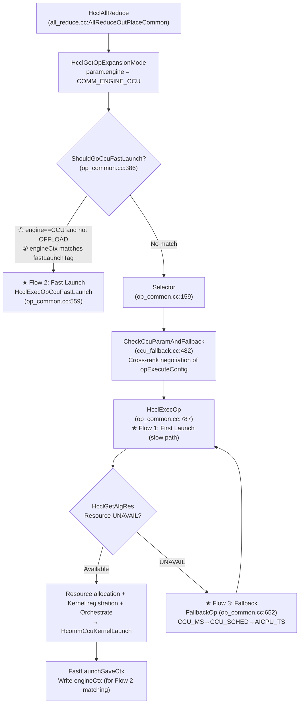
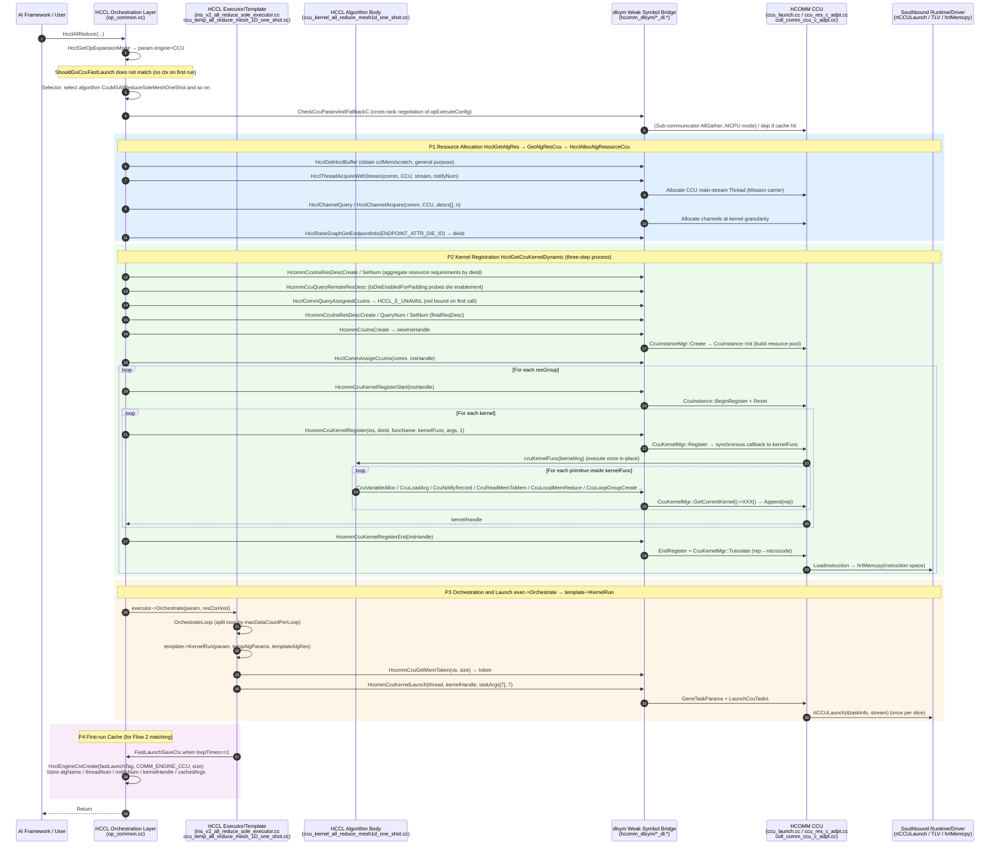

# CCU Mode Northbound Interface Call Sequence (First Launch / Fast Launch / Fallback to AICPU)

> Scope: Using AllReduce in the HCCL repository (`cann/hccl`) as the sample operator, this document describes the call sequence of **HCCL to HCOMM CCU northbound interfaces** (dlsym C ABI) under three main flows in CCU mode.
>
> Terminology:
> - **Northbound interface** = the C ABI boundary where HCCL calls HCOMM (weak symbols in `hccl/src/common/hcomm_dlsym/` + `dlsym`, exported by `HCOMM_WEAK_SYMBOL` on the HCOMM side). Southbound = the Runtime/Driver boundary below HCOMM (`rtCCULaunch` / TLV / `hrtMemcpy`), marked only as endpoints in this document.
> - **CCU three-phase model**: Registration phase "execute kernelFunc in-place to record rep" -> Translation phase "translate rep into microcode and load into instruction space" -> Launch phase "swap only taskArgs and dispatch".
>
> Code baseline: `hccl/`, `hcomm/`, and `CheckerL2/` reside at the same directory level.

---

## 0. Decision Entry Point for Three Flows (One Diagram)



The three flows differ only in which segments they execute and which they skip:

| Flow | Entry Point | Algorithm Selection | Resource Allocation / Kernel Registration | Runtime Northbound Call |
|---|---|---|---|---|
| ① First Launch | `HcclExecOp` slow path | Yes (Selector) | Yes (three-step + 84 primitive recording + translation) | `HcommCcuKernelLaunch` |
| ② Fast Launch | `ShouldGoCcuFastLaunch` match | No (reuse ctx.algName) | No (reuse ctx thread/kernelHandle/cachedArgs) | `HcommCcuKernelLaunch` |
| ③ Fallback to AICPU | Resource/negotiation failure → `FallbackOp` | Yes (ReSelector with degraded config) | **No longer uses CCU** (switches to AICPU resources) | None (switches to AICPU northbound family) |

---

## 1. CCU Northbound Interface Overview (Participants in the Call Sequence Diagram)

### 1.1 Interface Classification and Symbol/Implementation Mapping

| Class | Northbound Symbol (HCCL Side Declaration File) | HCOMM Side Implementation | Exposure Timing |
|---|---|---|---|
| **A. Communicator-Instance Binding** | `HcclCommQueryCcuIns` / `HcclCommQueryAssignedCcuIns` / `HcclCommAssignCcuIns`<br/>(`hccl_ccu_res_dl.h`) | `coll_comm_ccu_c_adpt.cc:67 / :109 / :148` | Resource allocation phase |
| **B. Instance/Resource Family** | `HcommCcuInsResDescCreate` / `Destroy` / `SetNum` / `QueryNum`, `HcommCcuInsCreate` / `CreateDefault` / `Destroy` / `QueryResDesc`, `HcommCcuQueryRemainResDesc`, `HcommCcuKernelQueryResReq`<br/>(`ccu_res_dl.h`) | `ccu_res_c_adpt.cc` | First operator resource allocation phase |
| **B'. Instance/Resource Family (legacy package compatibility)** | `HcommCcuInsCreateLegacy`, `HcommCcuGetMemToken` | `ccu_res_c_adpt.cc:195`, `ccu_launch.cc:406` | Legacy path / every launch |
| **C. Kernel Lifecycle (weak definition W)** | `HcommCcuKernelRegisterStart` / `HcommCcuKernelRegister` / `HcommCcuKernelRegisterEnd` / `HcommCcuKernelLaunch`<br/>(`ccu_launch_dl.h`) | `ccu_launch.cc:47 / :77 / :120 / :293` | Registration phase / every launch |
| **D. DSL Primitive Family (84 to 88 primitives)** | `CcuVariableAlloc` / `CcuLoadArg` / `CcuNotifyRecord` / `CcuNotifyWait` / `CcuWriteVariableWithNotify` / `CcuReadMemToMem` / `CcuLocalMemReduce` / `CcuLoopGroupCreate` / `CcuIf*` / `CcuWhile*` ...<br/>(`ccu_primitives_impl_dl.h` ↔ `hcomm/include/ccu/ccu_primitives.hpp`) | `ccu_primitives_impl.cc` | **Registration phase only** (inside kernelFunc) |
| **E. Thread/Channel (existing stubs + CCU branch)** | `HcclThreadAcquireWithStream` / `HcclChannelAcquire` / `HcclChannelQuery` / `HcclRankGraphGetEndpointInfo` | HCOMM base_comm thread/channel | Resource allocation phase (every slow path) / fast launch phase (thread only) |
| **F. Auxiliary Query** | `HcommCcuGetTaskArgsNum`, `HcclGetCcuTaskInfo` | `ccu_launch.cc:138` | Optional |

### 1.2 Key Invariants

1. **Registration phase records rep; launch phase swaps only args**: `HcommCcuKernelRegister` **synchronously calls back** `kernelFunc`. The function body issues `Ccu*` primitives one by one, which do not move data but only record actions as rep into `CcuKernel::res_`. The `Translate` call in `HcommCcuKernelRegisterEnd` translates rep into microcode and calls `LoadInstruction`.
2. **Primitives operate on the "currently registering kernel"**: All `Ccu*` implementations resolve to `CcuKernelMgr::GetInstance(devId).GetCurrentKernel()->XXX()`. They depend on the TLS registration transaction context.
3. **The threadHandle in `HcommCcuKernelLaunch` is an RTS Thread**: On the HCOMM side, the code performs `reinterpret_cast<hccl::Thread*>` and then calls `GetStream()->ptr()` to obtain the attached `aclrtStream`.

---

## 2. Flow 1: First Operator Launch (Slow Path)

### 2.1 Sequence Diagram



### 2.2 Key Steps and Northbound Interface List

| Phase | HCCL Call Site | Northbound Interface (dlsym) | HCOMM Implementation | Artifact |
|---|---|---|---|---|
| Algorithm Selection | `Selector`→`CheckCcuParamAndFallback` | (Sub-communicator negotiation, not on CCU main path) | `ccu_fallback.cc:482` | `algName` + final `opExecuteConfig` |
| Thread | `HcclAllocAlgResourceCcu`→`HcclGetThread` | `HcclThreadAcquireWithStream(CCU)` | base_comm thread | `resCtxHost->threads[0]` (main stream) |
| Channel | `HcclGetChannelForCcu`→`CcuAcquireKernelChannels` | `HcclChannelQuery`, `HcclChannelAcquire`, `HcclRankGraphGetEndpointInfo` | base_comm channel | `kernelArg->channels[i]` + `kernelInfo.dieId` |
| Requirement Aggregation | `BuildAggregatedResReq` | `HcommCcuInsResDescCreate` / `SetNum` / `Destroy`, `HcommCcuQueryRemainResDesc` | `ccu_res_c_adpt.cc` | `reqDescs` (by dieId) |
| Instance Query | `HcclGetCcuKernelDynamic` | `HcclCommQueryAssignedCcuIns` (UNAVAIL on first call) | `coll_comm_ccu_c_adpt.cc:109` | Proceeds to creation path |
| Instance Creation | `CreateAndAssignNewCcuIns` | `HcommCcuInsResDescCreate/QueryNum/SetNum`, `HcommCcuInsCreate`, `HcclCommAssignCcuIns` | `ccu_res_c_adpt.cc:208`, `coll_comm_ccu_c_adpt.cc:148` | `insHandle` bound to comm |
| Registration | `RegisterCcuKernels` | `HcommCcuKernelRegisterStart` / `HcommCcuKernelRegister` / `HcommCcuKernelRegisterEnd` | `ccu_launch.cc:47/:77/:120` | `kernelHandle` + microcode loaded |
| Recording | (HCOMM callback to kernelFunc) | `CcuVariableAlloc` / `CcuLoadArg` / `CcuNotify*` / `CcuReadMemToMem` / `CcuLocalMemReduce` / `CcuLoopGroupCreate` ... | `ccu_primitives_impl.cc` | `CcuKernel::res_` (rep sequence) |
| Launch | `template->KernelRun` | `HcommCcuGetMemToken`, `HcommCcuKernelLaunch` | `ccu_launch.cc:406/:293` | `rtCCULaunch` (southbound) |
| Cache | `FastLaunchSaveCtx` | (Not cross-repository, `HcclEngineCtxCreate`) | — | `fastLaunchCtx` |

> **CCU resource fallback points in the slow path**: If `HcclChannelAcquire` in `HcclGetChannelForCcu` returns `HCCL_E_UNAVAIL`, or if the capacity check in `HcclGetCcuKernelDynamic` / `HcommCcuInsCreate` / `HcommCcuKernelRegister` returns `CCU_E_UNAVAIL`, then `HcclGetAlgRes` returns `HCCL_E_UNAVAIL` and triggers Flow 3.

---

## 3. Flow 2: Fast Launch (Fast Path)

### 3.1 Sequence Diagram

```mermaid
sequenceDiagram
    autonumber
    participant APP as AI Framework / User
    participant OPS as HCCL Orchestration Layer<br/>(op_common.cc)
    participant EXE as HCCL Executor/Template
    participant DL as dlsym Weak Symbol Bridge
    participant HC as HCOMM CCU<br/>(ccu_launch.cc)
    participant HW as Southbound Runtime<br/>(rtCCULaunch)

    APP->>OPS: HcclAllReduce(...) (same shape, second call onward)
    OPS->>OPS: HcclGetOpExpansionMode → engine=CCU

    rect rgb(225,240,255)
    Note over OPS: ShouldGoCcuFastLaunch(op_common.cc:386)
    OPS->>OPS: Verify opMode!=OFFLOAD and engine==CCU
    OPS->>OPS: SetOpParamFastLaunchTag (compose tag from dataType/reduceOp/count/root)
    OPS->>OPS: HcclEngineCtxGet(comm, fastLaunchTag, COMM_ENGINE_CCU) → match ✓
    end

    OPS->>OPS: HcclExecOpCcuFastLaunch(op_common.cc:559)
    OPS->>OPS: CollAlgExecRegistryV2::GetAlgExec(opType, ctx->algName)
    OPS->>OPS: HcclGetHcclBuffer → param.hcclBuff (scratch)
    OPS->>DL: HcclThreadAcquireWithStream(comm, CCU, stream, ctx->notifyNumOnMainThread)
    DL->>HC: Override main stream (obtain one CCU Thread, write back to ctx->threads[0])
    OPS->>OPS: ConstructHcclDfxOpInfo + HcclDfxRegOpInfoByCommId
    opt Graph capture and multi-thread
        OPS->>OPS: CaptureSlaveStreams
    end

    rect rgb(235,250,235)
    Note over OPS,HW: executor->FastLaunch → template->FastLaunch (no Selector / no CalcRes / no Register)
    OPS->>EXE: executor->FastLaunch(param, ccuFastLaunchCtx)
    EXE->>EXE: Retrieve threads / submitInfos from ctx + new inputPtr/outputPtr
    EXE->>EXE: args[0]=inputPtr+args[7]; args[1]=outputPtr+args[8] (change addresses only)
    EXE->>DL: HcommCcuKernelLaunch(threads[0], kernelHandle, args, argSize)
    DL->>HC: GeneTaskParams (validate argsNum==LoadArg set) → LaunchCcuTasks
    HC->>HW: rtCCULaunch(&taskInfo, stream)
    end
    OPS->>OPS: HcclProfilingReportOp
    OPS-->>APP: Return
```

### 3.2 Key Differences from Flow 1

| Dimension | First Launch | Fast Launch |
|---|---|---|
| Decision | No fastLaunchTag match | `ShouldGoCcuFastLaunch` match |
| Algorithm Selection | `Selector` + cross-rank negotiation | None (use `CcuFastLaunchCtx::algName` directly) |
| Resource/Registration | Full `HcclGetAlgRes` + `HcommCcuKernelRegister*` | None (reuse thread / kernelHandle / cachedArgs) |
| Northbound Interfaces | Thread + Channel + Resource Family + Lifecycle + Primitives | **Only `HcclThreadAcquireWithStream` + `HcommCcuKernelLaunch`** |
| Cache Write | `FastLaunchSaveCtx` (when loopTimes==1 and not OFFLOAD) | — |
| Cache Structure | — | `CcuFastLaunchCtx{algName, threadNum, notifyNumOnMainThread, ccuKernelNum[], ThreadHandle[], CcuKernelSubmitInfo{handle, cachedArgs[48]}}` (`alg_param.h:407`) |

> `cachedArgs` layout convention (using one-shot as example): `[0]=inputAddr, [1]=outputAddr, [2]=token, [3..6]=goSize[0..3], [7]=inBuffBaseOff, [8]=outBuffBaseOff`. The fast path changes only `[0]/[1]`. The remaining fields (token/goSize/offset) are reused from cache. This is the prerequisite for "direct launch with same shape".

---

## 4. Flow 3: CCU Fallback to AICPU

Fallback has **4 trigger points**. All of them converge to `FallbackOp` (progressive degradation: `CCU_MS → CCU_SCHED → AICPU_TS`).

### 4.1 Trigger Point Overview

| # | Trigger Location | Condition | Handling |
|---|---|---|---|
| T1 | `HcclGetAlgRes` (`op_common.cc:863`) returns `HCCL_E_UNAVAIL` | Channel allocation / kernel registration / instance creation resource shortage | `HcclExecOp` calls `FallbackOp` |
| T2 | `CheckCcuParamAndFallback` inside `Selector` (`ccu_fallback.cc:482`) | Cross-rank exchange of `opExecuteConfig`; lowest common value is less than local | `ReSelector(lowestConfig)` directly degrades and reselects |
| T3 | `CheckCcuResNegotiation` in CCU branch of `GetAlgResWithEngine` (`ccu_fallback.cc:337`) | Local resources are OK but a peer rank has insufficient resources (AllReduce MIN negotiation fails) | `ReleaseCcuAcquiredChannels` → return `HCCL_E_UNAVAIL` |
| T4 | HCOMM `CreateCcuInsByFixedResNum` (`coll_comm_ccu_c_adpt.cc:21`) | CCU_MS instance resource shortage on legacy path | Internal degradation CCU_MS→CCU_SCHED, retry once |

### 4.2 Sequence Diagram (Resource Fallback Main Path T1 + Negotiation T2/T3)

```mermaid
sequenceDiagram
    autonumber
    participant OPS as HCCL Orchestration Layer<br/>(op_common.cc)
    participant NEG as Cross-rank Negotiation<br/>(ccu_fallback.cc)
    participant DL as dlsym Weak Symbol Bridge
    participant HC as HCOMM CCU
    participant AICPU as AICPU Execution Path<br/>(GetAlgResAICPU /<br/>HcclAicpuKernelEntranceLaunch)

    rect rgb(255,235,235)
    Note over OPS,HC: Trigger: resource shortage (DIE not enabled / capacity insufficient / channels insufficient)
    OPS->>DL: HcclGetCcuKernel → HcommCcuInsCreate / HcommCcuKernelRegister
    DL->>HC: Capacity/resource validation
    HC-->>OPS: CCU_E_UNAVAIL
    Note over OPS: HcclAllocAlgResourceCcu returns HCCL_E_UNAVAIL
    end

    rect rgb(255,245,225)
    Note over OPS,NEG: T3 Multi-card resource negotiation (confirm peers even if local succeeds)
    OPS->>NEG: CheckCcuResNegotiationC(comm, param, localResAvailable)
    NEG->>NEG: Obtain commName+"_negotiation" sub-communicator (AICPU mode)
    NEG->>AICPU: HcclAllReduce(MIN, localVal=success/failure flag) on subComm
    AICPU-->>NEG: result
    NEG-->>OPS: result==FAIL → HCCL_E_UNAVAIL (any peer has shortage)
    OPS->>OPS: ReleaseCcuAcquiredChannels (release allocated CCU channels)
    end

    rect rgb(225,240,255)
    Note over OPS,AICPU: T2 Cross-rank parameter negotiation (inside Selector, CANN>=9.2.0)
    OPS->>NEG: CheckCcuParamAndFallbackC
    NEG->>NEG: Check cacheTag=algName+config+"_ccuParamCache" (reuse directly on hit)
    NEG->>AICPU: HcclAllGather(CheckParamInfo) on subComm → obtain lowestConfig
    alt lowestConfig != local config
        NEG->>OPS: ReSelector(comm, param, topoInfo, algName, lowestConfig)
    end
    end

    rect rgb(240,240,240)
    Note over OPS,AICPU: FallbackOp progressive degradation (op_common.cc:652)
    OPS->>OPS: nextConfig: CCU_MS→CCU_SCHED; CCU_SCHED→AICPU_TS
    OPS->>OPS: HcclEngineCtxCreate(fallbackTag, COMM_ENGINE_CCU, FallbackCtxData)<br/>Cache algName + opExecuteConfig
    OPS->>OPS: ReSelector (param.opExecuteConfig=nextConfig → reselect algName)
    alt nextConfig == AICPU_TS
        OPS->>AICPU: LoadAICPUKernel()
    end
    OPS->>OPS: SetCommEngine() → param.engine=AICPU_TS; SetOpParamAlgTag()
    OPS->>OPS: HcclExecOp recursion (now takes AICPU branch)
    OPS->>AICPU: GetAlgResAICPU (HcclGetThread/HcclGetChannel, AICPU family)
    OPS->>AICPU: executor->Orchestrate → HcclAicpuKernelEntranceLaunch
    end

    Note over OPS: Next call with same algorithm: HcclExecOp entry checks fallbackTag match<br/>→ apply cached config/algName directly → recursive execution (no CCU retry)
```

### 4.3 Key Points

1. **Degradation occurs at the "config level", not "within this operator instance"**: `FallbackOp` first calls `ReSelector` with a lower `opExecuteConfig` to **reselect the algorithm**, then restarts `HcclExecOp` from the beginning. CCU_MS and CCU_SCHED are two separate resource threshold/algorithm sets (MS mode has larger LOOP/CCU_BUF/EVENT thresholds).
2. **Fallback results are cached in two locations**:
   - `fallbackTag = algName + "_fallback"`, `FallbackCtxData{algName, opExecuteConfig}` (written by `FallbackOp`, read at `HcclExecOp` entry) → next call reuses the degradation conclusion directly;
   - `cacheTag = algName + config + "_ccuParamCache"` (read/written by `CheckCcuParamAndFallback`) → skip cross-rank negotiation.
3. **Negotiation uses a "sub-communicator"**: Both `CheckCcuParamAndFallback` and `CheckCcuResNegotiation` lazily create a `commName+"_negotiation"` sub-communicator (`hcclOpExpansionMode=AICPU`) and run `HcclAllGather`/`HcclAllReduce` on it. Therefore the "communication" during fallback **no longer goes through CCU northbound interfaces**, avoiding coupling between fallback logic and CCU resources.
4. **No CCU northbound calls after fallback**: After `param.engine` changes to `AICPU_TS`, `HcclGetAlgRes`→`GetAlgResWithEngine` takes `GetAlgResAICPU`, and execution proceeds through `HcclAicpuKernelEntranceLaunch`. The CCU three-step process, primitives, and launch interfaces all disappear from that call.
5. **A single disabled die is not a fallback but a skip-padding action**: `IsDieEnabledForPadding` probes with `HcommCcuQueryRemainResDesc`. When the die is disabled (`CCU_E_UNAVAIL`), the system only skips padding for that die to avoid redundant allocation. Fallback occurs only when capacity is truly insufficient.

### 4.4 Fallback to AICPU Step-by-Step Operation List (in Call Order)

> Goal: answer "what exactly happens during one CCU-to-AICPU fallback". The process is broken into five segments: **trigger → rollback → degraded reselection → recursive execution → memorization**. Each step is annotated with its call site and interface.

#### Phase 0: Trigger Evaluation (the "cause" of fallback)

| # | Trigger Point | Code Location | Trigger Condition | Local/Peer Relationship | Next Destination |
|---|---|---|---|---|---|
| T1 | `HcclExecOp` captures `HcclGetAlgRes` returning `HCCL_E_UNAVAIL` | `op_common.cc:863` | Channel allocation / kernel registration / instance creation resource shortage | Local | `FallbackOp` |
| T2 | `CheckCcuParamAndFallback` inside `Selector` | `ccu_fallback.cc:482` (`op_common.cc:225`) | Cross-rank exchange of `opExecuteConfig`; received value lower than local | Cross-rank minimum | Direct `ReSelector` (**does not go through `FallbackOp`**) |
| T3 | `CheckCcuResNegotiation` in CCU branch of `GetAlgResWithEngine` | `op_common.cc:1578` / `ccu_fallback.cc:337` | Local resources OK, but `HcclAllReduce(MIN)` negotiation finds **any rank** insufficient | Peer | Release local channels → return UNAVAIL → then T1 enters `FallbackOp` |
| T4 | HCOMM legacy path `CreateCcuInsByFixedResNum` | `coll_comm_ccu_c_adpt.cc:21` | Resource shortage when creating CCU_MS instance with fixed resources | Local | Internal `CCU_MS→CCU_SCHED` retry once (**still within CCU**) |

> Note the difference between T2 and T1/T3: **T2 is "selection-phase degradation"** (only swaps `opExecuteConfig` and `algName`; the system may still stay on CCU afterward). **T1/T3/T4 are "execution-phase fallback"**. Only `FallbackOp` can degrade all the way to AICPU_TS.

#### Phase 1: Local Resource Rollback (settle accounts before fallback)

| Operation | Interface/Code | Description |
|---|---|---|
| Release channels newly created for this CCU kernel | `ReleaseCcuAcquiredChannels` (`op_common.cc:1531`) → `HcclChannelDestroy(comm, acquiredChannels[], n)` | Release only `resRequest.acquiredChannels` (channels that `CcuAcquireKernelChannels` recorded as newly created by this `HcclChannelAcquire`; pre-existing reused channels are not released). Call `clear()` after release. |
| Automatic rollback when channel allocation fails mid-way | `CcuAcquireKernelChannels` UNAVAIL branch (`op_common.cc:2269-2273`) | On mid-allocation failure, call `ReleaseCcuAcquiredChannels` immediately. Do not propagate dirty state. |
| Rollback on negotiation failure | `GetAlgResWithEngine` (`op_common.cc:1581`) | After `CheckCcuResNegotiation` returns UNAVAIL, release channels then return UNAVAIL |
| **Actions not taken** | — | Created `CcuInstance`, registered `CcuKernel`/microcode, and main-stream `Thread` are **not actively destroyed** (the comm owns them; they can be reused if CCU is retried next time; the AICPU path does not reuse them but does not need to tear them down either) |

#### Phase 2: `FallbackOp` Main Body (`op_common.cc:652`)

| Step | Operation | Code/Interface | Description |
|---|---|---|---|
| 1 | Compute `nextConfig` | `FallbackOp:656-670` | `CCU_MS→CCU_SCHED`; `CCU_SCHED→AICPU_TS`; already at AICPU_TS or unknown → `HCCL_E_NOT_SUPPORT` (CANN<9.2.0 goes directly to `AICPU_TS`) |
| 2 | Allocate fallback result cache | `HcclEngineCtxCreate(comm, fallbackTag, COMM_ENGINE_CCU, sizeof(FallbackCtxData))` (`:674`) | `fallbackTag = algName+"_fallback"` (`SetOpParamFallbackTag`, `:812`); **note the ctx is stored under the CCU engine**, but its content is the fallback conclusion |
| 3 | Degraded reselection | `ReSelector(comm, param, topoInfo, algName, nextConfig)` (`:676`) | See Phase 3 |
| 4 | Write post-fallback algorithm name | `sprintf_s(ctxData->algName, algName)` (`:677`) | `FallbackCtxData{algName, opExecuteConfig}` (`op_common.h:36`) |
| 5 | Write post-fallback config | `ctxData->opExecuteConfig = param.opExecuteConfig` (`:682`) | For next top-level call to match |
| 6 | Continue execution with new config | `HcclExecOp(comm, param, topoInfo, algName, resPack)` (`:683`) | Recursive call; see Phase 4 |

#### Phase 3: `ReSelector` Reselection (`op_common.cc:687`)

| Step | Operation | Description |
|---|---|---|
| 1 | `param.opExecuteConfig = executeConfig` | Overwrite with `nextConfig` |
| 2 | **Do not recompute topology** | Reuse the already computed `topoInfo` (difference from the first `Selector` call) |
| 3 | Reselect algorithm | `SelectorEngine::Global()->Run(...)` or `ExecuteSelector::Run(...)`; candidate engine priority is given by `SelectorEngine::GetEnginePriority`: `CCU_MS→{CCU_MS,CCU_SCHED,AICPU_TS,HOSTCPU}`, `CCU_SCHED→{CCU_SCHED,AICPU_TS,HOSTCPU}` |
| 4 | Update engine | `SetCommEngine(param)` (`op_common.cc:3288`): `AICPU_TS→COMM_ENGINE_AICPU_TS`, `CCU_MS/CCU_SCHED→COMM_ENGINE_CCU` |
| 5 | Load artifacts for new engine | Landing on `AICPU_TS` → `LoadAICPUKernel()` (`load_kernel.cc:40`, internally prevents duplicate loading); landing on `AIV` → `RegisterKernel()` |
| 6 | Update algTag | `SetOpParamAlgTag(param, algName)` |
| 7 | Return | `checkValidAlgName` validates non-empty |

#### Phase 4: Recursive `HcclExecOp` Takes the AICPU Path

| Step | Operation | Code/Interface | Description |
|---|---|---|---|
| 1 | Entry checks fallback cache | `HcclEngineCtxGet(comm, fallbackTag, param.engine, ...)` (`:813`) | algName has changed in this recursion, so usually no match; next top-level call matches |
| 2 | Resource allocation (AICPU family) | `GetAlgResWithEngine` → `GetAlgResAICPU` → `HcclAllocAlgResourceAICPU` (`:1751`) | `HcclGetHcclBuffer` (scratch), `HcclGetThread`→`HcclGetAicpuThread` (`HcclThreadAcquireWithConfig(COMM_ENGINE_AICPU)` + expand stream Thread), `HcclGetChannel` |
| 3 | ctx serialization and dispatch | `Serialize()` + `HcclMemcpyCtxHostToDevice` (`:1735`) | `HcclEngineCtxCreate(AICPU_TS)` + `HcclEngineCtxCopy` |
| 4 | Execution | `executor->Orchestrate` → `HcclAicpuKernelEntranceLaunch` (`:902`) | **No CCU northbound interfaces appear here** |
| 5 | Cache check (AICPU side) | `HcclAivCacheCheckAndReplay` / `aicpuCacheEnable` | Unrelated to fallback; uses its own cache |

#### Phase 5: Memorization (avoid future fallback)

| Cache | Key | Write Point | Hit Effect |
|---|---|---|---|
| Fallback conclusion | `fallbackTag = algName+"_fallback"` (COMM_ENGINE_CCU) | `FallbackOp:674` | Next top-level `HcclExecOp` entry (`:813`) matches → directly set `param.opExecuteConfig=cached config` + `SetCommEngine` (→AICPU_TS) + `SetOpParamAlgTag(cached algName)` → recursive execution (**no CCU three-step/resource allocation retry**) |
| Cross-rank parameter negotiation conclusion | `cacheTag = algName+"_"+config+"_ccuParamCache"` (COMM_ENGINE_CCU) | `ccu_fallback.cc:553` | Next `CheckCcuParamAndFallback` matches → if config is the same, skip negotiation; if config differs, apply cached conclusion directly (`SetCommEngine`+`SetOpParamAlgTag`) |

#### Appendix: What the "Negotiation Communication" Itself Uses During Fallback

Both `CheckCcuParamAndFallback` and `CheckCcuResNegotiation` lazily create a `commName+"_negotiation"` **sub-communicator** (`hcclOpExpansionMode=AICPU`, `ccu_fallback.cc:199`) and prepare:

| Resource | Operation | Code |
|---|---|---|
| Stream | `aclrtCreateStream` | `ccu_fallback.cc:158` |
| Host/Device Buffer | `aclrtMallocHost` / `aclrtMalloc` (one each for send/recv) | `ccu_fallback.cc:162-181` |
| Sub-communicator | `HcclCreateSubCommConfig` (rankIds identity mapping) | `ccu_fallback.cc:213` |
| Persistent worker | `CommWorkerMgr::GetInstance().Submit(comm, task)` serializes negotiation operator execution | `ccu_fallback.cc:273` |
| Parameter negotiation | `HcclAllGather(CheckParamInfo)` → `CompareCcuParam` obtains lowest config | `ccu_fallback.cc:408 / :433` |
| Resource negotiation | `HcclAllReduce(MIN, 0x5a5a5a5a/0x0)` → `CompareNegotiationResult` | `ccu_fallback.cc:297 / :326` |
| Pre-reuse cleanup | `ClearNegotiationBuf` (memset host/device send/recv buffers) | `ccu_fallback.cc:136` |
| Lifecycle | `NegotiationCleanupCb`: `DESTROY_PRE` releases (`Remove` worker → `CleanupNegotiationRes` → `HcclEngineCtxDestroy`), `RESUME_POST` cascades `HcclCommResume` | `ccu_fallback.cc:96` |

> Therefore all "communication" on the fallback chain completes within the AICPU sub-communicator and **does not go through CCU northbound interfaces**, ensuring that fallback decisions are decoupled from CCU resources.

#### One-Sentence Summary

One "CCU fallback to AICPU" = **release local dirty channels** → **`FallbackOp` creates fallback cache + `ReSelector` degrades and reselects (CCU_MS→CCU_SCHED→AICPU_TS)** → **recursive `HcclExecOp` uses the AICPU engine to reallocate thread/channel and execute** → **write conclusion into `fallbackTag`/`cacheTag`**, so subsequent calls with the same algorithm **start directly from AICPU** and never re-enter CCU.

---

## 5. Northbound Interface Call Comparison Across Three Flows

| Northbound Interface | ① First Launch | ② Fast Launch | ③ Fallback to AICPU |
|---|:---:|:---:|:---:|
| `HcclCommQueryAssignedCcuIns` | ✓ | — | ✓ (failure triggers fallback) |
| `HcclCommAssignCcuIns` | ✓ | — | — (skipped after fallback) |
| `HcommCcuInsResDescCreate/SetNum/QueryNum/Destroy` | ✓ | — | ✓ (failure triggers fallback) |
| `HcommCcuQueryRemainResDesc` | ✓ (die probing) | — | ✓ (failure triggers fallback) |
| `HcommCcuKernelQueryResReq` | (optional) | — | (optional) |
| `HcommCcuInsCreate` | ✓ | — | ✓ (failure triggers fallback) |
| `HcclThreadAcquireWithStream(CCU)` | ✓ | ✓ | — |
| `HcclChannelAcquire/HcclChannelQuery` | ✓ | — | — |
| `HcclRankGraphGetEndpointInfo` | ✓ | — | — |
| `HcommCcuKernelRegisterStart/Register/RegisterEnd` | ✓ | — | — |
| `Ccu*` DSL Primitives (84 to 88) | ✓ (callback recording) | — | — |
| `HcommCcuGetMemToken` | ✓ | — (reuse token from cachedArgs) | — |
| `HcommCcuKernelLaunch` | ✓ | ✓ | — |
| AICPU Northbound Family (`HcclThreadAcquire*`/`HcclGetChannel`/...) | — | — | ✓ |

---

## 6. Reference File List

**HCCL Repository**
- `src/ops/all_reduce/all_reduce.cc` (operator entry / fast path branch)
- `src/ops/op_common/op_common.cc` (`Selector` / `HcclExecOp` / `HcclGetAlgRes` / `HcclAllocAlgResourceCcu` / `HcclGetChannelForCcu` / `HcclGetCcuKernel` / `ShouldGoCcuFastLaunch` / `HcclExecOpCcuFastLaunch` / `FallbackOp` / `ReSelector` / `SetCommEngine`)
- `src/ops/op_common/ccu_fallback.{h,cc}` (`CheckCcuResNegotiation` / `CheckCcuParamAndFallback`)
- `src/ops/op_common/inc/alg_param.h` (`CcuKernelSubmitInfo` / `CcuFastLaunchCtx`)
- `src/ops/all_reduce/algorithm/executor/ins_v2_all_reduce_sole_executor.cc` (`Orchestrate` / `OrchestrateLoop` / `FastLaunchSaveCtx` / `FastLaunch`)
- `src/ops/all_reduce/algorithm/template/ccu/ccu_temp_all_reduce_mesh_1D_one_shot.cc` (`CalcRes` / `KernelRun` / `FastLaunch`)
- `src/ops/all_reduce/algorithm/template/ccu/kernel/ccu_kernel_all_reduce_mesh1d_one_shot.{h,cc}` (algorithm body, registration-phase recording)
- `src/common/hcomm_dlsym/` (`ccu_launch_dl.*`, `ccu_res_dl.*`, `hccl_ccu_res_dl.*`, `ccu_primitives_impl_dl.*`)

**HCOMM Repository**
- `include/ccu/ccu_launch.h` / `ccu_primitives.hpp` / `ccu_res.h` (northbound CCU API)
- `src/base_comm/primitives/api_c_adpt/ccu/ccu_launch.cc` (`HcommCcuKernelRegister*` / `HcommCcuKernelLaunch` / `HcommCcuGetMemToken`)
- `src/base_comm/primitives/api_c_adpt/ccu/ccu_res_c_adpt.cc` (`HcommCcuInsCreate*`)
- `src/base_comm/primitives/api_c_adpt/ccu/ccu_primitives_impl.cc` (`Ccu*` primitive C adapter)
- `src/coll_communicator_mgr/api_c_adpt/coll_comm_ccu_c_adpt.cc` (`HcclCommQuery/AssignCcuIns`)
- `src/base_comm/resources/ccu/ccu_instance/`, `ccu_kernel/`, `ccu_representation/` (instance / Kernel / rep→microcode translation)

**Related Existing Documents (CheckerL2)**
- `ccu_allreduce_call_flow.md` (AllReduce CCU end-to-end flow)
- `ccu_dataplane_architecture.md` (control plane / data plane SO split)
- `docs/CCU northbound hijacking four-scheme comparison and selection.md` (hccl→hcomm CCU call sequence and stubbing targets)
