# Checker Quick Start Guide

This document introduces the basic concepts and processing flow of Checker. The [Error Code FAQ](faq/modules/checker_faq_en.md) expands on specific scenarios by error code.

[toc]

## 1 What Is Checker

Checker is a static verification tool. It does not intervene in operator execution. Instead, it reads the records left after operator execution, rebuilds the execution graph, and performs static analysis to determine whether the operator execution is logically correct.
- Checker input: operator information + task data for each Rank + CCU instruction sequence
- Checker output: verification conclusion (success/failure) + error log

---

## 2 Checker Overall Flow

### 2.1 Key Terminology

| Term | Description |
|------|------|
| Communicator | A group of communication members that describes the communication scope|
| Communication member | Commonly called a rank; the smallest logical entity participating in communication. Each rank is assigned a unique identifier, namely `rankId`|
| Communication operator | A single collective communication operation, such as `AllReduce` or `AllGather`. Communication operators typically employ different communication algorithm implementations depending on network topology, data volume, and hardware resource scenarios |
| Task | The core data structure of Checker. It describes a record of one atomic operation on a rank, such as memory transfer, Reduce, or memory copy |
| Task graph | The core data structure of Checker. It expresses the task nodes generated by an operator execution and their dependency relationships |
| Node | Each node on the task graph is a task |
| Stream | A queue within a rank that executes tasks in order. Each task uses `streamId` to record which queue it belongs to |
| Task type | Different task types serve different purposes, for example: executing memory transfers, Reduce operations, or synchronization |

### 2.2 Checker Processing Flow

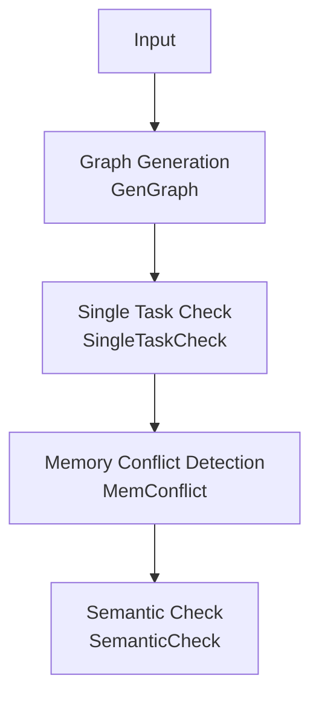

| Phase | Purpose |
|------|------|
| Graph Generation | Generate the task graph based on Checker input. In CCU mode, convert CCU instructions into a task graph |
| Single Task Check | Check whether memory ranges of individual tasks are valid and verify slave stream head/tail structure |
| Memory Conflict Detection | Check whether unprotected memory overlaps exist between concurrent tasks |
| Semantic Check | Simulate the operator execution process and verify whether the final output matches the operator expectation |

---

## 3 Task Graph
The task graph is the core data structure of Checker. It expresses the task nodes generated by an operator execution and their dependency relationships. The task graph is generated during the graph generation phase based on Checker input.

### 3.1 Nodes and Edges

Each node on the task graph is a task with a specific task type that indicates the concrete operation the node performs. Common types are as follows:

| Task Type | Description | Core Fields |
|---|---|---|
| `TRANS_MEM` | Memory data transfer | `srcDeviceId`, `srcOffset`<br>`dstDeviceId`, `dstOffset`<br>`len`, `type` |
| `BATCH_TRANS_MEM` | Batch memory data transfer; one node contains multiple `(src -> dst)` transfer relationships | `srcs[]`<br>`dsts[]` |
| `REDUCE` | Data reduction | `srcDeviceId`, `srcOffset`<br>`dstDeviceId`, `dstOffset`<br>`type`, `dataCount`, `dataType`, `reduceOp` |
| `BATCH_REDUCE` | Batch data reduction; one node contains multiple `(src -> dst)` reduction relationships | `srcs[][]`<br>`dsts[]`<br>`dataType`, `reduceOp` |
| `RECORD` / `WAIT` | Synchronization tasks. They represent sending a synchronization signal and waiting for a synchronization signal respectively | `srcDeviceId` (sender)<br>`dstDeviceId` (waiter)<br>`notifyId` |

In addition to the real execution tasks above, the task graph also adds `START` / `END` virtual boundary nodes. These nodes do not correspond to actual data transfer or computation actions. They mainly express boundaries of the main graph, subgraphs, and Loop structures.

| Virtual Node Type | Supported `boundaryType` | Description |
|---|---|---|
| `START` | `MAIN_GRAPH`, `CCU_SUB_GRAPH`, `AIV_SUB_GRAPH`, `LOOP` | Start boundary node. Marks the entire task graph entry, or the start position of a CCU/AIV subgraph or Loop segment |
| `END` | `CCU_SUB_GRAPH`, `AIV_SUB_GRAPH`, `LOOP` | End boundary node. Marks the end position of a CCU/AIV subgraph or Loop segment and uniformly aggregates tail nodes within that boundary |

Edges represent the execution ordering between nodes. The tail node of a directed edge always executes after the head node. Edges fall into the following two categories:

| Edge Type | Description |
|--------|------|
| Sequential edge | Dependency edges connected by execution order within the same stream, as shown in the diagram below: `rank0/stream0` has two sequentially executed tasks, `rank1/stream0` has three sequentially executed tasks |
| Synchronization edge | Dependency edges between synchronization task nodes, as shown in the diagram below: the `WAIT` node must wait for the signal from the `RECORD` node before it can continue. A directed edge from `RECORD` to `WAIT` represents this dependency |

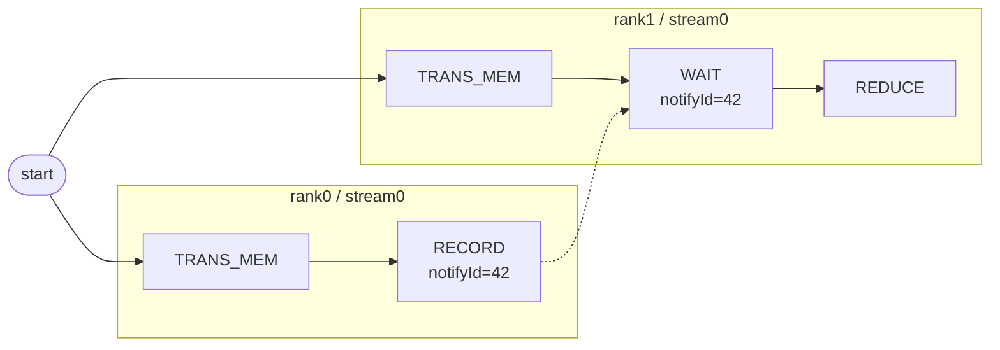

### 3.2 Task Graph Examples

#### 3.2.1 AICPU Mode
In AICPU mode, the task graph is typically composed of `RECORD`, `WAIT`, and `TRANS_MEM` node types. Below is a typical 2-rank `AllGather` example where each rank has two streams. Sequential edges within streams are shown by execution sequence, and dashed lines represent `RECORD` to `WAIT` synchronization dependencies.

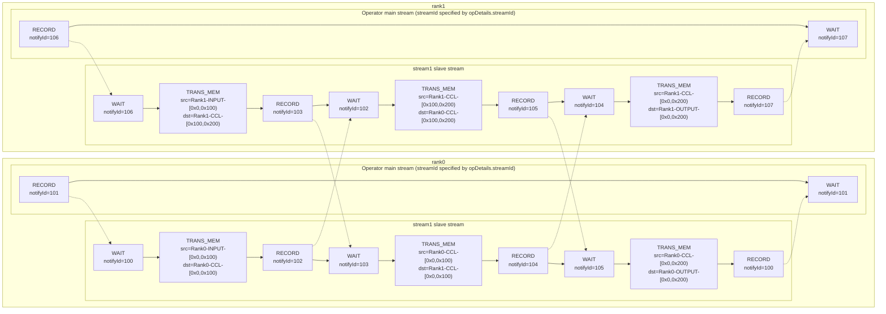

#### 3.2.2 CCU Mode
In CCU mode, Checker expands CCU instructions into CCU subgraphs. The following uses the 2-rank `AllReduce` data flow. CCU subgraph-external synchronization operations are omitted. Only the task sequence inside the CCU subgraph is retained. CCU uses synchronization fields that change from `notifyId` to `cke` / `mask`. The intermediate buffer uses the CCU `MS` type.

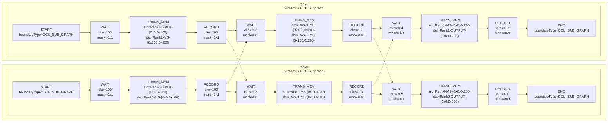

#### 3.2.3 Graphviz Basic Visualization
Checker provides task graph export capability to output the task graph as a Graphviz `.dot` file.

The exported content includes not only "which nodes exist" but also information commonly used during debugging directly embedded in the graph:
- Nodes are arranged by `rank / stream` for easy observation of sequential relationships on the same execution queue
- Solid lines represent normal dependency edges; dashed lines represent `RECORD -> WAIT` synchronization dependency edges
- Node labels include task type, `nodeId`, location information, and key fields such as memory segments, `notifyId`, or `cke/mask`

Usage:
- Checker automatically attempts to export the `.dot` file after graph generation completes. No extra switch is needed.
- After successful export, search for `[GraphvizDot]` in the log. The log prints the final file path, typically `hccl_vm_install/data/`
- Output file name format is `TaskGraph_YYYYMMDDHHMMSS.dot`

> After obtaining the `.dot` file, use `Microsoft VS Code` plugins such as `Graphviz Interactive Preview` for instant browsing.


---

## 4. Single Task Check
This phase mainly checks whether memory ranges of individual tasks are valid and verifies slave stream head/tail structure.

### 4.1 Memory Range (MemSlice)

The most important information in memory transfer and reduction tasks is the memory range (MemSlice). A memory range consists of the following information:

```
MemSlice = { rankId, type, offset, len }
```

- `rankId` indicates which rank the memory belongs to
- `type` indicates the memory type
  | Memory Type | Purpose |
  |----------|------|
  | INPUT | Operator input BUFFER |
  | OUTPUT | Operator output BUFFER |
  | CCL | CCL_BUFFER |
  | MS_CCU | CCU MS |
- `offset` and `len` together define the memory access range
  - `offset` indicates the start address of this access within the memory segment
  - `len` indicates the length of this memory access
  - Access ranges use half-open notation: `[offset, offset + length)` is the memory segment for this access


Verification points for a single task memory range:
- `offset + length` must not overflow the `uint64` upper bound; otherwise an error is reported
- Multiple MemSlice entries within the same task must not have range overlap under the same `(rankId, memType)`; otherwise an error is reported
    ```mermaid
    gantt
        title MemSlice Range Comparison
        dateFormat x
        axisFormat %L
        tickInterval 100millisecond

        section Valid (no overlap)
        Slice A  0x000-0x400 : 0, 400
        Slice B  0x400-0x800 : 400, 800

        section Violation (overlap)
        Slice A  0x000-0x600 : crit, 0, 600
        Slice B  0x400-0x800 : crit, 400, 800
    ```
- Different `type` values represent independent address spaces. The same `offset` under different `type` values does not constitute overlap
- `offset + length` must not exceed the boundary of the current `type` address space
    ```mermaid
    gantt
        title MemSlice Boundary Check
        dateFormat x
        axisFormat %L
        tickInterval 100millisecond

        section Valid (within bounds)
        Type Space [0x000,0x800) : 0, 800
        MemSlice   [0x200,0x500) : 200, 500

        section Violation (out of bounds)
        Type Space [0x000,0x800) : 0, 800
        MemSlice   [0x600,0x900) : crit, 600, 900
    ```

### 4.2 Slave Stream Structure Verification

Slave streams execute auxiliary tasks for operators, such as data pre-fetching. The operator main stream is specified by `opDetails.streamId` and is no longer assumed to be `stream0`. In the HCCL programming model, the main stream triggers the slave stream through synchronization tasks `RECORD -> WAIT`. After the slave stream completes, another set of synchronization tasks notifies the main stream. Therefore the slave stream must satisfy a fixed head/tail structure: first task is `WAIT` and last task is `RECORD`.

The diagram below shows an error example. Nodes marked in red are violation nodes:
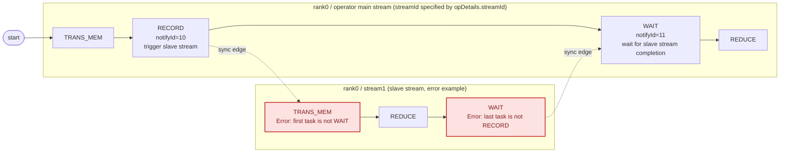

---

## 5. Memory Conflict Check

This phase verifies whether memory conflicts may exist in the task graph. A memory conflict means: at the same time, multiple memory operations access the same memory segment, and at least one operation is a write. When a memory conflict occurs, the value of the conflicting memory segment is indeterminate, which causes accuracy issues in the collective communication operator.

### 5.1 Memory Conflict Determination Criteria

Two memory access task nodes are determined to have a memory conflict when all three of the following conditions are met:
1. The two nodes may execute concurrently (no path exists between the two nodes on the task graph)
2. The accessed memory address ranges overlap
3. At least one side performs a write operation

Checker efficiently verifies every pair of memory access task nodes to ensure no omissions.

### 5.2 Memory Conflict Example
The diagram below shows a task graph example with a memory conflict:

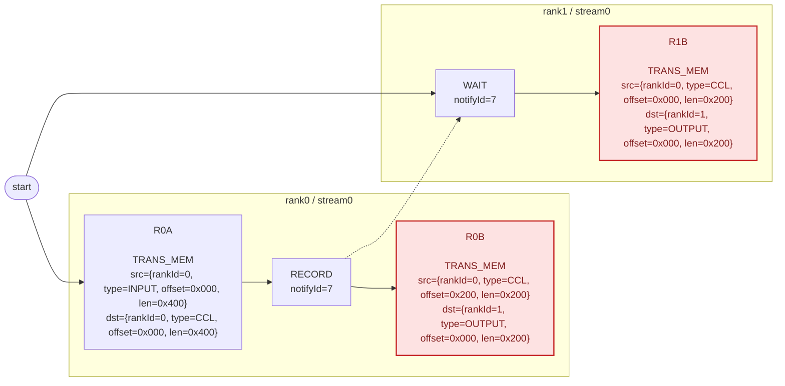

- `R0A` and `R0B` execute sequentially on the same stream. They do not meet the concurrent execution condition, so no memory conflict occurs.
- `R0A` and `R1B` have their execution order constrained by synchronization nodes: `R0A -> R0RECORD -> R1WAIT -> R1B`. So no memory conflict occurs.
- `R0B` and `R1B` can execute concurrently, and their write destination `dst` fully overlaps. Therefore a memory conflict exists.

### 5.3 Conflict Log Interpretation

The memory conflict check error log format is as follows:

```text
[ErrorCode: 302] Two tasks may access the same memory range in parallel, and at least one access is a write.
  Conflict memory : rank 0 OUTPUT
  Overlap range    : [0x0,0xc80)
  Conflict task 1:
    node 17, action=write
    access range : [0x0,0xc80)
    task         : [TaskTransMem] node=17, rank=1, stream=0, queue=0, protocol=SDMA, src=rank 1 CCL [0x0,0xc80), dst=rank 0 OUTPUT [0x0,0xc80)
  Conflict task 2:
    node 23, action=write
    access range : [0x0,0xc80)
    task         : [TaskTransMem] node=23, rank=2, stream=0, queue=0, protocol=SDMA, src=rank 2 CCL [0x0,0xc80), dst=rank 0 OUTPUT [0x0,0xc80)
```

Log field descriptions:

| Field | Meaning |
|----|------|
| `[ErrorCode: 302]` | Memory conflict error code, corresponding to `MEMCONFLICT_DETECTED` |
| `Conflict memory : rank X TYPE` | Location of the conflicting memory |
| `Overlap range : [start,end)` | The address range where the two accesses truly overlap |
| `Conflict task 1 / Conflict task 2` | The two accesses finally determined to be "concurrently executable with overlapping addresses" |
| `node X, action=read/write` | Node ID in the task graph and the read/write type of this access. A conflict is reported as long as at least one of the two accesses is `write` |
| `access range : [start,end)` | The full address range covered by this access. This range may differ from `Overlap range` |
| `task :` | Specific task details (task type, node ID, location, src/dst memory ranges, and so on) |
---

## 6. Semantic Check

The semantic check phase traverses the task graph in topological order, simulates the operator execution process, and verifies whether the final output matches the operator expectation.

### 6.1 BufferSemantic

During semantic checking, Checker maintains a data provenance record for each memory segment:

```
BufferSemantic = {
  startAddr:  memory range start address (offset)
  size:       memory range length (len)
  srcBufs:    data source set; each item is {rankId, bufferType, srcAddr}
  isReduce:   whether this is a Reduce operation
  reduceType: Reduce operation type SUM/MAX/MIN/...
}
```

The `srcBufs` field records data provenance. `bufferType` indicates the source buffer type, for example `INPUT`, `OUTPUT`, or `CCL`.

When each node executes, the system translates every `(src -> dst)` relationship into one of the following two operations, then writes back to the target address space. `(src -> dst)` represents one transfer or reduction relationship from source address to target address:

| TaskType | Operation | Behavior |
|----------|------|------|
| `TRANS_MEM` / `BATCH_TRANS_MEM` | overwrite | First clear existing semantics in the target range, then copy the source semantics over |
| `REDUCE` / `BATCH_REDUCE` | reduce | Require the target range to be pre-filled with semantics; otherwise report an error. Then append the new source into `srcBufs` and set `isReduce=true` |

### 6.2 OUTPUT Expectations for Each Operator

The goal of semantic checking is to determine whether the `OUTPUT` of each rank matches the expectation for the current operator. Operator expectations are as follows:

| Operator | OUTPUT Semantic Expectation |
|------|----------------|
| AllReduce | OUTPUT of every rank is the reduce result of all rank INPUTs |
| AllGather | OUTPUT of every rank is the sequential concatenation of all rank INPUTs |
| ReduceScatter | OUTPUT of each rank is the shard assigned to that rank after global reduce |
| AllGatherV | Same as AllGather, but each rank contributes a different size |
| ReduceScatterV | Same as ReduceScatter, but each rank output shard has a different size |
| Send/Recv | OUTPUT of the target rank equals INPUT of the source rank; single source with no reduce |
| BatchSendRecv | Multiple Send/Recv pairs execute simultaneously |
| Broadcast | OUTPUT of all ranks equals INPUT of the root rank |
| Reduce | Only the root rank OUTPUT is the reduce result of all rank INPUTs |
| All2All | `OUTPUT[i]` of each rank equals `INPUT[this rank offset]` of `rank i` |

The diagram below uses 2-rank collective communication operators as examples to show the `OUTPUT` expectations:

**AllReduce**

```mermaid
gantt
    title AllReduce (2-rank)
    dateFormat x
    axisFormat %L
    tickInterval 100millisecond

    section rank0.INPUT
    rank0.INPUT : 0, 100

    section rank1.INPUT
    rank1.INPUT : 0, 100

    section rank0.OUTPUT
    rank0.INPUT + rank1.INPUT : 0, 100

    section rank1.OUTPUT
    rank0.INPUT + rank1.INPUT : 0, 100
```

**AllGather / AllGatherV**

```mermaid
gantt
    title AllGather (2-rank)
    dateFormat x
    axisFormat %L
    tickInterval 100millisecond

    section rank0.INPUT
    rank0.INPUT : 0, 100

    section rank1.INPUT
    rank1.INPUT : 0, 100

    section rank0.OUTPUT
    rank0.INPUT : 0, 100
    rank1.INPUT : 100, 200

    section rank1.OUTPUT
    rank0.INPUT : 0, 100
    rank1.INPUT : 100, 200
```

`AllGatherV` has the same semantics as the diagram above, except each rank contribution length may differ.

**ReduceScatter / ReduceScatterV**

```mermaid
gantt
    title ReduceScatter (2-rank, shard Len=100 each)
    dateFormat x
    axisFormat %L
    tickInterval 100millisecond

    section rank0.INPUT
    rank0.INPUT1 : 0, 50
    rank0.INPUT2 : 50, 100

    section rank1.INPUT
    rank1.INPUT1 : 0, 50
    rank1.INPUT2 : 50, 100

    section rank0.OUTPUT
    rank0.INPUT1 + rank1.INPUT1 : 0, 50

    section rank1.OUTPUT
    rank0.INPUT2 + rank1.INPUT2 : 50, 100
```

`ReduceScatterV` has the same semantics as the diagram above, except each rank output shard length may differ.

**Send/Recv**

```mermaid
gantt
    title Send/Recv (2-rank, src=0, dst=1)
    dateFormat x
    axisFormat %L
    tickInterval 100millisecond

    section rank0.INPUT
    rank0.INPUT : 0, 100

    section rank1.INPUT
    None: 0,0

    section rank0.OUTPUT
    None: 0,0

    section rank1.OUTPUT
    rank0.INPUT : 0, 100
```

**BatchSendRecv**

```mermaid
gantt
    title BatchSendRecv (2-rank)
    dateFormat x
    axisFormat %L
    tickInterval 100millisecond

    section rank0.INPUT
    rank0.INPUT : 0, 100

    section rank1.INPUT
    rank1.INPUT : 0, 100

    section rank0.OUTPUT
    rank1.INPUT : 0, 100

    section rank1.OUTPUT
    rank0.INPUT : 0, 100
```

**Broadcast**

```mermaid
gantt
    title Broadcast (2-rank, root=0)
    dateFormat x
    axisFormat %L
    tickInterval 100millisecond

    section rank0.INPUT
    rank0.INPUT : 0, 100

    section rank1.INPUT
    None: 0,0

    section rank0.OUTPUT
    rank0.INPUT : 0, 100

    section rank1.OUTPUT
    rank0.INPUT : 0, 100
```

**Reduce**

```mermaid
gantt
    title Reduce (2-rank, root=0, SUM)
    dateFormat x
    axisFormat %L
    tickInterval 100millisecond

    section rank0.INPUT
    rank0.INPUT : 0, 100

    section rank1.INPUT
    rank1.INPUT : 0, 100

    section rank0.OUTPUT
    rank0.INPUT + rank1.INPUT : 0, 100

    section rank1.OUTPUT
    None: 0,0
```

**All2All**

```mermaid
gantt
    title All2All (2-rank)
    dateFormat x
    axisFormat %L
    tickInterval 100millisecond

    section rank0.INPUT
    rank0.INPUT1 : 0, 100
    rank0.INPUT2 : 100, 200

    section rank1.INPUT
    rank1.INPUT1 : 0, 100
    rank1.INPUT2 : 100, 200

    section rank0.OUTPUT
    rank0.INPUT1 : 0, 100
    rank1.INPUT1 : 100, 200

    section rank1.OUTPUT
    rank0.INPUT2 : 0, 100
    rank1.INPUT2 : 100, 200
```

### 6.3 Final Verification Flow

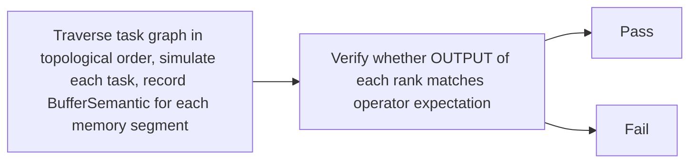

Using 4-rank `AllReduce` as an example:

```
rank0.OUTPUT[0,L) expectation:
  sources    = { rank0.INPUT, rank1.INPUT, rank2.INPUT, rank3.INPUT }
  reduceType = SUM

Suppose sources is missing rank3.INPUT:
  actualSourceRankCount=3, expectedRankSize=4 -> verification fails
```

### 6.4 Semantic Propagation Example

Using 2-rank `AllGather` (each rank INPUT size 100 bytes) as an example to illustrate the semantic propagation process.

**Initial State**

Each rank INPUT already has its own initial semantics (source points to itself):

```
rank0.INPUT[0, 100):  srcBufs = { (rank0, INPUT, 0) }
rank1.INPUT[0, 100):  srcBufs = { (rank1, INPUT, 0) }
rank0.OUTPUT:         empty
rank1.OUTPUT:         empty
```

**Propagation Process**

The diagram below shows the semantic filling process for rank0.OUTPUT. Each arrow represents one overwrite operation: read the source buffer semantics and write to the corresponding range of the target buffer.

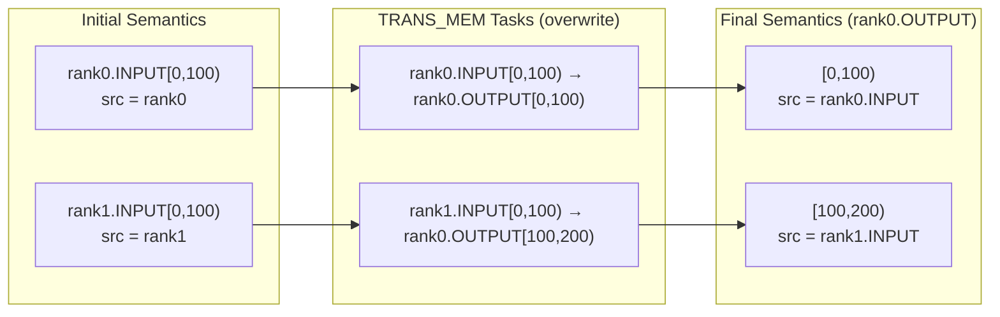

The propagation process for rank1.OUTPUT is analogous. Eventually both rank OUTPUTs are fully filled with correct sources, and verification passes.

**Range Splitting**

If the write range does not align with existing semantic boundaries, Checker splits first and then overwrites. For example, rank0.OUTPUT[0,100) already has semantics for the entire segment, and a write to [35,65) occurs:

```mermaid
gantt
    title Range Splitting Diagram
    dateFormat x
    axisFormat %L
    tickInterval 100millisecond

    section Before Write
    rank0.OUTPUT[0,100) src=rank0.INPUT : 0, 100

    section After Write
    [0,35) keeps original semantics : 0, 35
    [35,65) replaced with new source :crit, 35, 65
    [65,100) keeps original semantics : 65, 100
```

Before the write, the original semantic block is split at offsets 35 and 65. The [35,65) range is replaced with the new source. The remaining parts stay unchanged.

### 6.5 Two Root Causes of Semantic Errors

Semantic check failures fundamentally fall into only two categories:

- **Data missing**: the OUTPUT range was not written to, or was written incompletely (missing head, gap, or missing tail).
- **Data source error**: the OUTPUT is fully written, but the source rank, offset, or reduce type does not match the expectation.

When investigating, first determine the problem type. If data is missing, focus on whether the task orchestration lacks transfers. If the data source is wrong, focus on whether src/dst addresses and reduceOp are correct.

### 6.6 Error Log Interpretation

```text
[ErrorCode: 407] AllGather output range [0x1000,0x1400) for rank 3 should come from rank 4, but it actually comes from rank 5.
Current result range detail:
  range=[0x1000,0x1400), size=0x400, sourceCount=1
  sources:
    - sourceRank=5, sourceBufferType=INPUT, sourceAddr=0x0
```

Log field descriptions:

| Line | Meaning |
|----|------|
| Line 1 | Error code and main error message. `407` indicates a final output source attribute error. `output range [0x1000,0x1400) for rank 3` identifies the output rank and range with the error. `should come from rank 4, but it actually comes from rank 5` indicates that the expected source rank differs from the actual source rank |
| `Current result range detail` | Full semantic expansion of this output range to assist further investigation |
| `range / size / sourceCount` | Address range, length, and number of sources contained in this output semantic block |
| `sources` | Source list for this range. Each item includes the source rank, source buffer type, and source address |

---

## 7. Terminology Quick Reference Table

| Term | Description |
|------|------|
| Communicator | A group of communication members that describes the communication scope|
| Communication member | Commonly called a rank; the smallest logical entity participating in communication. Each rank is assigned a unique identifier, namely `rankId`|
| Communication operator | A single collective communication operation, such as `AllReduce` or `AllGather`. Communication operators typically employ different communication algorithm implementations depending on network topology, data volume, and hardware resource scenarios |
| Task | The core data structure of Checker. It describes a record of one atomic operation on a rank, such as memory transfer, Reduce, or memory copy |
| Task graph | The core data structure of Checker. It expresses the task nodes generated by an operator execution and their dependency relationships |
| Node | Each node on the task graph is a task |
| Stream | A queue within a rank that executes tasks in order. Each task uses `streamId` to record which queue it belongs to |
| Task type | Different task types serve different purposes, for example: executing memory transfers, Reduce operations, or synchronization |
| Queue | Internal serial instruction queue within a CCU |
| MemSlice | Memory access range `{rankId, type, offset, len}` |
| Slave stream | Auxiliary stream that executes secondary tasks. Requires head `WAIT` and tail `RECORD` |
| `RECORD` / `WAIT` | A matched pair of synchronization tasks. They represent sending a synchronization signal and waiting for a synchronization signal respectively |
| Synchronization edge | Cross-stream or cross-rank execution dependency established by `RECORD -> WAIT` |
| Memory conflict | Multiple memory operations access the same memory segment at the same time, and at least one operation is a write |
| BufferSemantic | Important data structure in the semantic check phase. Records where a memory segment data originates from |
| `reduceType` | Reduction type in semantics, such as `SUM`, `MAX`, or `MIN`. Describes how multi-source data is merged |
| OUTPUT expectation | The correct semantic definition that a communication operator final output should satisfy. Used for final comparison against actual results |
