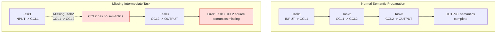

```mermaid
---
config:
  gantt:
    displayMode: compact
---
gantt
    title Target Buffer
    dateFormat x
    axisFormat 0x%L
    tickInterval 100millisecond
    todayMarker off

    section Address Layout
    0x000-0x100 Data present :done, blk0, 0, 100ms
    0x100-0x200 Gap          :crit, hole, 100, 100ms
    0x200-0x300 Data present :done, blk1, 200, 100ms
```

# Checker Error Code FAQ

---

## Module: Checker

### Submodule: Graph Generation Phase

---

#### FAQ-CHK101

**Title:** Graph Translation Failed

**Error Code:**
```
GRAPH_TRANSLATE_FAILED (101)
```

**Key Logs:**
```
[GenGraph] [ErrorCode: 101] Failed to convert one task into a graph node, taskIndex=128, ret=1, taskMeta=taskType=0, rankId=3, streamId=7, srcRankId=3, dstRankId=4, src=[0x0,0x400), dst=[0x1000,0x1400), protocol=1
```

**Symptom:** The graph generation phase cannot translate input task meta into internal graph nodes. This commonly occurs when the task type is unsupported or field combinations do not meet translation conditions.

**Diagnosis Guidance:**
```
[Possible Causes]
1. The `taskType` has no corresponding translation implementation currently.
2. Fields such as `rankId`, `streamId`, offset, or length are abnormal.
3. The task meta generated by the upstream is itself incorrect.

[Troubleshooting Steps]
Typical error points:
1. A normal task meta cannot be translated into a graph node: first locate which task it is by `taskIndex` in the original task list; then confirm the root cause based on the specific task information.
```
---

#### FAQ-CHK102

**Title:** Deadlock in Graph Generation Phase

**Error Code:**
```
GRAPH_DEADLOCK (102)
```

**Key Logs:**
```
[GenGraph] [ErrorCode: 102] Local Record/Wait matching is stuck on this rank. Some Wait tasks are still blocked, but no new local Record task can unblock them, rankId=0, firstBlockedWaitNode=[TaskWaitAICPU] node=143, rank=0, stream=3, protocol=SDMA, notify={recordRank=0, waitRank=0, notifyId=17}, blockedWaitNodeCount=5
```

**Symptom:** Synchronization pairing in the graph generation phase stalls. Wait nodes remain pending, but no new Record nodes can pair with those Wait nodes.

**Diagnosis Guidance:**
```
[Possible Causes]
1. Wait count exceeds Record count, or Record cannot participate in pairing because other dependencies are not met.
2. `notifyId` is incorrect. The `notifyId` of Wait and Record are inconsistent, preventing pairing completion.
3. Record has already executed, but predecessor dependencies of the subsequent Wait are not yet satisfied, so Wait cannot enter the pairable queue.

[Troubleshooting Steps]
1. Read `notifyId`, `recordRank`, and `waitRank` of `firstBlockedWaitNode` in the log. Confirm which entity should theoretically unblock this Wait.
2. Check whether a matching Record exists on the same rank or the corresponding peer rank. If it exists, continue to check whether the two can pair correctly.
```

---

#### FAQ-CHK103

**Title:** Unconsumed Synchronization Pairing Residuals

**Error Code:**
```
GRAPH_UNMATCHED (103)
```

**Key Logs:**
```
[GenGraph] [ErrorCode: 103] Found cross-rank Record tasks that were never consumed by any matching Wait task, recordRankId=0, waitRankId=3, notifyId=21, firstUnconsumedRecordNode=[TaskRecordAICPU] node=77, rank=0, stream=1, protocol=RDMA, notify={recordRank=0, waitRank=3, notifyId=21}, unconsumedRecordCount=2
```

**Symptom:** After synchronization pairing completes, unconsumed synchronization nodes remain. This typically manifests as Record nodes without corresponding Wait nodes.

**Diagnosis Guidance:**
```
[Possible Causes]
1. Record and Wait counts do not match.
2. The `notifyId` used is incorrect.

[Troubleshooting Steps]
1. Check whether `recordRankId`, `waitRankId`, and `notifyId` meet expectations.
```
---

#### FAQ-CHK104

**Title:** Missing AIV Group Member

**Error Code:**
```
GRAPH_MEMBER_MISSING (104)
```

**Symptom:** This error code indicates that the graph generation phase under AIV mode found incomplete group members.

---

#### FAQ-CHK105

**Title:** Illegal Graph Structure

**Error Code:**
```
GRAPH_STRUCTURE_INVALID (105)
```

**Key Logs:**
```
[GenGraph] [ErrorCode: 105] Failed to remove one graph edge because the parent or child node does not exist, parentNodeId=91, childNodeId=123, parentNode=[TaskTransMem] node=91, rank=2, stream=0, protocol=SDMA, src=rank 2 INPUT [0x0,0x400), dst=rank 2 CCL [0x1000,0x1400), childNode=null
```

**Symptom:** Graph edge relationships do not meet graph construction prerequisites. For example, the parent or child node does not exist when removing or reconnecting edges.

**Diagnosis Guidance:**
```
[Possible Causes]
1. This issue is usually not caused by algorithm scheduling.

[Troubleshooting Steps]
1. First confirm whether task nodes have already been generated in `Checker`.
2. Contact tool support personnel for assistance in diagnosis.
```
---

#### FAQ-CHK106

**Title:** AIV Snapshot Inconsistency

**Error Code:**
```
GRAPH_SNAPSHOT_MISMATCH (106)
```

**Symptom:** This error code indicates that the snapshot or environment information loaded during the graph generation phase under AIV mode is inconsistent.

---

#### FAQ-CHK107

**Title:** Missing Graph Generation Resources

**Error Code:**
```
GRAPH_RESOURCE_NOT_FOUND (107)
```

**Symptom:** This error code indicates that resources, mappings, or data files required by the graph generation phase under AIV mode are missing.

---

#### FAQ-CHK108

**Title:** Register or HBM Not Initialized

**Error Code:**
```
GRAPH_REGISTER_UNINITIALIZED (108)
```

**Key Logs:**
```
[GenGraphCCU] [ErrorCode: 108] Failed to read XN register before it was initialized, rankId=2, dieId=0, instrId=73, xnId=11

[GenGraphCCU] [ErrorCode: 108] Failed to read HBM content before it was initialized, rankId=2, dieId=0, instrId=73, hbmAddr=0x1000
```

**Symptom:** The current instruction reads a register or HBM content but cannot find corresponding initialized data. This usually indicates that the preceding write chain was not correctly established.

**Diagnosis Guidance:**
```
[Possible Causes]
1. The preceding Load / Set / Store instruction was not executed.
2. The queue responsible for initialization was blocked by Wait or other dependencies and could not advance.
3. Address or register resolution was misaligned, causing reads from incorrect locations.

[Troubleshooting Steps]
1. If the log provides `xnId`, look back for the most recent valid write to that register in the same queue.
2. If the log provides `hbmAddr`, check whether a valid write exists in earlier tasks for the corresponding address range.
```
---

#### FAQ-CHK109

**Title:** ID or Index Out of Range

**Error Code:**
```
GRAPH_OUT_OF_RANGE (109)
```

**Key Logs:**
```
[GenGraphCCU] [ErrorCode: 109] dieId is out of range when converting address to MS id, dieId=4, maxDieId=1

[GenGraphCCU] [ErrorCode: 109] Xn register id is out of the valid range, xnId=37, validMin=0, validMax=31
```

**Symptom:** An ID, index, or address ownership field exceeds the range constrained by current resources or instructions. This commonly occurs with `dieId`, register ID, or intermediate address resolution results going out of range.

**Diagnosis Guidance:**
```
[Possible Causes]
1. Resource pool size does not match task data, for example only partial dies were loaded.
2. Address ownership resolution error mapped a local address to a nonexistent resource ID.
3. Instruction field resolution was misaligned, causing abnormal register ID or index values.
4. The current data comes from an instruction set of a different version or branch.

[Troubleshooting Steps]
1. If the log provides `dieId/maxDieId`, first verify whether the die count in the current resource file matches the task data.
2. If the log provides `xnId/validMin/validMax`, look back at the original instruction fields to confirm whether the register ID was incorrectly parsed or computed.
```
---

#### FAQ-CHK110

**Title:** Illegal Address or Alignment Constraint Not Met

**Error Code:**
```
GRAPH_ADDRESS_INVALID (110)
```

**Key Logs:**
```
[GenGraphCCU] [ErrorCode: 110] Address does not fall into any known MS address range, localMsAddr=0x27f0000, rawAddr=0x82ff000

[GenGraphCCU] [ErrorCode: 110] Load source address must be 8-byte aligned, sourceAddress=0x1003
```

**Symptom:** An address cannot be mapped to any resource range known to Checker, or Load/Store related addresses or lengths do not meet the alignment constraints of the current instruction.

**Diagnosis Guidance:**
```
[Possible Causes]
1. The base address table does not match.
2. The upstream wrote an incorrect raw address, causing an abnormal value.
3. The upstream address calculation was off.
4. The address or length of an instruction was not aligned as required.

[Troubleshooting Steps]
1. If the log provides `rawAddr/localMsAddr` or `addr/dieBaseAddr`, first determine which resource type that address should theoretically fall into.
2. If the log provides `sourceAddress`, `hbmAddr`, or `dataLengthBytes`, verify whether 8-byte or 64-byte granularity constraints are met.
```
---

#### FAQ-CHK111

**Title:** Current Task or Instruction Not Yet Supported

**Error Code:**
```
GRAPH_UNSUPPORTED (111)
```

**Key Logs:**
```
[GenGraph] [ErrorCode: 111] This task type is not supported for CheckerV3 graph generation, taskIndex=128, taskMeta=taskType=9, rankId=3, streamId=7

[GenGraphCCU] [ErrorCode: 111] This CCU instruction type is not supported by CheckerV3 graph expansion, rankId=2, queueId=1, instructionHeader=0xf431
```

**Symptom:** A feature not yet supported by Checker was used.

**Diagnosis Guidance:**
```
[Possible Causes]
1. Checker does not yet support that feature.

[Troubleshooting Steps]
1. Check the corresponding fields in the log to confirm whether they meet expectations.
2. Contact tool support personnel for assistance in diagnosis.
```
---

#### FAQ-CHK112

**Title:** Remote Rank Derivation Inconsistency

**Error Code:**
```
GRAPH_REMOTE_RANK_MISMATCH (112)
```

**Key Logs:**
```
[GenGraphCCU] [ErrorCode: 112] Remote address resolves to a different rank than the selected channel, instruction=TransLocMemToRmtMem, rankId=2, dieId=0, queueId=1, instrId=73, channelId=7, expectedRemoteRankId=5, actualRemoteRankId=6, remoteAddr=140737488363520
```

**Symptom:** The remote rank derived from the channel or remote address is inconsistent.

**Diagnosis Guidance:**
```
[Possible Causes]
1. The channel table is incorrect.
2. The remote address was incorrectly encoded.

[Troubleshooting Steps]
1. Verify the rank ownership of `channelId` and `remoteAddr` to confirm whether they meet expectations.
```
---

#### FAQ-CHK113

**Title:** Merged Loop Emission Failed

**Error Code:**
```
GRAPH_LOOP_MERGE_ERROR (113)
```

**Key Logs:**
```
[GenGraphCCU] [ErrorCode: 113] Failed to emit one merged loop instruction because the merged instruction entry is null, rankId=2, queueId=1

[GenGraphCCU] [ErrorCode: 113] Failed to emit one merged loop transfer task, rankId=2, queueId=1, mergedLoopInstr={rankId=2, dieId=0, instrId=73, srcs=4, dsts=4, waitOps=1, setOps=1}
```

**Symptom:** Loop merging fails in CCU mode.

**Diagnosis Guidance:**
```
[Possible Causes]
1. Resource conflicts occur during serial or parallel loop expansion (memory addresses, CKE, and so on).
Note: After loop merging fails, the system falls back to normal expansion. This may affect performance.

[Troubleshooting Steps]
1. Confirm that the loop body instruction template design meets expectations.

```
---

### Submodule: Single Task and Slave Stream Validation

---

#### FAQ-CHK201

**Title:** Illegal Memory Slice

**Error Code:**
```
SINGLETASK_SLICE_INVALID (201)
```

**Error Functions:**
```
task_graph_single_task_check_v3.cc::CheckMemorySlice()
task_graph_single_task_check_v3.cc::CheckBatchTrans()
task_graph_mem_conflict_v3.cc
task_graph_semantic_check_v3.cc
```

**Key Logs:**
```
[MemConflict] [ErrorCode: 201] One memory slice is missing a valid rank or memory type, task=[TaskTransMem] node=42, rank=0, stream=2, protocol=SDMA, src=rank 0 INPUT [0x0,0x400), dst=rank 0 CCL [0x1000,0x1400), rankId=invalid, memType=invalid, offset=0x0, length=0x400
    

[SingleTaskCheck] [ErrorCode: 201] One memory slice is invalid because its end address overflows while total coverage is being calculated, task=[TaskBatchTransMem] node=108, rank=1, stream=5, protocol=CCU, pairCount=2, mergedPairCount=2, src0=rank 1 CCL [0xfffffffffffffff0,0xffffffffffffff30), dst0=rank 1 OUTPUT [0x0,0x40), memorySlice={rankId=1, memType=CCL, offset=0xfffffffffffffff0, length=0x40}
    

[SingleTaskCheck] [ErrorCode: 201] Batch trans slice length mismatch, node=[TaskBatchTransMem] node=108, rank=1, stream=5, protocol=CCU, label=src, index=2, expectedLen=0x400, actualLen=0x200

[SingleTaskCheck] [ErrorCode: 201] Batch trans pair size mismatch, node=[TaskBatchTransMem] node=108, rank=1, stream=5, protocol=CCU, label=src, srcCount=4, dstCount=3

[SingleTaskCheck] [ErrorCode: 201] Batch reduce has different counts of source groups and target memory slices, task=[TaskBatchReduce] node=176, rank=2, stream=4, protocol=CCU, group=src, sourceGroupCount=3, targetMemorySliceCount=2

[SingleTaskCheck] [ErrorCode: 201] Source data size is not an integer multiple of target data size, task=[TaskBatchReduce] node=176, rank=2, stream=4, protocol=CCU, srcDataSize=0xc00, dstDataSize=0x800, group=src
```

**Symptom:** The memory slice itself is illegal, or slices within the same group overlap. The issue may occur during single task validation, memory conflict checking, or semantic simulation.

**Diagnosis Guidance:**
```
[Possible Causes]
1. Slice fields are incomplete.
2. Memory type conversion failed.
3. Length or offset does not meet expectations.
4. During CCU Loop merging, slice overlap between loops was detected.

[Troubleshooting Steps]
1. Check whether `rankId/memType/offset/length` of the slice fields in the log output meet expectations.
```

---

#### FAQ-CHK202

**Title:** Slice Conflict Within a Single Task

**Error Code:**
```
SINGLETASK_SLICE_CONFLICT (202)
```

**Key Logs:**
```
[SingleTaskCheck] [ErrorCode: 202] Two memory slices overlap inside the same task, task=[TaskReduce] node=57, rank=0, stream=4, protocol=CCU, dataType=0, reduceOp=0, srcs=[rank 0 CCL [0x1000,0x1400), rank 0 CCL [0x1200,0x1600)], dst=rank 0 OUTPUT [0x0,0x400), memorySlice1={rankId=0, memType=CCL, offset=0x1000, length=0x400}, memorySlice2={rankId=0, memType=CCL, offset=0x1200, length=0x400}, position=rankId=0, streamId=4
```

**Symptom:** Overlapping memory slices exist within the same task, causing address range intersection in the same buffer.

**Diagnosis Guidance:**
```
[Possible Causes]
1. Transmem source and destination addresses overlap.
2. Reduce source segment partitioning is incorrect.
3. Overlap residuals remain after Batch merging.
Note: In CCU mode, source and destination addresses being fully identical is allowed.

[Troubleshooting Steps]
1. Check whether `rankId/memType/offset/length` of the slice fields in the log output meet expectations.
```

---

#### FAQ-CHK203

**Title:** Illegal Slave Stream Structure

**Error Code:**
```
SINGLETASK_SLAVE_STREAM_INVALID (203)
```

**Key Logs:**
```
[StreamCheck] [ErrorCode: 203] This slave stream is missing its start node or end node, rankId=0, streamId=6, taskCount=4, startNode=null, endNode=[TaskRecordAICPU] node=241, rank=0, stream=6, protocol=SDMA, notify={recordRank=0, waitRank=0, notifyId=32}
    

[StreamCheck] [ErrorCode: 203] The first task in this slave stream is not a local WAIT task, rankId=0, streamId=6, actualFirstTaskType=TRANS_MEM, firstTask=[TaskTransMem] node=214, rank=0, stream=6, protocol=SDMA, src=rank 0 INPUT [0x0,0x400), dst=rank 0 CCL [0x4000,0x4400)
    

[StreamCheck] [ErrorCode: 203] The last task in this slave stream is not a local RECORD task, rankId=0, streamId=6, actualLastTaskType=WAIT, lastTask=[TaskWaitAICPU] node=245, rank=0, stream=6, protocol=SDMA, notify={recordRank=0, waitRank=0, notifyId=32}
    

[StreamCheck] [ErrorCode: 203] This slave stream still has no valid end node after empty local-copy tasks are skipped, rankId=0, streamId=6, skippedEmptyLocalCopyCount=3, currentTailNode=null
```

**Symptom:** The slave stream structure does not meet Checker constraints. Common manifestations include missing valid head or tail nodes, the first task not being a local `WAIT`, or the last task not being a local `RECORD`.

**Diagnosis Guidance:**
```
[Possible Causes]
1. The slave stream is missing head or tail synchronization nodes.

[Troubleshooting Steps]
1. Slave stream missing start or end node: confirm whether the stream node list itself is complete, then confirm whether the current head and tail nodes meet expectations.
```

---

### Submodule: Memory Conflict Validation

---

#### FAQ-CHK301

**Title:** Illegal Memory Conflict DAG

**Error Code:**
```
MEMCONFLICT_DAG_INVALID (301)
```

**Key Logs:**
```
[MemConflict] [ErrorCode: 301] Reachability analysis cannot start because the main start node is invalid, mainStartNode=[TaskTransMem] node=42, rank=0, stream=2, protocol=SDMA, src=rank 0 INPUT [0x0,0x400), dst=rank 0 CCL [0x1000,0x1400)
    

[MemConflict] [ErrorCode: 301] This data-move node is missing its reachability index, node=[TaskBatchTransMem] node=318, rank=3, stream=2, protocol=CCU, pairCount=4, mergedPairCount=2, src0=rank 3 CCL [0x8000,0x8400), dst0=rank 3 OUTPUT [0x0,0x400)
    

[MemConflict] [ErrorCode: 301] This V3 graph is not a complete DAG from the main start node, topoSize=412, expectedTopoSize=415, reachableTaskCount=411, taskNodeCount=414, mainStartNodeId=-1
```

**Symptom:** The main graph structure required by memory conflict checking is abnormal. This commonly occurs when the main graph start node is illegal, reachability index nodes are missing, or the task graph is not a complete DAG.

**Diagnosis Guidance:**
```
[Possible Causes]
1. The main graph generated during the graph generation phase is incomplete.
2. Some task nodes are not on reachable paths from the `main_start` head node.

[Troubleshooting Steps]
1. First confirm whether task graph generation executed correctly.
2. Contact tool support personnel for assistance in diagnosis.
```

---

#### FAQ-CHK302

**Title:** Actual Memory Conflict Detected

**Error Code:**
```
MEMCONFLICT_DETECTED (302)
```

**Key Logs:**
```
[MemConflict] [ErrorCode: 302] Two tasks may access the same memory range in parallel, and at least one access is a write.
  Conflict memory : rank 0 OUTPUT
  Overlap range    : [0x1000,0x1400)
  Conflict task 1:
    node 214, action=write
    access range : [0x1000,0x1800)
    task         : [TaskTransMem] node=214, rank=0, stream=6, protocol=SDMA, src=rank 0 CCL [0x4000,0x4800), dst=rank 0 OUTPUT [0x1000,0x1800)
  Conflict task 2:
    node 233, action=write
    access range : [0x1000,0x1400)
    task         : [TaskReduce] node=233, rank=0, stream=8, protocol=CCU, dataType=0, reduceOp=0, srcs=[rank 0 CCL [0x5000,0x5400), rank 3 CCL [0x5000,0x5400)], dst=rank 0 OUTPUT [0x1000,0x1400)
```

**Symptom:** An actual memory concurrency conflict was detected. Two tasks access the same memory range, and at least one access is a write.

**Diagnosis Guidance:**
```
[Possible Causes]
1. Missing synchronization constraints between two streams.
2. Tasks that should be serial were incorrectly built as parallelizable.
3. Read/write range partitioning or address calculation is incorrect.
Note: Only `read-write` / `write-write` conflicts are validated. `read-read` is not considered a conflict.

[Troubleshooting Steps]
1. Check the log to identify which two tasks conflict at which address range. Verify whether the task arrangement and synchronization signal design meet expectations.
```

---

### Submodule: Semantic Validation

---

#### FAQ-CHK401

**Title:** No Semantic Source for Target Range

**Error Code:**
```
SEMANTIC_BUFFER_EMPTY (401)
```

**Key Logs:**
```
[SemanticCheck] [ErrorCode: 401] No source/output information was found for the target memory range, startAddr=0x0, size=0x1000
```

**Symptom:** Semantic checking cannot find any available source data or output semantics on the target range.

**Diagnosis Guidance:**
```
[Possible Causes]
1. The relevant write task has not been executed yet.
2. Earlier semantic construction already failed due to another error.
Note: Checker initializes only INPUT memory semantics by default. Subsequent semantics are propagated based on memory operation tasks.

[Troubleshooting Steps]
1. First confirm which task should theoretically write this result. Confirm whether the source address semantics used by that task are correctly set.
```

**Diagram:**


---

#### FAQ-CHK402

**Title:** Semantic Result Range Discontinuity

**Error Code:**
```
SEMANTIC_GAP (402)
```

**Key Logs:**
```
[SemanticCheck] [ErrorCode: 402] Output data does not start from the expected address; the beginning is missing, expectedStart=0x0, actualStart=0x400
    

[SemanticCheck] [ErrorCode: 402] Output data is broken in the middle; one piece ends at 0x800 but the next starts at 0xc00
    

[SemanticCheck] [ErrorCode: 402] Output data ends too early; the tail is missing, expectedEnd=0x2000, actualEnd=0x1c00
```

**Symptom:** The semantic result range is discontinuous. Common manifestations include a missing beginning, a middle gap, or an incomplete tail coverage.

**Diagnosis Guidance:**
```
[Possible Causes]
1. The relevant write task did not execute completely.
2. Offset or length calculation does not meet expectations.

[Troubleshooting Steps]
1. Use `expectedStart/actualStart`, breakpoint address, or `expectedEnd/actualEnd` to determine whether the gap is at the head, middle, or tail.
2. Then check the corresponding write task to confirm which data segment was not written or which segment has incorrect write length.
```

**Diagram:**


---

#### FAQ-CHK403

**Title:** Incorrect Reduce Semantics

**Error Code:**
```
SEMANTIC_REDUCE_ERROR (403)
```

**Key Logs:**
```
[SemanticCheck] [ErrorCode: 403] Target output range is only partially filled before reduce continues, dataMapping={operation=reduce, sourceMemorySlice={rankId=3, memoryType=CCL, offset=0x800, length=0x400}, targetMemorySlice={rankId=1, memoryType=OUTPUT, offset=0x0, length=0x400}, launchIdx=18446744073709551615, blockId=4294967295, pipeId=4294967295, taskId=4294967295, reduceType=HCCL_REDUCE_SUM}, outputRange=[0x0,0x400), pieceCount=1
    

[SemanticCheck] [ErrorCode: 403] Reduce result type is inconsistent while merging one source data range, dataMapping={operation=reduce, sourceMemorySlice={rankId=2, memoryType=CCL, offset=0x0, length=0x400}, targetMemorySlice={rankId=0, memoryType=OUTPUT, offset=0x0, length=0x400}, launchIdx=18446744073709551615, blockId=4294967295, pipeId=4294967295, taskId=4294967295, reduceType=HCCL_REDUCE_MAX}
    

[SemanticCheck] [ErrorCode: 403] Source data needed by this reduce is missing, dataMapping={operation=reduce, sourceMemorySlice={rankId=5, memoryType=INPUT, offset=0x400, length=0x400}, targetMemorySlice={rankId=0, memoryType=OUTPUT, offset=0x400, length=0x400}, launchIdx=18446744073709551615, blockId=4294967295, pipeId=4294967295, taskId=4294967295, reduceType=HCCL_REDUCE_SUM}
```

**Symptom:** The reduce semantic chain is incomplete or inconsistent. Common manifestations include the target range not being fully covered before reduce continues, reduce type inconsistency, or missing reduce source data.

**Diagnosis Guidance:**
```
[Possible Causes]
1. The preceding overwrite or transfer did not fully cover the target range or source range.
2. Reduce execution order is abnormal, or different `reduceOp` values were written to the same target range.
3. Some ranks did not participate in the reduce correctly.

[Troubleshooting Steps]
1. Check the log information to first determine whether the issue is incomplete range coverage, type inconsistency, or missing source data.
2. Then check the corresponding preceding memory operation tasks to confirm which semantic chain segment is missing.
```

---

#### FAQ-CHK404

**Title:** Missing Overwrite Source Semantics

**Error Code:**
```
SEMANTIC_SIMULATE_FAILED (404)
```

**Key Logs:**
```
[SemanticCheck] [ErrorCode: 404] Source data needed by this overwrite is missing, dataMapping={operation=overwrite, sourceMemorySlice={rankId=1, memoryType=INPUT, offset=0x0, length=0x800}, targetMemorySlice={rankId=1, memoryType=OUTPUT, offset=0x0, length=0x800}, launchIdx=18446744073709551615, blockId=4294967295, pipeId=4294967295, taskId=4294967295}
```

**Symptom:** The source range semantics required by overwrite are incomplete. The current semantic implementation continues simulation but warns that this overwrite is not "complete memcpy semantics". Subsequent semantic analysis results may be affected.

**Diagnosis Guidance:**
```
[Possible Causes]
1. The source range of the overwrite was not fully initialized beforehand, or only partial source semantics were established.
2. The source address or length of preceding transfer or slice tasks was configured incorrectly, causing overwrite to read from an uninitialized gap range.
3. Some dependent tasks are missing or have abnormal ordering, causing the source data to be unprepared when overwrite executes.

[Troubleshooting Steps]
1. Use `sourceMemorySlice` to locate the source buffer range read by the overwrite. Confirm whether that range has complete semantics established in preceding tasks.
2. Check the transfer, slice, and reduce tasks before the overwrite. Confirm that address ranges are contiguous, lengths match, and no intermediate gaps exist.
3. If this is expected behavior, further confirm whether subsequent analysis allows "partial source semantics" to propagate. Otherwise, complete the preceding data chain.
```

---

#### FAQ-CHK405

**Title:** Final Output Validation Prerequisites Not Met

**Error Code:**
```
SEMANTIC_FINAL_CHECK_FAILED (405)
```

**Key Logs:**
```
[SemanticCheck] [ErrorCode: 405] Send/Recv final output validation supports exactly 2 ranks, but got expectedRankSize=2, actualRankSize=3, sourceRank=1, targetRank=5
```

**Symptom:** Final output validation prerequisites are not met. For example, the number of ranks used in a Send/Recv scenario is not 2.

**Diagnosis Guidance:**
```
[Possible Causes]
1. The input rank count configuration is incorrect.
2. Ranks not belonging to the same Send/Recv were mixed together.

[Troubleshooting Steps]
1. Confirm whether this Send/Recv validation round should theoretically include only two ranks.
```

---

#### FAQ-CHK406

**Title:** Final Output Has Missing Data

**Error Code:**
```
SEMANTIC_FINAL_MISSING (406)
```

**Key Logs:**
```
[SemanticCheck] [ErrorCode: 406] AllGatherV produced no result data for rank 3, but this rank is expected to receive data from all 8 participating ranks with an expected total result size of 0x1c00 bytes.
    

[SemanticCheck] [ErrorCode: 406] Send/Recv output for rank 5 should continue at 0x0, but the next actual range starts at 0x400 (actual range: [0x400,0x800)).
    Current result range detail:
      range=[0x400,0x800), size=0x400, sourceCount=1
      sources:
        - sourceRank=1, sourceBufferType=INPUT, sourceAddr=0x0
    

[SemanticCheck] [ErrorCode: 406] ReduceScatter output for rank 6 ends too early: the checker validated 0x1800 bytes in total, but the expected result size is 0x1c00.
```

**Symptom:** Final output has missing data. Common manifestations include a rank having no results at all, incorrect result start address, or the result tail not being fully written.

**Diagnosis Guidance:**
```
[Possible Causes]
1. The result write chain did not execute completely.
2. The memory transfer process has gaps or abnormal offsets.
3. Address offset or segment size does not meet expectations.

[Troubleshooting Steps]
1. Use `expectedStartAddr/actualStartAddr` or `expectedSize/checkedSize` to determine which result segment is missing.
2. Then trace back from the memory transfer tasks of the corresponding rank to confirm whether each memory transfer task meets expectations.
```

---

#### FAQ-CHK407

**Title:** Incorrect Final Output Source Attributes

**Error Code:**
```
SEMANTIC_FINAL_SRC_ERROR (407)
```

**Key Logs:**
```
[SemanticCheck] [ErrorCode: 407] AllGatherV output range [0x1000,0x1400) for rank 3 should come from rank 4, but it actually comes from rank 5.
    Current result range detail:
      range=[0x1000,0x1400), size=0x400, sourceCount=1
      sources:
        - sourceRank=5, sourceBufferType=INPUT, sourceAddr=0x0
    

[SemanticCheck] [ErrorCode: 407] AllReduce result range [0x0,0x400) for rank 0 should come from INPUT, but source rank 3 actually provides buffer type CCL.
    Current result range detail:
      range=[0x0,0x400), size=0x400, reduce=HCCL_REDUCE_SUM, sourceCount=8
      sources:
        - sourceRank=0, sourceBufferType=INPUT, sourceAddr=0x0
        - sourceRank=1, sourceBufferType=INPUT, sourceAddr=0x0
        - sourceRank=2, sourceBufferType=INPUT, sourceAddr=0x0
        - sourceRank=3, sourceBufferType=CCL, sourceAddr=0x0
        - sourceRank=4, sourceBufferType=INPUT, sourceAddr=0x0
        - sourceRank=5, sourceBufferType=INPUT, sourceAddr=0x0
        - sourceRank=6, sourceBufferType=INPUT, sourceAddr=0x0
        - sourceRank=7, sourceBufferType=INPUT, sourceAddr=0x0
    

[SemanticCheck] [ErrorCode: 407] Send/Recv output range [0x400,0x800) for rank 5 should take data from source rank 1 at input address 0x400, but it actually takes data from source rank 1 at input address 0x0.
    Current result range detail:
      range=[0x400,0x800), size=0x400, sourceCount=1
      sources:
        - sourceRank=1, sourceBufferType=INPUT, sourceAddr=0x0
```

**Symptom:** The source attributes of the final output are incorrect. This may manifest as the source rank, source buffer type, or source address not matching expectations.

**Diagnosis Guidance:**
```
[Possible Causes]
1. Result concatenation order or rank semantic tagging is incorrect.
2. An intermediate buffer was incorrectly used as the final source.
3. Address offset or segment ordering does not meet expectations.

[Troubleshooting Steps]
1. First observe `actualSourceRank`, `actualSourceBufferType`, `expectedAddr`, and `actualAddr` to determine the issue type.
2. Then check the corresponding memory transfer tasks to confirm whether each memory transfer task meets expectations.
```

---

#### FAQ-CHK408

**Title:** Excessive Data Volume from Single Source

**Error Code:**
```
SEMANTIC_FINAL_SIZE_ERROR (408)
```

**Key Logs:**
```
[SemanticCheck] [ErrorCode: 408] AllGatherV data collected from rank 4 for rank 3 becomes larger than expected after outputRange [0x1000,0x1600). The accumulated size is 0x600, but the expected size from this source rank is 0x400.
    Current result range detail:
      range=[0x1000,0x1600), size=0x600, sourceCount=1
      sources:
        - sourceRank=4, sourceBufferType=INPUT, sourceAddr=0x0
```

**Symptom:** The data contribution from a source rank in the final output exceeds the range allowed by operator semantics.

**Diagnosis Guidance:**
```
[Possible Causes]
1. The length configuration of that source rank is incorrect.
2. The same data segment was concatenated repeatedly.

[Troubleshooting Steps]
1. First verify the counts/displs configuration corresponding to `expectedSize`. Then confirm whether the result from that source rank was concatenated repeatedly.
```

---

#### FAQ-CHK409

**Title:** Incorrect Final Output Reduce Semantics

**Error Code:**
```
SEMANTIC_FINAL_REDUCE_ERROR (409)
```

**Key Logs:**
```
[SemanticCheck] [ErrorCode: 409] Send/Recv output range [0x0,0x400) for rank 5 should come from exactly one source, but it actually comes from 2 sources.
    Current result range detail:
      range=[0x0,0x400), size=0x400, sourceCount=2
      sources:
        - sourceRank=1, sourceBufferType=INPUT, sourceAddr=0x0
        - sourceRank=2, sourceBufferType=INPUT, sourceAddr=0x0
    

[SemanticCheck] [ErrorCode: 409] AllReduce result range [0x0,0x400) for rank 0 was reduced with mode HCCL_REDUCE_MAX, but the operator expects reduce mode HCCL_REDUCE_SUM.
    Current result range detail:
      range=[0x0,0x400), size=0x400, reduce=HCCL_REDUCE_MAX, sourceCount=8
      sources:
        - sourceRank=0, sourceBufferType=INPUT, sourceAddr=0x0
        - sourceRank=1, sourceBufferType=INPUT, sourceAddr=0x0
        - sourceRank=2, sourceBufferType=INPUT, sourceAddr=0x0
        - sourceRank=3, sourceBufferType=INPUT, sourceAddr=0x0
        - sourceRank=4, sourceBufferType=INPUT, sourceAddr=0x0
        - sourceRank=5, sourceBufferType=INPUT, sourceAddr=0x0
        - sourceRank=6, sourceBufferType=INPUT, sourceAddr=0x0
        - sourceRank=7, sourceBufferType=INPUT, sourceAddr=0x0
    

[SemanticCheck] [ErrorCode: 409] ReduceScatter output range [0x0,0x400) for rank 6 expected 8 source ranks but got 6.
    Current result range detail:
      range=[0x0,0x400), size=0x400, reduce=HCCL_REDUCE_SUM, sourceCount=6
      sources:
        - sourceRank=0, sourceBufferType=INPUT, sourceAddr=0x1800
        - sourceRank=1, sourceBufferType=INPUT, sourceAddr=0x1800
        - sourceRank=2, sourceBufferType=INPUT, sourceAddr=0x1800
        - sourceRank=3, sourceBufferType=INPUT, sourceAddr=0x1800
        - sourceRank=4, sourceBufferType=INPUT, sourceAddr=0x1800
        - sourceRank=5, sourceBufferType=INPUT, sourceAddr=0x1800
```

**Symptom:** The reduce semantics of the final output are incorrect. This may manifest as a single-source operator having multiple sources, `reduceType` mismatch, or insufficient source rank count.

**Diagnosis Guidance:**
```
[Possible Causes]
1. The overwrite / reduce merging logic does not meet expectations.
2. `reduceOp` is inconsistent, or intermediate semantics were contaminated.
3. Contributions from some ranks did not enter the result range.

[Troubleshooting Steps]
1. First observe `sourceCount`, `expectedSourceCount`, `actualReduceType`, and the `sources` list to determine whether the issue is multi-source, type inconsistency, or missing sources.
2. Then check the corresponding memory transfer and Reduce tasks to confirm whether each memory operation meets expectations.
```

---

### Submodule: Dump Output

---

#### FAQ-CHK501

**Title:** Dump Output Failed

**Error Code:**
```
DUMP_FAILED (501)
```

**Symptom:** Dump manager initialization, file writing, or serialization process failed, preventing validation results from being written to disk.

**Diagnosis Guidance:**
```
[Possible Causes]
1. The output directory or target path is not writable.
2. Disk space is insufficient, or the dump path is not ready.
3. File handle, flush, or serialization failed.

[Troubleshooting Steps]
1. First check the dump output directory, permissions, and disk space.
2. Contact tool support personnel for assistance in diagnosis.
```

---

### Submodule: Main Flow and Configuration

---

#### FAQ-CHK901

**Title:** Generic Runtime Error

**Error Code:**
```
CHECKER_RUNTIME_ERROR (901)
```

**Key Logs:**
```
[Main] [ErrorCode: 901] Failed to load instruction data for this rank, rankId=3
    

[Main] [ErrorCode: 901] Unsupported collective type, collectiveTypeCode=37
    

[SemanticCheck] [ErrorCode: 901] Semantic check initialization failed because the rank count is 0, collectiveType=AllReduce, dataType=FLOAT, elementCount=1024, reduceType=SUM
    

[SemanticCheck] [ErrorCode: 901] Output simulation stopped because some tasks still have unresolved dependencies, handledNodeCount=410, totalNodeCount=415, firstRemainingNode=[TaskReduce] node=233, rank=2, stream=5, protocol=CCU, dataType=0, reduceOp=0, srcs=[rank 2 CCL [0x2000,0x2400)], dst=rank 2 OUTPUT [0x0,0x400)
```

**Symptom:** A generic exception occurred during main flow runtime.

**Diagnosis Guidance:**
```
[Possible Causes]
1. This issue is usually an internal Checker problem.

[Troubleshooting Steps]
1. First determine the error type. If it is an `Unsupported` type, check whether the data meets Checker requirements.
2. Contact tool support personnel for assistance in diagnosis.
```
---

#### FAQ-CHK902

**Title:** Configuration or Runtime Strategy Warning

**Error Code:**
```
SETTING_WARNING (902)
```

**Key Logs:**
```
[Main] [ErrorCode: 902] This op is skipped because the new checker is disabled, opIndex=47, newCheckerEnabled=0
```

**Symptom:** `enable_new_checker` is disabled. The current operator did not execute Checker V3 single-operator validation. The old Checker version has been removed. No other switch can take over operator validation.

**Diagnosis Guidance:**
```
[Possible Causes]
1. `enable_new_checker` in `manifest.json` is set to `false`.

[Troubleshooting Steps]
1. Check `enable_new_checker` in `manifest.json`. Set it to `true` when single-operator validation is needed.
2. If only cross-operator synchronization resource validation is needed, enable `enable_big_graph_checker` separately. This switch cannot replace single-operator Checker V3.
```