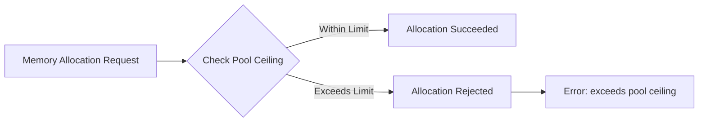
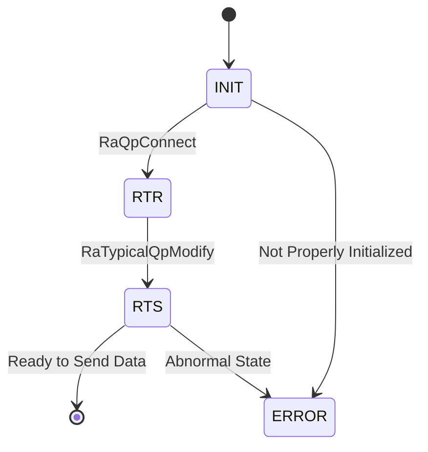
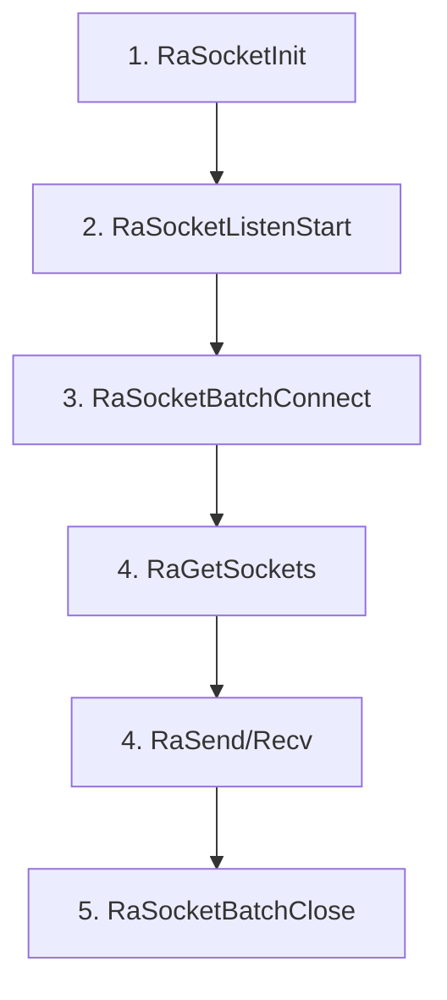
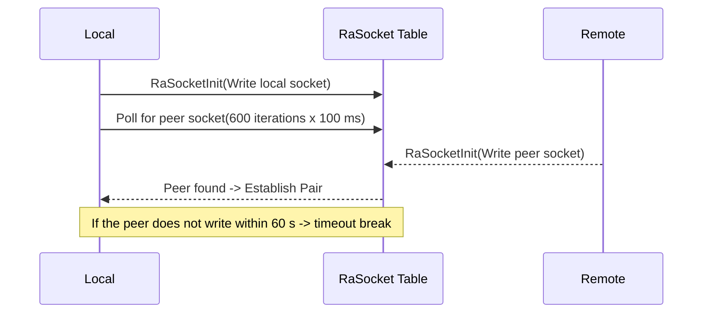

# HCCL-VM FAQ Test Document

> This document tests the FAQ HTML generation framework.

---

## Module: CANN Package Installation and WSL Environment Configuration

### Sub-module: Environment Configuration

---

#### FAQ-C001

**Title:** WSL Environment Configuration

**Error Code:**
```
NA (4)
```

**Error Function:**
```
NA
```

**Key Log:**
```
[ 85%] Building CXX object src/legacy/ascend910/framework/CMakeFiles/hcomm.dir/common/src/config/env_config_host.cc.o
{standard input}: Assembler messages:
{standard input}:61985: Warning: end of file not at end of a line; newline inserted
{standard input}:61986: Error: expecting operand after ','; got nothing
{standard input}: Error: open CFI at the end of file; missing .cfi_endproc directive
c++: fatal error: Killed signal terminated program cc1plus
compilation terminated.
gmake[2]: *** [src/legacy/ascend910/framework/CMakeFiles/hcomm.dir/build.make:160: src/legacy/ascend910/framework/CMakeFiles/hcomm.dir/common/src/topo/topoinfo_ranktableParser.cc.o] Error 1
gmake[2]: *** Waiting for unfinished jobs....
gmake[1]: *** [CMakeFiles/Makefile2:6400: src/legacy/ascend910/framework/CMakeFiles/hcomm.dir/all] Error 2
gmake: *** [Makefile:156: all] Error 2
  Full log: /home/zhf/workspace/.hccl_vm_install_logs/build-pkg-20260705-234844.log
  You can also run manually: bash /home/zhf/workspace/hcomm/test/hccl_vm/build_pkg.sh --tool_path /home/zhf/workspace/hcomm/test/hccl_vm
[ERROR] Sub-package compilation failed. Check the log and try again.
```

**Symptom:** When you compile the hcomm sub-package in the WSL environment using the one-click command or compile the hcomm sub-package manually, the system reports the error shown above.

**Troubleshooting Guidance:**
```
[Possible Causes]
Compiling the hcomm sub-package has specific requirements for the WSL virtual Linux environment.
1. Ensure the WSL system version is Ubuntu 22.04 or Ubuntu 24.04.
2. Ensure the WSL settings meet the following conditions: available memory >= 8 GB, swap space >= 4 GB. You can configure these through the WSL settings.
```

---

## Module: HCCL-VM

### Sub-module: Command Line

---

#### FAQ-E001

**Title:** Communicator Not Configured

**Error Code:**
```
NA (4)
```

**Error Function:**
```
db_sim_runner_common.cc::GetDeviceByRankId()
```

**Key Log:**
```
[error][PID:173579][TID:173579][db_sim_runner_common.cc][GetDeviceByRankId] cannot find rank by rank id 0
[error][PID:173579][TID:173579][aclrt_device_stub.cc][aclrtSetDevice] [DEVICE_STUB]device not found by rankId:0
acl interface return err ./common/src/hccl_test_common.cc:861, retcode: 100000.
This is an error in device_init.
```

**Symptom:** When you run the test case, the system reports that the device with rank id 0 cannot be found.

**Troubleshooting Guidance:**
```
[Possible Causes]
Before running the test case, you must determine the communicator size required by the current operator and configure the communicator through the hccl-vm mock-comm aa command. The aa.yaml file is located at $HCCL_VM_INSTALL_DIR/config/topo_meta/aa.yaml.
```

---

#### FAQ-E002

**Title:** RANK_TABLE_FILE Not Set

**Error Code:**
```
HCCL_SIM_E_PARA (1)
```

**Error Function:**
```
hccl_comm_stub.cc::HcclCommInitRootInfo()
```

**Key Log:**
```
RANK_TABLE_FILE env not set, please check your config.
```

**Symptom:** The system cannot find the rank table configuration file during communicator initialization.

**Troubleshooting Guidance:**
```
[Possible Causes]
1. The environment variable is not set.
2. The file path is incorrect.

[Solution]
export RANK_TABLE_FILE=/path/to/rank_table.json
```

---

#### FAQ-E003

**Title:** HCCL_VM_INSTALL_DIR Not Set

**Error Code:**
```
HCCL_SIM_E_INTERNAL (4)
```

**Error Function:**
```
hccl_op_stub.cc::VirtualExecuteAivKernel()
```

**Key Log:**
```
[virtual-aiv] env HCCL_VM_INSTALL_DIR is not set, can not locate <path> for kernel <name>
```

**Symptom:** The virtual execution of the AIV kernel fails because the system cannot find the corresponding .so file.

**Troubleshooting Guidance:**
```
[Solution]
export HCCL_VM_INSTALL_DIR=/path/to/hccl_vm/install/dir
```

---

#### FAQ-E004

**Title:** Repeated Start Command in a Sub-shell

**Error Code:**
```
NA (No error code, WARNING only)
```

**Error Function:**
```
subcmd_start.cc::StartCommand::Execute()
```

**Key Log:**
```
[warning][PID:<PID>][TID:<TID>][subcmd_start.cc][Execute] hccl-vm has already started. Please do not start it again in a sub-bash.
```

**Symptom:** When you run the `hccl-vm start` command again inside the hvm sub-shell, the system indicates that hccl-vm has already started and ignores the current operation.

**Troubleshooting Guidance:**
```
[Possible Causes]
The `hccl-vm start` command forks a sub-bash process. When you enter `hccl-vm start` again inside that sub-bash (prompt: `(hvm)$>`), the system rejects the repeated start.

[Solution]
Do not run `hccl-vm start` repeatedly inside the sub-shell. To restart the simulation environment, first exit the current sub-shell (enter `exit`), and then run `hccl-vm start` again.
```

---

#### FAQ-E005

**Title:** Fork Child Process Failure

**Error Code:**
```
HCCL_SIM_HOST_ERROR_CMD (No standard error code)
```

**Error Function:**
```
cmd_base_utils.cc::StartHvmCmd()
```

**Key Log:**
```
fork failed: Resource temporarily unavailable
```

**Symptom:** After you run the `hccl-vm start` command, the system cannot create the sub-shell process, and the simulation environment fails to start.

**Troubleshooting Guidance:**
```
[Possible Causes]
1. The system user process count has reached the upper limit (ulimit -u).
2. The system memory is insufficient and cannot allocate resources for the new process.
3. PID resources are exhausted (/proc/sys/kernel/pid_max).

[Troubleshooting Steps]
ulimit -u
cat /proc/sys/kernel/pid_max
free -m
ps -eLf | wc -l

[Solution]
1. Increase the user process count limit: `ulimit -u <larger value>`.
2. Clean up residual zombie processes in the system.
3. Check whether other programs occupy excessive system resources.
```

---

#### FAQ-E006

**Title:** Plugin Name Format Error

**Error Code:**
```
NA (CLI parameter validation)
```

**Error Function:**
```
subcmd_plugin.cc::PluginCommand::Setup()
```

**Key Log:**
```
[HVM] [ERROR] Install plugin : Invalid format! Plugin name must start with '@' (e.g., @myplugin).
[HVM] [ERROR] Uninstall plugin : Invalid format! Plugin name must start with '@' (e.g., @myplugin).
[HVM] [ERROR] Run plugin : Invalid format! Plugin name must start with '@' (e.g., @myplugin).
```

**Symptom:** When you run the `hccl-vm plugin install/run/uninstall` command, the CLI parameter validation fails and the system refuses to execute.

**Troubleshooting Guidance:**
```
[Possible Causes]
The plugin name does not start with the `@` symbol. For instance, you enter `hccl-vm plugin install runner` instead of `hccl-vm plugin install @runner`.

[Solution]
Ensure the plugin name starts with `@`, for instance:
hccl-vm plugin install @runner
hccl-vm plugin install @checker
hccl-vm plugin uninstall @runner
```

---

#### FAQ-E007

**Title:** Topology Configuration File Does Not Exist

**Error Code:**
```
NA (CLI parameter validation)
```

**Error Function:**
```
cmd_base_utils.cc::FileInModelDir()
```

**Key Log:**
```
[HVM] model File not found: <install_path>/config/topo_meta/<name>.yaml
```

**Symptom:** When you run the `hccl-vm mock-comm <name>` command, the specified topology YAML configuration file does not exist, and the CLI parameter validation rejects the request. The communicator configuration file describes the communicator size for operator execution (such as how many super nodes and servers the communicator contains, and which cards each server uses; for details, see the file description).

**Troubleshooting Guidance:**
```
[Possible Causes]
1. The specified topology name has a spelling error.
2. The corresponding YAML file is not placed in the `$HCCL_VM_INSTALL_DIR/config/topo_meta/` directory.
3. The file extension is incorrect (it must be `.yaml`).

[Troubleshooting Steps]
ls $HCCL_VM_INSTALL_DIR/config/topo_meta/

[Solution]
Confirm that the topology YAML file is placed in the correct directory and that the file name matches the command parameter. For instance, running `hccl-vm mock-comm 121` requires the `config/topo_meta/121.yaml` file to exist.
```

---

#### FAQ-E008

**Title:** YAML Topology File Parsing Exception

**Error Code:**
```
NA (Runtime parsing error)
```

**Error Function:**
```
cmd_cluster_model_utils.cc::ParseYamlTopoImpl()
```

**Key Log:**
```
[error][PID:<PID>][TID:<TID>][cmd_cluster_model_utils.cc][ParseYamlTopoImpl] Exception when parsing YAML: <detail>
```

**Symptom:** When you run the `hccl-vm mock-comm <name>` command, the YAML topology configuration file parsing fails, and the communicator initialization is interrupted.

**Troubleshooting Guidance:**
```
[Possible Causes]
1. The YAML file contains a syntax error (such as incorrect indentation, a missing space after a colon, or illegal characters).
2. The YAML file contains unsupported field types or formats.
3. The YAML file encoding is not UTF-8.

[Troubleshooting Steps]
# Use python to validate the YAML format
python3 -c "import yaml; yaml.safe_load(open('$HCCL_VM_INSTALL_DIR/config/topo_meta/<name>.yaml'))"

[Solution]
Fix the YAML file syntax errors based on the `<detail>` information in the log. Common issues include:
1. Indentation must use spaces, not tabs.
2. A space is required after the colon in key-value pairs.
3. The indentation of list items (`-`) must match the current level.
```

---

### Sub-module: Memory Management

---

#### FAQ-M001

**Title:** Device Memory Allocation Exceeds Limit

**Error Code:**
```
HCCL_SIM_E_MEMORY (3)
```

**Error Function:**
```
store_sim_device_memory_manager.cc::AllocPhyMem()
```

**Key Log:**
```
dev:<N> alloc phy mem:<ADDR> size:<SIZE> exceeds pool ceiling:<CEILING>, reject
```

**Symptom:** The device memory allocation request exceeds the simulated memory pool upper limit.

**Diagram:**


---

#### FAQ-M002

**Title:** Shared Memory Creation Failure

**Error Code:**
```
HCCL_SIM_E_SYSCALL (8)
```

**Error Function:**
```
store_sim_shm_ops.cc::ShmCreate()
```

**Key Log:**
```
[SHM_OPS] create: shm_open failed, name: <name>
[SHM_OPS] create: ftruncate failed, name: <name>
[SHM_OPS] create: mmap failed, name: <name>
```

**Symptom:** The system cannot create the shared memory segment.

**Troubleshooting Guidance:**
```
[Possible Causes]
1. The `/dev/shm` space is insufficient.
2. Insufficient permissions.
3. A shared memory segment with the same name already exists and causes a conflict.

[Troubleshooting Steps]
df -h /dev/shm
ls /dev/shm/ | grep hccl
```

---

#### FAQ-M003

**Title:** Communication Memory Allocation Failure

**Error Code:**
```
HCCL_SIM_E_NOT_FOUND (6)
```

**Error Function:**
```
store_sim_comm_memory_manager.cc
```

**Key Log:**
```
[COMM_MEM] alloc failed, name: <name>
[COMM_MEM] acquire failed, name: <name>
[COMM_MEM] write size too large, size: <N>, max: <MAX>
```

**Symptom:** A cross-process communication memory operation fails.

---

#### FAQ-M004

**Title:** BUS Error Crash During Device Memory Operation

**Error Code:** `NA`

**Error Function:** `CommunicationMemoryManager::Send`

**Key Log:**
```
Bus error
```

**Symptom:** The service process crashes and reports a bus error.

**Possible Causes:** The `/dev/shm` has no available space. Check with the command `df -h /dev/shm`.

---

### Sub-module: Stub Proxy

---

#### FAQ-PX001

**Title:** AIV Kernel Virtual Execution Failure

**Error Code:**
```
HCCL_SIM_E_INTERNAL (4)
```

**Error Function:**
```
hccl_op_stub.cc::VirtualExecuteAivKernel()
```

**Key Log:**
```
[virtual-aiv] env HCCL_VM_INSTALL_DIR is not set
[virtual-aiv] missing aiv stub shared library, kernel=<name>
[virtual-aiv] dlopen <so> failed, err = <error>
[virtual-aiv] dlsym <symbol> from <so> failed, err = <error>
```

**Symptom:** The AIV kernel execution fails in the virtual environment.

**Troubleshooting Guidance:**
```
[Troubleshooting Steps]
echo $HCCL_VM_INSTALL_DIR
ls -la $HCCL_VM_INSTALL_DIR/lib/aiv/
nm -D $HCCL_VM_INSTALL_DIR/lib/aiv/<kernel>.so | grep <symbol>
```

---

#### FAQ-PX002

**Title:** Operator Database Record Failure

**Error Code:**
```
HCCL_SIM_E_INTERNAL (4)
```

**Error Function:**
```
hccl_op_stub.cc::RecordOpDbInfo()
```

**Key Log:**
```
[RecordOpDbInfo] insert op detail+mem failed
[HcclAllReduce] record op db info failed
```

**Symptom:** The system cannot write the HCCL collective communication operator parameters to the simulation database.

**Affected Operators:** AlltoAll, AlltoAllV, AllGather, Broadcast, AllReduce, Scatter, Reduce, ReduceScatter

---

#### FAQ-PX003

**Title:** QP Not Found or State Error

**Error Code:**
```
HCCL_SIM_E_NOT_FOUND (6)
```

**Error Function:**
```
hccp_stub.cc::RaSendWr()
```

**Key Log:**
```
[HCCP] RaSendWr: QP <N> not found
[HCCP] RaSendWr: QP <N> not in RTS state, current state:<N>
```

**Symptom:** The RDMA QP operation fails because the QP does not exist or has not reached the RTS state.

**Diagram:**


---

#### FAQ-PX004

**Title:** EndPoint Lookup Failure

**Error Code:**
```
HCCL_SIM_E_NOT_FOUND (6)
```

**Error Function:**
```
hccp_stub.cc::RaCtxQpImport()
```

**Key Log:**
```
[HCCP] cannot find endpoint addr:<IP>
Get remote endpoint failed. ip:<IP>, eid:<EID>
```

**Symptom:** The network endpoint lookup fails.

**Troubleshooting Guidance:**
```
[Possible Causes]
The IP address is not in the endpoint list configured in the rank table.
```

---

#### FAQ-PX005

**Title:** CCU Microcode Loading Failure

**Error Code:**
```
HCCL_SIM_E_INTERNAL (4)
```

**Error Function:**
```
hccp_ccu_stub.cc::LoadMicrocodeInstruction()
```

**Key Log:**
```
[LoadMicrocodeInstruction] get device by logic id <N> failed.
[LoadMicrocodeInstruction] get ccu from device by die id <N> failed.
[LoadMicrocodeInstruction] insert instr failed
```

**Symptom:** The system fails to load the CCU microcode instruction into the simulator.

---

#### FAQ-PX006

**Title:** Unable to Obtain the Current Context

**Error Code:**
```
HCCL_SIM_E_NOT_FOUND (6)
```

**Error Function:**
```
hccp_stub.cc::RaRdevInit()
```

**Key Log:**
```
[error][PID:<PID>][TID:<TID>][hccp_stub.cc][RaRdevInit] can not get CurrContext: <N>
```

**Symptom:** During RDMA device initialization, the system cannot obtain the active Context through the current Runner, which causes the RDMA device creation to fail.

**Troubleshooting Guidance:**
```
[Possible Causes]
1. The application layer has not called `aclrtSetDevice`/`aclrtCreateContext` to initialize the device and context.
2. The Context has been destroyed prematurely.
3. The current_ctx_id in the Runner TLS (Thread Local Storage) is invalid.
4. The application layer called other runtime interfaces to obtain the context before calling `aclrtSetDevice` to initialize the device context.

[Troubleshooting Steps]
# Check the Context table
hccl-vm table show Context
# Check the current_ctx_id in the Runner table
hccl-vm table show Runner

[Solution]
Confirm that the application layer has properly called `aclrtSetDevice` and `aclrtCreateContext` before calling RDMA operations, and that the Context has not been destroyed prematurely.
```

---

#### FAQ-PX007

**Title:** AICPU Binary File Not Found

**Error Code:**
```
ACL_ERROR_RT_FEATURE_NOT_SUPPORT
```

**Error Function:**
```
aclrt_kernel_stub.cc::aclrtDestroyBinary()
```

**Key Log:**
```
[error][PID:<PID>][TID:<TID>][aclrt_kernel_stub.cc][aclrtDestroyBinary] can not find this binary
```

**Symptom:** When destroying the AICPU binary object, the system cannot find the corresponding binary handle in the global kernel binary registry.

**Troubleshooting Guidance:**
```
[Possible Causes]
1. The binary file was not properly loaded (`aclrtLoadBinary` was not executed or failed).
2. The binary handle has been destroyed repeatedly (double-free).
3. The binary object was operated on concurrently in a multi-threaded environment, which caused state inconsistency.

[Troubleshooting Steps]
# Check for duplicate destroy calls
# Confirm the return value of aclrtLoadBinary

[Solution]
Ensure that `aclrtLoadBinary` returns successfully before calling `aclrtDestroyBinary`, and do not destroy the same binary object repeatedly.
```

---

#### FAQ-PX008

**Title:** AICPU Device Process Abnormal Exit

**Error Code:**
```
NA (Process-level error)
```

**Error Function:**
```
aclrt_kernel_stub.cc::WaitAicpuProcess()
```

**Key Log:**
```
[error][PID:<PID>][TID:<TID>][aclrt_kernel_stub.cc][WaitAicpuProcess] device process[<PID>] exited with status <N>
[error][PID:<PID>][TID:<TID>][aclrt_kernel_stub.cc][WaitAicpuProcess] device process[<PID>] killed by signal <N>
```

**Symptom:** The AICPU device child process exits abnormally or is killed by a signal, which causes the main process to exit subsequently (`exit(EXIT_FAILURE)`).

**Troubleshooting Guidance:**
```
[Possible Causes]
1. An uncaught exception or segmentation fault occurs inside the AICPU process.
2. Insufficient system resources (memory, file descriptors, and so on) cause the child process to be killed by the OOM killer.
3. The AICPU binary file itself contains a bug.
4. A shared library that the child process depends on is missing.

[Troubleshooting Steps]
# Check whether the system log contains OOM records
dmesg | grep -i "oom\|killed"
# Confirm whether the AICPU binary file is complete
ls -la $HCCL_VM_INSTALL_DIR/bin/
# Check system resources
ulimit -a
free -m

[Solution]
1. Check whether the AICPU binary file is compiled and deployed correctly.
2. Confirm that system resources are sufficient (memory, file descriptor limits, and so on).
3. If the process was killed by a signal, identify the root cause based on the signal number (for instance, 11=SIGSEGV, 9=SIGKILL).
```

---

#### FAQ-PX009

**Title:** CCU Cannot Find Any Rank When Loading Microcode

**Error Code:**
```
HCCL_SIM_E_NOT_FOUND (6)
```

**Error Function:**
```
hccp_ccu_stub.cc::LoadMicrocodeInstruction()
```

**Key Log:**
```
[error][PID:<PID>][TID:<TID>][hccp_ccu_stub.cc][LoadMicrocodeInstruction] can not find any rank
```

**Symptom:** During CCU microcode instruction loading, the system cannot find any rank record in the Rank table corresponding to the current device.

**Troubleshooting Guidance:**
```
[Possible Causes]
1. The communicator has not been initialized through the `mock-comm` command, and the Rank table is empty.
2. The current device ID does not exist in the communicator configuration.

[Troubleshooting Steps]
# Check whether the Rank table contains data
hccl-vm table show Rank
# Check the Device table
hccl-vm table show Device

[Solution]
Ensure that the communicator has been properly initialized through the `hccl-vm mock-comm` command before performing CCU-related operations, and that the communicator configuration covers the current device.
```

---

#### FAQ-PX010

**Title:** Device Lookup by rankId Failure

**Error Code:**
```
HCCL_E_NOT_FOUND
```

cc
```
aclrt_device_stub.cc::hrtSetDevice()
```

**Key Log:**
```
[error][PID:<PID>][TID:<TID>][aclrt_device_stub.cc][hrtSetDevice] device not found by rankId:<N>
```

**Symptom:** When you call `aclrtSetDevice` to set the current device, the system fails to find the corresponding device by rankId.

**Troubleshooting Guidance:**
```
[Possible Causes]
1. The rankId exceeds the range of ranks that actually exist in the communicator. For instance, the communicator configuration specifies 4 NPUs, but mpirun launches 6 NPU processes, which causes rankId 4 and 5 to report that the device is not found.
2. The communicator has not been initialized (the `mock-comm` command has not been executed). The Rank table is initialized internally only after the communicator is initialized.
3. The rank table configuration does not match the actual number of ranks in use. The `RANK_TABLE_FILE` may point to an incorrect file path.

[Troubleshooting Steps]
# Check whether the rankId is within the valid range
hccl-vm table show Rank

[Solution]
Confirm that the rankId falls within the valid range of the communicator configuration (0 to rank_count-1), and that the `RANK_TABLE_FILE` environment variable points to the correct ranktable.json file.
```

---

#### FAQ-PX011

**Title:** Stub Interface Not Yet Implemented

**Error Code:**
```
HCCL_SIM_E_INTERNAL (4) or NA
```

**Error Function:**
```
Multiple stub function files (hccp_stub.cc, ascend_hal_stub.cc, aclrt_kernel_stub.cc, and so on)
```

**Key Log:**
```
[warning][PID:<PID>][TID:<TID>][ascend_hal_stub.cc][*] [STUB] is empty
[warning][PID:<PID>][TID:<TID>][hccp_stub.cc][*] [STUB] is empty
[error][PID:<PID>][TID:<TID>][hccp_stub.cc][RaCtxGetAuxInfo] Not support yet
[error][PID:<PID>][TID:<TID>][hccp_stub.cc][RaCtxGetCrErrInfoList] Not support yet
```

**Symptom:** The application layer calls a low-level driver or runtime interface that the simulator has not yet implemented. The log shows `[STUB] is empty` or `Not support yet` warnings or errors. These stub functions return default values directly (typically 0 or success) and do not perform any actual operations.

**Troubleshooting Guidance:**
```
[Possible Causes]
The current simulator version implements only the core interface subset required for HCCL collective communication. Some low-level driver interfaces (such as drvGetDeviceCapability, RaCtxGetAuxInfo, and drvMemPrefetch) are not on the core path of HCCL communication, so the stub function bodies are empty or marked as unsupported.
In general, processes supported by the HCCL-VM tool do not call these interfaces, so these warnings do not appear. If you call incorrect application layer interfaces or enter an incorrect HCCL service flow, these warnings may appear.

[Solution]
1. These warnings typically do not affect the correctness simulation of HCCL operators and can be safely ignored.
2. If the warning is accompanied by a functional anomaly, the application depends on an unimplemented interface. Report the issue to the simulator development team.
3. If you need a stub implementation for a specific interface, contact the development team to prioritize the adaptation.
```

**Main Interface Types Involved:**
1. **Driver Layer Interfaces** (`ascend_hal_stub.cc`): drvGetDeviceCapability, drvMemPrefetch, drvStreamQuery, and approximately 315 other interfaces
2. **RDMA Interfaces** (`hccp_stub.cc`): RaRestoreSnapshot, RaRdevInitWithBackup, RaCtxGetAuxInfo, and approximately 44 other interfaces
3. **Runtime Adaptation Layer** (`adapter_rts_stub.cc`): Some aclrt extension interfaces
4. **TSD Client** (`tsd_client_stub.cc`): TSD-related interfaces

---

#### FAQ-PX012

**Title:** Socket Retrieval Failure

**Error Code:** `NA`

**Error Function:** `hccp_ra_socket_stub.cc::RaGetSockets()`

**Key Log:**
```
[RASOCKET_STUB]get socket failed local:socketFd peerAddr:ipaddr role:0
```

**Symptom:** The system fails to obtain the expected socket handle for link establishment.

**Possible Causes:**
1. The peer socket has not called RaSocketInit.
2. The peer socket has not called RaSocketBatchConnect.
3. The peer socket has already called RaSocketBatchClose.

**Diagram:**


---

#### FAQ-PX013

**Title:** Socket Buffer Allocation Failure

**Error Code:** `NA`

**Error Function:** `hccp_ra_socket_stub.cc::RaSocketBatchConnect()`

**Key Log:**
```
[RASOCKET_STUB] AllocSlot failed for tag:xxx
```

**Symptom:** The socket fails to allocate the link slot memory.

**Possible Causes:** Residual SHM pages may not have been cleaned up. Run `ls /dev/shm/` to check.

---

#### FAQ-PX014

**Title:** waitpid Failure When Waiting for the AICPU Device Process

**Error Code:**
```
NA (Process-level error)
```

**Error Function:**
```
aclrt_kernel_stub.cc::WaitAicpuProcess()
```

**Key Log:**
```
[error][PID:<PID>][TID:<TID>][aclrt_kernel_stub.cc][WaitAicpuProcess] waitpid failed for pid <PID>, errno: <N> (<description>)
```

**Symptom:** When the main process waits for the AICPU device child process to exit, the `waitpid` system call does not return the target device process PID. The main process then calls `exit(EXIT_FAILURE)` to exit, and the simulation is interrupted. Unlike FAQ-PX008, in this scenario the exit status of the device child process is not successfully collected (waitpid itself fails), rather than the child process crashing actively.

**Troubleshooting Guidance:**
```
[Possible Causes]
The waitpid return value is incorrect. Common errno causes include:
1. ECHILD (10): The current process has no child process that can be waited for. The device child process has been reaped by another thread or process, or the fork parent-child relationship is incorrect (for instance, the child process was reaped first by a wait4 call inside a signal handler).
2. EINVAL (22): The options or signal parameter passed is invalid (typically a code logic bug).
3. EINTR (4): The waitpid call was interrupted by a signal and did not automatically restart (rare, because waitpid retries on EINTR by default, but some call paths do not handle this).

[Troubleshooting Steps]
# Confirm whether the target PID exists and whether its parent process is the current process
ps -eo pid,ppid,stat,cmd | grep <PID>
# Check the system log for abnormal process reaping or signal handling
dmesg | grep -i "process\|killed"
# Check whether duplicate WaitAicpuProcess calls or multi-thread race conditions exist for child process reaping
# (Code side) Check whether a SIGCHLD handler is registered that internally calls wait/waitpid

```

---

#### FAQ-PX015

**Title:** Socket Link Establishment Cannot Find Remote IP Endpoint

**Error Code:**
```
NA (Returns -1, no standard error code)
```

**Error Function:**
```
hccp_ra_socket_stub.cc::RaSocketInit()
hccp_ra_socket_stub.cc::RaSocketBatchConnect()
```

**Key Log:**
```
[RASOCKET_STUB] get device by phy id <N> failed
[RASOCKET_STUB] cannot find remote ip <IP>
```

**Symptom:** After `RaSocketInit` resolves the IP based on `rdevInfo.localIp` or `RaSocketBatchConnect` resolves the IP based on `conn[i].remoteIp`, the system cannot find the corresponding endpoint in the EndPoint table, and the socket initialization or link establishment returns -1 and is interrupted. The `<IP>` in the log is typically an IPv6 address with the prefix removed.

**Troubleshooting Guidance:**
```
[Possible Causes]
1. The ranktable.json does not configure the endpoint for this IP (the EndPoint table is missing this entry).
2. The communicator has not been initialized (the `mock-comm` command has not been executed), and the EndPoint table is empty.
3. The IP address does not match. The IP configured in the rank table differs from the IP actually delivered at runtime (such as IPv6 address abbreviation or prefix mapping differences).
4. The server_count or device_list in the rank table is insufficient, and the IPs of some ranks are not included in the endpoint table.

[Troubleshooting Steps]
# Check whether the endpoint table contains this IP
hccl-vm table show EndPoint
# Confirm the rank table configuration
echo $RANK_TABLE_FILE
cat $RANK_TABLE_FILE | python3 -m json.tool
# Confirm whether the communicator has been initialized
hccl-vm table show Rank

```

---

#### FAQ-PX016

**Title:** Socket Link Establishment Peer Timeout

**Error Code:**
```
NA (The function returns 0, but the connection pair is not established. RaGetSockets will subsequently trigger FAQ-PX012)
```

**Error Function:**
```
hccp_ra_socket_stub.cc::RaSocketBatchConnect()
```

**Key Log:**
```
[RASOCKET_STUB] can not find remote dev:<N>, endpoint:<N>
[RASOCKET_STUB] can not get break dev:<N> sock:<N> connect dev:<N> ip addr:<IP> tag:<tag>
```

**Symptom:** `RaGetSockets` (Server side) polls and waits for the peer Client to create an RaSocketPair record in the DB. After 180 iterations x 500 ms = 90 s, the record is still not found, and a timeout error is reported. The `RaSocket` table is deprecated and no longer in use.

**Troubleshooting Guidance:**
```
[Possible Causes]
1. The peer Client process has not started, or has not yet called `RaSocketBatchConnect`.
2. The multi-rank startup order is incorrect. The Server starts GetSockets before the Client creates the RaSocketPair.
3. The tag matching is inconsistent. The tag_hash used by the Client and Server do not match.
4. The peer process exits abnormally, and the RaSocketPair record is not written to the DB.

[Troubleshooting Steps]
# Check the RaSocketPair table and confirm whether the record for the tag has been created and the slot_idx
hccl-vm table show RaSocketPair
# Confirm that all rank processes have started
ps -ef | grep <service process name>
# Confirm that the rank count in the communicator matches the process count
hccl-vm table show Rank

```

**Diagram:**


---

#### FAQ-PX017

**Title:** socketHandle Does Not Exist in the RaSocket Table

**Error Code:**
```
NA (Returns -1)
```

**Error Function:**
```
hccp_ra_socket_stub.cc::RaSocketListenStart()
hccp_ra_socket_stub.cc::RaSocketListenStop()
hccp_ra_socket_stub.cc::RaSocketBatchConnect()
hccp_ra_socket_stub.cc::RaGetSockets()
```

**Key Log:**
```
[RASOCKET_STUB] can not get Socket:<N>
[RASOCKET_STUB] can not get Local Ra Socket:<N>
[RASOCKET_STUB] can not get local socket fd:<N>
```

**Symptom:** When you call `RaSocketListenStart`/`RaSocketListenStop`/`RaSocketBatchConnect`/`RaGetSockets`, the passed `socketHandle` cannot be found by `GetById` in the RaSocket table, and the corresponding operation fails and returns -1.

**Troubleshooting Guidance:**
```
[Possible Causes]
1. The socketHandle has been deleted by `RaSocketDeinit` (Deinit was called before the handle was used).
2. The socketHandle value is invalid. It comes from uninitialized memory or from another process.
3. The handle was passed across processes. The simulator socketHandle is allocated locally within the process. Handles are not shared across processes. If the service layer passes file descriptors between processes, the peer process cannot find the handle.
4. RaSocketInit returned a failure (such as FAQ-PX015), and the caller did not check the return value and still used the null handle.

[Troubleshooting Steps]
# Confirm the call order. Check whether the handle is still used after Deinit.
# Confirm the handle source. Check whether it was returned successfully by RaSocketInit.

```

---

#### FAQ-PX018

**Title:** Socket Link Send/Recv Read/Write Failure

**Error Code:**
```
NA (Returns -1)
```

**Error Function:**
```
hccp_ra_socket_stub.cc::RaSocketSend()
hccp_ra_socket_stub.cc::RaSocketRecv()
hccp_ra_socket_stub.cc::RaSocketRecvAsync()
```

**Key Log:**
```
[RASOCKET_STUB] cannot pair socket:<N> role:<N>, key=<key>
[RASOCKET_STUB] socket pair:<N> role:<N>, key=<key> recv failed
[RASOCKET_STUB] socket pair:<N> role:<N>, key=<key> read try again
```

**Symptom:** `RaSocketSend` calls `Send` to write to the slot shared memory and fails, returning -1; or `RaSocketRecv`/`RaSocketRecvAsync` calls `Recv` and returns -1. The link data send/recv is interrupted. `SOCK_EAGAIN` indicates that no data is available for reading, and the caller retries. This case is outside the scope of this FAQ.

**Troubleshooting Guidance:**
```
[Possible Causes]
1. The slot shared memory of the pair has been released by `RaSocketBatchClose`. `mgr.CloseSlot` cleared the slot header, but a thread is still performing Send/Recv.
2. The /dev/shm space is insufficient or residual ra_sock_pool_* old pages cause memory segment conflicts.
3. The slot allocation failed (`AllocSlot` returned UINT32_MAX, and the pool is exhausted).
4. The caller passed an incorrect fdHandle. The slotIdx parsing failed, and the corresponding slot was never allocated.

[Troubleshooting Steps]
# Check whether /dev/shm contains residual ra_sock_pool_* pages
ls /dev/shm/ | grep ra_sock_pool
# Check the /dev/shm space
df -h /dev/shm
# Check the RaSocketPair status and slot_idx
hccl-vm table show RaSocketPair

```

---

### Sub-module: Networking

---

#### FAQ-N001

**Title:** Ranktable Environment Variable Configuration Error

**Error Code:**
```
NA (1)
```

**Error Function:**
```
param_check_v2.cc::RanktableRealPath
```

**Key Log:**
```
[error][PID:172019][TID:172019][log_stub.cc][DlogPrintStub] [HCCL_LOG][param_check_v2.cc:457][172019]RanktableRealPath: /home/teamserver/workspace/CheckerL2_2128/hccl_vm_install/ranktable.json is not a valid real path

[info][PID:172021][TID:172021][log_stub.cc][DlogPrintStub] [HCCL_LOG][adapter_rts.cc:234] [172021][hrtGetDeviceRefresh]deviceLogicId[3]
[error][PID:172020][TID:172020][log_stub.cc][DlogPrintStub] [HCCL_LOG][param_check_v2.cc:457][172020]RanktableRealPath: /home/teamserver/workspace/CheckerL2_2128/hccl_vm_install/ranktable.json is not a valid real path

[info][PID:172018][TID:172018][log_stub.cc][DlogPrintStub] [HCCL_LOG][adapter_rts.cc:234] [172018][hrtGetDeviceRefresh]deviceLogicId[0]
[error][PID:172019][TID:172019][log_stub.cc][DlogPrintStub] [HCCL_LOG][op_base_v2.cc:294][172019][HcclCommInitClusterInfoV2]call trace: hcclRet -> 1

[error][PID:172019][TID:172019][log_stub.cc][DlogPrintStub] [HCCL_LOG][op_base.cc:811] [172019][operator()]call trace: hcclRet -> 1
```

**Symptom:** When you run the test case, the communicator initialization fails.

**Troubleshooting Guidance:**
```
[Possible Causes]
The ranktable.json file path is configured incorrectly. Check the RANK_TABLE_FILE environment variable configuration. The ranktable.json file is generated by the tool, and its path is $HCCL_VM_INSTALL_DIR/data/ranktable.json.

[Troubleshooting Steps]
echo $RANK_TABLE_FILE

[Solution]
Confirm that the RANK_TABLE_FILE environment variable is configured correctly and points to the path of the ranktable.json file.
```

---

#### FAQ-N002

**Title:** topo.json Path Configuration Error

**Error Code:**
```
NA (1)
```

**Error Function:**
```
communicator_impl.cc::GetTopoFilePath
```

**Key Log:**
```
[error][PID:172635][TID:172635][log_stub.cc][DlogPrintStub] [HCCL_LOG][communicator_impl.cc:1339][172635][GetTopoFilePath] topo_file_path[/home/teamserver/workspace/CheckerL2_2128/hccl_vm_install/topo.json] is not a valid real path
```

**Symptom:** When you run the test case, the communicator initialization fails.

**Troubleshooting Guidance:**
```
[Possible Causes]
The topo.json file path is configured incorrectly in the /etc/hccl_rootinfo.json file. Check the topo_file_path field. The topo.json file is generated by the tool, and its path is $HCCL_VM_INSTALL_DIR/data/topo.json.

[Troubleshooting Steps]
echo $TOPO_FILE_PATH

[Solution]
Confirm that the TOPO_FILE_PATH environment variable is configured correctly and points to the path of the topo.json file.
```

---

#### FAQ-N003

**Title:** mock-comm Command Error

**Error Code:**
```
NA
```

**Error Function:**
```
db_sim_runner_ops.cc::GetServerKeyById
```

**Key Log:**
```
(hvm)$> hccl-vm mock-comm 144
[error][PID:172799][TID:172875][db_sim_runner_ops.cc][GetServerKeyById] can not find server by id: 0, 2
[error][PID:172799][TID:172875][topo_ascend_cluster_parser.cc][InitDynamicModelData] cannot find device by physical id 0
[error][PID:172799][TID:172875][cmd_base_utils.cc][InitHvmCommEnv] [HVM] InitHvmCommEnv failed
[error][PID:172799][TID:172875][subcmd_mock_comm.cc][Execute] [HVM] Failed to initialize mock communication environment. Cleaning up environment.
```

**Symptom:** Before running the test case, the communicator configuration through the mock-comm command fails.

**Troubleshooting Guidance:**
```
[Possible Causes]
The communicator 144 configuration in the mock-comm command exceeds the cluster configuration that the tool started with. For instance, the cluster started by the tool has only 2 servers in one super node, but communicator 144 specifies 4 servers under that super node.

[Troubleshooting Steps]
Confirm the cluster configuration file used when the tool was started and the communicator configuration file used by the mock-comm command.

[Solution]
Check the cluster configuration that the tool started with, and confirm the number of servers under each super node. If communicator 144 is truly required, ensure that a larger cluster networking configuration is selected when the tool is started.
Ensure that the communicator configured by the mock-comm command does not exceed the cluster configuration that the tool started with.
```

---

#### FAQ-N004

**Title:** EndPoint IP Lookup Failure

**Error Code:**
```
HCCL_SIM_E_NOT_FOUND (6)
```

**Error Function:**
```
topo_ascend_cluster_parser.cc::AddLinkInfo()
```

**Key Log:**
```
cannot find endPoint by ip <IP_ADDR>
```

**Symptom:** The IP address referenced in the network link configuration does not exist in the topology.

---

#### FAQ-N005

**Title:** Superpod Index Out of Range

**Error Code:**
```
HCCL_SIM_E_NOT_FOUND (6)
```

**Error Function:**
```
topo_ascend_cluster_parser.cc::InitDynamicModelData()
```

**Key Log:**
```
[InitDynamicModelData] superpod index <N> out of range
```

**Symptom:** When parsing the rank table to generate ranktable.json, the referenced superpod index exceeds the actual number of superpods in the cluster, which causes initialization to fail.

**Troubleshooting Guidance:**
```
[Possible Causes]
The number of superpods that the devices in the rank table belong to exceeds the cluster networking configuration that the tool started with. For instance, the cluster has only 1 superpod, but the rank table references a second superpod.

[Troubleshooting Steps]
1. Check the cluster networking configuration used when the tool was started (topo_meta/*.yaml), and confirm the number of superpods.
2. Check the rank table configuration ($HCCL_VM_INSTALL_DIR/data/ranktable.json), and confirm whether the referenced superpod index exceeds the valid range.

[Solution]
Ensure that the number of superpods referenced by the communicator configured through the mock-comm command does not exceed the cluster networking configuration. If more superpods are required, select a larger cluster networking configuration when starting the tool.
```

---

#### FAQ-N006

**Title:** Server Index Out of Range

**Error Code:**
```
HCCL_SIM_E_NOT_FOUND (6)
```

**Error Function:**
```
topo_ascend_cluster_parser.cc::InitDynamicModelData()
```

**Key Log:**
```
[InitDynamicModelData] server index <N> out of range in superpod <M>
```

**Symptom:** When parsing the rank table to generate ranktable.json, the referenced server index exceeds the actual number of servers in the superpod, which causes initialization to fail.

**Troubleshooting Guidance:**
```
[Possible Causes]
The number of servers under a certain superpod configured in the rank table exceeds the number of servers under that superpod in the cluster networking configuration that the tool started with. For instance, the cluster networking configuration has 2 servers per superpod, but the rank table references a third server.

[Troubleshooting Steps]
1. Check the cluster networking configuration used when the tool was started (topo_meta/*.yaml), and confirm the number of servers under each superpod.
2. Check the rank table configuration ($HCCL_VM_INSTALL_DIR/data/ranktable.json), and confirm whether the referenced server index exceeds the valid range.

[Solution]
Ensure that the number of servers under each superpod in the communicator configured through the mock-comm command does not exceed the cluster networking configuration. If more servers are required, select a larger cluster networking configuration when starting the tool.
```

---

#### FAQ-N007

**Title:** Device Lookup by Physical ID Failure

**Error Code:**
```
HCCL_SIM_E_NOT_FOUND (6)
```

**Error Function:**
```
topo_ascend_cluster_parser.cc::InitDynamicModelData()
```

**Key Log:**
```
[InitDynamicModelData] cannot find device by physical id <N>
```

**Symptom:** When parsing the rank table, the system fails to find the device by physical device ID. This typically occurs when the mock-comm command configures the communicator.

**Troubleshooting Guidance:**
```
[Possible Causes]
The physical device ID (physical id) referenced in the communicator configured by the mock-comm command exceeds the actual device range in the cluster networking. For instance, the cluster has only 2 devices (physical id 0 and 1), but the communicator configuration references physical id 2.

[Troubleshooting Steps]
1. Check the cluster networking configuration used when the tool was started (topo_meta/*.yaml), and confirm the number of devices under each server.
2. Check the rank table configuration ($HCCL_VM_INSTALL_DIR/data/ranktable.json), and confirm whether the referenced device_id exceeds the valid range.

[Solution]
Ensure that the physical device IDs referenced in the communicator configured by the mock-comm command do not exceed the device range in the cluster networking configuration. If more devices are required, select a larger cluster networking configuration when starting the tool.
```

---

### Sub-module: Database

---

#### FAQ-DB001

**Title:** SQLite Database Connection Failure

**Error Code:**
```
HCCL_SIM_E_OPEN_FILE_FAILURE (10)
```

**Error Function:**
```
db_hccl_db_sqlite.cc::Connect()
```

**Key Log:**
```
[dbInit] Connect database failed
Connect database:<path> failed
```

**Symptom:** The system cannot connect to the SQLite database file.

**Troubleshooting Guidance:**
```
[Possible Causes]
1. The database file does not exist.
2. Insufficient file permissions.
3. The file is locked by another process.
```

---

#### FAQ-DB002

**Title:** Database Backup File Not Found

**Error Code:**
```
HCCL_SIM_E_OPEN_FILE_FAILURE (10)
```

**Error Function:**
```
sim_loader.cc::BackupDatabase()
```

**Key Log:**
```
[Loader] Backup database file not found: <dbPath>
```

**Symptom:** The Loader cannot find the simulation database file.

**Troubleshooting Guidance:**
```
[Possible Causes]
1. The simulation data file path is configured incorrectly.
2. The simulation data has not been generated yet.
3. Insufficient file permissions.

[Troubleshooting Steps]
ls -la <dbPath>
```

---

#### FAQ-DB003

**Title:** SQLite Query Failure

**Error Code:**
```
HCCL_SIM_E_INTERNAL (4)
```

**Error Function:**
```
db_hccl_db_sqlite.cc
```

**Key Log:**
```
Prepare failed: <error> sql:<SQL>
Step failed: <error>, sql:<SQL>
```

**Symptom:** The SQL query execution fails.

**Troubleshooting Guidance:**
```
[Possible Causes]
1. The database table schema does not match (version incompatibility).
2. The database file is corrupted.
3. Insufficient disk space.
```

---

## Module: Plugins

### Sub-module: Checker

> The Checker plugin error codes (101-902) have been migrated to the [Checker Error Code FAQ](checker_faq.md). This document no longer lists them. Only entries that do not belong to the V3 error code system are retained below.

---

#### FAQ-C008

**Title:** Binary File Magic Number Mismatch

**Error Function:**
```
binary_data_operator.cc::FileHeaderRead()
```

**Key Log:**
```
[FileHeaderRead] Unmatched magic number:0x<N>≠0x<M>
```

**Symptom:** When reading the simulation data file, the magic number in the file header does not match.

**Troubleshooting Guidance:**
```
[Possible Causes]
1. The data file version is incompatible with the tool version.
2. The file is corrupted.
```

---

## Appendix: Error Code Quick Reference

| Error Code | Enum Value | Description |
|------------|------------|-------------|
| 0 | HCCL_SIM_SUCCESS | Success |
| 1 | HCCL_SIM_E_PARA | Parameter error |
| 2 | HCCL_SIM_E_PTR | Null pointer |
| 3 | HCCL_SIM_E_MEMORY | Memory error |
| 4 | HCCL_SIM_E_INTERNAL | Internal error |
| 5 | HCCL_SIM_E_NOT_SUPPORT | Unsupported feature |
| 6 | HCCL_SIM_E_NOT_FOUND | Resource not found |
| 8 | HCCL_SIM_E_SYSCALL | System call error |
| 9 | HCCL_SIM_E_TIMEOUT | Timeout |
| 10 | HCCL_SIM_E_OPEN_FILE_FAILURE | File open failure |