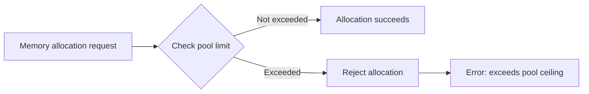
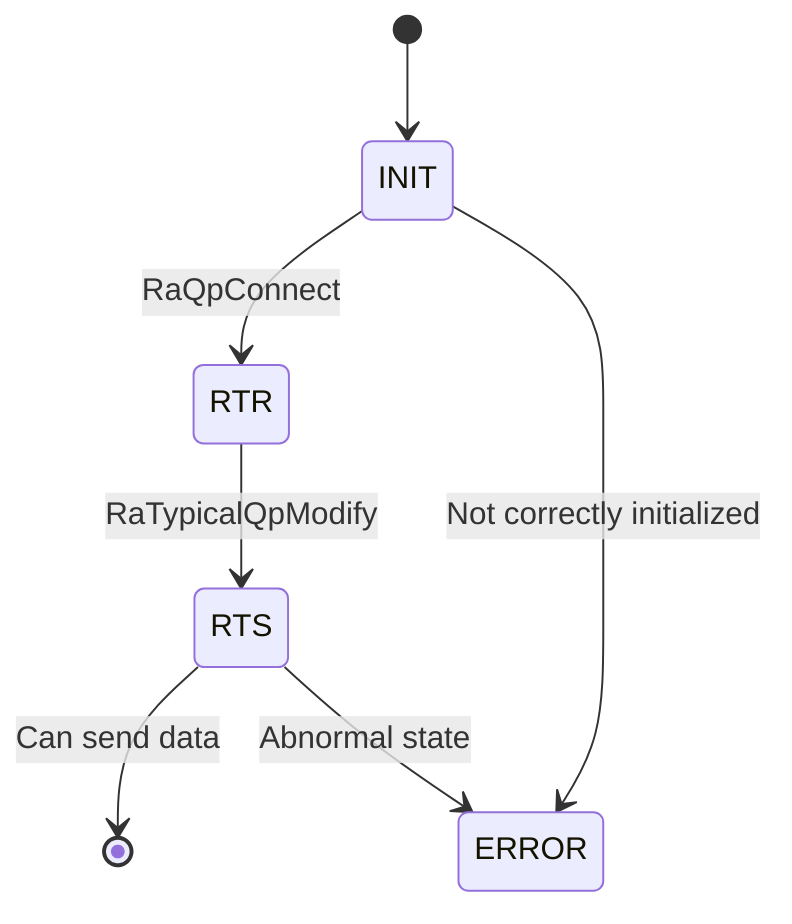
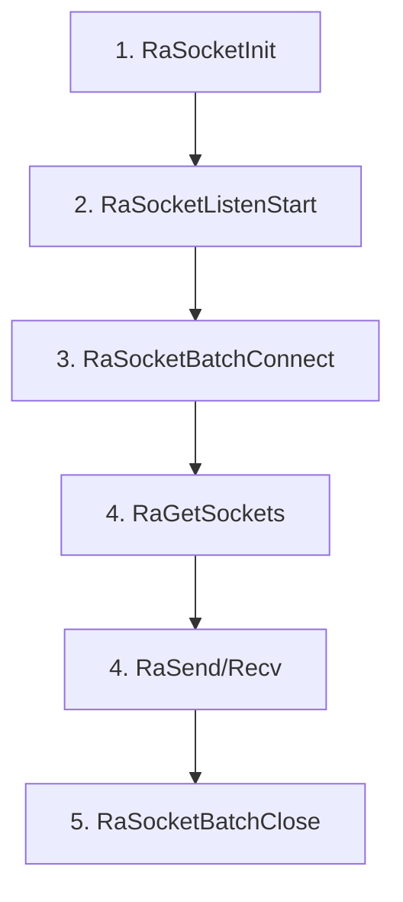
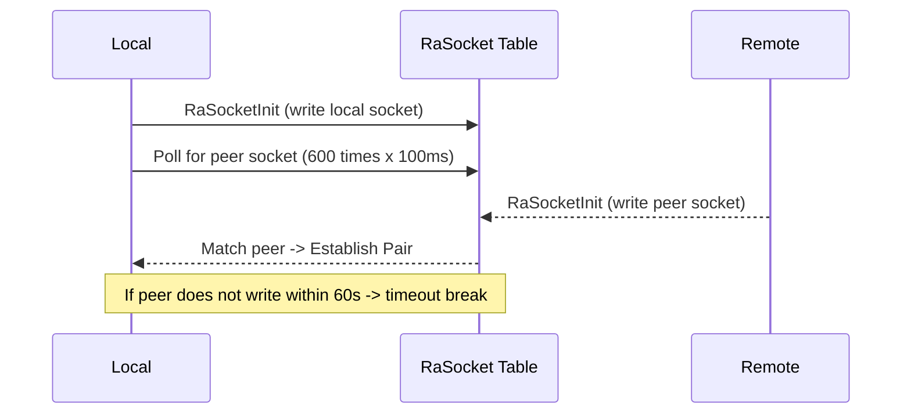

# HCCL-VM FAQ Test Document

> This document is used for testing the FAQ HTML generation framework.

---

## Module: CANN Package Installation and WSL Environment Configuration

---

#### FAQ-C001

**Title:** WSL Environment Configuration

**Error Code:**
```
NA (4)
```

**Error Function:**
```
NA
```

**Key Logs:**
```
[ 85%] Building CXX object src/legacy/ascend910/framework/CMakeFiles/hcomm.dir/common/src/config/env_config_host.cc.o
{standard input}: Assembler messages:
{standard input}:61985: Warning: end of file not at end of a line; newline inserted
{standard input}:61986: Error: expecting operand after ','; got nothing
{standard input}: Error: open CFI at the end of file; missing .cfi_endproc directive
c++: fatal error: Killed signal terminated program cc1plus
compilation terminated.
gmake[2]: *** [src/legacy/ascend910/framework/CMakeFiles/hcomm.dir/build.make:160: src/legacy/ascend910/framework/CMakeFiles/hcomm.dir/common/src/topo/topoinfo_ranktableParser.cc.o] Error 1
gmake[2]: *** Waiting for unfinished jobs....
gmake[1]: *** [CMakeFiles/Makefile2:6400: src/legacy/ascend910/framework/CMakeFiles/hcomm.dir/all] Error 2
gmake: *** [Makefile:156: all] Error 2
  Full log: /home/zhf/workspace/.hccl_vm_install_logs/build-pkg-20260705-234844.log
  You can also run manually: bash /home/zhf/workspace/hcomm/test/hccl_vm/build_pkg.sh --tool_path /home/zhf/workspace/hcomm/test/hccl_vm
[ERROR] Sub-package compilation failed. Check the log and retry.
```

**Symptom:** When compiling the hcomm sub-package using the one-click command in the WSL environment, or compiling the hcomm sub-package manually, the error above occurs.

**Diagnosis Guidance:**
```
[Possible Causes]
Compiling the hcomm sub-package has specific requirements for the WSL virtual Linux environment.
1. Ensure the WSL system version is Ubuntu 22.04 or Ubuntu 24.04.
2. Ensure the WSL settings meet the following conditions: available memory >= 8GB, swap space >= 4GB. The user can configure these through WSL settings.
```

---

## Module: HCCL-VM

### Submodule: Command Line

---

#### FAQ-E001

**Title:** Communicator Not Configured

**Error Code:**
```
NA (4)
```

**Error Function:**
```
db_sim_runner_common.cc::GetDeviceByRankId()
```

**Key Logs:**
```
[error][PID:173579][TID:173579][db_sim_runner_common.cc][GetDeviceByRankId] cannot find rank by rank id 0
[error][PID:173579][TID:173579][aclrt_device_stub.cc][aclrtSetDevice] [DEVICE_STUB]device not found by rankId:0
acl interface return err ./common/src/hccl_test_common.cc:861, retcode: 100000.
This is an error in device_init.
```

**Symptom:** When executing a business test case, the system reports that the device with rank id 0 cannot be found.

**Diagnosis Guidance:**
```
[Possible Causes]
Before executing a business test case, the user must determine the communicator size used by the current operator. Then configure the communicator using the hccl-vm mock-comm aa command. The aa.yaml file is located at $HCCL_VM_INSTALL_DIR/config/topo_meta/aa.yaml.
```

---

#### FAQ-E002

**Title:** RANK_TABLE_FILE Not Set

**Error Code:**
```
HCCL_SIM_E_PARA (1)
```

**Error Function:**
```
hccl_comm_stub.cc::HcclCommInitRootInfo()
```

**Key Logs:**
```
RANK_TABLE_FILE env not set, please check your config.
```

**Symptom:** The rank table configuration file cannot be found during communicator initialization.

**Diagnosis Guidance:**
```
[Possible Causes]
1. The environment variable is not set.
2. The file path is incorrect.

[Solution]
export RANK_TABLE_FILE=/path/to/rank_table.json
```

---

#### FAQ-E003

**Title:** HCCL_VM_INSTALL_DIR Not Set

**Error Code:**
```
HCCL_SIM_E_INTERNAL (4)
```

**Error Function:**
```
hccl_op_stub.cc::VirtualExecuteAivKernel()
```

**Key Logs:**
```
[virtual-aiv] env HCCL_VM_INSTALL_DIR is not set, can not locate <path> for kernel <name>
```

**Symptom:** AIV kernel virtual execution fails. The corresponding .so file cannot be found.

**Diagnosis Guidance:**
```
[Solution]
export HCCL_VM_INSTALL_DIR=/path/to/hccl_vm/install/dir
```

---

#### FAQ-E004

**Title:** Repeatedly Executing Start Command in Sub-shell

**Error Code:**
```
NA (no error code, WARNING only)
```

**Error Function:**
```
subcmd_start.cc::StartCommand::Execute()
```

**Key Logs:**
```
[warning][PID:<PID>][TID:<TID>][subcmd_start.cc][Execute] hccl-vm has already started. Please do not start it again in a sub-bash.
```

**Symptom:** The user executes the `hccl-vm start` command again inside the hvm sub-shell. The system reports that it has already started and ignores the operation.

**Diagnosis Guidance:**
```
[Possible Causes]
`hccl-vm start` forks a sub-bash process. When the user enters `hccl-vm start` again inside that sub-bash (prompt is `(hvm)$>`), the system rejects the duplicate start.

[Solution]
Do not execute `hccl-vm start` repeatedly inside the sub-shell. To restart the simulation environment, first exit the current sub-shell (enter `exit`), then re-execute `hccl-vm start`.
```

---

#### FAQ-E005

**Title:** Fork Child Process Failed

**Error Code:**
```
HCCL_SIM_HOST_ERROR_CMD (no standard error code)
```

**Error Function:**
```
cmd_base_utils.cc::StartHvmCmd()
```

**Key Logs:**
```
fork failed: Resource temporarily unavailable
```

**Symptom:** After executing the `hccl-vm start` command, the system cannot create a sub-shell process. The simulation environment fails to start.

**Diagnosis Guidance:**
```
[Possible Causes]
1. The system user process count has reached the limit (ulimit -u).
2. System memory is insufficient. Resources cannot be allocated for the new process.
3. PID resources are exhausted (/proc/sys/kernel/pid_max).

[Troubleshooting Steps]
ulimit -u
cat /proc/sys/kernel/pid_max
free -m
ps -eLf | wc -l

[Solution]
1. Increase the user process count limit: `ulimit -u <larger value>`
2. Clean up residual zombie processes in the system.
3. Check whether other programs occupy excessive system resources.
```

---

#### FAQ-E006

**Title:** Plugin Name Format Error

**Error Code:**
```
NA (CLI parameter validation)
```

**Error Function:**
```
subcmd_plugin.cc::PluginCommand::Setup()
```

**Key Logs:**
```
[HVM] [ERROR] Install plugin : Invalid format! Plugin name must start with '@' (e.g., @myplugin).
[HVM] [ERROR] Uninstall plugin : Invalid format! Plugin name must start with '@' (e.g., @myplugin).
[HVM] [ERROR] Run plugin : Invalid format! Plugin name must start with '@' (e.g., @myplugin).
```

**Symptom:** When executing the `hccl-vm plugin install/run/uninstall` command, CLI parameter validation fails. The system rejects the execution.

**Diagnosis Guidance:**
```
[Possible Causes]
The plugin name does not start with the `@` symbol. For example, the user enters `hccl-vm plugin install runner` instead of `hccl-vm plugin install @runner`.

[Solution]
Ensure the plugin name starts with `@`, for example:
hccl-vm plugin install @runner
hccl-vm plugin install @checker
hccl-vm plugin uninstall @runner
```

---

#### FAQ-E007

**Title:** Topology Configuration File Does Not Exist

**Error Code:**
```
NA (CLI parameter validation)
```

**Error Function:**
```
cmd_base_utils.cc::FileInModelDir()
```

**Key Logs:**
```
[HVM] model File not found: <install_path>/config/topo_meta/<name>.yaml
```

**Symptom:** When executing the `hccl-vm mock-comm <name>` command, the specified topology YAML configuration file does not exist. CLI parameter validation rejects the command directly. The communicator configuration file describes the scale of the operator execution communicator (for example, how many super nodes and servers the communicator contains, and which cards are used in each server. For details, see the file description).

**Diagnosis Guidance:**
```
[Possible Causes]
1. The specified topology name is misspelled.
2. The corresponding YAML file is not placed in the `$HCCL_VM_INSTALL_DIR/config/topo_meta/` directory.
3. The file extension is incorrect (should be `.yaml`).

[Troubleshooting Steps]
ls $HCCL_VM_INSTALL_DIR/config/topo_meta/

[Solution]
Confirm that the topology YAML file is placed in the correct directory and the file name matches the command parameter. For example, executing `hccl-vm mock-comm 121` requires the `config/topo_meta/121.yaml` file to exist.
```

---

#### FAQ-E008

**Title:** YAML Topology File Parsing Error

**Error Code:**
```
NA (runtime parsing error)
```

**Error Function:**
```
cmd_cluster_model_utils.cc::ParseYamlTopoImpl()
```

**Key Logs:**
```
[error][PID:<PID>][TID:<TID>][cmd_cluster_model_utils.cc][ParseYamlTopoImpl] Exception when parsing YAML: <detail>
```

**Symptom:** When executing the `hccl-vm mock-comm <name>` command, the YAML topology configuration file parsing fails. Communicator initialization is interrupted.

**Diagnosis Guidance:**
```
[Possible Causes]
1. The YAML file has syntax errors (for example, incorrect indentation, missing space after colon, illegal characters, and so on).
2. The YAML file contains unsupported field types or formats.
3. The YAML file encoding is not UTF-8.

[Troubleshooting Steps]
# Use python to verify YAML format
python3 -c "import yaml; yaml.safe_load(open('$HCCL_VM_INSTALL_DIR/config/topo_meta/<name>.yaml'))"

[Solution]
Fix the YAML file syntax errors based on the `<detail>` information in the log. Common issues include:
1. Indentation must use spaces. Tabs are not allowed.
2. A space is required after the colon in key-value pairs.
3. List item (`-`) indentation must be consistent with the current level.
```

---

### Submodule: Memory Management

---

#### FAQ-M001

**Title:** Device Memory Allocation Exceeds Limit

**Error Code:**
```
HCCL_SIM_E_MEMORY (3)
```

**Error Function:**
```
store_sim_device_memory_manager.cc::AllocPhyMem()
```

**Key Logs:**
```
dev:<N> alloc phy mem:<ADDR> size:<SIZE> exceeds pool ceiling:<CEILING>, reject
```

**Symptom:** A device memory allocation request exceeds the simulated memory pool upper limit.

**Diagram:**


---

#### FAQ-M002

**Title:** Shared Memory Creation Failed

**Error Code:**
```
HCCL_SIM_E_SYSCALL (8)
```

**Error Function:**
```
store_sim_shm_ops.cc::ShmCreate()
```

**Key Logs:**
```
[SHM_OPS] create: shm_open failed, name: <name>
[SHM_OPS] create: ftruncate failed, name: <name>
[SHM_OPS] create: mmap failed, name: <name>
```

**Symptom:** A shared memory segment cannot be created.

**Diagnosis Guidance:**
```
[Possible Causes]
1. `/dev/shm` space is insufficient.
2. Permissions are insufficient.
3. A shared memory with the same name already exists and conflicts.

[Troubleshooting Steps]
df -h /dev/shm
ls /dev/shm/ | grep hccl
```

---

#### FAQ-M003

**Title:** Communication Memory Allocation Failed

**Error Code:**
```
HCCL_SIM_E_NOT_FOUND (6)
```

**Error Function:**
```
store_sim_comm_memory_manager.cc
```

**Key Logs:**
```
[COMM_MEM] alloc failed, name: <name>
[COMM_MEM] acquire failed, name: <name>
[COMM_MEM] write size too large, size: <N>, max: <MAX>
```

**Symptom:** Cross-process communication memory operations fail.

---

#### FAQ-M004

**Title:** BUS Error Crash When Operating Device Memory

**Error Code:** `NA`

**Error Function:** `CommunicationMemoryManager::Send`

**Key Logs:**
```
Bus error
```

**Symptom:** The business process crashes directly with a bus error.

**Possible Causes:** `/dev/shm` has no available space. Check with the command `df -h /dev/shm`.

---

### Submodule: Stub Proxy

---

#### FAQ-PX001

**Title:** AIV Kernel Virtual Execution Failed

**Error Code:**
```
HCCL_SIM_E_INTERNAL (4)
```

**Error Function:**
```
hccl_op_stub.cc::VirtualExecuteAivKernel()
```

**Key Logs:**
```
[virtual-aiv] env HCCL_VM_INSTALL_DIR is not set
[virtual-aiv] missing aiv stub shared library, kernel=<name>
[virtual-aiv] dlopen <so> failed, err = <error>
[virtual-aiv] dlsym <symbol> from <so> failed, err = <error>
```

**Symptom:** The AIV kernel fails to execute in the virtual environment.

**Diagnosis Guidance:**
```
[Troubleshooting Steps]
echo $HCCL_VM_INSTALL_DIR
ls -la $HCCL_VM_INSTALL_DIR/lib/aiv/
nm -D $HCCL_VM_INSTALL_DIR/lib/aiv/<kernel>.so | grep <symbol>
```

---

#### FAQ-PX002

**Title:** Operator Database Recording Failed

**Error Code:**
```
HCCL_SIM_E_INTERNAL (4)
```

**Error Function:**
```
hccl_op_stub.cc::RecordOpDbInfo()
```

**Key Logs:**
```
[RecordOpDbInfo] insert op detail+mem failed
[HcclAllReduce] record op db info failed
```

**Symptom:** The parameters of HCCL collective communication operators cannot be written to the simulation database.

**Affected Operators:** AlltoAll, AlltoAllV, AllGather, Broadcast, AllReduce, Scatter, Reduce, ReduceScatter

---

#### FAQ-PX003

**Title:** QP Not Found or Status Error

**Error Code:**
```
HCCL_SIM_E_NOT_FOUND (6)
```

**Error Function:**
```
hccp_stub.cc::RaSendWr()
```

**Key Logs:**
```
[HCCP] RaSendWr: QP <N> not found
[HCCP] RaSendWr: QP <N> not in RTS state, current state:<N>
```

**Symptom:** RDMA QP operation fails. The QP does not exist or has not reached RTS state.

**Diagram:**


---

#### FAQ-PX004

**Title:** EndPoint Lookup Failed

**Error Code:**
```
HCCL_SIM_E_NOT_FOUND (6)
```

**Error Function:**
```
hccp_stub.cc::RaCtxQpImport()
```

**Key Logs:**
```
[HCCP] cannot find endpoint addr:<IP>
Get remote endpoint failed. ip:<IP>, eid:<EID>
```

**Symptom:** Network endpoint lookup fails.

**Diagnosis Guidance:**
```
[Possible Causes]
The IP address is not in the endpoint list configured in the rank table.
```

---

#### FAQ-PX005

**Title:** CCU Microcode Loading Failed

**Error Code:**
```
HCCL_SIM_E_INTERNAL (4)
```

**Error Function:**
```
hccp_ccu_stub.cc::LoadMicrocodeInstruction()
```

**Key Logs:**
```
[LoadMicrocodeInstruction] get device by logic id <N> failed.
[LoadMicrocodeInstruction] get ccu from device by die id <N> failed.
[LoadMicrocodeInstruction] insert instr failed
```

**Symptom:** CCU microcode instructions fail to load into the simulator.

---

#### FAQ-PX006

**Title:** Cannot Obtain Current Context

**Error Code:**
```
HCCL_SIM_E_NOT_FOUND (6)
```

**Error Function:**
```
hccp_stub.cc::RaRdevInit()
```

**Key Logs:**
```
[error][PID:<PID>][TID:<TID>][hccp_stub.cc][RaRdevInit] can not get CurrContext: <N>
```

**Symptom:** During RDMA device initialization, the active Context cannot be obtained through the current Runner. RDMA device creation fails.

**Diagnosis Guidance:**
```
[Possible Causes]
1. The application layer did not call `aclrtSetDevice`/`aclrtCreateContext` to initialize the device and context.
2. The Context was destroyed prematurely.
3. The current_ctx_id in the Runner TLS (Thread Local Storage) is invalid.
4. The application layer called other runtime interfaces to obtain the context before calling `aclrtSetDevice` to initialize the device context.

[Troubleshooting Steps]
# Check the Context table
hccl-vm table show Context
# Check current_ctx_id in the Runner table
hccl-vm table show Runner

[Solution]
Confirm that the application layer has correctly called `aclrtSetDevice` and `aclrtCreateContext` before RDMA operations, and that the Context has not been destroyed prematurely.
```

---

#### FAQ-PX007

**Title:** AICPU Binary File Not Found

**Error Code:**
```
ACL_ERROR_RT_FEATURE_NOT_SUPPORT
```

**Error Function:**
```
aclrt_kernel_stub.cc::aclrtDestroyBinary()
```

**Key Logs:**
```
[error][PID:<PID>][TID:<TID>][aclrt_kernel_stub.cc][aclrtDestroyBinary] can not find this binary
```

**Symptom:** When destroying an AICPU binary object, the corresponding binary handle cannot be found in the global kernel binary registry.

**Diagnosis Guidance:**
```
[Possible Causes]
1. The binary file was not correctly loaded (`aclrtLoadBinary` was not executed or failed).
2. The binary handle was destroyed repeatedly (double-free).
3. The binary object was operated on concurrently in a multi-threaded environment, causing state inconsistency.

[Troubleshooting Steps]
# Check for duplicate destroy calls
# Confirm the return value of aclrtLoadBinary

[Solution]
Ensure `aclrtLoadBinary` returns successfully before calling `aclrtDestroyBinary`. Do not destroy the same binary object repeatedly.
```

---

#### FAQ-PX008

**Title:** AICPU Device Process Exited Abnormally

**Error Code:**
```
NA (process-level error)
```

**Error Function:**
```
aclrt_kernel_stub.cc::WaitAicpuProcess()
```

**Key Logs:**
```
[error][PID:<PID>][TID:<TID>][aclrt_kernel_stub.cc][WaitAicpuProcess] device process[<PID>] exited with status <N>
[error][PID:<PID>][TID:<TID>][aclrt_kernel_stub.cc][WaitAicpuProcess] device process[<PID>] killed by signal <N>
```

**Symptom:** The AICPU device child process exits abnormally or is killed by a signal. The main process then also exits (`exit(EXIT_FAILURE)`).

**Diagnosis Guidance:**
```
[Possible Causes]
1. An uncaught exception or segmentation fault occurred inside the AICPU process.
2. System resources are insufficient (memory, file descriptors, and so on). The child process was killed by the OOM killer.
3. The AICPU binary file itself has a bug.
4. Shared libraries required by the child process are missing.

[Troubleshooting Steps]
# Check system logs for OOM records
dmesg | grep -i "oom\|killed"
# Confirm that the AICPU binary file is complete
ls -la $HCCL_VM_INSTALL_DIR/bin/
# Check system resources
ulimit -a
free -m

[Solution]
1. Check whether the AICPU binary file is correctly compiled and deployed.
2. Confirm that system resources are sufficient (memory, file descriptor limits, and so on).
3. If killed by a signal, further diagnose the cause based on the signal number (for example, 11=SIGSEGV, 9=SIGKILL).
```

---

#### FAQ-PX009

**Title:** No Rank Found During CCU Microcode Loading

**Error Code:**
```
HCCL_SIM_E_NOT_FOUND (6)
```

**Error Function:**
```
hccp_ccu_stub.cc::LoadMicrocodeInstruction()
```

**Key Logs:**
```
[error][PID:<PID>][TID:<TID>][hccp_ccu_stub.cc][LoadMicrocodeInstruction] can not find any rank
```

**Symptom:** During CCU microcode instruction loading, no rank records can be found in the Rank table corresponding to the current device.

**Diagnosis Guidance:**
```
[Possible Causes]
1. The communicator was not initialized through the `mock-comm` command. The Rank table is empty.
2. The current device ID does not exist in the communicator configuration.

[Troubleshooting Steps]
# Check whether the Rank table has data
hccl-vm table show Rank
# Check the Device table
hccl-vm table show Device

[Solution]
Ensure that the communicator has been correctly initialized through the `hccl-vm mock-comm` command before CCU-related operations, and that the communicator configuration covers the current device.
```

---

#### FAQ-PX010

**Title:** Device Lookup by rankId Failed

**Error Code:**
```
HCCL_E_NOT_FOUND
```

cc
```
aclrt_device_stub.cc::hrtSetDevice()
```

**Key Logs:**
```
[error][PID:<PID>][TID:<TID>][aclrt_device_stub.cc][hrtSetDevice] device not found by rankId:<N>
```

**Symptom:** When calling `aclrtSetDevice` to set the current device, the corresponding device lookup by rankId fails.

**Diagnosis Guidance:**
```
[Possible Causes]
1. The rankId exceeds the actual rank range in the communicator. For example, the communicator configures 4 NPUs, but mpirun actually launched 6 NPU processes. RankIds 4 and 5 both report device not found.
2. The communicator was not initialized (the `mock-comm` command was not executed). [Most likely] The Rank table is initialized internally only after the communicator is initialized.
3. The ranktable configuration does not match the actual rank count in use. The `RANK_TABLE_FILE` may point to an incorrect file path.

[Troubleshooting Steps]
# Check whether rankId is within the valid range
hccl-vm table show Rank

[Solution]
Confirm that rankId is within the valid range of the communicator configuration (0 to rank_count-1), and that the `RANK_TABLE_FILE` environment variable points to the correct ranktable.json file.
```

---

#### FAQ-PX011

**Title:** Stub Interface Not Yet Implemented

**Error Code:**
```
HCCL_SIM_E_INTERNAL (4) or NA
```

**Error Function:**
```
Multiple stub function files (hccp_stub.cc, ascend_hal_stub.cc, aclrt_kernel_stub.cc, and so on)
```

**Key Logs:**
```
[warning][PID:<PID>][TID:<TID>][ascend_hal_stub.cc][*] [STUB] is empty
[warning][PID:<PID>][TID:<TID>][hccp_stub.cc][*] [STUB] is empty
[error][PID:<PID>][TID:<TID>][hccp_stub.cc][RaCtxGetAuxInfo] Not support yet
[error][PID:<PID>][TID:<TID>][hccp_stub.cc][RaCtxGetCrErrInfoList] Not support yet
```

**Symptom:** The application layer calls underlying driver or runtime interfaces that the simulator has not yet implemented. The log shows `[STUB] is empty` or `Not support yet` warnings/errors. Such stub functions return default values directly (usually 0 or success) and perform no actual operations.

**Diagnosis Guidance:**
```
[Possible Causes]
The current simulator version implements only the core interface subset required for HCCL collective communication. Some underlying driver interfaces (for example, drvGetDeviceCapability, RaCtxGetAuxInfo, drvMemPrefetch) are not on the core HCCL communication path. Therefore, stub function bodies are empty or marked as unsupported.
  Normally, flows supported by the HCCL-VM tool do not call these interfaces. Such warnings do not appear. If the user calls incorrect application layer interfaces or enters an incorrect HCCL business flow, such warnings may occur.

[Solution]
1. Such warnings usually do not affect HCCL operator correctness simulation and can be safely ignored.
2. If the warning is accompanied by functional anomalies, the application depends on unimplemented interfaces. Report this to the simulator development team.
3. If a stub implementation for a specific interface is needed, contact the development team for priority adaptation.
```

**Main Interface Types Involved:**
1. **Driver layer interfaces** (`ascend_hal_stub.cc`): drvGetDeviceCapability, drvMemPrefetch, drvStreamQuery, and approximately 315 interfaces
2. **RDMA interfaces** (`hccp_stub.cc`): RaRestoreSnapshot, RaRdevInitWithBackup, RaCtxGetAuxInfo, and approximately 44 interfaces
3. **Runtime adaptation layer** (`adapter_rts_stub.cc`): Some aclrt extension interfaces
4. **TSD client** (`tsd_client_stub.cc`): TSD-related interfaces

---

#### FAQ-PX012

**Title:** Socket Acquisition Failed

**Error Code:** `NA`

**Error Function:** `hccp_ra_socket_stub.cc::RaGetSockets()`

**Key Logs:**
```
[RASOCKET_STUB]get socket failed local:socketFd peerAddr:ipaddr role:0
```

**Symptom:** The desired connection socket handle acquisition fails.

**Possible Causes:**
1. The peer socket did not call RaSocketInit.
2. The peer socket did not call RaSocketBatchConnect.
3. The peer socket already called RaSocketBatchClose.

**Diagram:**


---

#### FAQ-PX013

**Title:** Socket Buffer Allocation Failed

**Error Code:** `NA`

**Error Function:** `hccp_ra_socket_stub.cc::RaSocketBatchConnect()`

**Key Logs:**
```
[RASOCKET_STUB] AllocSlot failed for tag:xxx
```

**Symptom:** Socket link slot memory allocation fails.

**Possible Causes:** Residual SHM pages may exist and have not been cleared. Execute `ls /dev/shm/` to check.

---

#### FAQ-PX014

**Title:** waitpid Waiting for AICPU Device Process Failed

**Error Code:**
```
NA (process-level error)
```

**Error Function:**
```
aclrt_kernel_stub.cc::WaitAicpuProcess()
```

**Key Logs:**
```
[error][PID:<PID>][TID:<TID>][aclrt_kernel_stub.cc][WaitAicpuProcess] waitpid failed for pid <PID>, errno: <N> (<description>)
```

**Symptom:** When the main process waits for the AICPU device child process to exit, the `waitpid` system call does not return the target device process PID. The main process then calls `exit(EXIT_FAILURE)` to exit. The simulation is interrupted. Unlike FAQ-PX008, in this scenario the exit status of the device child process was not successfully collected (waitpid itself failed), rather than the child process actively crashing.

**Diagnosis Guidance:**
```
[Possible Causes]
The waitpid return value is incorrect. Common errno causes:
1. ECHILD (10): The current process has no child processes that can be waited on. The device child process was already reaped by another thread/process, or the fork parent-child relationship is disordered (for example, the child process was already reaped preemptively by wait4 in a signal handler).
2. EINVAL (22): The options or signal parameter passed is invalid (usually a code logic bug).
3. EINTR (4): waitpid was interrupted by a signal and did not auto-restart (rare. waitpid retries on EINTR by default, but some call paths do not handle this).

[Troubleshooting Steps]
# Confirm whether the target PID exists and whether its parent process is the current process
ps -eo pid,ppid,stat,cmd | grep <PID>
# Check system logs for abnormal process reaping or signal handling
dmesg | grep -i "process\|killed"
# Confirm whether duplicate WaitAicpuProcess calls exist or multi-thread competition for child process reaping exists
# (Code side) Check whether a SIGCHLD handler is registered that internally calls wait/waitpid

```

---

#### FAQ-PX015

**Title:** Socket Connection Cannot Find Remote IP Endpoint

**Error Code:**
```
NA (returns -1, no standard error code)
```

**Error Function:**
```
hccp_ra_socket_stub.cc::RaSocketInit()
hccp_ra_socket_stub.cc::RaSocketBatchConnect()
```

**Key Logs:**
```
[RASOCKET_STUB] get device by phy id <N> failed
[RASOCKET_STUB] cannot find remote ip <IP>
```

**Symptom:** After `RaSocketInit` resolves the IP from `rdevInfo.localIp` or `RaSocketBatchConnect` resolves the IP from `conn[i].remoteIp`, the corresponding endpoint cannot be found in the EndPoint table. Socket initialization/connection directly returns -1 and is interrupted. The `<IP>` in logs is typically an IPv6 string address with the prefix removed.

**Diagnosis Guidance:**
```
[Possible Causes]
1. ranktable.json does not configure an endpoint for that IP (EndPoint table is missing that entry).
2. The communicator was not initialized (`mock-comm` was not executed). The EndPoint table is empty.
3. IP address mismatch. The IP configured in ranktable differs from the IP actually delivered at runtime (for example, IPv6 address abbreviation or prefix mapping differences).
4. The server_count or device_list count in ranktable is insufficient. IPs of some ranks are not included in the endpoint table.

[Troubleshooting Steps]
# Check whether the endpoint table contains that IP
hccl-vm table show EndPoint
# Confirm ranktable configuration
echo $RANK_TABLE_FILE
cat $RANK_TABLE_FILE | python3 -m json.tool
# Confirm whether the communicator has been initialized
hccl-vm table show Rank

```

---

#### FAQ-PX016

**Title:** Socket Connection Peer Timeout Not Ready

**Error Code:**
```
NA (function returns 0, but that connection did not establish a pair. Subsequent RaGetSockets triggers FAQ-PX012)
```

**Error Function:**
```
hccp_ra_socket_stub.cc::RaSocketBatchConnect()
```

**Key Logs:**
```
[RASOCKET_STUB] can not find remote dev:<N>, endpoint:<N>
[RASOCKET_STUB] can not get break dev:<N> sock:<N> connect dev:<N> ip addr:<IP> tag:<tag>
```

**Symptom:** `RaGetSockets` (Server side) polls waiting for the peer Client to create an RaSocketPair record in the DB. After looping 180 times x 500ms = 90s without finding it, a timeout error occurs. The `RaSocket` table is deprecated and no longer used.

**Diagnosis Guidance:**
```
[Possible Causes]
1. The peer Client process was not started, or has not yet called `RaSocketBatchConnect`.
2. Multi-rank startup order is disordered. The Server starts GetSockets before the Client creates RaSocketPair.
3. Tag matching is inconsistent. The tag_hash used by Client and Server does not match.
4. The peer process exited abnormally. The RaSocketPair record was not written to the DB.

[Troubleshooting Steps]
# Check the RaSocketPair table to confirm whether the record for the tag has been created and the slot_idx
hccl-vm table show RaSocketPair
# Confirm that all rank processes have been started
ps -ef | grep <business process name>
# Confirm that the rank count in the communicator matches the process count
hccl-vm table show Rank

```

**Diagram:**


---

#### FAQ-PX017

**Title:** socketHandle Does Not Exist in RaSocket Table

**Error Code:**
```
NA (returns -1)
```

**Error Function:**
```
hccp_ra_socket_stub.cc::RaSocketListenStart()
hccp_ra_socket_stub.cc::RaSocketListenStop()
hccp_ra_socket_stub.cc::RaSocketBatchConnect()
hccp_ra_socket_stub.cc::RaGetSockets()
```

**Key Logs:**
```
[RASOCKET_STUB] can not get Socket:<N>
[RASOCKET_STUB] can not get Local Ra Socket:<N>
[RASOCKET_STUB] can not get local socket fd:<N>
```

**Symptom:** When calling `RaSocketListenStart`/`RaSocketListenStop`/`RaSocketBatchConnect`/`RaGetSockets`, the passed `socketHandle` cannot be found in the RaSocket table through `GetById`. The corresponding operation fails and returns -1.

**Diagnosis Guidance:**
```
[Possible Causes]
1. That socketHandle was already deleted by `RaSocketDeinit` (Deinit was called before usage).
2. The socketHandle value is invalid. It comes from uninitialized memory or a handle from another process.
3. The handle was passed across processes. The simulator socketHandle is locally allocated within the process. Handles are not shared across processes. If the business layer passes fd between processes, the peer process cannot find it.
4. RaSocketInit returned failure (for example, FAQ-PX015). The caller did not check the return value and still uses the null handle.

[Troubleshooting Steps]
# Confirm call order. Check whether the handle is still used after Deinit.
# Confirm handle source. Check whether it was returned successfully by RaSocketInit.

```

---

#### FAQ-PX018

**Title:** Socket Link Send/Recv Read/Write Failed

**Error Code:**
```
NA (returns -1)
```

**Error Function:**
```
hccp_ra_socket_stub.cc::RaSocketSend()
hccp_ra_socket_stub.cc::RaSocketRecv()
hccp_ra_socket_stub.cc::RaSocketRecvAsync()
```

**Key Logs:**
```
[RASOCKET_STUB] cannot pair socket:<N> role:<N>, key=<key>
[RASOCKET_STUB] socket pair:<N> role:<N>, key=<key> recv failed
[RASOCKET_STUB] socket pair:<N> role:<N>, key=<key> read try again
```

**Symptom:** `RaSocketSend` calls `Send` to write to slot shared memory and fails, returning -1. Or `RaSocketRecv`/`RaSocketRecvAsync` calls `Recv` and returns -1. Link data send/recv is interrupted. `SOCK_EAGAIN` indicates no data is available for reading currently. The caller retries. This is not within the scope of this FAQ.

**Diagnosis Guidance:**
```
[Possible Causes]
1. The slot shared memory of the pair was already freed by `RaSocketBatchClose`. `mgr.CloseSlot` cleared the slot header, but threads are still performing Send/Recv.
2. /dev/shm space is insufficient or residual ra_sock_pool_* old pages exist, causing memory segment conflicts.
3. Slot allocation failed (`AllocSlot` returned UINT32_MAX, pool is exhausted).
4. The caller passed an incorrect fdHandle. The slotIdx resolution is wrong. The corresponding slot was never allocated.

[Troubleshooting Steps]
# Check whether /dev/shm has residual ra_sock_pool_* pages
ls /dev/shm/ | grep ra_sock_pool
# Check /dev/shm space
df -h /dev/shm
# Check RaSocketPair status and slot_idx
hccl-vm table show RaSocketPair

```

---

### Submodule: Networking

---

#### FAQ-N001

**Title:** Ranktable Environment Variable Configuration Error

**Error Code:**
```
NA (1)
```

**Error Function:**
```
param_check_v2.cc::RanktableRealPath
```

**Key Logs:**
```
[error][PID:172019][TID:172019][log_stub.cc][DlogPrintStub] [HCCL_LOG][param_check_v2.cc:457][172019]RanktableRealPath: /home/teamserver/workspace/CheckerL2_2128/hccl_vm_install/ranktable.json is not a valid real path

[info][PID:172021][TID:172021][log_stub.cc][DlogPrintStub] [HCCL_LOG][adapter_rts.cc:234] [172021][hrtGetDeviceRefresh]deviceLogicId[3]
[error][PID:172020][TID:172020][log_stub.cc][DlogPrintStub] [HCCL_LOG][param_check_v2.cc:457][172020]RanktableRealPath: /home/teamserver/workspace/CheckerL2_2128/hccl_vm_install/ranktable.json is not a valid real path

[info][PID:172018][TID:172018][log_stub.cc][DlogPrintStub] [HCCL_LOG][adapter_rts.cc:234] [172018][hrtGetDeviceRefresh]deviceLogicId[0]
[error][PID:172019][TID:172019][log_stub.cc][DlogPrintStub] [HCCL_LOG][op_base_v2.cc:294][172019][HcclCommInitClusterInfoV2]call trace: hcclRet -> 1

[error][PID:172019][TID:172019][log_stub.cc][DlogPrintStub] [HCCL_LOG][op_base.cc:811] [172019][operator()]call trace: hcclRet -> 1
```

**Symptom:** Running the test case fails to initialize the communicator.

**Diagnosis Guidance:**
```
[Possible Causes]
The ranktable.json file path is configured incorrectly. Check the RANK_TABLE_FILE environment variable configuration. ranktable.json is generated by the tool. Its path is $HCCL_VM_INSTALL_DIR/data/ranktable.json.

[Troubleshooting Steps]
echo $RANK_TABLE_FILE

[Solution]
Confirm that the RANK_TABLE_FILE environment variable is configured correctly and points to the ranktable.json file path.
```

---

#### FAQ-N002

**Title:** topo.json Path Configuration Error

**Error Code:**
```
NA (1)
```

**Error Function:**
```
communicator_impl.cc::GetTopoFilePath
```

**Key Logs:**
```
[error][PID:172635][TID:172635][log_stub.cc][DlogPrintStub] [HCCL_LOG][communicator_impl.cc:1339][172635][GetTopoFilePath] topo_file_path[/home/teamserver/workspace/CheckerL2_2128/hccl_vm_install/topo.json] is not a valid real path
```

**Symptom:** Running the test case fails to initialize the communicator.

**Diagnosis Guidance:**
```
[Possible Causes]
The topo.json file path is configured incorrectly in the /etc/hccl_rootinfo.json file. Check the topo_file_path field. topo.json is generated by the tool. Its path is $HCCL_VM_INSTALL_DIR/data/topo.json.

[Troubleshooting Steps]
echo $TOPO_FILE_PATH

[Solution]
Confirm that the TOPO_FILE_PATH environment variable is configured correctly and points to the topo.json file path.
```

---

#### FAQ-N003

**Title:** mock-comm Command Error

**Error Code:**
```
NA
```

**Error Function:**
```
db_sim_runner_ops.cc::GetServerKeyById
```

**Key Logs:**
```
(hvm)$> hccl-vm mock-comm 144
[error][PID:172799][TID:172875][db_sim_runner_ops.cc][GetServerKeyById] can not find server by id: 0, 2
[error][PID:172799][TID:172875][topo_ascend_cluster_parser.cc][InitDynamicModelData] cannot find device by physical id 0
[error][PID:172799][TID:172875][cmd_base_utils.cc][InitHvmCommEnv] [HVM] InitHvmCommEnv failed
[error][PID:172799][TID:172875][subcmd_mock_comm.cc][Execute] [HVM] Failed to initialize mock communication environment. Cleaning up environment.
```

**Symptom:** Before running the test case, configuring the communicator through the mock-comm command fails.

**Diagnosis Guidance:**
```
[Possible Causes]
The communicator 144 configured by the mock-comm command exceeds the cluster configuration that the tool started with. For example, the cluster started by the tool has only 2 servers per super node, but communicator 144 specifies 4 servers under that super node.

[Troubleshooting Steps]
Confirm the cluster configuration file used when the tool started and the communicator configuration file used by the mock-comm command.

[Solution]
Check the cluster configuration that the tool started with. Confirm the server count under each super node. If communicator 144 is truly needed, ensure that a larger cluster networking configuration is selected when the tool starts.
Ensure that the communicator configured by the mock-comm command does not exceed the cluster configuration that the tool started with.
```

---

#### FAQ-N004

**Title:** EndPoint IP Lookup Failed

**Error Code:**
```
HCCL_SIM_E_NOT_FOUND (6)
```

**Error Function:**
```
topo_ascend_cluster_parser.cc::AddLinkInfo()
```

**Key Logs:**
```
cannot find endPoint by ip <IP_ADDR>
```

**Symptom:** The IP address referenced in the network link configuration does not exist in the topology.

---

#### FAQ-N005

**Title:** Superpod Index Out of Range

**Error Code:**
```
HCCL_SIM_E_NOT_FOUND (6)
```

**Error Function:**
```
topo_ascend_cluster_parser.cc::InitDynamicModelData()
```

**Key Logs:**
```
[InitDynamicModelData] superpod index <N> out of range
```

**Symptom:** When parsing the ranktable to generate ranktable.json, the referenced superpod index exceeds the actual superpod count in the cluster. Initialization fails.

**Diagnosis Guidance:**
```
[Possible Causes]
The number of superpods that the devices in the ranktable belong to exceeds the cluster networking configuration that the tool started with. For example, the cluster has only 1 superpod, but the ranktable references the 2nd superpod.

[Troubleshooting Steps]
1. Check the cluster networking configuration when the tool started (topo_meta/*.yaml). Confirm the superpod count.
2. Check the ranktable configuration ($HCCL_VM_INSTALL_DIR/data/ranktable.json). Confirm whether the referenced superpod index exceeds the range.

[Solution]
Ensure that the superpod count referenced by the communicator configured through the mock-comm command does not exceed the cluster networking configuration. If more superpods are needed, select a larger cluster networking configuration when starting the tool.
```

---

#### FAQ-N006

**Title:** Server Index Out of Range

**Error Code:**
```
HCCL_SIM_E_NOT_FOUND (6)
```

**Error Function:**
```
topo_ascend_cluster_parser.cc::InitDynamicModelData()
```

**Key Logs:**
```
[InitDynamicModelData] server index <N> out of range in superpod <M>
```

**Symptom:** When parsing the ranktable to generate ranktable.json, the referenced server index exceeds the actual server count within the superpod. Initialization fails.

**Diagnosis Guidance:**
```
[Possible Causes]
The server count configured for a superpod in the ranktable exceeds the server count for that superpod in the cluster networking configuration that the tool started with. For example, the cluster networking has 2 servers per superpod, but the ranktable references the 3rd server.

[Troubleshooting Steps]
1. Check the cluster networking configuration when the tool started (topo_meta/*.yaml). Confirm the server count under each superpod.
2. Check the ranktable configuration ($HCCL_VM_INSTALL_DIR/data/ranktable.json). Confirm whether the referenced server index exceeds the range.

[Solution]
Ensure that the server count under each superpod in the communicator configured through the mock-comm command does not exceed the cluster networking configuration. If more servers are needed, select a larger cluster networking configuration when starting the tool.
```

---

#### FAQ-N007

**Title:** Device Lookup by Physical ID Failed

**Error Code:**
```
HCCL_SIM_E_NOT_FOUND (6)
```

**Error Function:**
```
topo_ascend_cluster_parser.cc::InitDynamicModelData()
```

**Key Logs:**
```
[InitDynamicModelData] cannot find device by physical id <N>
```

**Symptom:** When parsing the ranktable, device lookup by physical device ID fails. This usually occurs during communicator configuration with mock-comm.

**Diagnosis Guidance:**
```
[Possible Causes]
The physical device ID (physical id) referenced in the communicator configured by the mock-comm command exceeds the actual device range in the cluster networking. For example, the cluster has only 2 devices (physical id 0 and 1), but the communicator configuration references physical id 2.

[Troubleshooting Steps]
1. Check the cluster networking configuration when the tool started (topo_meta/*.yaml). Confirm the device count under each server.
2. Check the ranktable configuration ($HCCL_VM_INSTALL_DIR/data/ranktable.json). Confirm whether the referenced device_id exceeds the range.

[Solution]
Ensure that the physical device IDs referenced in the communicator configured by the mock-comm command do not exceed the device range in the cluster networking configuration. If more devices are needed, select a larger cluster networking configuration when starting the tool.
```

---

### Submodule: Database

---

#### FAQ-DB001

**Title:** SQLite Database Connection Failed

**Error Code:**
```
HCCL_SIM_E_OPEN_FILE_FAILURE (10)
```

**Error Function:**
```
db_hccl_db_sqlite.cc::Connect()
```

**Key Logs:**
```
[dbInit] Connect database failed
Connect database:<path> failed
```

**Symptom:** The system cannot connect to the SQLite database file.

**Diagnosis Guidance:**
```
[Possible Causes]
1. The database file does not exist.
2. File permissions are insufficient.
3. The file is locked by another process.
```

---

#### FAQ-DB002

**Title:** Database Backup File Not Found

**Error Code:**
```
HCCL_SIM_E_OPEN_FILE_FAILURE (10)
```

**Error Function:**
```
sim_loader.cc::BackupDatabase()
```

**Key Logs:**
```
[Loader] Backup database file not found: <dbPath>
```

**Symptom:** The Loader cannot find the simulation database file.

**Diagnosis Guidance:**
```
[Possible Causes]
1. The simulation data file path is configured incorrectly.
2. The simulation data has not been generated yet.
3. File permissions are insufficient.

[Troubleshooting Steps]
ls -la <dbPath>
```

---

#### FAQ-DB003

**Title:** SQLite Query Failed

**Error Code:**
```
HCCL_SIM_E_INTERNAL (4)
```

**Error Function:**
```
db_hccl_db_sqlite.cc
```

**Key Logs:**
```
Prepare failed: <error> sql:<SQL>
Step failed: <error>, sql:<SQL>
```

**Symptom:** SQL query execution fails.

**Diagnosis Guidance:**
```
[Possible Causes]
1. Database table structure does not match (version incompatibility).
2. The database file is corrupted.
3. Disk space is insufficient.
```

---

## Module: Plugins

### Submodule: Checker

> Checker plugin error codes (101-902) have been migrated to [Checker Error Code FAQ](checker_faq_en.md). This document no longer lists them. Only items not belonging to the V3 error code system are retained below.

---

#### FAQ-C008

**Title:** Binary File Magic Number Mismatch

**Error Function:**
```
binary_data_operator.cc::FileHeaderRead()
```

**Key Logs:**
```
[FileHeaderRead] Unmatched magic number:0x<N>≠0x<M>
```

**Symptom:** When reading a simulation data file, the magic number in the file header does not match.

**Diagnosis Guidance:**
```
[Possible Causes]
1. The data file version is incompatible with the tool version.
2. The file is corrupted.
```

---

## Appendix: Error Code Quick Reference Table

| Error Code | Enum Value | Meaning |
|--------|--------|------|
| 0 | HCCL_SIM_SUCCESS | Success |
| 1 | HCCL_SIM_E_PARA | Parameter error |
| 2 | HCCL_SIM_E_PTR | Null pointer |
| 3 | HCCL_SIM_E_MEMORY | Memory error |
| 4 | HCCL_SIM_E_INTERNAL | Internal error |
| 5 | HCCL_SIM_E_NOT_SUPPORT | Unsupported feature |
| 6 | HCCL_SIM_E_NOT_FOUND | Resource not found |
| 8 | HCCL_SIM_E_SYSCALL | System call error |
| 9 | HCCL_SIM_E_TIMEOUT | Timeout |
| 10 | HCCL_SIM_E_OPEN_FILE_FAILURE | File open failed |