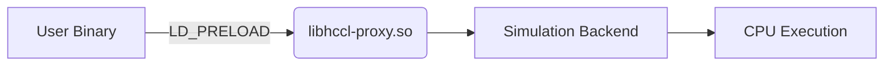
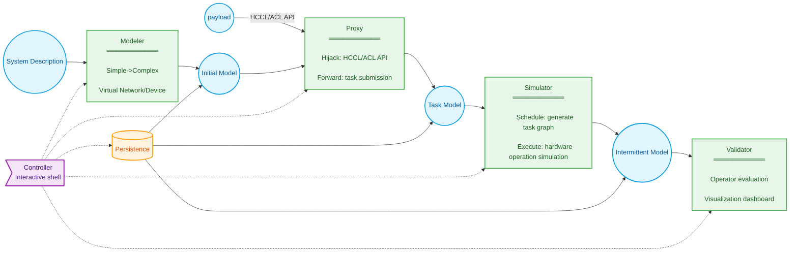
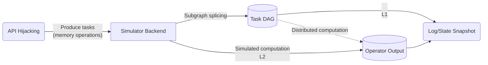
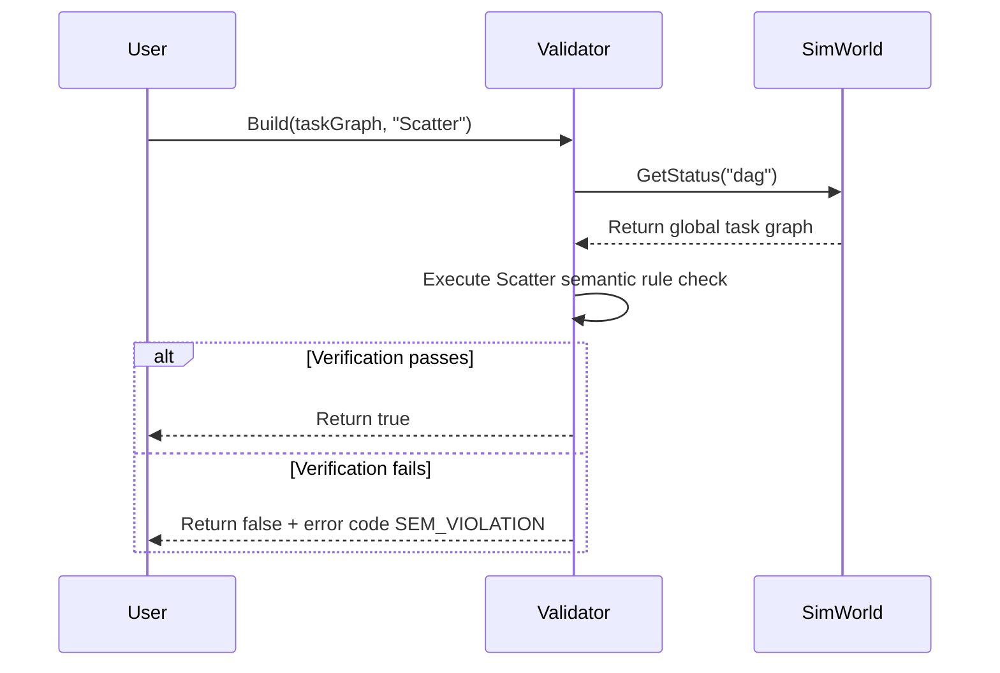
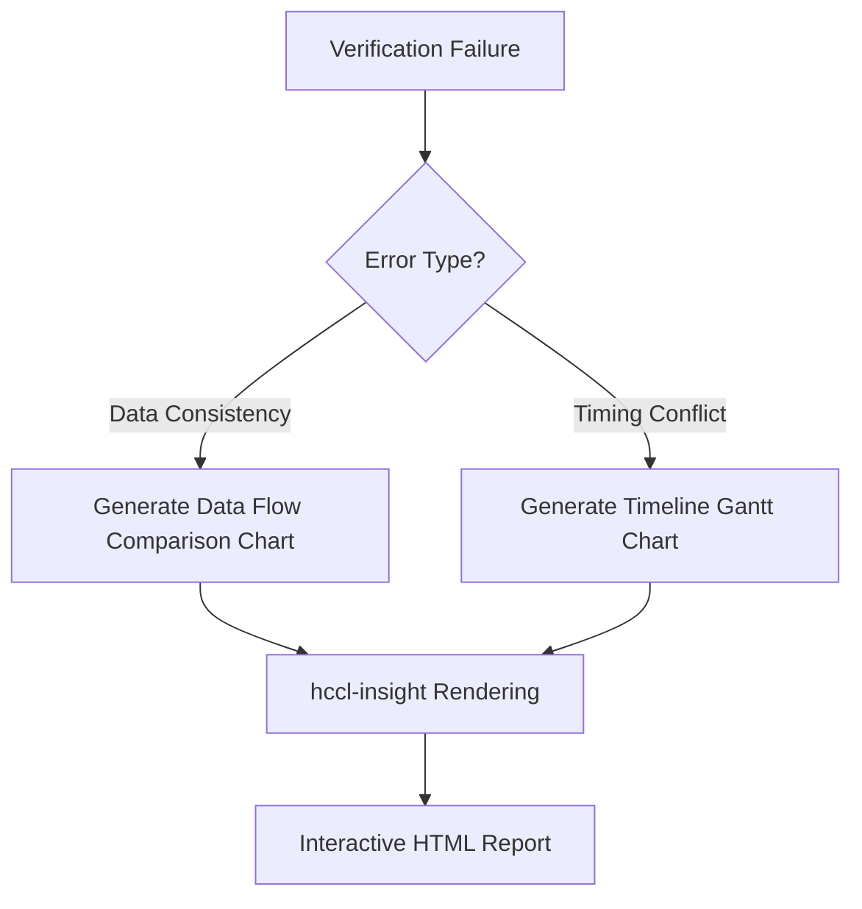

# HCCL Simulator Requirements Analysis

## 1 Requirements Background

### 1.1 Purpose

Provide a **offline, extensible, highly deterministic** testing framework for the cluster communication module:

- **New algorithm research and development**.
  Support design verification of custom communication operators (such as scatter variants) and provide algorithm visualization analysis.
- **Base package quality assurance**.
  Enable offline fast regression of HCCL test cases through Runtime/Driver/Net HAL interfaces.
- **Architecture verification (long-term)**.
  Verify physical compatibility between algorithms and hardware topologies (HCCS/RoCE).

### 1.2 Scope

Layered simulation depth implementation:

| Level | Capability | Phase |
|------|------|------|
| L1 | Communication semantic verification | ✅Current |
| L2 | Logical function reproduction | ⚠️Challenging |
| L3 | Network performance modeling | ⏳Long-term |
| L4 | Fault injection diagnostics | ⏳Long-term |


#### 1.2.1 Usage Scenarios

| Role     | Purpose                       |
| -------- | -------------------------- |
| Open-source contribution | Verify new operator/algorithm semantics      |
| Testing     | Run HCCL API test cases     |
| Development     | Execute Runtime/Driver-level test cases |


#### 1.2.2 Input Format

- **Configuration-driven**
  YAML defines hardware topology (Appendix B)
- **API hijacking**
  Redirect hcclInitComm/aclrtMalloc and similar calls to the simulation backend.

#### 1.2.3 Output Format

| Type     | Purpose                  |
| -------- | --------------------- |
| Program log | User standard output          |
| Verification result | External checker report        |
| State snapshot | Binary buffer file      |
| Visualization   | hccl-insight rendering and analysis |

---

## 2 System Context (Ignored)

---

## 3 Requirements Overview

### 3.1 Core Architecture

#### 3.1.1 Design Philosophy

**Non-intrusive runtime hijacking**:



**Core advantages**:

1. **High fidelity**: real binary execution paths.
2. **Zero intrusion**: no user code modification required.
3. **Strong extensibility**: supports any HCCL/ACL program.

**Determinism guarantee**:

- L1: communication semantic checks (no concurrent communicators/operators)
- L2: global event serialization.
- L3/L4: fixed-seed random sources or unified clock.


### 3.2 Typical Workflow


#### 3.2.1 Open-Source Contributor Custom Operator Verification Flow (LLT)

1. **Environment preparation**

    - Clone the `hccl_ops` operator repository.
    - Build and run the preset **scatter operator test case** according to the contribution guide.

2. **Operator development**

    - Implement a **CustomAllreduce operator** by referencing the scatter operator.
    - Complete operator compilation and verify successful execution.

3. **Execute verification test case**
   Run the Checker test case in the code project (sample logic):

   ```python
   model = SimWorld("./topologies/cloud_matrix.yaml")  # Initialize simulation model

   # Single-thread loop simulating each Rank execution
   foreach rank in rankGraph:
      HcclInitComm(...)
      ret = HcclScatter(rankGraph, scatter, array, 'root:0')  # Execute original operator

   # Task graph generation
   taskGraph = model.GetStatus('taskGraph')

   # Operator semantic verification
   checker = Validator<Scatter>().Build(taskGraph)
   EXPECT(checker.CheckSemantic(), 'success')  # Verify result
   ```

4. **Verify custom operator**.
   Replace `HcclScatter` with `CustomAllreduce` in the code above and re-execute the test case.

#### 3.2.2 Developer Local Development Flow: Rapid Iteration on Simulation System Before Code Submission

1. **Launch the simulator:** Run the `hccl-vm` command as root user and specify the topology.

   ```bash
   root%> hccl-vm --topology=atlas900
   ```

    - **System feedback:** `info: entered hccl-vm` _(simulator: create simulation model)_.
    - **System state:** prompt changes to `hccl-vm%>` _(simulator: start interactive shell)_.

2. **Execute communication program:** Run the `scatter.bin` program in the simulator shell (MPI/slurm or similar launchers are supported).

   ```bash
   hccl-vm%> ./scatter.bin
   ```

3. **Repeat execution operations:** Execute the initialize-communicator test case individually in the simulator shell as needed.

   ```bash
   hccl-vm%> ./test_init_comm
   ```

4. **Exit the simulator:** Enter the `exit` command in the simulator shell.

   ```bash
   hccl-vm%> exit
   ```

    - **System feedback:** `info: exit hccl-vm` _(simulator: clean up resources and exit)_.
    - **System state:** prompt reverts to `root%>`.

#### 3.2.3 Tester Running Multi-Server Test Cases on Multiple Servers

1. **Log in to Server1:** Launch the simulator as root user.

    - **System state:** prompt changes to `hccl-vm%>` _(simulator: start interactive shell)_.

2. **Execute communication program:** Run the `scatter.bin` program in the simulator shell.

   ```bash
   hccl-vm%> py3 allreduce.py --host 90.91.103.38 --data-sample large-b16 --serverid 0 --deviceid 8 --op sum
   hccl-vm%> py3 allreduce.py --host 90.91.103.38 --data-sample small-b16 --serverid 1 --deviceid 1 --op sum
   ```

3. **Log in to other servers:** Repeat steps 1-2 _(simulator: start interactive shell)_.

4. **On a server command line, view program logs:**:

   ```bash
   hccl-vm%> ...
   hccl-vm%> ...
   ```

### 3.3 Conventions

#### 3.3.1 Terminology

- hccl-vm: the controller program delivered by the simulator (interactive shell + backend process)
- libhccl-vm.so: the core library delivered by the simulator.
- libhccl-proxy.so: the hijack library (LD_PRELOAD)
- IPC: libhccl-proxy.so communicates with the hccl-vm backend through shared memory to execute payloads (tasks) constructed after hijacking ACL/HCCL calls

#### 3.3.2 Key Mechanisms

- CLI:
  1. hccl-vm --topology=`describe-file-path`
  2. After entering the interactive shell, execute user commands.
- Environment variable: LD_PRELOAD points to libhccl-proxy.so. The hccl-vm program sets this variable and it takes effect in child processes.
- Process model: hccl-vm uses fork+exec to execute user commands. The OS loader loads libhccl-proxy.so with priority.

---

## 4 System Functional Requirements Decomposition



The delivery matrix organized by project schedule is as follows:

| Phase    | Modeler    | Proxy     | Simulator   | Validator        | Persistence       | Controller   |
| ------- | --------- | ---------- | -------- | ------------- | ------------ | -------- |
| L1      | A3 simplified   | HCCL-AICPU | Task graph generation | checker porting  | -            | -        |
| L2      | A2/5 full series | HCCL/ACL   | Sequential execution | A5 plugin porting | ✅           | ✅       |
| L2 Challenge | Distributed    | Batch forwarding   | Parallel computation | Visualization        | High-concurrency IO library | Cluster management |

- **L1 Phase**: deliver the simulator core library.
  `libhccl-vm.so` (A3/AICPU modeling and simulation + validator) + `libhccl-proxy.so` (simplified proxy)
  Users achieve communication semantic verification through LLT (FR2.1→FR3)
- **L2 Phase**: deliver the standalone controller.
  `hccl-vm` (FR5) + full modeler (FR1) + persistence (FR4)
  Support command-line launch of non-intrusive environment for logical function reproduction.
- **L2 Challenge**: attempt to directly run the original distributed real-device test cases from the test suite.

### 4.1 FR1 Construct Collective Communication Simulation Environment

**Constraints**:

- ✅Supports only dynamically linked libraries (acl/aclRt/hccl-base)
- ❌Does not support setuid/setgid programs.

**Core capabilities**:

> Create/query: collective communication simulation model.

```python
# Example
model = SimWorld("./topologies/cloud_matrix.yaml")
device = model.GetStatus("device0")
```

**Interaction flow**:

| Step | Action | Result |
|------|-------|------|
| 1 | Load YAML configuration | Generate initial model |
| 2 | Call `SimWorld()` | Return model handle |
| 3 | Query `GetStatus()` | Obtain specified state data |

**Failure scenario**: configuration file error; print parsing details.

### 4.2 FR2 Simulate Execution of Collective Communication Operators



#### 4.2.1 **Core Capability Description (Completed Automatically in Background)**

| Phase     | Function                    | User (Developer) Visible Effect  |
| -------- | ----------------------- | ----------------------- |
| **Hijack** | Dynamically redirect HCCL/ACL API | Original LLT test case link options modified |
| **Forward** | Encapsulate communication task metadata      | ~~Invisible~~              |
| **Simulate** | Generate global DAG task graph     | Available from modeler interface  |
| **Execute** | Simulate memory transfers and state migration  | Available from modeler interface  |

**Development prerequisites**:

1. The developer has already developed a scatter operator variant program `./my_scatter.bin`.
2. `./my_scatter.bin` uses the `lib-vm.so` interface to complete simulation modeling.

**Success scenario 1**: Run after linking the proxy library with `-lhccl-proxy`.

```bash
# Link at compilation time (illustrative)
ld ./scatter.bin -lhccl-proxy -lhccl-vm
# Execute from command line
./scatter.bin
```

**Success scenario 2**: Hijack the proxy library through LD_PRELOAD.

```bash
# Single-machine execution (automatically completes hijacking → simulation)
LD_PRELOAD=libhccl-proxy.so ./scatter.bin
```

**Capability evolution, scenarios unchanged**:

| Phase | Capability | User Operation Change |
| ------- | -------------------- | ----------------------- |
| L1 | Single-process multi-Rank simulation | ~~No change~~ |
| L2 | Multi-process single-Server simulation | ~~No change~~ |

### 4.3 **FR3 Semantic Verification of Operator Results in Simulation Environment**

#### 4.3.1 **Core Capabilities**

1. **Operator semantic verification**.
    - Support communication semantic verification for preset operators (AllReduce/Scatter and so on).
    - Provide pluggable extension interface.
2. **Visualization analysis**
    - Generate interactive communication topology graphs.
    - Mark semantic violation points.
3. **Verification report generation**.
    - Structured error diagnostics (data consistency / timing conflicts)

### 4.4 **Success Scenarios**

#### 4.4.1 **Scenario 1: Basic Operator Semantic Verification**



**User operations**:

```python
# Load task graph
task_graph = model.GetStatus('taskGraph')

# Create validator
scatter_validator = Validator<Scatter>()
scatter_validator.Build(task_graph)

# Execute verification
if scatter_validator.CheckSemantic():
   print("Scatter semantic verification passed")
```

#### 4.4.2 **Scenario 2: Custom Operator Hot-Plug**

```bash
# In the hccl-vm interactive environment
hccl-vm%> validator install ./custom_allreduce_validator.so
[System] Success: Validator 'CustomAllReduce' registered

# Code invocation
validator = Validator<CustomAllReduce>()
validator.Build(task_graph)
validator.CheckSemantic()
```

#### 4.4.3 **Scenario 3: Visualization Diagnostics**



**Output example**:

| Error Type   | Node  | Expected Value         | Actual Value       |
| ---------- | ----- | -------------- | ------------ |
| Data inconsistency | Rank1 | 0x7f8e (32782) | 0x0000 (0)   |
| Deadlock risk   | Rank2 | Waiting for Rank3     | Timeout (>200ms) |

---

### 4.4 **Failure Scenarios**

#### 4.4.1 **Scenario 1: Validator Plugin Load Failure**

**Trigger conditions**:

- Plugin ABI version is incompatible.
- Plugin does not export the symbol `Validator_CreateInstance`.

**System response**:

```bash
hccl-vm%> validator install ./broken_validator.so
[ERROR] Plugin load failed:
  - ABI version mismatch (expected v3, got v2)
  - Symbol 'Validator_CreateInstance' not found
[Suggestion] Use validator check-abi ./broken_validator.so to check compatibility
```

#### 4.4.2 **Scenario 2: Invalid Task Graph Input**

**Trigger conditions**:

```python
# Pass in non-DAG structure
validator.Build("invalid_data")
```

**System response**:

```python
Traceback (most recent call last):
  File "test.py", line 12, in <module>
    validator.Build("invalid_data")
hccl.error.InvalidGraphError:
    Expected TaskGraph object, got <class 'str'>
```

#### 4.4.3 **Scenario 3: Runtime State Conflict**

**Trigger conditions**:

```python
# Attempt verification during communication execution
while HcclAllReduceInner(is_running=True):
    validator.CheckSemantic()  # Illegal call!
```

**System response**:

```text
[FATAL] Validator state conflict:
  - Operation not allowed during HcclAllReduceInner execution
  - Call GetStatus('idle') before validation
```

---

### 4.5 **Constraints and Evolution**

| Capability             | L1 Phase  | L2 Phase             |
| ---------------- | -------- | ------------------- |
| **Preset validators**   | Scatter  | Full HCCL operator set      |
| **Plugin mechanism**     | Static linking | Dynamic loading (.so)       |
| **Visualization**       | Text report | Interactive topology graph + timeline |
| **Error localization accuracy** | Node level   | Buffer byte offset    |

**Key evolution paths**:

1. Provide `validator-template` code generator (L2);
2. Support distributed verification coordination (L2 challenge phase);
3. Integrate memory access trace tracking (L3).

### 4.6 FR4 Persistence


#### 4.6.1 `L2 Phase` Story: The simulator provides persistence interfaces so that developers can quickly locate issues after testing ends

### 4.7 FR5 Controller


For usability considerations, users generally work with HCCL test programs in a terminal. Therefore the controller is hosted through a command-line instance program.

#### 4.7.1 Controller Conventions

- The command-line runtime does not support switching topologies.
- The term `shell` is used below to refer to the command line.

#### 4.7.2 `L2 Phase` Story: The user launches the simulator through an interactive `shell`, which automatically creates a virtual communication cluster in the background. Therefore the user intuitively expects to repeatedly test and verify HCCL programs within this interactive `shell` environment

##### `shell` Launch Prerequisites

- During installation, the simulator places multiple system configuration files in its sibling directory (such as `./topologies`), for example: `cloud_matrix.yaml`, `atlas900.yaml`.
- System configuration files are read-only and are not corrupted.

##### Success Scenario: System Model Discovery


1. The user runs `hccl-vm --list-topologies` to view supported simulation systems.
2. The command prints a list of all built-in system models such as cloud_matrix, atlas900, but does not launch the simulator.

##### Success Scenario: Successfully Launch Simulator and Hijack Application

1. The user launches the `hccl-vm` main control program, specifies a topology configuration file, and enters the interactive shell.
2. `hccl-vm` parses and loads the corresponding system configuration file, calls the modeler, creates the initial system model, and reports that simulator creation succeeded.
3. The user executes `./scatter_perf` in the `shell`, for example:
4. `hccl-vm` sets `LD_PRELOAD=libhccl-proxy.so` for the child process and performs `fork/exec` execution.
5. The OS loader loads `libhccl-proxy.so` with priority. When the application calls CUDA/NCCL APIs, hijacking occurs.
6. `libhccl-proxy.so` delegates execution to the `hccl-vm` backend through IPC for simulation.
7. The application completes and replays standard output/error to the user. The return code is passed through to the hccl-vm interactive shell.
8. The user can type `exit` to leave the shell. The sim_run exit code is 0. The interaction flow example is as follows.

   ```bash
   root%>hccl-vm --topology=atlas900
   info: entered hccl-vm
   hccl-vm%>
   hccl-vm%>./scatter_perf
   hccl-vm%>exit
   info: exit hccl-vm
   root%>
   ```

##### Success Scenario: Launch with Default System Model

1. The user launches the simulator with `hccl-vm` without any parameters.
2. `hccl-vm` searches its preset directory and locates the `cloud_matrix.yaml` file.
3. The subsequent flow is identical to "Success Scenario: Successfully Launch Simulator and Hijack Application".

##### Failure Scenario: Specified System Configuration Name Does Not Exist

1. The user executes `hccl-vm --topology=non_existent_topo`.
2. `hccl-vm` outputs an error message and terminates normally, such as "Error: system named 'non_existent_topo' not found. Available systems: cloud_matrix, atlas900".

#####  Failure Scenario: Topology Configuration File Format Error

1. The topology configuration file content provided by the user does not conform to YAML specifications or lacks required fields, causing `hccl-vm` to fail parsing during initialization.
2. The simulator outputs a clear error message to standard error, such as "Error: failed to parse topology file a.yaml, reason: ...", and immediately terminates the entire program.

##### Failure Scenario: Topology Configuration File Does Not Exist or Is Not Readable

#### 4.7.3 `L2 Phase` Story: The user can quickly configure a system model description file and launch the simulator. For format reference see **Appendix B**

#### 4.7.4 `L2 Phase` Story: The user manages validator plugins through `shell` subcommands

##### Success Scenario: User installs a custom validator plugin and successfully completes verification

##### Success Scenario: User views available validator plugins

##### Failure Scenario: Validator plugin and simulator version mismatch

##### Failure Scenario: Multiple validator plugin conflict causes installation failure

#### 4.7.5 `L2 Phase` Story: Developers can use controller subcommands to export simulation environment state (such as specific device memory buffer contents) to files for subsequent analysis or visualization

##### Subcommand System State View Constraints

- A test program is running in the `hccl-vm` interactive shell.
- The export operation triggers synchronously at any point during the test program.
- The export is an instant snapshot of the `hccl-vm` current system model.

##### Success Scenario: Successfully Export Simulated Device State Buffer

1. The user executes the export subcommand in the interactive `shell`.
   For example: `hccl-vm%> snapshot --path=/tmp/hccl_vm_state`
2. `hccl-vm` calls the persistence interface and writes the system model state to the `hccl_vm_state` file.
3. After the write operation completes, `hccl-vm` prints a success message to standard output, for example: "Snapshot export succeeded: /tmp/global_sim_state.bin".
4. The user can find the `hccl_vm_state` file in the `/tmp/` directory and view the simulated device memory at the current time.

##### Success Scenario: Overwrite When Output File Already Exists

1. The user executes the snapshot command and specifies an output file path that already exists.
2. `hccl-vm` prompts the user that the file already exists and asks whether to overwrite.
3. The user confirms the overwrite.
4. `hccl-vm` overwrites the file and prints a success message.

##### Failure Scenario: Insufficient Disk Space

1. `hccl-vm` outputs a clear error message to standard error, such as "Error: insufficient disk space to write snapshot file: ...", and terminates the write.

##### Failure Scenario: No Write Permission or Directory Does Not Exist

1. `hccl-vm` outputs a clear error message to standard error, such as "Error: no write permission or directory does not exist: ...", and terminates the write.

#### 4.7.6 `L2 Phase` Story: In the interactive shell, the user can activate a validator plugin and then use the visualization subcommand to visually inspect algorithm results

##### Visualization Preparation for Verification Results

- `hccl-vm` has the `scatter` operator validator plugin installed.
- `hccl-vm` has integrated the `hccl-insight` command-line visualization tool.
- A simulator run has completed and one or more binary-format algorithm verification result files (for example `rank0_output.bin`) have been successfully exported through the persistence API
- The snapshot file `rank0_output.bin` contains an 8x8 float32 matrix data.

##### Success Scenario: Render Single-Card Memory Data as Heatmap

1. The user executes the visualization tool in the interactive `shell` targeting the exported snapshot file. The user must provide file metadata (data type and shape) so the tool can parse it correctly, for example:

   ```bash
   hccl-insight --file=rank0_output.bin --dtype=float32 --shape=8x8
   ```

2. `hccl-insight` (Go program) starts and parses the command-line arguments.
3. The program reads the binary content of the `rank0_output.bin` file.
4. Based on the `--dtype=float32` and `--shape=8x8` parameters, the program parses the binary stream into a two-dimensional array.
5. The program starts a built-in web server on a locally available random port (for example `:9527`).
6. The program prints a message to standard output: "Visualization service started, open <http://localhost:9527> in your browser".
7. (Optional) The program automatically invokes a system command to attempt opening the URL in the user default browser.
8. The user sees a Vue/JS-rendered page in the browser. The page displays an 8x8 heatmap where each cell color represents its corresponding numeric value. The user can hover over cells to view precise values.

##### Failure Scenario: Snapshot File Does Not Exist

1. The `--file` parameter provided by the user points to a non-existent file.
2. The `hccl-insight` tool fails when attempting to open the file.
3. The tool outputs a clear error message to standard error, such as "Error: file 'xxx.bin' not found", and exits with a non-zero status code.

##### Failure Scenario: File Size Does Not Match Metadata

1. The user specifies `--shape=8x8` and `--dtype=float32` (requiring 8 _8_ 4 = 256 bytes), but the actual `rank0_output.bin` file size is only 100 bytes.
2. After reading the file, the `hccl-insight` tool detects that the file size does not match the expected size calculated from the metadata.
3. The tool outputs a clear error message to standard error, such as "Error: data format mismatch. Based on shape(8x8) and dtype(float32), 256 bytes are required, but the file size is only 100 bytes", and exits with a non-zero status code.

##### Failure Scenario: Required Metadata Parameters Are Missing

1. The user executes `hccl-insight --file=rank0_output.bin` without providing `--dtype` or `--shape`.
2. The `hccl-insight` tool command-line parsing library detects that required parameters are missing.
3. The tool outputs usage help information to standard error, indicating that the user must provide these parameters, and exits with a non-zero status code.

#### 4.7.7  `L2 Phase` Story: The user can switch between L1/L2 proxies to select simulators of different speeds

- `hccl-vm` integrates multiple versions of the simulator core library, for example:
  - `libhccl-proxy-l1.so`: performs only NCCL communication operator semantic-level simulation.
  - `libhccl-proxy-l2.so`: Runtime/Driver/Net-level logical function simulation (default)
- `hccl-vm` has integrated the validator plugin.
- Launch `hccl-vm` to enter the interactive `shell`.

##### Success Scenario (Default): The controller uses the L2 proxy to hijack the user program at the HAL layer, attempts to simulate memory transfer operations, and writes algorithm results to simulated device buffers

##### Success Scenario (Full Feature): The controller uses the L2 proxy, simulates low-level algorithm operations while invoking the validator plugin, and outputs verification results and visualization files

##### Success Scenario (Lightest Weight): The controller uses the L1 proxy, does not execute memory transfers, and the user manually views the task graph orchestrated by the algorithm through persistence commands

##### Success Scenario (Common for Operator Research): The controller uses the L1 proxy, does not execute memory transfers, uses preset validator plugins, and outputs verification results

1. Specify simulation depth through the proxy control subcommand.
2. `hccl-vm` determines that the core library to load is `libhccl-proxy-l1.so` based on the subcommand parameter `L1`.
3. `hccl-vm` sets the `LD_PRELOAD` environment variable to the full path of `libhccl-proxy-l1.so`.
4. After the test program starts, it is hijacked by `libhccl-proxy-l2.so`. When `ncclMemcpyWrite` executes, the system only infers task semantics through the validator and does not simulate the full data transfer operation.
5. The program eventually completes and outputs semantic verification results. The total elapsed time is much faster than using `L2`.

   The complete command sequence may look like:

   ```bash
   hccl-vm%>validator install scatter
   hccl-vm%>proxy -l1
   hccl-vm%>./scatter_perf.bin
   info[validator]: scatter checking finished, result is ...
   ```

##### Failure Scenario: Non-Existent Subcommand or Parameter Specified

### 4.8 Distributed Controller (NFR)

On-device test programs run on real cards. In this case, the user must manually or through scripts launch the same test program on multiple servers. To run the simulator, a simulator controller must be prepared on every server running the test program. The simulator needs to model the entire network topology and hardware environment in a unified manner. Therefore the controller requires a distributed design.


#### 4.8.1 `L2 Phase` Story: The user can run HCCL real test cases collaboratively on multiple servers through cluster management software such as k8s

## 5 **Appendix**

### 5.1 **Appendix A: API Support Plan**

Convention: perform Host offline implementation for the behavior of the APIs listed below. For API calls not in this list, the default simulator behavior is to print a warning message and return `0` without performing any actual operation.

#### 5.1.1 `L1 Phase`


- HCCL communicator management (25 APIs)
- HCCL control plane programming (23 APIs)
- HCCL AICPU programming (8 APIs)

#### 5.1.2 `L2 Phase`


### 5.2 **Appendix B: Topology Configuration File Format (Schema)**

The topology configuration file uses YAML format to describe the simulated hardware environment. The file must contain the following fields:

- `gpus` (integer, required): total number of GPUs.
- `links` (list, required): a list describing point-to-point physical connections.

Each `link` object contains:

- `peer` (list of 2 integers, required): describes the IDs of two GPUs connected to each other.
- `type` (string, optional): connection type, such as "HCCS" or "PCIe". In the current L1 phase, this field serves as a comment only and does not affect logic.

**Example: `my_topo.yaml`**


```yaml
## Describe a 4-card ring connection topology
npus: 4
links:
  - peer: [0, 1]
    type: "HCCS"
  - peer: [1, 2]
    type: "HCCS"
  - peer: [2, 3]
    type: "HCCS"
  - peer: [3, 0]
    type: "HCCS"
```

### 5.3 **Appendix C: Validation Plugin Interface (API) Definition**

To create a valid validation plugin, the user must implement and export one or more callback functions conforming to the following specification. The simulator locates these symbols through `dlsym`.

#### 5.3.1 **Data Structures**

```c++
// sim_validator_api.h

// Describes HCCL data types; consistent with real HCCL
typedef enum { hcclInt8 = 0, ..., hcclFloat64 = 7 } SimHcclDataType_t;

// Context information passed to callback functions
struct SimCommContext {
    int world_size;             // Number of ranks in the communicator
    void** rank_output_buffers; // Pointer array containing output buffer addresses in simulated memory for each rank
    size_t element_count;       // Number of elements in the buffer
    SimHcclDataType_t datatype;   // Data type
};

// Plugin return value
struct SimValidationResult {
    bool success;               // Whether verification passed
    char error_message[256];    // Error message if failed
};
```

##### 5.3.2 **Callback Function Signatures**

The plugin must implement C functions with the following naming pattern as needed:
`SimValidationResult post_<hccl_function_name>_hook(const SimCommContext* context);`

##### 5.3.3 **Example: AllReduce Verification Function**

```c++
// Function to implement in allreduce_validator.so
extern "C" SimValidationResult post_HcclAllReduceInner_hook(const SimCommContext* context) {
    // 1. Determine data type based on context->datatype
    // 2. Allocate memory on CPU and copy the contents of all rank_output_buffers
    // 3. Implement AllReduce mathematical verification (for example, check whether all rank outputs are consistent)
    // 4. Return SimValidationResult
}
```

### 5.4 **Appendix D: System Models**

