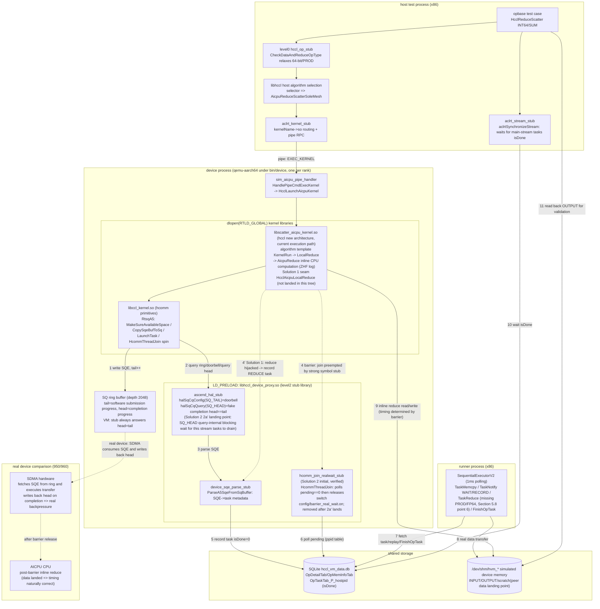

# 64-bit / PROD Reduction CPU Computation Flow Analysis and Task Hijacking Solution (950/960)

> **Repository scope and actual VM paths in use (verified in 2026-10 against `hccl_vm_install/bin/log.txt`)**: This solution involves two independent repositories:
> - **hccl** (`/home/teamserver/workspace/hccl`, new architecture, no instruction layer, device kernel = `libscatter_aicpu_kernel.so`): **64-bit reduce in the current VM is actually executed by the library from this repository**. Empirical evidence (ReduceScatter / INT64(dataType=5) / SUM(reduceOp=0) test case, `hccl_reducescatter_rootinfo_test.cc:164`): `aclrt_kernel_stub` resolves `HcclLaunchAicpuKernel` via dlsym from `libscatter_aicpu_kernel.so` (`log.txt:12228`); the algorithm selects `AicpuReduceScatterSoleMesh`; reduction enters hccl's `LocalReduce->AicpuReduce`; and `alg_data_trans_wrapper.cc:907` prints `ZHF-LocalReduce: dataType is [5], reduceOp is [0]` (`log.txt:12662 / 12674`). Therefore, the effective seam must be located in this repository (see **Section 5.6**).
> - **hcomm** (`/home/teamserver/workspace/hcomm`, legacy architecture, contains the instruction/`Interpret` instruction layer): **This path is currently not reached during execution and is deprecated legacy**. Empirical evidence: the debugging marker `InsAicpuReduce: Interpret enter` added to its `ins_to_sqe_rule_v82.cc` appears **0 times** in `log.txt`, and no `instruction.cc` / `ins_to_sqe_rule_v82.cc` log lines are present throughout; although `libccl_kernel.so` (an hcomm artifact) is loaded by the device process, it does not lie on the 64-bit reduction computation path. The hcomm changes described in the original Sections 5.1-5.5 are only meaningful for legacy/910 or for host-side `libhccl_v2.so`, and are retained here for historical reference.
>
> **Landing status (important, verified in 2026-10, correcting the earlier "landed" wording of this document)**: The exported seam `HcclAicpuLocalReduce`, the CheckerL2 dual stubs (level1 skip / level2 observe), and the REDUCE streamId tracking mechanism described in Sections 5.2-5.9 **are not landed in the current code tree**. Searching the entire repositories (hccl / hcomm / CheckerL2 source code) and all deployed `.so` files for `HcclAicpuLocalReduce` yields 0 hits; `aicpu_reduce_observe_stub.cc` does not exist; `hccl_task_collection.cc` does not contain `TrackLocalCopyStream` / `GetLastLocalCopyStreamDev`. The actual changes in the current workspace consist of only three debugging/experimental edits: (1) CheckerL2 `hccl_op_stub.cc` only comments out the `CheckDataAndReduceOpType` call site for `HcclReduceScatter` (:1109) - the function body still returns `NOT_SUPPORT` for 64-bit/PROD (:389-395), and the call sites for other operators (AllReduce :929 / Reduce :1046 / ReduceScatterV / GraphMode family) are not relaxed; (2) hccl `alg_data_trans_wrapper.cc:907` adds the `ZHF-LocalReduce` log; (3) hcomm `ins_to_sqe_rule_v82.cc` adds the `Interpret enter` log.
>
> **Actual result of current execution**: After relaxing ReduceScatter, the test case indeed reaches hccl `AicpuReduce`, but the device process then **crashes with signal 11** inside `HcclLaunchAicpuKernelA3` of `libscatter_aicpu_kernel.so` (`crash_133229.log` / `crash_133255.log`); the host side reports `EXEC_KERNEL failed`, and the test case returns `retcode 10`. That is, **without a seam or stub, the real `AicpuReduce` runs a CPU loop directly on simulated device addresses and crashes** - this both confirms the necessity of this solution (reduction must be hijacked into a checker task rather than real computation), and indicates that Section 5.6 is currently still a **design to be implemented** rather than an established fact. (The subsequent 14:39 round no longer crashes but fails data validation `total err is 4` - the root cause is timeline inversion rather than addressing; the two fix paths and spike implementation details are presented in **Section 9**.)
>
> **Convergence conclusion**: For the 64-bit/PROD target test case, the CCU/AIV engine hardware does not support it, and the algorithm selection layer forcibly excludes it, so everything converges on the single point of the **AICPU engine** - hccl's `AicpuReduce` (hcomm's `RunAicpuReduce` is the corresponding point of the deprecated legacy and is currently not reached). See **Section 5.7**.
>
> **Fix path status (2026-10-24)**: Two paths are established in parallel - **Solution 1 (seam + stub taskification, main line)** has been implemented and tested (in another workspace); **Solution 2 (real wait)** initial version (join-layer strong symbol stub) passed spike verification on 2026-10-20 (`check_result: success`, timeline inversion confirmed as the sole root cause of data errors), and has now evolved into a **dual-form landing**: level2 = southbound `halSqCqQuery(SQ_HEAD)` query-internal blocking wait (2a') + level1 = L1 library's existing join stub connected to real wait, sharing the `barrier_real_wait` module (Section 9.2); both level1/level2 passed empirical testing (2026-10-24); checker-side degradation (skipping semantic validation for 64-bit/PROD reduce operators, retaining memory conflict validation) is presented in **Section 9.6**. The **sequence diagrams and module diagrams for SQE execution flow / reduce computation flow / synchronization relations / hal ring buffer are in Section 10**; **the ultimate solution (hal ring buffer slot-level true modeling, the evolutionary endpoint of 2a') interface and data structure research is in Section 11**.
> **Gate update (2026-11-03)**: The Solution 2 real-wait gate changed from "env `HCCL_VM_BARRIER_REAL_WAIT` / `config/barrier_real_wait.on` manual switch" to **automatic determination by operator attributes** (the latest-logged operator on this device hits a reduce class + 64-bit|PROD, then real wait is automatically enabled; other operators keep the baseline; the determination is cached by operator row id and logged with `gate decision`). The environment variable and switch file have been deleted; no manual configuration is needed (Section 9.2 D5).

## 1 Problem Overview

### 1.1 Symptom

`CheckDataAndReduceOpType` in `src/proxy/level0/hccl_op_stub.cc` returns `HCCL_E_NOT_SUPPORT` directly for **64-bit data types** (INT64 / UINT64 / FP64) and **PROD (multiplication) reduction**, causing `HcclAllReduce` / `HcclReduce` / `HcclReduceScatter` to be intercepted at the host entry:

```cpp
// src/proxy/level0/hccl_op_stub.cc:389
HcclResult CheckDataAndReduceOpType(HcclDataType dataType, HcclReduceOp op)
{
    if (dataType == HCCL_DATA_TYPE_INT64 || dataType == HCCL_DATA_TYPE_UINT64 ||
        dataType == HCCL_DATA_TYPE_FP64 || op == HcclReduceOp::HCCL_REDUCE_PROD) {
        return HcclResult::HCCL_E_NOT_SUPPORT;
    }
    return HcclResult::HCCL_SUCCESS;
}
```

Call sites (2026-10 empirical line numbers): `hccl_op_stub.cc:929` (HcclAllReduce), `:1046` (HcclReduce), `:1109` (HcclReduceScatter, **currently relaxed via comment and is the only relaxed entry**), `:1174` (HcclReduceScatterV), and each GraphMode entry. The function body itself is unchanged and still returns `NOT_SUPPORT`.

### 1.2 Root Cause

In real hcomm business, reduction computation is normally **fused into SDMA copy tasks (inline reduce SQE)** - one read-modify-write completes both "transfer + reduction". However, **SDMA hardware supports neither 64-bit data types nor PROD multiplication**. These two types of reduction are therefore diverted by the algorithm layer to **CPU (AICPU) direct C++ loop computation**, which **does not generate tasks (SQEs) available for checker/runner validation**. The CheckerL2 checker plugin relies on task artifacts for post-validation; without tasks, it cannot validate and therefore directly returns `NOT_SUPPORT` at the entry.

### 1.3 Goal

On the **950/960** platform, provide a **stable, hijackable, symbol-hiding-immune** interface for the "CPU reduction computation" step so that CheckerL2 can hijack it and **force generation of a REDUCE task** (the task is not sent to the real NPU for execution but is instead consumed by subsequent checker/runner plugins).

---

## 2 Key Concepts

### 2.1 Three Reduction Execution Engines

| Engine | Reductions Hosted | Generates Tasks? | Supports 64-bit/PROD |
|------|-----------|-------------|----------------|
| **SDMA inline reduce** | Transfer and reduction fused into one copy SQE | Yes (SDMA SQE) | **No** |
| **AIV / TBE vector kernel** (910) | Reduction inside vector kernel | Yes (vector kernel task) | No (no atomic multiply for PROD; 64-bit not supported) |
| **AICPU CPU loop** (950/960) | Pure C++ for-loop, element-wise computation | **No** (only DFX mirror information) | **Yes** (designed specifically for this) |

### 2.2 Data Type / Reduction Operator Enumerations

```
HcclDataType:  INT8=0 INT16=1 INT32=2 FP16=3 FP32=4 INT64=5 UINT64=6 UINT8=7 UINT16=8 UINT32=9 FP64=10 BFP16=11
HcclReduceOp:  SUM=0  PROD=1  MAX=2  MIN=3
HcommDataType / HcommReduceOp values match the above (include/hcomm_primitives.h:46-64)
```

---

## 3 Business Flow Analysis

### 3.1 Why 64-bit / PROD Does Not Go Through SDMA Tasks

SDMA reduction is encoded into an **8-bit opcode** of a `MEMCPY_ASYNC` SQE: the high 4 bits encode the data type, and the low 4 bits encode the reduction kind. The bit fields physically cannot represent 64-bit or PROD:

```cpp
// src/legacy/ascend910/pub_inc/aicpu/aicpu_hccl_sqcq.h
// :220 reduction kinds only include CPY/ADD/MAX/MIN/EQUAL - no multiplication
enum rtStarsMemcpyAsyncOperationKind { ...ADD=0x01, MAX=0x02, MIN=0x03, EQUAL=0x04 };
// :228 data types only include INT8/16/32, UINT8/16/32, FP16/FP32/BFP16 - no 64-bit
enum rtStarsMemcpyAsyncDataType { ...FP32=0x70, BFP16=0x80 };

// :168 PROD maps to INVALID
constexpr aclrtReduceKind RK_MAP_TABLE[...] = {
    ACL_RT_MEMCPY_SDMA_AUTOMATIC_SUM,  /* SUM  */
    ACL_RT_MEMCPY_INVALID,             /* PROD */   // <- not supported
    ACL_RT_MEMCPY_SDMA_AUTOMATIC_MAX,  /* MAX  */
    ACL_RT_MEMCPY_SDMA_AUTOMATIC_MIN,  /* MIN  */
};
// :150 INT64/UINT64/FP64 map to UNDEFINED
constexpr aclDataType DT_MAP_TABLE[...] = { ... ACL_DT_UNDEFINED /*INT64*/, ACL_DT_UNDEFINED /*UINT64*/, ... ACL_DT_UNDEFINED /*FP64*/ ... };
```

The capability detection functions consistently exclude 64-bit and PROD (`src/legacy/ascend910/platform/common/device_capacity.cc`):

| Function | Location | Allowed Range |
|------|------|---------|
| `IsSupportAIVReduce` | :57 | `{int8/16/32, fp16/fp32, bfp16} x {sum,max,min}` |
| `IsDataTypeSupport` | :89 | No 64-bit |
| `IsRedOpSupport` | :112 | No PROD |
| `IsSupportSDMAReduce` | :130 | = alignment && data type && operator |
| `IsSupportRDMAReduce` | :138 | No 64-bit, no PROD |

The 950/960 capability table also marks INT64/UINT64/FP64 and PROD as `false`: `src/legacy/ascend950/unified_platform/common/dev_capability.cc:18-52`.

### 3.2 How the Algorithm Layer Routes

Each executor uses a uniform ternary expression to route 64-bit/PROD to the non-inline path (repeated verbatim in approximately 12 places), for example:

```cpp
// src/legacy/ascend910/algorithm/impl/coll_executor/coll_reduce/coll_reduce_executor.cc:95
ReduceType reduceType =
    ((param.reduceType != HCCL_REDUCE_PROD) && (param.DataDes.dataType != HCCL_DATA_TYPE_INT64))
        ? ReduceType::INLINE_REDUCE   // SDMA, fused into the copy task
        : ReduceType::TBE_REDUCE;     // 64-bit/PROD falls to another engine
```

- **910 (legacy)**: `TBE_REDUCE` -> `dispatcher_graph.cc:307` (comment: "dtype=int64 or redOp=prod both take TbeReduce, controlled by the algorithm layer") -> `TbeReduceAsync` -> vector kernel `HcclTbeReduce` (`extern "C"`, cross-.so).
- **950/960**: When the algorithm selector hits 64-bit/PROD, it selects `"InsReduceAicpuReduce(Mesh2D)"`:

```cpp
// src/legacy/ascend950/service/collective/alg/selector/reduce_auto_selector.cc:266
if (op.dataType == DataType::INT64 || op.dataType == DataType::UINT64 ||
    op.dataType == DataType::FP64 || op.reduceOp == ReduceOp::PROD) {
    primQueueGenName = "InsReduceAicpuReduce";   // <- takes the AICPU CPU computation path
}
// :318 SelectAivAlgo returns NOT_MATCH directly for PROD, and NOT_MATCH for UINT64/FP64 as well
```

The entry side also has `HcclCommunicator::IsReduceWithInt64OrProd` (`hccl_communicator_host.cc:4556`) to identify these operators.

### 3.3 950/960 CPU Computation: No Tasks, Only a DFX Mirror

The `InsReduceAicpuReduce` template generates the `InsAicpuReduce` instruction (`AicpuReduce()` at `alg_data_trans_wrapper_mid.cc:908`). At execution time, `Interpret(InsAicpuReduce)` **does not construct any SQE** and directly runs a C++ loop:

```cpp
// src/legacy/ascend950/framework/service/aicpu/ins_to_sqe_rule_v82.cc:721
void Interpret(const InsAicpuReduce& insAicpuReduce, const StreamLite& stream, ResMgrFetcher* resMgrFetcher)
{
    // Use aicpu for reduce operations; supports int64 uint64 fp64
    ...
    insAicpuReduce.RunAicpuReduce(dst, dstSize, src, srcSize, dataType, reduceOp);  // :745 pure CPU computation
    ...
    taskParam.taskType = TaskParamType::TASK_REDUCE_INLINE;                          // :751
    resMgrFetcher->GetMirrorTaskMgrLite()->AddTaskInfo(std::move(taskInfo));         // DFX mirror only, not a hardware task
}
```

The computation body (`instruction.cc:465`):

```cpp
template <typename T>
void InsAicpuReduce::AicpuReduceTemplate(T* dst, u64 dstSize, T* src, u64 srcSize, ReduceOp reduceOp)
{
    u64 count = dstSize / u64(sizeof(T));
    for (u64 i = 0; i < count; ++i) {
        switch (reduceOp) {
            case ReduceOp::PROD: *(dst + i) = *(src + i) * *(dst + i); break;   // multiplication on the CPU
            case ReduceOp::SUM:  ...
        }
    }
}
// :500 RunAicpuReduce only dispatches INT64 / UINT64 / FP64
```

> **Conclusion**: At the moment the reduction computation occurs, no task representing it exists - the copy SQE for transfer has already completed, and the CPU computation only leaves a `TASK_REDUCE_INLINE` DFX mirror. The checker has nothing to validate.

### 3.4 Timing Relationship Between SDMA Transfer and CPU Computation

The division is a holistic split, not "carving out" PROD/64-bit from SDMA tasks: SDMA performs only pure transfer (0 arithmetic) on these data types, and AICPU performs all reduction arithmetic.

Within a single operator, execution is staged + completion-barrier serial, not element-wise interleaving. The instruction queue generation order is linear (`ins_temp_all_reduce_aicpu_reduce.cc:110` `GenExtIns`):

```cpp
RunAllGatherMesh(...);      // Stage 1: all SDMA copy instructions (InsLocalCopy + SendRecv)
StreamSync(tempInsQues);    // Stage 2: barrier
RunAicpuLocalReduce(...);   // Stage 3: all CPU reduce instructions (InsAicpuReduce) + LocalCopy
```

The barrier **waits for hardware to actually complete execution** - `Interpret(InsStreamSync)` (`ins_to_sqe_rule_v82.cc:679`) spins until the SQ head catches up with the tail:

```cpp
do { head = stream.GetRtsq()->QuerySqHead(); ... } while (head != tail);   // :706 wait for SDMA to land data
```

Multi-stream rendezvous is guaranteed by `PreStreamSync` + `CheckPreStreamSync` (`ins_executor.cc:266`): all streams must arrive before unified release. The reason serialization is required is a **hard data dependency**: the SCRATCH read by CPU reduce is exactly the SCRATCH written by SDMA.

The actual "interleaving" occurs at a **coarser slice/burst granularity**: when data exceeds scratch capacity, the algorithm iterates by slice (`ins_v2_reduce_sole_executor.cc:195`), with the queue showing `slice0[transfer|compute] slice1[transfer|compute] ...` alternation; overlaying two more layers of concurrency - "AICPU submission vs SDMA hardware execution asynchronous" and "multi-stream copy parallel".

```
AICPU interpreter: submit copy SQE -> PreStreamSync(all streams flush + rendezvous) -> [spin until head==tail] -> CPU for-loop computes PROD/int64 -> submit LocalCopy
SDMA hardware:                \------parallel transfer of each peer's data to SCRATCH------/(complete)         (idle, data arrived)              \-transfer result->
                                                                              ^ Barrier: computation strictly after transfer completion
```

> This diagram is from the real device (hcomm legacy) perspective; the **complete sequence diagram from the VM record-replay perspective (including hal ring buffer stub semantics, runner replay, Solution 1/2 mount points) and the three-process module diagram are in Section 10**.

---

## 4 Hijack Point Selection Analysis

Constraint: **C++ mangled symbols cannot be used** (unstable), and hcomm will later enable **symbol hiding** (symbols not exported externally are hidden at compile time, such as `local: *;` in `ccl_dpu.map`).

### 4.1 Southbound Interfaces (rts / hccp ra) - Not Feasible

The **root cause** of 64-bit/PROD falling to the CPU is that all southbound engines do not support it:

- RTS: `aclrtReduceAsync` (`orion_adapter_rts.cc:936`), `hrtReduceAsync` (`cpu_ts_thread.cc:348`) are all SDMA-backed;
- `IAicpuTsThread::SdmaReduce` (`aicpu_ts_thread_interface.cc:148`) directly says "not supported" for 64-bit/PROD at `:35/:39`;
- HCCP/RDMA reduce capability also excludes 64-bit/PROD (`IsSupportRDMAReduce`).

**The computation step does not cross any southbound interface** (southbound only carries data transfer copies, which already generate tasks), so there is no southbound hijack point.

### 4.2 Existing Northbound Interface `HcommLocalReduceOnThread` - Not Suitable for Direct Reuse

`HcommLocalReduceOnThread` (`include/hcomm_primitives.h:164`, `extern int32_t`, data-plane public interface) appears ideal, but has two hard obstacles:

1. **Instruction engine context has no ThreadHandle**: `framework/service/aicpu/` and `service/collective/instruction/` have no thread handle, yet the first parameter of this interface is `thread`;
2. **A5 branch ultimately still falls to SDMA**: `aicpu_ts_primitives_c_adpt.cc:110` -> `threadPtr->LocalReduce -> SdmaReduce`, which rejects 64-bit/PROD.

Reusing it requires both "injecting a thread handle into the engine + adding CPU fallback in the thread engine"; the change scope and real-device behavior risk are both large.

> Note: CheckerL2 already hijacks `HcommLocalReduceOnThread` on host (`src/proxy/level1/data_local_op_stub.cc:291`) and device_arm (`src/device_arm/level1/data_op_device_stub.cc:1845`), generating REDUCE tasks; and `ValidateA5Reduce` (`data_op_device_stub.cc:510`) already accepts 8-byte types (case 5/6/10) and PROD (reduceOp 0-3). However, this stub is only hit in the **data-plane programming path (SDMA inline reduce)**. The collective communication 64-bit/PROD reduction takes hccl's `AicpuReduce` (current VM) / hcomm legacy's `InsAicpuReduce` (deprecated); neither passes through this stub - which is exactly why a separate `HcclAicpuLocalReduce` seam must be added.

### 4.3 Conclusion: Add a New Exported C Seam

Adopt "slightly modify hcomm, add a hijackable symbol", strictly following hcomm's existing export mechanism (`RunAicpuThreadInit` and others use `__attribute__((visibility("default")))`; see `aicpu_thread_kernel.h:17`; the export allowlist is in `ccl_dpu.map`), naturally immune to symbol hiding.

---

## 5 Solution: New Exported Seam `HcclAicpuLocalReduce`

> **Status: design / to be implemented (not landed in current tree).** Sections 5.1-5.9 in this chapter are all **solution designs**, not established facts. For landing progress, refer to the "Landing status" at the top: the seam symbol, the CheckerL2 dual stubs, and the streamId tracking mechanism do not exist in any of the hccl/hcomm/CheckerL2 repositories; currently there is only a crashing level0 relaxation experiment (see top note and Section 5.5). Sections 5.1-5.5 target **hcomm (deprecated legacy)**; Section 5.6 targets **hccl (current actual path, recommended landing direction)**.

Submerge AICPU local reduction computation into a symbol that is **`extern "C"` + weak + default visible + listed in the `.map` allowlist**; `RunAicpuReduce` retreats to a pure internal implementation (can be hidden) and is no longer the hijack surface.

### 5.1 Target Symbol Location

- Single choke point: `InsAicpuReduce::RunAicpuReduce` (`instruction.cc:500`, declared `instruction.h:807`), called from only one place in the entire repository (`ins_to_sqe_rule_v82.cc:745`), covering all 64-bit/PROD reductions for AllReduce / Reduce / ReduceScatter.
- **950 has no `ccl_kernel` target**: The CMakeLists of `instruction.cc` / `ins_to_sqe_rule_v82.cc` mount with both `if(TARGET hccl_v2)` / `if(TARGET ccl_kernel)`; the 950 build only has `hccl_v2` (`SHARED`, `hccl_v2.cmake:12`) matching, so both are compiled only into **`hccl_v2`**; this library **does not use `-Bsymbolic`** (only release mounts version-script), and intra-DSO calls go through PLT and can be preempted by strong symbols.
- device_arm uses `dlopen(RTLD_NOW|RTLD_GLOBAL)` to load execution kernel libraries (`sim_kernel_lib_mgr.cc:34`).

### 5.2 hcomm Side Changes (legacy, deprecated / not landed - historical reference only)

> This section targets the hcomm legacy instruction layer path. The current VM execution **does not pass through** this path (see top verification). The following changes are **not landed** (repository-wide search for `HcclAicpuLocalReduce` yields 0) and are retained for historical/910-host reference only. The effective solution is in Section 5.6 (hccl repository).

**1. Declaration** (design: placed in `instruction.h` after the `InsAicpuReduce` class; both TUs see it via `ins_to_sqe_rule.h:16 -> instruction.h`. `weak` is added only at the definition; the declaration has only `visibility("default")`):

```c
// instruction.h (within namespace Hccl, extern "C" -> global C symbol without mangling)
extern "C" __attribute__((visibility("default"))) int32_t HcclAicpuLocalReduce(
    void* dst, uint64_t dstSize, const void* src, uint64_t srcSize, HcclDataType dataType, HcclReduceOp reduceOp);
```

> `HcclDataType/HcclReduceOp` are already visible via `instruction.h -> coll_operator.h -> data_type.h/reduce_op.h -> <hccl/hccl_types.h>`; `int32_t/uint64_t` are visible via `types.h -> <cstdint>`. No new includes are needed.

**2. Real device implementation** (`instruction.cc`, thin wrapper, behavior unchanged; reverse mappings already exist: `data_type.h:103`, `reduce_op.h:51`):

```cpp
extern "C" __attribute__((weak)) __attribute__((visibility("default"))) int32_t HcclAicpuLocalReduce(
    void* dst, uint64_t dstSize, const void* src, uint64_t srcSize, HcclDataType dataType, HcclReduceOp reduceOp)
{
    InsAicpuReduce::RunAicpuReduce(dst, static_cast<u64>(dstSize), const_cast<void*>(src), static_cast<u64>(srcSize),
        HcclDataTypeToDataType(dataType), HcclReduceOpToReduceOp(reduceOp));
    return 0;
}
```

**3. Modify the single call site** `ins_to_sqe_rule_v82.cc:745`, changing from direct call of the internal method to the exported seam:

```cpp
    HcclAicpuLocalReduce(dst, insAicpuReduce.GetDstSlice().GetSize(),
        src, insAicpuReduce.GetSrcSlice().GetSize(),
        DataTypeToHcclDataType(insAicpuReduce.GetDataType()),
        ReduceOpToHcclReduceOp(insAicpuReduce.GetReduceOp()));
    // The DFX mirror that follows (:749-761) remains unchanged
```

**4. Register in the export allowlist**: Add a line to the `global:` section of `src/legacy/ascend950/hccl_v2.map`, the version-script of the library `hccl_v2` to which `instruction.cc` belongs (`extern "C"` symbols use the unmangled pure C name):

```
    HcclAicpuLocalReduce;
```

So that it is not hidden by `local: *;`. (Note: `ccl_dpu.map` belongs to the host-side `ccl_dpu` library, and that library uses `-Bsymbolic`; it does not contain the instruction engine and is not the owner of this seam.)

### 5.3 CheckerL2 device_arm Side Strong Symbol Hijacking (design, not landed)

Completely isomorphic with the existing `HcommLocalReduceOnThread` stub (`data_op_device_stub.cc:1845`, current empirical line number), reusing `TransLocalAddrToVirtual` / `InsertCollectedTask` / `GetCurRankId`:

```cpp
extern "C" int32_t HcclAicpuLocalReduce(void* dst, uint64_t dstSize, const void* src, uint64_t srcSize,
                                        HcclDataType dataType, HcclReduceOp reduceOp)
{
    if (dst == nullptr || src == nullptr || dstSize == 0 || dstSize != srcSize) {
        return static_cast<int32_t>(HCCL_E_PARA);
    }
    uint32_t curRank = 0;
    (void)GetCurRankId(&curRank);

    HcclTaskMetaData t{};                       // Local reduction: src/dst same rank
    t.taskType = HccLTaskMetaType::REDUCE;
    t.commId   = 0;                             // Allow degradation (consistent with HcommLocalReduceOnThread stub)
    t.rankId   = curRank;
    t.streamId = 0;                             // If exact value is needed, the seam can take a parameter passed from stream.GetId()
    t.taskData.reduce.srcDeviceId = curRank;
    t.taskData.reduce.srcOffset   = TransLocalAddrToVirtual(reinterpret_cast<uint64_t>(src));
    t.taskData.reduce.dstDeviceId = curRank;
    t.taskData.reduce.dstOffset   = TransLocalAddrToVirtual(reinterpret_cast<uint64_t>(dst));
    t.taskData.reduce.dataCount   = dstSize;                    // Byte length, consistent with device-side convention
    t.taskData.reduce.dataType    = static_cast<uint8_t>(dataType);   // Already HcclDataType
    t.taskData.reduce.reduceOp    = static_cast<uint8_t>(reduceOp);   // Already HcclReduceOp

    return InsertCollectedTask(t) == 0 ? 0 : static_cast<int32_t>(HCCL_E_INTERNAL);
    // Do not perform real computation; hand off to runner for task execution
}
```

Place in the device_arm main executable (global scope). `ccl_kernel` is dlopened with `RTLD_GLOBAL`, hcomm has no `-Bsymbolic` -> **strong symbol preempts hcomm's weak default implementation**, and LD_PRELOAD-style stable activation.

### 5.4 Prerequisite Changes (Otherwise the Hijack Point Cannot Be Reached)

Relax level0 `hccl_op_stub.cc:389`'s `CheckDataAndReduceOpType`: currently it returns `NOT_SUPPORT` for 64-bit/PROD at the host entry and **does not forward to the real libhccl**, so collective communication does not run and device-side `HcclAicpuLocalReduce` is never called. Change to relax (still `RecordOpDbInfo` + forward).

> **Current actual status (partial relaxation experiment, not landed as a formal solution)**: The `CheckDataAndReduceOpType` function body **still** returns `HCCL_E_NOT_SUPPORT` for INT64/UINT64/FP64/PROD (`hccl_op_stub.cc:389-395`, unchanged); only the `HcclReduceScatter` call site is entirely commented out (`:1109`), while the other call sites (`HcclAllReduce:929`, `HcclReduce:1046`, `HcclReduceScatterV:1174` and each GraphMode entry `:1258/:1540/:1612/:1686`) are still intercepting. Therefore, currently only ReduceScatter's 64-bit/PROD can enter the device, and it crashes due to the missing seam/stub (see top). When formally landed, the function body should be changed to always return `HCCL_SUCCESS` (or relax per entry as needed), rather than scattered comments.

### 5.5 Implementation Status (Verified in 2026-10: **None of the Following Designs Are Landed**)

> This section was originally titled "Landed Change List". Upon verification, **items 1-6 in the table below do not exist in the current tree** (repository-wide search across hccl/hcomm/CheckerL2 source code and all deployed `.so` files for `HcclAicpuLocalReduce` yields 0 hits). The table is retained as a **design checklist**, with each item's real status annotated:

| # | Repository | File | Change (design) | Real Status (verified 2026-10) |
|---|------|------|------|------|
| 1 | hcomm | `src/legacy/ascend950/service/collective/instruction/instruction.h` | After `InsAicpuReduce` class, add `extern "C" visibility("default")` declaration of `HcclAicpuLocalReduce` | Not landed (hcomm has no such symbol) |
| 2 | hcomm | `src/legacy/ascend950/service/collective/instruction/instruction.cc` | After `RunAicpuReduce`, add weak default implementation that forwards to `RunAicpuReduce` | Not landed |
| 3 | hcomm | `src/legacy/ascend950/framework/service/aicpu/ins_to_sqe_rule_v82.cc` | Change `Interpret(InsAicpuReduce)` call site to call `HcclAicpuLocalReduce(...)` | Not landed (currently only the `Interpret enter` debug log was added; the call site is still `RunAicpuReduce`) |
| 4 | hcomm | `src/legacy/ascend950/hccl_v2.map` | In the `global:` section, add `HcclAicpuLocalReduce;` | Not landed |
| 5 | CheckerL2 | `src/device_arm/level1/data_op_device_stub.cc` | Add `extern "C"` strong symbol `HcclAicpuLocalReduce` that constructs a REDUCE task and calls `InsertCollectedTask` | Not landed (that file only has the `HcommLocalReduceOnThread` (:1845) stub, no `HcclAicpuLocalReduce`) |
| 6 | CheckerL2 | `src/proxy/level0/hccl_op_stub.cc` | `CheckDataAndReduceOpType` relaxes 64-bit/PROD (always returns `HCCL_SUCCESS`) | Partial only: the `HcclReduceScatter` call site is commented out (:1109); the function body still returns `NOT_SUPPORT` (:389-395); other entries are not relaxed (see Section 5.4) |

**Verification (original claim no longer valid)**: The original text claimed "level0 passes `-fsyntax-only`, and the device_arm stub is line-by-line isomorphic with the neighboring `HcommLocalReduceOnThread` stub" - that was a description of a time when items 1-5 **were once landed**. Currently, items 1-5 are not landed, and there are no corresponding artifacts to verify; the relaxation fragment in item 6 compiles, but at runtime it crashes in hccl `AicpuReduce` (see top "Actual result of current execution").

**Integration-stage assumption verification conclusion (important, 2026-10 empirical correction, analysis still holds)**: The original solution inferred from `instruction.cc -> hccl_v2` that export registration was in `hccl_v2.map`; empirical testing found that this assumption covered only the **host side**, and that **the current VM's runtime path is not in hcomm at all**:

1. `ins_to_sqe_rule_v82.cc` / `instruction.cc` in hcomm are compiled into **two builds** separately:
   - **host x86** `libhccl_v2.so` (`build/src/legacy/ascend950`, links `hccl_v2.map`) - if declaration/definition were added, `nm -D` should show `W HcclAicpuLocalReduce` (currently not added, so not present);
   - **device aarch64** `libccl_kernel.so` (links `ccl_kernel.map`) and `libaicpu_custom.so` (links `aicpu_custom.map`) - these two maps **have not** registered the symbol, and `local:*;` would hide it.
2. And in this VM, the device computation for 64-bit reduce is **not done by hcomm at all**: `aclrt_kernel_stub` dlsyms `HcclLaunchAicpuKernel` from **`libscatter_aicpu_kernel.so`** (`log.txt:12228`), and this library is built by **another repository `hccl`** (`/home/teamserver/workspace/hccl`), unrelated to hcomm; its reduction goes through hccl's own `AicpuReduce` (see Section 5.6). Even if hcomm side added a seam, it would not enter the runtime path.
3. Conclusion: **the effective seam must land in the `hccl` repository** (Section 5.6). hcomm side changes are only meaningful for legacy/910 or host-side `libhccl_v2.so` and are not needed in the current VM.

### 5.6 hccl Repository (New Architecture / libscatter_aicpu_kernel.so) Isomorphic Change Plan (**Recommended Landing Direction, Currently Not Landed**)

> This is the current VM's actual path (see top verification), and is the repository where the seam **should** land. The following three items H1/H2/H3 are **not implemented**: `alg_data_trans_wrapper.cc` currently only has the additional `ZHF-LocalReduce` debug log (:907); `AicpuReduce` is still a library-internal local C++ call; `scatter_aicpu_kernel.map` has no `HcclAicpuLocalReduce`. This section is retained as a **to-be-implemented design**.

hccl is the new architecture repository, **without the instruction/Interpret instruction layer**: the device kernel directly runs algorithm templates' `KernelRun`, and its local reduction uniformly dispatches via the wrapper `LocalReduce`. Therefore, the seam descends to `LocalReduce`'s CPU branch `AicpuReduce` (one-to-one correspondence with hcomm's deprecated legacy's `RunAicpuReduce`).

**Convergence point confirmation** (unique in the entire repository, line numbers from 2026-10 empirical testing): `AicpuReduce` is called from only one place in the entire repository - `LocalReduce` (defined at `alg_data_trans_wrapper.cc:901`, called at :908); `LocalReduce` is called by all AICPU reduction templates (all_reduce / reduce / reduce_scatter / reduce_scatter_v's OneShot/TwoShot/NHR/AicpuReduce/order-preserved/dpu variants, approximately 15 places); no template bypasses `LocalReduce` to directly call `AicpuReduceTemplate`/`AicpuReduceFp16`.

```
ins_temp_all_reduce_mesh_1D_one_shot.cc  PostLocalReduce -> LocalReduce(...)
  -> alg_data_trans_wrapper.cc:901 LocalReduce: 64-bit/PROD branch (:907 ZHF debug log)
      -> :908 AicpuReduce(thread, srcSlice, dstSlice, dataType, reduceOp)   <- unique call site in entire repo (seam)
          -> :1260 AicpuReduce: switch(dataType) -> AicpuReduceTemplate<int64_t/...>(:1320) CPU loop
```

Follow hccl's existing weak-alias export convention (`HcclGetDeviceType` uses `hccl_weak_alias` + `hccl.map global:`; see `common/dev_type.cc:75`, `common/dev_type.h:101`), with 3 changes in total:

| # | Repository | File | Change |
|---|------|------|------|
| H1 | hccl | `src/ops/op_common/algorithm/template/wrapper/alg_data_trans_wrapper.h` | After `AicpuReduce` declaration (:82), add `extern "C"` declaration `HcclAicpuLocalReduce` (signature byte-identical to CheckerL2 stub) |
| H2 | hccl | `src/ops/op_common/algorithm/template/wrapper/alg_data_trans_wrapper.cc` | `AicpuReduce` (:1260) retains validation + `TraceDataSlice`; computation dispatch changes to call `HcclAicpuLocalReduce`; the original switch is moved into `__HcclAicpuLocalReduce` with `hccl_weak_alias(__HcclAicpuLocalReduce, HcclAicpuLocalReduce)` |
| H3 | hccl | `src/scatter_aicpu_kernel.map` | In the `global:` section, add `HcclAicpuLocalReduce;` (the library has no `-Bsymbolic`; intra-DSO goes through PLT and can be preempted by strong symbols) |

**H1 declaration** (`alg_data_trans_wrapper.h`, within `namespace ops_hccl`; `HcclDataType/HcclReduceOp` already visible with `AicpuReduce` declaration):

```cpp
extern "C" __attribute__((visibility("default"))) int32_t HcclAicpuLocalReduce(
    void* dst, uint64_t dstSize, const void* src, uint64_t srcSize, HcclDataType dataType, HcclReduceOp reduceOp);
```

**H2 definition** (`alg_data_trans_wrapper.cc`, modify `AicpuReduce` + add weak implementation, following `dev_type.cc`'s `hccl_weak_alias` convention):

```cpp
HcclResult AicpuReduce(
    const ThreadHandle& thread, const DataSlice& srcSlice, const DataSlice& dstSlice, const HcclDataType dataType,
    const HcclReduceOp reduceOp)
{
    (void)thread;
    CHK_PRT_RET(srcSlice.size_ != dstSlice.size_, /* original error print unchanged */, HcclResult::HCCL_E_INTERNAL);
    u8* src = static_cast<u8*>(GetSliceAddr(srcSlice));
    u8* dst = static_cast<u8*>(GetSliceAddr(dstSlice));
    TraceDataSlice("AicpuReduce", "AICPU_REDUCE", 0, 1, srcSlice, dstSlice, src, dst, srcSlice.size_, dataType, reduceOp);
    // Sink via exported seam: real device takes weak default implementation (CPU loop); simulation side strong symbol overrides to generate REDUCE task.
    return static_cast<HcclResult>(
        HcclAicpuLocalReduce(dst, dstSlice.size_, src, srcSlice.size_, dataType, reduceOp));
}

#ifdef __cplusplus
extern "C" {
#endif
int32_t __HcclAicpuLocalReduce(
    void* dst, uint64_t dstSize, const void* src, uint64_t srcSize, HcclDataType dataType, HcclReduceOp reduceOp)
{
    auto ret = HcclResult::HCCL_SUCCESS;
    u8* dstU8 = static_cast<u8*>(dst);
    u8* srcU8 = const_cast<u8*>(static_cast<const u8*>(src));
    switch (dataType) {   // <- original AicpuReduce switch moved in verbatim
        case HcclDataType::HCCL_DATA_TYPE_INT8:
            ret = AicpuReduceTemplate<int8_t>(reinterpret_cast<int8_t*>(dstU8), dstSize,
                reinterpret_cast<int8_t*>(srcU8), srcSize, reduceOp); break;
        case HcclDataType::HCCL_DATA_TYPE_INT32:
            ret = AicpuReduceTemplate<int32_t>(reinterpret_cast<int32_t*>(dstU8), dstSize,
                reinterpret_cast<int32_t*>(srcU8), srcSize, reduceOp); break;
        case HcclDataType::HCCL_DATA_TYPE_FP16:
            ret = AicpuReduceFp16(dstU8, srcU8, srcSize, reduceOp); break;
        case HcclDataType::HCCL_DATA_TYPE_FP32:
            ret = AicpuReduceTemplate<float>(reinterpret_cast<float*>(dstU8), dstSize,
                reinterpret_cast<float*>(srcU8), srcSize, reduceOp); break;
        case HcclDataType::HCCL_DATA_TYPE_INT64:
            ret = AicpuReduceTemplate<int64_t>(reinterpret_cast<int64_t*>(dstU8), dstSize,
                reinterpret_cast<int64_t*>(srcU8), srcSize, reduceOp); break;
        case HcclDataType::HCCL_DATA_TYPE_UINT64:
            ret = AicpuReduceTemplate<uint64_t>(reinterpret_cast<uint64_t*>(dstU8), dstSize,
                reinterpret_cast<uint64_t*>(srcU8), srcSize, reduceOp); break;
        case HcclDataType::HCCL_DATA_TYPE_FP64:
            ret = AicpuReduceTemplate<double>(reinterpret_cast<double*>(dstU8), dstSize,
                reinterpret_cast<double*>(srcU8), srcSize, reduceOp); break;
        default:
            HCCL_ERROR("DataType[%d] is not supported", int(dataType));
            ret = HcclResult::HCCL_E_INTERNAL; break;
    }
    return static_cast<int32_t>(ret);
}
hccl_weak_alias(__HcclAicpuLocalReduce, HcclAicpuLocalReduce);
#ifdef __cplusplus
} // extern "C"
#endif
```

> `hccl_weak_alias` macro comes from `common/dev_type.h` (if the wrapper does not include it, `#include "dev_type.h"`); `AicpuReduceTemplate`/`AicpuReduceFp16` are in the same TU as the weak implementation (declarations in header :90/:93), and can be called directly.

**H3 export allowlist** (`src/scatter_aicpu_kernel.map`'s `global:` section, alongside `HcclLaunchAicpuKernel`):

```
        HcclAicpuLocalReduce;
```

**Rebuild and deploy** (key to taking effect, otherwise changes do not enter the runtime path):

```bash
cd /home/teamserver/workspace/CheckerL2_64bit
bash build_pkg.sh --install hccl   # hccl build.sh --full -> .run installs into CANN -> unpacks aicpu_hccl.tar.gz into hccl_vm_install/lib/aarch64/
# Self-check: W/T HcclAicpuLocalReduce should appear (currently not landed, so empirical count is 0)
nm -D hccl_vm_install/lib/aarch64/libscatter_aicpu_kernel.so | grep HcclAicpuLocalReduce
```

CheckerL2 device_arm side strong symbol stub (design placed in `data_op_device_stub.cc`, enters the device process via `LD_PRELOAD` with `libhccl_device_proxy_level1.so`, `sim_sub_process_manager.cc:585`) **does not exist yet and must be added**; the kernel library is loaded with `dlopen(RTLD_NOW|RTLD_GLOBAL)` (`sim_kernel_lib_mgr.cc:34`) and has no `-Bsymbolic` -> strong symbol preempts weak default implementation.

> Note: `alg_data_trans_wrapper.cc` is also compiled into **host** `libhccl.so` (`build/src/CMakeFiles/hccl.dir`, links `hccl.map`) for CCU 2-die host templates to call `LocalReduce`. This host copy is currently not overridden by the device-side strong symbol stub, and CCU does not support 64-bit/PROD (table below), so it has no effect on this test case; if host-side hijacking is also needed, add the same-named symbol to `hccl.map global:` separately.

### 5.7 Runtime Mode Convergence Verification (CCU / AICPU / AIV)

The hijacked interface must land on a convergence point that "as many runtime modes as possible pass through". Verification conclusion: **for the target test case (INT64/UINT64/FP64 and PROD), all engines are forcibly converged to the AICPU engine at the algorithm selection layer, and thus physically converge to the single seam of `AicpuReduce` (hccl) / `RunAicpuReduce` (hcomm)**. CCU/AIV engines do not support these types in hardware and cannot bypass.

**Engine capability matrix** (based on `REGISTER_ALG_ATTRS` and selector code, consistent across both repositories):

| Engine | PROD | INT64 | UINT64/FP64 | Reduction Implementation Location | Passes Through Seam |
|------|------|-------|-------------|--------------|-----------|
| **AICPU** | Supported | Supported | Supported | `LocalReduce`->`AicpuReduce` (hccl) / `Interpret(InsAicpuReduce)`->`RunAicpuReduce` (hcomm) | **Yes (the only engine hosting 64-bit/PROD)** |
| **CCU / CCU_MS / CCU_SCHED** | Not supported | Not supported | Not supported | CCU hardware mem2mem inline reduce (`GroupLocalReduce`/`PairwiseLocalReduce` in `ccu_kernel_*`) | No (does not support target types, cannot be selected) |
| **AIV** | Not supported | See below | Not supported | AIV kernel (real-device vector kernel / simulation `libhccl_aiv_kernel.so`'s `Reduce64`) | No |
| **SDMA inline** | Not supported | Not supported | Not supported | Fused into copy SQE (`HcommLocalReduceOnThread` branch of `LocalReduce`) | Already hijacked by existing stub (`data_op_device_stub.cc:1845`, empirical line number) |

Evidence:
- **Capability declaration**: In hccl's entire repository, there are only 2 places with `isSupportProd = true`, and the only reduction algorithm among them is `AicpuAllReduceSequenceMeshNHRAicpuReduce` (AICPU); all CCU algorithms have `isSupportProd=false` and `unsupportedDataTypes ⊇ {INT64,UINT64,FP64}`; all AIV algorithms have `isSupportProd=false` and `unsupportedDataTypes ⊇ {UINT64,FP64}` (`alg_attrs.h:85-93`).
- **Selector enforcement**: When `isDataTypeOrReduceTypeSpecial = INT64||UINT64||FP64||PROD` hits, it selects an `Aicpu*` algorithm (`all_reduce_auto_selector.cc:432/:536`; hcomm `reduce_auto_selector.cc:266`).
- **Empirical (2026-10 `log.txt`, ReduceScatter/INT64/SUM test case)**: `cost_model.cc:356` `algName=AivReduceScatterSoleMesh filtered: engine=3 not in candidate engines` (`log.txt:7951`) - AIV (engine=3) is filtered out by engine; `selector_engine.cc:446` `SelectMinCost: selected algName=AicpuReduceScatterSoleMesh, engine=AICPU_TS` (`log.txt:8383`), `:315` `dataType[int64] reduceType[sum]` (`log.txt:8385`) - ultimately selects AICPU engine's `AicpuReduceScatterSoleMesh`.

**AIV INT64 edge case description** (the only theoretical exception, not a gap): The AIV capability table does not list INT64 as unsupported, so theoretically INT64 SUM/MAX/MIN could take AIV. However, (1) the selector's special-datatype branch routes INT64 to AICPU as well; (2) even if it takes AIV, its reduction happens inside the AIV kernel; CheckerL2 handles it via the AIV stub `Reduce64`, and that stub currently explicitly reports `"Not support yet!"` for int64 (`aiv_communication_base_v2.h:481-489`) - an explicit failure, not a silent miss; (3) on real devices, AIV INT64 reduction is an observable vector kernel task. Therefore AIV INT64 neither constitutes a checker blind spot nor needs (and physically cannot) go through this seam.

**Why the seam is placed at `AicpuReduce` rather than the higher-level `LocalReduce`**: `LocalReduce` is the unified entry for AICPU (and some CCU 2-die host templates) local reduction, split into two branches - 64-bit/PROD takes `AicpuReduce` (CPU loop, **no task, checker blind spot**), others take `HcommLocalReduceOnThread` (SDMA inline, **already generates tasks and is already hijacked by existing stub**). Placing the seam at `AicpuReduce` exactly fills only the blind spot branch, complementary to the existing `HcommLocalReduceOnThread` stub; their union = full `LocalReduce` coverage; moving up to `LocalReduce` would cause duplicate capture with the SDMA stub. Therefore `AicpuReduce` is the correct seam point that is "maximum convergence without duplication".

**Convergence summary**: The reductions of CCU/AIV/AICPU three engines are physically independent kernel implementations; no single C++ function is shared by all three. But for the "invisible CPU reduction" (64-bit/PROD) that the checker truly lacks, the capability matrix + selector guarantee that only AICPU can host, thus 100% converging to the single point of `AicpuReduce`/`RunAicpuReduce`. This is the maximum convergence achievable under the premise of "not duplicating with existing SDMA/AIV observable paths".

### 5.8 Level Semantics and CheckerL2 Dual-Stub Arbitration (level1 skip / level2 observe, **design; stubs not landed**)

> **Status clarification (verified 2026-10)**: The **preload arbitration framework in this section is real** - `sim_sub_process_manager.cc:576-587` does decide `LD_PRELOAD` based on `HCCL_VM_LEVEL` (level1=`L1:L0`, level2=only `L0`), and `libhccl_device_proxy_level1.so` and `libhccl_device_proxy.so` are deployed. **But stubs for both levels targeting `HcclAicpuLocalReduce` do not exist**: the level1 strong symbol stub is not added to `data_op_device_stub.cc`, and the level2 `aicpu_reduce_observe_stub.cc` file is not created (and the seam symbol itself also does not exist in the kernel library, see Section 5.6). Therefore the "stub semantics/data effect" column in the table below is **design goal**, currently not triggerable. The only status-quo item is point 6 (runner-side gap).

Tool startup level is one of two (`--level`, default 2). The REDUCE task production mechanism under the two levels is **designed** as follows:

| Level | Preload stub library (`sim_sub_process_manager.cc:576-587`, verified to exist) | Stub semantics (design, stubs not landed) | Data effect source |
|------|------|------|------|
| **level1** (northbound hijack) | `libhccl_device_proxy_level1.so` : `libhccl_device_proxy.so` | **skip**: only records the task (design placement in `data_op_device_stub.cc`, **currently no such stub**) | runner replays the task (`hccl_task_thread.cc:114 TaskReduce`, verified to exist but lacks PROD/FP64) |
| **level2** (southbound hijack, default) | Only `libhccl_device_proxy.so` | **observe**: records the task + forwards to real computation (design file `aicpu_reduce_observe_stub.cc`, **currently does not exist**) | Stub forwards to the kernel library's own weak default implementation, completed immediately within the process |

Key points:

1. **Arbitration relies on preload order, naturally mutually exclusive**: In level1, `LD_PRELOAD=level1:level0`, so the level1 library's same-named strong symbol is resolved first, and the observe stub is never called; level2 only preloads the level0 library, so the observe stub takes effect. The observe stub additionally uses `HCCL_VM_LEVEL` as a defensive fallback (level1 semantics = record only). Both stubs **must coexist**: removing the level1 stub would make level1 mistakenly enter the observe path, stacking with runner replay to cause double reduction.
2. **The hccl repository's seam change is indispensable under both levels**: Without the change in Section 5.6, `libscatter_aicpu_kernel.so` has **zero dynamic references** to `HcclAicpuLocalReduce` (`LocalReduce->AicpuReduce->AicpuReduceTemplate` is a library-internal bound C++ call, no PLT, not in export table), so LD_PRELOAD strong symbols at any level cannot be called. The seam creates the "interceptable point"; the stub is merely the interceptor.
3. **The observe stub forwards by "caller location" rather than RTLD_NEXT**: `dladdr(return address)` -> `dlopen(RTLD_NOLOAD)` -> `dlsym(caller library handle, "HcclAicpuLocalReduce")` takes **the caller library's own** weak default implementation. Reason: The VM device process simultaneously loads hcomm `libccl_kernel.so` (default implementation dispatches only INT64/UINT64/FP64, and is loaded earlier) and hccl `libscatter_aicpu_kernel.so` (full-type dispatch); RTLD_NEXT by global load order would cross-bind to hcomm's narrow implementation, and FP32/FP16/INT8/INT32+PROD would hit its `NotSupportException`. By caller location, both stacks work correctly, and data is bit-identical to the un-hijacked case (single source of truth = kernel library's own implementation).
4. **level2 record format** follows the convention of `device_sqe_parse_stub.cc`: `opDetailId -> QueryOpDetailIdentity` restores real commId/rankId/deviceId (degrades to commId=0+local rank, same as level1 stub); addresses are converted to virtual addresses + physical owning device via `ResolveTaskAddress`; `dataCount` stores bytes.
5. **streamId must be restored to the main data stream (sorting key; design, tracking mechanism not landed)**: The checker task graph builds intra-stream order edges + notify edges by `(rank, streamId)` queues (`task_graph_generator_v3.cc:GenGraph4Rank`); semantic simulation executes by that DAG topological order (`task_graph_semantic_check_v3.cc`). If REDUCE records `streamId=0`, it becomes an isolated queue with no parent nodes; its topological order **inevitably precedes** the peer's remote write (which is deep inside the peer's stream chain) -> at merge time, the src range has no semantics yet -> `GetSourceIntersection` is empty, merge is silent no-op -> AllReduce semantic validation reports `ErrorCode 409: should combine inputs from 2 source ranks, but it actually combines 1`. Design fix: CPU reduction occurs after the barrier join, between two copies of the main data stream, so REDUCE **inherits "the most recent landed-local (dstDeviceId==local device) MEM_CPY" streamId** - the tracking point is intended to be set at the all-device-side task intake funnel `InsertTaskToCollectionDev` (`hccl_task_collection.cc`, getter `GetLastLocalCopyStreamDev`; **note: this tracking function/getter does not exist yet and must be added**); the stub intake timing naturally inserts REDUCE into the correct position in that stream queue (after preceding copy/barrier WAIT, before result transfer copy); cross-rank order is guaranteed by existing notify RECORD/WAIT edges. When no tracking value is available, fall back to 0 and log a WARN. **Acquisition logic details, correctness basis, rejected alternatives and known boundaries are in Section 5.9.**
6. **Known runner-side gap (level1-related, fixed separately; empirically valid, still holds upon 2026-10 verification)**: `TaskReduce` (`hccl_task_thread.cc:114`) only dispatches MIN/MAX/SUM, **no PROD branch** (`:123 default: break` directly returns success = no-op); and `MemReduceMin/MaxTemplate` loops start from `index=1` (`hccl_task_reduce_process.cc:36/:50`, missing element 0); `MemReduce*` has no FP64 branch (only int8/16/32/64, uint8/16/32/64, FP16, float). Under level1, PROD/FP64 test case replay data is wrong, and runner semantics must be supplemented (aligned with hccl `AicpuReduceTemplate`). level2 observe mode is not affected (computation is done by the kernel library's default implementation). **Note: This gap is triggered only after the Section 5.6 seam + level1 stub are landed; currently both are missing, so it has not manifested.**

### 5.9 REDUCE Task streamId Restoration (Seam Has No Stream Context, **Design; Tracking Mechanism Not Landed**)

> **Status (verified 2026-10)**: The intake funnel tracking mechanism described in this section **does not currently exist** - `hccl_task_collection.cc` has no `TrackLocalCopyStream` / `GetLastLocalCopyStreamDev` / `g_lastLocalCopyStream`, and the `aicpu_reduce_observe_stub.cc` file also does not exist. The line numbers and "empirical dev1->stream15..." data below come from an **implementation period that was once landed and subsequently rolled back**; they cannot be reproduced currently and are retained as design basis only. Landing this section requires first landing the Section 5.6 seam and Section 5.8 dual stubs.

**Problem**: The seam signature `HcclAicpuLocalReduce(dst, dstSize, src, srcSize, dataType, reduceOp)` does not carry stream/thread context, and it cannot be cheaply supplemented - the hccl side call site `AicpuReduce(thread, ...)` only has `ThreadHandle` (which is then `(void)`-ed out); hcomm northbound primitives expose no thread->stream mapping (stream-related API count in `hcomm_primitives.h` is 0); only the hcomm side `Interpret(InsAicpuReduce)` has `stream.GetId()` to pass. The checker task graph builds intra-stream order edges by `(rank, streamId)` queues; a REDUCE with `streamId=0` becomes an isolated node whose topological order inevitably precedes the peer's remote write, causing semantic merge no-op (the 409 fault in Section 5.8 point 5).

**Design: intake funnel tracking + inheritance** (does not change seam ABI, pure CheckerL2 side; the following files/functions are all to be added):

```
Every device-side task intake passes through InsertTaskToCollectionDev (device executable, --export-dynamic for stub library calls)
  \- TrackLocalCopyStream(task)                     hccl_task_collection.cc:57 -> :27-38
       Condition: taskType==MEM_CPY and transMem.dstDeviceId==GetCurDeviceKey() (copies "landing locally")
       Action: g_lastLocalCopyStream[deviceId] = task.streamId   (mutex-protected)
  \- GetLastLocalCopyStreamDev(deviceId)            hccl_task_collection.cc:41-46 (returns UINT64_MAX when no tracking value)

observe stub recording REDUCE:                            aicpu_reduce_observe_stub.cc:136-146
  taskMeta.streamId = GetLastLocalCopyStreamDev(localDeviceId); no value -> fallback 0 + WARN
```

**Correctness basis**:
1. **Timing fact**: CPU reduction is executed by the kernel main thread after the barrier join, before its next data copy; the "locally landing" copy immediately preceding it is exactly the baseline data transfer on the main data stream (main thread SQ) (in this example, dev1's INPUT->scratchA on stream15). This premise comes from the general staged model of the AICPU reduction algorithm family (Section 3.4), not specific to 64-bit allreduce; **loop reduction scenarios verified**: TwoShot consecutive `LocalReduce` by sliceIdx (`ins_temp_all_reduce_mesh_1D_two_shot.cc:353-359`), ReduceScatter post-barrier loop accumulation by peer (`ins_temp_reduce_scatter_mesh_1D.cc:206-220`) - no new copies between multiple reduces -> all inherit the same stream; intake order = the real order of the template comment "deterministic computation, sequential Reduce".
2. **Filter correctness**: Outbound remote writes (dst=peer) are excluded by `dstDeviceId==local device` condition; inbound tasks of peer writing into this rank's scratch are intaked in the **peer process**, not polluting this rank's tracking; their cross-rank ordering is expressed by notify RECORD/WAIT edges.
3. **Queue position**: Each rank's task table is in auto-increment id = real-time order; the REDUCE intake time naturally falls in the correct position of that stream queue (after preceding copy/barrier WAIT, before result transfer copy); the checker's intra-stream order edge thus gives the correct partial order. Empirical: dev1->stream15 (`COPY(12310)->WAIT 5(12311)->[REDUCE]->COPY(12492)`), dev2->stream9; cross-rank chain `dev1 COPY->RECORD 131082->dev2 WAIT->...->dev2 REDUCE` verified edge by edge.

**Rejected alternatives**:
| Alternative | Rejection Reason |
|------|---------|
| Seam ABI adds streamId/thread parameter | hccl side cannot get value (no thread->stream API); requires synchronized ABI changes across two repositories + three stubs at level1/level2 |
| Use opDetails' main stream | That is the host launch stream space (such as 2/4), different from device SQ (9/10/15/16); the main stream queue has only a mainStart->head edge, with no order constraint to SQE tasks |
| Keep streamId=0 | Isolated node -> 409 semantic failure (empirical) |
| Checker side treats stream0 tasks by global insertion order as "cross-stream cut" | Semantically most orthodox, but requires passing row id into generator, and host/device two-process DBs merged by rank have no unified real-time order; large change, high regression risk. **Retained as evolution direction** (to be applied if heuristic fails on some algorithm) |

**Known boundaries** (honestly recorded):
- When this process has not yet intaked any "locally landing" MEM_CPY (such as inplace algorithm omitting baseline copy, inbound data all delivered by peer remote write), fall back to `streamId=0` + WARN - sorting may again be incorrect; at that point, tracking sources need to be extended (such as barrier WAIT stream) or the checker cross-stream cut solution enabled.
- If some algorithm's last landing copy before reduce is initiated by a **secondary stream**, REDUCE inherits the secondary stream id, and the order with the main stream's result copy degrades to relying on the notify chain (usually present in barrier scenarios, but weaker than same-stream order).

---

## 6 Solution Key Points and Conventions

### 6.1 Why This Hijack Point Is Stable and Reliable

| Concern | Guarantee |
|--------|------|
| Symbol stability | `extern "C"`, no C++ mangling; signature all C scalars/pointers, ABI stable |
| Not hidden | `visibility("default")` + listed in `.map` `global:` allowlist, same mechanism as `RunAicpu*`; symbol hiding only hides `local: *` |
| Reliable preemption | hcomm side weak, CheckerL2 side strong, across `dlopen(RTLD_GLOBAL)` override is unambiguous, does not depend on compiler interposition default |
| Coverage | Single choke point, one change covers all 64-bit/PROD for three reduction operators |

### 6.2 Key Conventions

1. **skip vs observe (designed dual-mode semantics, stubs not landed, see Section 5.8)**: level1 stub **skips** inline computation, consistent with the existing `HcommLocalReduceOnThread` stub's "record only, no compute, runner executes" contract (SDMA reduce also has no real hardware in sim, relies on runner to write back; both symmetric); level2 has no task replay phase, so the observe stub "records then forwards to real computation", with data effects completed immediately within the process. **Currently both stubs are not created**, so this convention is a landing goal rather than the status quo.
2. **dataCount stores bytes**: `dstSize` is already byte count; store directly, matching device-side `count*typeSize` convention (see `HcommLocalReduceOnThread` stub in `data_op_device_stub.cc`) so that the Checker can perform address range conflict analysis.
3. **Enumeration consistency**: The seam passes `HcclDataType/HcclReduceOp`, aligned with the `hccl_types.h` enumeration expected by task metadata `taskData.reduce.dataType/reduceOp` (`include/sim_common_defs.h:283-289`).

---

## 7 Alternative Solutions

### 7.1 Reuse Existing Northbound `HcommLocalReduceOnThread` (Not Recommended)

Requires two hcomm changes: (a) inject/synthesize `ThreadHandle` into the instruction engine and pass it to `Interpret`; (b) add a "unsupported type -> CPU loop" fallback before A5 `LocalReduce` / `IAicpuTsThread::SdmaReduce` (bypassing the not-supported at `aicpu_ts_thread_interface.cc:35/39`). Both the change scope and real-device behavior risk are higher than adding a dedicated seam.

### 7.2 Pure CheckerL2 Side Hijacking of Mangled Symbol (Emergency, Fragile)

LD_PRELOAD a strong definition of `RunAicpuReduce`'s mangled C++ symbol to preempt `ccl_kernel` (since it is not `-Bsymbolic` and internal calls go through PLT). Obtain the symbol name via `nm -D libccl_kernel.so | grep RunAicpuReduce`. Drawbacks: depends on mangling/ABI and the specific type of `u64`, and **is directly broken by the subsequent symbol hiding feature** - does not satisfy the constraint, emergency only.

---

## 8 Key Code Index

### CheckerL2

> Line numbers from 2026-10 empirical testing; marked: present in current tree, not landed (does not currently exist), partial/experimental.

| Description | Location | Status |
|------|------|------|
| Entry interception `CheckDataAndReduceOpType` | `src/proxy/level0/hccl_op_stub.cc:389` | Present |
| HcclAllReduce / HcclReduce / HcclReduceScatter | `hccl_op_stub.cc:925 / :1042 / :1105` | Present |
| level0 relax 64-bit/PROD | `hccl_op_stub.cc:1109` (only `HcclReduceScatter` call site commented; function body :389-395 still returns `NOT_SUPPORT`, other entries :929/:1046/:1174/:1258/:1540/:1612/:1686 not relaxed) | Partial experiment |
| Host-side `HcommLocalReduceOnThread` stub | `src/proxy/level1/data_local_op_stub.cc:291` | Present |
| device_arm side `HcommLocalReduceOnThread` stub | `src/device_arm/level1/data_op_device_stub.cc:1845` | Present |
| device_arm side `HcclAicpuLocalReduce` strong symbol stub (level1 skip, compiled into `libhccl_device_proxy_level1.so`) | Design placement in `src/device_arm/level1/data_op_device_stub.cc` | Not landed |
| device_arm side `HcclAicpuLocalReduce` observe stub (level2: record + forward to weak default implementation, compiled into `libhccl_device_proxy.so`) | Design file `src/device_arm/level2/proxy/aicpu_reduce_observe_stub.cc` | File does not exist |
| REDUCE streamId restoration: locally-landing copy stream tracking + getter (Section 5.9) | Design placement in `src/device_arm/common/hccl_task_collection.cc` (`TrackLocalCopyStream`/`GetLastLocalCopyStreamDev`) | Functions do not exist |
| device subprocess LD_PRELOAD injection (level1=`L1:L0`, level2=`L0`, arbitration basis) | `src/common/sim_sub_process_manager.cc:576-587` (`HCCL_VM_LEVEL` :576; L1 path :505) | Present |
| level2 task record convention (opDetailId identity restoration / ResolveTaskAddress) | `src/device_arm/level2/proxy/device_sqe_parse_stub.cc` (`QueryOpDetailIdentity` :66; `ResolveTaskAddress` :246) | Present |
| runner REDUCE replay (missing PROD/FP64 branches, see Section 5.8 point 6) | `src/plugin/runner/runner_utils/hccl_task_thread.cc:114` (no PROD, :123 default); `hccl_task_reduce_process.cc:36/:50` (Min/Max from index=1, no FP64) | Present (gap confirmed) |
| `ValidateA5Reduce` (accepts 8-byte + PROD) | `data_op_device_stub.cc:510` | Present |
| kernel library dlopen(RTLD_GLOBAL) | `src/device_arm/common/sim_kernel_lib_mgr.cc:34` | Present |
| kernelName->soName routing (host parses kernel.json) | `src/proxy/level2/aclrt_kernel_stub.cc:256-310` (`ParseKernelJson` :256; `soName` :310) | Present |
| AIV kernel simulation (int64 `Reduce64` currently Not support yet) | `src/proxy/level2/aiv_kernel/hccl_op_stub/aiv_communication_base_v2.h:481-489` | Present |
| REDUCE task metadata fields | `include/sim_common_defs.h:283-289` | Present |
| Deployment script (rebuilds hccl/hcomm and unpacks aicpu kernel to `hccl_vm_install/lib/aarch64/`) | `build_pkg.sh --install <hccl\|hcomm>` | Present |

### hcomm (legacy, deprecated / current execution not reaching - historical reference only)

> The table below is the code index for the hcomm legacy instruction layer path. 2026-10 verification: the current VM's 64-bit reduce **does not pass through** hcomm (the `InsAicpuReduce: Interpret enter` debug marker appears 0 times in `log.txt`), so the seam-related entries below are all **design, not landed**; the analysis-class entries (capability table/selector/instruction layer structure) can still serve as legacy reference.

| Description | Location |
|------|------|
| SDMA opcode mapping (PROD->INVALID, 64-bit->UNDEFINED) | `src/legacy/ascend910/pub_inc/aicpu/aicpu_hccl_sqcq.h:150 / :168 / :220 / :228` |
| Capability detection (AIV/SDMA/RDMA reduce) | `src/legacy/ascend910/platform/common/device_capacity.cc:57 / :89 / :112 / :130 / :138` |
| 950 capability table (INT64/PROD=false) | `src/legacy/ascend950/unified_platform/common/dev_capability.cc:18-52` |
| 910 routing ternary | `.../coll_executor/coll_reduce/coll_reduce_executor.cc:95` |
| 910 TBE dispatch (comment) | `src/legacy/ascend910/platform/task/dispatcher_graph.cc:307` |
| 950 selector routing to AICPU reduce | `src/legacy/ascend950/service/collective/alg/selector/reduce_auto_selector.cc:266 / :318` |
| CPU computation body `AicpuReduceTemplate` / `RunAicpuReduce` | `src/legacy/ascend950/service/collective/instruction/instruction.cc:465 / :500` |
| `InsAicpuReduce` class declaration | `.../instruction/instruction.h:792 / :807` |
| `Interpret(InsAicpuReduce)` (single call site; currently only `Interpret enter` debug log added, not changed to call seam) | `src/legacy/ascend950/framework/service/aicpu/ins_to_sqe_rule_v82.cc:721 / :745` |
| `Interpret(InsStreamSync)` completion barrier | `ins_to_sqe_rule_v82.cc:679 / :706` |
| Instruction executor / PreStreamSync rendezvous | `src/legacy/ascend950/framework/service/aicpu/ins_executor.cc:131 / :200 / :266` |
| AllReduce AICPU template (transfer->barrier->compute) | `.../ins_alg_template/ins_temp_all_reduce_aicpu_reduce.cc:110 / :130-132` |
| Slice loop | `.../ins_alg_executor/reduce/ins_v2_reduce_sole_executor.cc:195` |
| Northbound data-plane reduction primitive | `include/hcomm_primitives.h:164`; implementation `src/base_comm/primitives/api_c_adpt/{cpu,aicpu_ts}_primitives_c_adpt.cc` |
| Southbound SDMA reduce (rejects 64-bit/PROD) | `src/legacy/ascend950/interface/aicpu_ts_thread_interface.cc:35 / :39 / :148` |
| Export allowlist (symbol hiding mechanism) | `src/legacy/ascend950/ccl_dpu.map` |
| **version-script (seam not landed)**: host `libhccl_v2.so`<-`hccl_v2.map`, device `libccl_kernel.so`<-`ascend910/framework/ccl_kernel.map`, `libaicpu_custom.so`<-`aicpu_custom.map` - all three **do not** register `HcclAicpuLocalReduce` (because the symbol does not exist at all in hcomm source code); to make it effective on hcomm device side, it must be added to `ccl_kernel.map` and `aicpu_custom.map` | `hccl_v2.map:15` / `ccl_kernel.map` / `aicpu_custom.map` |
| Default-visible exported symbol example | `src/base_comm/resources/comm_engine_res/threads/device/aicpu_thread_kernel.h:17` |
| Enumeration forward/reverse mapping | `src/legacy/ascend950/common/types/data_type.h:94 / :103`; `reduce_op.h:42 / :51` |
| 910 cross-.so vector reduction entry | `test/stub/depends/include/hcomm-legacy/hccl_tbe_task.h:19 / :44` |

### hccl (New Architecture / Current VM Actual Runtime Path)

> Repository root: `/home/teamserver/workspace/hccl`. Device kernel artifact `libscatter_aicpu_kernel.so` is built by `src/scatter_aicpu_kernel.cmake` (`AICPU_COMPILE`), and is the actual hosting library for this VM's 64-bit reduce (`log.txt:12228` dlsym, `:8383` selects `AicpuReduceScatterSoleMesh`). Line numbers from 2026-10 empirical testing; seam-related entries are **design, not landed**.

| Description | Location | Status |
|------|------|------|
| Local reduction unified entry `LocalReduce` (64-bit/PROD->AicpuReduce, others->SDMA) | `src/ops/op_common/algorithm/template/wrapper/alg_data_trans_wrapper.cc:901` (:907 ZHF debug log, :908 calls AicpuReduce) | Present (:907 log is experimental) |
| **Seam point** `AicpuReduce` (single call site in entire repo = LocalReduce) | `alg_data_trans_wrapper.cc:1260` | Present (seam not added) |
| CPU reduction loop body `AicpuReduceTemplate` / FP16 specialization | `alg_data_trans_wrapper.cc:1320 / :1238` | Present |
| `AicpuReduce`/`AicpuReduceTemplate` declarations | `alg_data_trans_wrapper.h:82 / :90 / :93` | Present |
| OneShot AllReduce template calls LocalReduce | `src/ops/all_reduce/algorithm/template/aicpu/ins_temp_all_reduce_mesh_1D_one_shot.cc` | Present |
| AICPU reduce template family (all_reduce/reduce/reduce_scatter/reduce_scatter_v) | `src/ops/*/algorithm/template/aicpu/*.cc` (~15 places `LocalReduce(`) | Present |
| device kernel export allowlist (**design requires adding `HcclAicpuLocalReduce;`, currently absent**) | `src/scatter_aicpu_kernel.map` (`global:` :12-15 only `HcclLaunchAicpuKernel*`; no `-Bsymbolic`) | Present (symbol not registered) |
| weak-alias export convention example `HcclGetDeviceType` | `src/common/dev_type.cc:75`; macro `src/common/dev_type.h:101` | Present |
| Engine capability preset collections (UNSUPPORTED_64BIT / _UINT64_FP64) | `src/ops/op_common/selector/alg_attrs.h:85-93` | Present |
| selector enforces 64-bit/PROD->AICPU (`isDataTypeOrReduceTypeSpecial`) | `src/ops/all_reduce/selector/all_reduce_auto_selector.cc:432 / :536`; AIV rejects UINT64/FP64 `:643` | Present |
| Engine enumeration `EngineType{AICPU,CCU,CCU_CIR_MODE,AIV,CPU}` | `src/ops/op_common/selector/cost_model.h:102` | Present |
| Engine candidate filtering ("engine=N not in candidate engines") | `src/ops/op_common/selector/cost_model.cc:338-357` (empirical `log.txt:7951`) | Present |
| CCU hardware reduction (does not go through seam, 64-bit/PROD not supported) | `src/ops/*/algorithm/template/ccu/kernel/ccu_kernel_*.cc` (`GroupLocalReduce`/`PairwiseLocalReduce`) | Present |
| CCU 2-die host template calls LocalReduce (takes SDMA branch) | `src/ops/reduce_scatter/algorithm/template/ccu/ccu_temp_reduce_scatter_mesh2die.cc:202` | Present |
| Host copy link script (if host-side hijacking needed, add symbol separately) | `src/hccl.map` (`build/src/CMakeFiles/hccl.dir`) | Present |
| AIV kernel simulation (int64 `Reduce64` = Not support yet) | CheckerL2 `src/proxy/level2/aiv_kernel/hccl_op_stub/aiv_communication_base_v2.h:481` | Present |
| device loads libscatter + dlsym evidence | `log.txt:12227-12228` (`loaded so:...libscatter_aicpu_kernel.so` / `dlsym(HcclLaunchAicpuKernel)`) | Present |
| 64-bit reduce enters `LocalReduce->AicpuReduce` evidence | `log.txt:12662 / 12674` (`ZHF-LocalReduce: dataType is [5], reduceOp is [0]`) | Present |
| **Current crash evidence** (not hijacked -> real AicpuReduce out-of-bounds) | `hccl_vm_install/bin/crash_133229.log` / `crash_133255.log` (`HcclLaunchAicpuKernelA3` signal 11); host reports `EXEC_KERNEL failed`, `retcode 10` | Present |

---

## 9 Two Fix Paths: Solution 1 (Taskification, Verified) and Solution 2 (Barrier Real Wait, Spike Experiment)

> Background (2026-10-19 14:39 empirical): After level0 relaxes ReduceScatter/INT64/SUM, the test case no longer crashes (different from the 12:06 round), but **data validation fails** - `total err is 4`, `check_result: failed` (`log.txt:14448/14468`, all 4 int64 output elements on two ranks are wrong). Root cause analysis (Section 9.0) shows this is not an addressing error but a **timeline inversion** under the record-replay architecture. This leads to two fix paths: Solution 1 is implemented and tested; Solution 2 completes spike implementation (CheckerL2 side only) in this round for comparative verification.

### 9.0 Root Cause: Generation/Replay Timeline Decoupling, Barrier Backpressure Stubbed Away

**Real device (single timeline)**: hccl places a dedicated barrier before `LocalReduce` for 64-bit/PROD (`ins_temp_reduce_scatter_mesh_1D.cc:198-205`: `HcommBatchModeEnd/Start` + per-thread `HcommThreadJoin`); `HcommThreadJoin` (hcomm `aicpu_ts_primitives_c_adpt.cc:1136`) spins `do { head = QuerySqHead(); } while (head != tail)`, where **tail is advanced by software submission and head is advanced by SDMA hardware completion** - the generating thread is backpressure-blocked until data physically lands, so the post-barrier inline CPU reduce is naturally safe.

**VM (dual timeline)**: `ascend_hal_stub.cc:296-303`'s `halSqCqQuery` always answers `GetSqTail(sqId)` for SQ_HEAD (comment: "represents sqBuffer always empty") -> the join's do-while passes in the first round (`log.txt`: `SqCqQuery is empty` -> immediately `HcommThreadJoin SUCCESS. RTSQ's head[9]==tail[9]`), the barrier degrades to no-op. Data transfer (MEM_CPY/NOTIFY) is only recorded into the DB by `device_sqe_parse_stub` during the generation phase; the real data effects are all deferred to the runner replay phase (while host `aclrtSynchronizeStream` waits for isDone). Thus inline reduce has two fatal points that no race can salvage:

1. **Cannot read the producer**: at execution time, scratch has no peer data (peer remote write task not replayed);
2. **Cannot outwrite the replayer**: its OUTPUT writes are subsequently inevitably overwritten by replayed local copy tasks - the last writer of OUTPUT is always in the replay sequence, and REDUCE is not in the replay sequence.

The inter-task order itself is faithful (intra-stream by id FIFO, cross-stream/cross-device by NOTIFY_WAIT/RECORD partial order + runner HOLD yield), so the key to the fix = bring inline reduce back to the correct position on the timeline. The two paths diverge here: **Solution 1 moves reduce to the replay timeline (taskification)**; **Solution 2 pulls replay data back to the generation timeline (barrier real wait)**.

#### 9.0.1 Empirical Task Flow Decoding (14:39 round, rank0/dev1, opIter0, `OpTaskTab_P_322656` BLOB decoded line by line)

```
#1  stream4  NOTIFY_RECORD(notifyId=6)                 main stream handshake
#2  stream9  NOTIFY_WAIT(6)   #3 RECORD(7)   #4 WAIT(5)
#5-#7  stream10 WAIT(7)/RECORD(131081->dev2)/WAIT(9)
#8  stream10 MEM_CPY dev1:INPUT+32 -> dev2:0x2000000400001(peer scratch) len=32   <- remote write peer half
#9  stream10 NOTIFY_RECORD(131082->dev2)   #10 WAIT(10)   #11 RECORD(5)
#12 stream9  MEM_CPY dev1:INPUT+0 -> dev1:OUTPUT+0 len=32                        <- local half into output
#13-#15 post-barrier wrap-up: RECORD(2)/WAIT(2)/SYNC_STREAM
REDUCE tasks: 0 (taskType distribution = 12xNOTIFY_WAIT + 12xNOTIFY_RECORD + 4xMEM_CPY + 2xSYNC_STREAM, all isDone=1)
```

Cross-device data dependency chain (how replay partial order guarantees peer data lands in this rank's scratch):
`rank0 reduce reads scratch <- rank0 #10 WAIT(10) <- rank1 #9 RECORD(10) <- rank1 #8 COPY(->rank0 scratch)`;
and rank0 stream9's `#4 WAIT(5) <- rank0 #11 RECORD(5)` (stream10, sequenced after #10) propagates this dependency into the stream containing reduce - **the REDUCE task position after #12 is naturally correct** (Solution 1's sorting basis), while generation-phase inline reduce is completely detached from this chain (what Solution 2 fixes is exactly this point).

### 9.1 Solution 1: Seam + Stub (Reduce Taskification, Moved to Replay Timeline) - Implemented and Tested

> Status: The implementer has landed and tested the complete implementation in a separate workspace in 2026-10 (this tree currently does not contain these changes; see top "Landing status"). Detailed design is Sections 5.6 (hccl seam H1/H2/H3), 5.3 (level1 skip stub), 5.8 (dual-stub arbitration), 5.9 (streamId inheritance) of this document; only conclusions and data timeline are recorded here.

**Data timeline (after landing)**:

```
Generation phase (device): emit #8/#12/notify (record) -> barrier (no-op, harmless) -> reduce intercepted by HcclAicpuLocalReduce stub
                 -> only record REDUCE task (streamId inherited from #12's stream, Section 5.9), no real computation
Replay phase (runner): ... -> rank1#8 (peer data lands in scratch) -> #12 (OUTPUT = local half) -> REDUCE (OUTPUT += scratch) OK
checker: REDUCE node enters task graph -> semantic merge sees 2 source ranks OK
```

**Landing checklist** (numbers follow Section 5.5/5.6): hccl repository H1/H2/H3 + `build_pkg.sh --install hccl` rebuild deploy; CheckerL2 level1 skip stub, level2 observe stub, streamId tracking (Section 5.9), level0 `CheckDataAndReduceOpType` formal relaxation; full runner coverage also requires adding `TaskReduce` PROD branch and `MemReduce*` FP64/index0 (Section 5.8 point 6; INT64/SUM test case uses the existing `MemReduceSumTemplate<int64_t>`, `hccl_task_reduce_process.cc:67`).

**Advantages**: Data correctness + checker verifiability both achieved; isomorphic with existing stub system (`HcommLocalReduceOnThread`); no new cross-process wait surface added; level1 skip additionally eliminates the generation-phase real-computation crash risk (12:06-type signal 11).
**Cost/boundary**: Cross-repository seam maintenance (must be kept as hccl upstream evolves); weak/strong preemption depends on build conventions (Section 6.1); Section 5.9 streamId heuristic fallback to 0 in "no preceding local copy" scenarios may reproduce 409.

### 9.2 Solution 2: Barrier Real Wait (Restore Backpressure, Inline Real Computation) - Dual-Form Implemented (2026-10-24; CheckerL2 Side Only, No hccl Repository Change)

> **Implementation location evolution**: The initial version was **2b join-layer strong symbol stub** (preempting `HcommThreadJoin`, passed spike verification on 2026-10-20, Sections 9.3 rounds one through four record it); on 2026-10-21, the design was updated to **2a' southbound hal query-internal wait**; on 2026-10-24 **dual-form landed**: **level2 = hal `halSqCqQuery(SQ_HEAD)` query-internal wait (2a') + level1 = L1 library's existing join stub connected to real wait**, sharing the same wait module `barrier_real_wait`; the initial L0 join strong symbol stub is removed (to avoid double-wait with hal layer, and the original hcomm join spin is restored, log observability better).

**Principle**: The only signal of real-device backpressure semantics is "SQ head is advanced by hardware completion" (Section 11.2/11.3); the current stub always answers `GetSqTail` for head (fake completion). 2a' **does not change head's counting contract** (after completion, still answers head=tail, avoiding counting space misalignment); instead **it moves the wait inside the query**: `halSqCqQuery(SQ_HEAD)` performs blocking polling inside when that sqId has uncompleted tasks (runner replay completion), and returns only after draining. Thus under level2, **all head consumers** - `HcommThreadJoin`/`HcommThreadSynchronize` spin, `MakeSureAvailableSpace` capacity check, `PollCompletion` completion harvest - all uniformly get real backpressure, without any northbound symbol preemption. Under level1, northbound hijacking causes SQE/doorbell not to be generated, and the hal path is entirely short-circuited (2026-10-24 round 5 empirical evidence), so level1's real wait is done **inside the L1 library's existing `HcommThreadJoin` no-op stub** (whole-table wait, initial version semantics verified). Equivalent to replacing the real device's "head is advanced by SDMA hardware completion" with "task isDone is advanced by runner replay".

**Variant trade-offs (updated)**:
- ~~2a (head directly answers by task completion count)~~: head/tail is an SQE circular counting space, not in the same order as task rows (not every SQE produces a task row, mod-2048 wraps), with a "never equal -> barrier stuck" risk. Rejected.
- **2a' (query-internal blocking wait, current level2 implementation)**: Keeps the "head==tail means pass" counting contract unchanged; wait occurs inside the stub - no counting misalignment risk; hal stub is the **only implementation** of these interfaces (not preemption), does not depend on strong symbol/RTLD_NEXT/preload order. Under level1, the hal path is short-circuited by northbound stub and not triggered -> supplemented by the L1 join stub form (next item).
- **level1 join stub form (current implementation)**: The L1 library's existing no-op `HcommThreadJoin` stub (`dpu_rpc_device_stub.cc`) connects to the shared wait module (when gate is on, first performs whole-table real wait then returns 0; when off, keeps the original no-op). level1's tasks are synthesized by northbound stub (do not go through SQE); join is the only rendezvous point in the template; semantics are identical to initial version 2b (round 3 verified).
- 2b (L0 join layer strong symbol stub, initial version/verified/removed): Covered only level2's `HcommThreadJoin`; depended on strong symbol preemption + RTLD_NEXT forwarding. Its verification conclusions and anti-hang gate are all inherited into the shared module.

**Implementation (landed 2026-10-24, 5 changes)**:

| # | File | Change |
|---|------|------|
| D1 | `src/device_arm/common/barrier_real_wait.{h,cc}` (new) | Shared wait module, **compiled into device executable** (`--export-dynamic`, both proxy libraries reference as undefined symbol, resolved at load time - same pattern as `InsertTaskToCollectionDev`, guaranteeing same-process gate cache/throttle state uniqueness). Provides `BarrierRealWaitEnabled` (dual-channel gate + entry self-check log) and `BarrierRealWait(streamId, wholeTable, tag)` (blocks until pending==0; built-in runner installation gate / 300s cap / 60s stall triple fail-open, 2ms polling, 500ms throttle log `[BarrierRealWait]`) |
| D2 | `src/device_arm/level2/proxy/ascend_hal_stub.cc` | `halSqCqQuery` **only the `DRV_SQCQ_PROP_SQ_HEAD` branch** connects to `BarrierRealWait(sqId, per-stream, "L2-SqHead")`; after wait returns `GetSqTail(sqId)` per original contract; **other props (SQ_TAIL/SQ_DEPTH/SQ_BASE etc.) and `halSqCqConfig` behavior byte-identical**; when gate is off, SQ_HEAD is also identical to baseline |
| D3 | `src/device_arm/level1/dpu_rpc_device_stub.cc` | `HcommThreadJoin` stub connects to `BarrierRealWait(0, whole-table, "L1-Join")`; when gate is off, keeps original no-op log and semantics |
| D4 | `include/operation_data/operation_data_ops.h` + `.cc` | Adds export `QueryPendingOpTaskCountByStreamDev(streamId, total, pending)`: ppid scope + streamId filter (per-SQ granularity, streamId and task table in same space = device SQ id); existing whole-table version `QueryPendingOpTaskCountDev` retained (used by level1 form) |
| D5 | `src/device_arm/common/barrier_real_wait.{h,cc}` + `include/operation_data/operation_data_ops.h` + `.cc` | **Gate automation (2026-11-03)**: Deletes env/switch file dual-channel determination and `BarrierRealWaitEnabled` export; changes to automatic determination by current operator attributes (reduce class + 64-bit/PROD hit triggers real wait, determination cached by operator row id); supporting new `QueryLatestOpDetailBlobByDeviceId` (id/opDetail two-column projection, empty table silent returns 0) |
| R' | `src/device_arm/level2/proxy/hcomm_join_realwait_stub.cc` | **Removed** (along with CMake mount) - level2 wait responsibility transferred to D2, avoiding join+hal double-wait; original hcomm join spin restored (`[HcommThreadJoin] START/SUCCESS` log returns, better observability) |

**Gate and anti-hang (D1 built-in, shared by both forms)**:
- **Operator attribute auto-determination (from 2026-11-03, replacing original env `HCCL_VM_BARRIER_REAL_WAIT` + `config/barrier_real_wait.on` dual-channel manual switch, both deleted)**: Take "this device (`GetCurDeviceKey`) latest logged operator row" (`OpDetailTab` filtered by deviceId, id descending take first, host level0 `RecordOpDbInfo` writes before kernel launch, device kernel execution phase is always current operator), parse its `opDetail` BLOB (fixed-length `OpDetails`: opType/dataType/reduceType), hit **reduce class operator (ALLREDUCE/REDUCE/REDUCE_SCATTER/REDUCE_SCATTER_V) + 64-bit (INT64/UINT64/FP64) or PROD reduction** - which is exactly the hit condition of hccl `LocalReduce->AicpuReduce` inline CPU reduction branch (strictly consistent with checker Section 9.6 blind spot determination) - then enable real wait; other operators keep baseline timing, no manual switch needed. Determination cached by operator row id (each query pays only once for a two-column projection SELECT), re-determines when operator switches and logs `gate decision`; no operator row (init kernel phase) / deviceKey not set / BLOB truncated / query failure all OFF (fail-open falls back to baseline). New query API: `QueryLatestOpDetailBlobByDeviceId` (`operation_data_ops.{h,cc}`, takes only id/opDetail two columns, does not read opExtInfo large BLOB; empty table returns 0 silently, backend error WARN + -1).
- runner installation gate: runtime DB `Plugin` table `tag=="runner"` row (same basis as host `aclrt_stream_stub.cc:228`; statically cached) - if not installed, directly do not wait, fall back to baseline (root fix of 10-21 round 4 hang incident).
- fail-open full coverage: query failure / stall 60s / cap 300s -> release + WARN/ERROR, never hang indefinitely.

**Completion determination mechanism (how "runner has completed" is perceived)**: The waiter and runner have **no direct communication**; the only medium is the shared task table's `isDone` column (SQLite WAL, write commit is cross-process visible):
- **Writer (runner, only advancer)**: `SequentialExecutorV2::Execute` every 1ms takes uncompleted tasks for replay by stream - MEM_CPY counts as complete only after real memcpy on shm; NOTIFY_WAIT returns **HOLD (does not set done, yields)** when notify is not set, and completes only after set (cross-stream/cross-device dependencies are translated to isDone here); then `FinishOpTask` -> `UPDATE OpTaskTab_P_<task.pid> SET isDone=1 WHERE id=..` (`hccl_task_sequential_execute_v2.cc:228`, `operation_data_ops.cc:952`).
- **Reader (BarrierRealWait)**: Every 2ms one aggregated COUNT - `CountMatches<OpTaskTab>(Process(getppid()), [Eq(streamId),] Eq(isDone,false))` -> `pending==0` means drained release (DB-side counting, does not pull task rows).
- **Correctness transmission chain**: MEM_CPY done <=> data physically moved; NOTIFY_WAIT done <=> corresponding RECORD done <=> (intra-stream id order) its preceding COPY done - cross-device chain `this rank WAIT(10) <= peer RECORD(10) <= peer COPY(->this rank scratch)` (Section 9.0.1) => pending zeroed = all peer data that this phase depends on has landed.
- **Semantic precision**: isDone=1 = "runner has processed to **terminal state**", not "success" (hard failure also sets done to prevent host deadlock, failure exposed by ERROR log and data validation); reader picks table by `getppid()`, writer by `task.pid`, both point to the same `OpTaskTab_P_<hostpid>`.

**Wait set and deadlock analysis (dual-form differences)**:
1. level1 (whole table): wait set = all uncompleted tasks in this rank's table; same as initial version 2b (round 3 verified: pre-barrier task notify dependency chain acyclic, inductively drainable);
2. level2 (per-sqId): wait set = recorded tasks on that SQ stream, closer to real-device per-SQ semantics; at barrier, join spin's first head query blocks until this stream drains -> head==tail release;
3. **level2 submission path new coupling surface (honestly recorded)**: `MakeSureAvailableSpace` queries SQ_HEAD once per LaunchTask -> when gate is on, becomes "before each batch submission, first wait for this stream to drain" (real device only waits when ring is full at 2048). No deadlock, relying on the "record before wait" submission discipline (Section 9.0.1 decoded chain empirical evidence); if future algorithms exhibit cross-rank "wait before its record" circular patterns, they may mutual-wait - stall gate (60s) catches it;
4. Cross-rank data correctness: this stream drains => this stream WAIT completes => peer RECORD/COPY completes (notify chain propagated, Section 9.0.1).

**Solution 2 inherent boundaries (unchanged with implementation location)**:
- **checker blind spot remains (degradation already applied)**: CPU reduction does not produce REDUCE task artifacts; in the task graph, OUTPUT has only the local copy as one writer; semantic validation, if executed, necessarily reports insufficient merge sources (409-class) - to this end, checker has implemented on-demand degradation: **reduce class operators + (64-bit|PROD) skip semantic validation, retain single-task/synchronization/memory conflict validation** (Section 9.6). Solution 2 only fixes data timing and **does not constitute a complete validation solution** (the essential difference from Solution 1);
- kernel blocking = host pipe RPC (`HandlePipeCmdExecKernel`->`LaunchAICPUKernelFunc`) synchronous blocking: if wait exceeds host-side EXEC_KERNEL window, it may falsely report "pipe error or device process abnormal" (this test case replay is sub-second, margin large; level2 per-launch lock amplifies cumulative wait, heavy load needs evaluation);
- CCU/AIV expansion mode not verified: in that mode, host side also inserts tasks into the same ppid table (`aclrt_kernel_stub.cc:2176/2239`, `hccp_ccu_stub.cc`), wait set semantics need separate confirmation - **limited to AICPU flow**;
- Performance: level2 step-lock granularity (per launch) is finer than level1 (per join), simulation time elongation more pronounced; runner 1ms polling forms latency lower bound;
- **runner dependency is a structural prerequisite** (Plugin table gate made explicit): when runner is not installed, directly answer fake completion/do not wait (baseline). Startup order: `hccl-vm start` -> `hccl-vm plugin install @runner` -> test case.

**Relationship with Section 11 ultimate solution**: Both share the same landing point (`halSqCqQuery(SQ_HEAD)`). 2a' = **query blocking form** (head externally has only "not completed/completed" two states, wait hidden inside stub, no mapping table needed); ultimate solution = **slot-level progressive advance form** (head advances slot by slot as each SQE completes, needs slot<->task mapping and cross-process completion feedback channel, simultaneously restoring capacity backpressure and CQ channel, `PollCompletion` slot-level harvest gets true semantics). 2a' is a simplified intermediate form of the ultimate solution; evolving toward it requires zero changes to consumers (hcomm/hccl), fully transparent.

### 9.3 Spike Experiment Steps (Solution 2 Verification)

> **Historical round description**: Rounds one through four below are implementation and verification records of the **initial version 2b (join layer strong symbol stub)** (`[BarrierRealWait]` log signature belongs to this version), retained for archive; its conclusions (timeline inversion = sole root cause, runner gate necessity, switch file placement in `config/`) are equally applicable to 2a' hal-layer implementation. 2a' experiment steps are at the end of this section.

> **Round 1 (2026-10-20 09:32) not-effective record**: After rerun, `[BarrierRealWait]` log 0 lines, original join passes in first round (`head[3]==tail[3]`), ZHF reduce still precedes host `Waiting for stream`, err=4 reproduced. Troubleshooting: stub library deployed and loaded (hal/sqe stub logs from the same library active, `nm` has `T HcommThreadJoin`, `strings` contains stub body); `device` executable does not define join (no "executable first" trap); `libscatter` link.txt only has `--version-script` no `-Bsymbolic*` (PLT preemptible) -> Conclusion: **gate env not passed into device process**, stub silently forwards to original implementation per design (indistinguishable from no-stub log, exposing diagnostic blind spot). Fix: Added entry self-check log + file fallback switch (see Section 9.2 key parameters).
>
> **Round 2 (2026-10-20 12:03) not-effective record**: Entry log prints normally with complete information - `stub entry: env=[<unset>], flagFile[.../data/barrier_real_wait.on]=absent, gate=OFF`, empirically proving stub is called, preemption holds, install root parsed correctly; but **the switch file is removed along with the entire `data/` directory by `hccl-vm start`'s `envInit()` via `remove_all`** (`src/main.cc:41`). Fix: Switch file moved to `config/barrier_real_wait.on` (`envInit` only clears `data/` and `logs/`), stub synchronized to the new path and redeployed (12:07).
>
> **Round 3 (2026-10-20 14:06) spike verification passed**: `stub entry: ... flagFile[.../config/barrier_real_wait.on]=present, gate=ON(real-wait)` (`log.txt:12686/12703`, two device processes); 7 lines `waiting runner replay: N/M pending` (such as `:12696` 3/11) -> 16 lines `barrier drained: all 11/12 task(s) done` (4 joins x 2 ops x 2 ranks); **`ZHF-LocalReduce` (`:12763`) first appears after drained (`:12761/12762`)** - reduce is later than data landing, timeline inversion eliminated; test `check_result: success`, no `total err` line (`:13820-13821`). Data-side verification (`hccl_vm_data_backup_20261020_140717.db`): 30 tasks per rank (12 WAIT + 12 RECORD + 4 MEM_CPY + 2 SYNC) all `isDone=1`, **REDUCE=0** - as expected (Solution 2 does not produce task artifacts, checker blind spot remains, see Section 9.2 boundaries). **Conclusion: Timeline inversion is the sole root cause of data errors, addressing mapping and reduction computation logic themselves are correct; Solution 2 data feasibility holds.**
>
> **Round 4 (2026-10-21 17:57) hang incident -> anti-hang hardening**: Reran same test case, both ranks stuck at `waiting runner replay: 11/11`, 0 drained lines, logs flooded with waiting throttle lines and device background thread (`aicpu_daemon_service`) `SqCqQuery` lines (44199 lines), manifesting as "infinite loop". Forensics (`hccl_vm_data_backup_20261021_175900.db`): 22 tasks all `done=0`, **even the first `NOTIFY_RECORD` with no dependencies that should complete in milliseconds was not executed** => This round **runner did not consume DB at all** (not started, or residual old runner held lock but bound to old DB inode that was deleted by envInit); host side stopped at `LaunchAICPUKernelFunc` pipe RPC, never reached sync. **Ruled out stub logic deadlock**: pre-barrier task dependency chain acyclic (#1 RECORD self-consistent, cross-rank notify paired, both sides' pre-barrier tasks already intaked), and 14:06 success round sub-second drained proves the mechanism itself holds. Root cause = real wait turned "runner installed and consuming this round's DB" from an implicit assumption into a hard dependency, and this round user did not run `hccl-vm plugin install @runner`. Hardening (deployed): before wait, query Plugin table `tag=="runner"` row to determine if runner is installed (if not, directly release, no real wait) + wait cap 300s + zero progress 60s fail-open (Section 9.2 initial archive) - in the same scenario, now immediately prints `runner plugin NOT installed ... real-wait disabled` (INFO) and falls back to baseline, no longer hangs. (Initial hardening used flock lock file for liveness probe, changed to Plugin table query because lock path in device subprocess may not resolve to daemon resource root, judgment basis consistent with host side.)
>
> **Round 5 (2026-10-24 14:46) level1 real wait short-circuited by L1 no-op join stub (not a defect, recorded boundary)**: This round ran in **level1** (`HCCL_VM_LEVEL=1`, log shows `[HCCL-VM-DPU_RPC_DEV]` tag x16 confirming L1 library preload), `total err is 4` reproduced. Forensics: (1) All 18 join logs are `dpu_rpc_device_stub.cc`'s `HcommThreadJoin: thread=N, no-op` (L1 existing no-op stub preempted by preload order L1:L0, zero wait direct return); (2) `[BarrierRealWait]`/`JOIN_REALWAIT` 0 lines - L0 real wait stub not called; (3) `HCCL-VM-STUB` (hal stub) and `PrintTaskMetaData` (SQE parse) both 0 - **level1 northbound hijacking short-circuits SQE generation entirely, southbound hal path not triggered** (thus empirically proving: 2a' is also ineffective under level1, Section 9.2 variant trade-offs updated); (4) `ZHF-LocalReduce` x8 (inline real computation runs as before, runs too early); (5) DB per rank 30 tasks (12W+12R+4MEM_CPY+2SYNC) all done, REDUCE=0 - this tree's L1 library has no Solution 1 `HcclAicpuLocalReduce` skip stub, reduce not taskified. Conclusion: This round = pure baseline behavior, err=4 inevitable; **both forms of Solution 2 are effective only under level2; the only correct fix for level1's 64-bit = Solution 1 L1 skip stub**. Disposition: To verify Solution 2, `unset HCCL_VM_LEVEL` (level2) and rerun; to take level1, must first land Solution 1 (Section 9.1 checklist).

**Initial version (2b join stub) experiment steps archived**: Build self-check (`nm -D libhccl_device_proxy.so` shows `T HcommThreadJoin`, `nm -D bin/device` shows `T QueryPendingOpTaskCountDev`) -> `touch config/barrier_real_wait.on` + `hccl-vm plugin install @runner` -> rerun -> diagnose by `[BarrierRealWait]` signature (stub entry gate=ON / waiting N/M / barrier drained / runner NOT installed / zero progress / wait cap). Round 3 verified passed (see above).

**Dual-form (implemented 2026-10-24) experiment steps**:

```bash
# 0) Build deploy self-check (bash build.sh --aicpu --package-path <CANN> --hcomm-path <hcomm> --hccl-path <hccl>)
nm -D hccl_vm_install/bin/device | grep -E "BarrierRealWait|QueryPendingOpTaskCountByStreamDev"
#      Expect T: sim::BarrierRealWait / QueryPendingOpTaskCount{Dev,ByStreamDev}
nm -D hccl_vm_install/lib/aarch64/libhccl_device_proxy.so | grep -cE "T HcommThreadJoin"   # Expect 0 (initial stub removed)
nm -D hccl_vm_install/lib/aarch64/libhccl_device_proxy.so | grep BarrierRealWait           # Expect U
nm -D hccl_vm_install/lib/aarch64/libhccl_device_proxy_level1.so | grep -E "T HcommThreadJoin|BarrierRealWait"
#      Expect T HcommThreadJoin (L1 join stub, connected to real wait) + U BarrierRealWait

# 1) Prerequisite (both forms share; gate already automated, no switches)
./hccl-vm plugin install @runner                      # If runner not installed -> no wait, direct baseline (Plugin table gate)

# 2) Startup order: hccl-vm start <yaml> -> plugin install @runner -> run opbase test
#    level2 (default): hal SQ_HEAD query-internal wait effective; level1 (HCCL_VM_LEVEL=1): L1 join stub real wait effective
#    Gate automatically determined by operator attributes: run 64-bit/PROD reduce-class test case automatically enables, no touch/env needed

# 3) Expected observations (hccl_vm_install/bin/log.txt, in time order; both forms' logs share prefix [BarrierRealWait], tag distinguishes):
#    a. [BarrierRealWait] gate decision (auto by op attrs): ... opType=7, dataType=5, reduceType=0, gate=ON(real-wait)
#                                                              <- one line per device process per operator; determination automatically hits
#    b. [BarrierRealWait] L2-SqHead|L1-Join waiting runner replay: N/M task(s) pending   <- real wait in progress
#    c. [BarrierRealWait] ... drained: all M recorded task(s) done, pass                 <- drain release
#    d. level2 additionally: original [HcommThreadJoin] START/SUCCESS log returns (join spin satisfied by real data landing,
#       SUCCESS always appears after same-stream line c); level1: "HcommThreadJoin: thread=N, real-wait pass"
#    e. ZHF-LocalReduce appears after c/d; total err is 0; check_result: success
# 4) Diagnostic decision tree (match by log signature):
#    - No line a                            -> wait path not triggered: level2 check if hal stub is called (SqCqQuery log),
#                                            level1 check if [HCCL-VM-DPU_RPC_DEV] join log exists
#    - line a gate=OFF(baseline)            -> Auto-determination did not hit: verify opType/dataType/reduceType is
#                                            reduce class + 64-bit/PROD; "no op recorded ... yet" is normal init-phase state
#    - "runner plugin NOT installed"        -> runner not installed: first `hccl-vm plugin install @runner` (err=4 expected)
#    - "zero progress for 60s fail-open"    -> runner installed but not consuming (crashed/residual old runner bound to deleted DB) -> clean and rerun
#    - "wait cap 300s fail-open"            -> Replay too slow/stuck -> check isDone progress and notify chain
#    - line b pending not decreasing        -> Decode that stream's tasks: does WAIT's notifyId have a corresponding RECORD intaked
#    - level2 submission path noticeably slower -> per-launch lock amplification (Section 9.2 risk 3); confirm no cross-rank circular wait pattern
# 5) Control group: Run same-shape fp32/SUM reduce_scatter test case (auto gate does not hit, gate=OFF) -> baseline timing unchanged;
#    64-bit test case without runner should print "runner plugin NOT installed" and reproduce err=4 (baseline invariance, both forms)
# 6) checker side expectation (Section 9.6 degradation implemented): task table still has no taskType=2 (REDUCE); semantic validation phase
#    prints WARN "[SemanticCheckSkip] ... missing REDUCE SQE task ... skipping semantic validation flow ...",
#    stage=SemanticCheck status=skipped reason=missing-reduce-sqe-task(64bit-or-PROD);
#    single-task/synchronization/memory conflict validation runs as usual and should pass
```

### 9.4 Comparison and Positioning of Two Solutions

| Dimension | Solution 1 (taskification, Section 5.6/5.8/5.9) | Solution 2 (barrier real wait, Section 9.2) |
|---|---|---|
| Data correctness | Guaranteed by replay sequence (REDUCE task sequenced after #8/#12) | Guaranteed by real wait then inline real computation (same code as real device) |
| Checker verifiability | REDUCE artifact enters task graph | Artifact missing (structural); degradation applied: 64-bit/PROD reduce class operators skip semantic validation, retain memory conflict validation (Section 9.6) |
| Change scope | hccl repository 3 places + CheckerL2 4-5 places | CheckerL2 only: `ascend_hal_stub.cc`'s `halSqCqQuery` SQ_HEAD branch + 1 per-stream query API (2a') |
| Behavior impact scope | Only 64-bit/PROD hijacked path | When gate is on, **all SQ_HEAD consumers** (Join/Synchronize spin, MakeSureAvailableSpace capacity check, PollCompletion) - broadest coverage, closest to real device |
| Wait surface / deadlock risk | None added | New device<->runner cross-process wait; barrier path inductively acyclic, submission path relies on "record before wait" submission discipline (Section 9.2 analysis); CCU/AIV not verified |
| Runner semantic supplementation | Needs PROD/FP64 added (Section 5.8 point 6) | Not needed (real device code computes, naturally all types) |
| Generation-phase real-computation crash risk (12:06 type) | level1 skip eliminates | Still exists (real computation runs as before, just timing is correct) |
| Performance | No impact | Generation<->replay step-lock (2a' granularity per launch, finer than initial per-barrier) |
| level applicability | level1 skip / level2 observe dual-mode | **Dual-level coverage (2026-10-24 dual-form implemented)**: level2 = hal `SQ_HEAD` query-internal wait (2a'); level1 = L1 library existing join stub connected to real wait (hal path short-circuited by northbound hijack under level1, round 5 empirical evidence). Shared `barrier_real_wait` module |
| Cross-repository maintenance | Seam needs to keep pace with hccl upstream evolution | None |
| Symbol mechanism dependency | weak/strong preemption + map allowlist | **None** (hal stub is already the only implementation, does not depend on preemption/RTLD_NEXT) |
| Status | **Implemented and tested (main-line solution)** | Initial version 2b (join stub) **spike verification passed** (2026-10-20: gate=ON -> drained -> reduce later -> `check_result: success`); **2a' (hal-layer query-internal wait) is current design, to be implemented** (Section 9.2) |

**Positioning conclusion**: Solution 1 is the productization main line (verifiability is CheckerL2's raison d'etre); Solution 2 is used to verify "timeline inversion is the sole root cause of data errors" (initial version verified to hold), and serves as a general timing fallback for other "generation-phase inline computation" problems. The two are not mutually exclusive: Solution 2's gate is automatically determined by operator attributes and only hits 64-bit/PROD reduce class operators (other operators' baseline unchanged), does not affect Solution 1's path; after Solution 1 lands, Solution 2 can still be retained as debug comparison. **Evolution path (three granularities, progressive application of the same backpressure idea)**: Initial version 2b waits at the join stub layer (coarse granularity, only at barrier points) -> current design 2a' blocks inside hal `halSqCqQuery(SQ_HEAD)` query (covers all head consumers, head still has only "not completed/completed" two states) -> ultimate solution does SQ ring buffer slot-level modeling in hal layer (head progressively advances with each SQE completion, capacity backpressure and CQ channel restored together) - 2a' is the query-blocking simplified form of the ultimate solution; interface and ring structure research in **Section 11**.

### 9.5 Solution 2 Code Index (Dual-Form, Implemented 2026-10-24)

| Description | Location | Status |
|------|------|------|
| Shared wait module (gate/runner gate/300s cap/60s stall/throttle log; compiled into device executable via `--export-dynamic` for both proxy libraries to resolve) | `src/device_arm/common/barrier_real_wait.{h,cc}`; mount `src/device_arm/CMakeLists.txt` (device sources) | D1 |
| level2 form: `halSqCqQuery` only `SQ_HEAD` branch query-internal wait (per-sqId), other props unchanged | `src/device_arm/level2/proxy/ascend_hal_stub.cc` (SQ_HEAD case) | D2 |
| level1 form: L1 existing `HcommThreadJoin` stub connected to real wait (whole table; gate off keeps no-op) | `src/device_arm/level1/dpu_rpc_device_stub.cc` | D3 |
| per-stream ppid-scope completion query API (used by level2); whole-table version (used by level1) | `include/operation_data/operation_data_ops.h` + `.cc`: `QueryPendingOpTaskCountByStreamDev` / `QueryPendingOpTaskCountDev` | D4 |
| Initial L0 join strong symbol stub (2b, verified) | ~~`src/device_arm/level2/proxy/hcomm_join_realwait_stub.cc`~~ | Removed (R', responsibility transferred to D2; original hcomm join spin and log restored) |
| Gate (both forms share; from 2026-11-03 is operator attribute auto-determination, env/switch file deleted) | `barrier_real_wait.cc` internal `RealWaitAutoGateHit`: this device's latest operator row (`QueryLatestOpDetailBlobByDeviceId`, id/opDetail two-column projection) hits reduce class + 64-bit/PROD to trigger real wait; determination cached by operator row id, switches log `gate decision`; no row/failure all OFF (fail-open) | Present |
| runner installation basis (Plugin table tag='runner') | Implemented inside shared module; basis same as host `src/proxy/level2/aclrt_stream_stub.cc:227-231` | Present |
| Real device barrier reference implementation | hcomm `src/base_comm/primitives/api_c_adpt/aicpu_ts_primitives_c_adpt.cc:1136` (`HcommThreadJoin` do-while head!=tail) | Reference |
| Real device head consumer landscape (capacity backpressure/completion harvest) | hcomm `rtsq_a5.cc` (`MakeSureAvailableSpace`/`PollCompletion`), see Section 11.2.3 | Reference |
| 64-bit template barrier call site | hccl `src/ops/reduce_scatter/algorithm/template/aicpu/ins_temp_reduce_scatter_mesh_1D.cc:198-205` | Reference |

### 9.6 Checker-Side Degradation: 64-bit/PROD Reduce Class Operators Skip Semantic Validation (Implemented 2026-10-24)

**Motivation**: Under Solution 2, data is correct (real wait then inline real computation), but CPU reduction does not produce REDUCE task artifacts (Section 9.2 inherent blind spot) - checker's task graph lacks reduction node, and **semantic validation** (per-DAG-dependency node-by-node simulation of memory sources, validating each rank's output layout/merge sources) necessarily reports "insufficient merge sources" (ErrorCode 409 class), an expected blind spot rather than a business error. Goal: **After identifying such operators, directly skip semantic validation, retaining only memory-class validation**.

**Degradation determination** (`checker.cc IsReduceSemanticBlindSpotOp`, strictly consistent with the hit condition of hccl `LocalReduce->AicpuReduce` branch, `alg_data_trans_wrapper.cc:905`):

```
reduce class operator: cmdType in {ALLREDUCE, REDUCE, REDUCE_SCATTER, REDUCE_SCATTER_V}
and (64-bit type: dataType in {INT64, UINT64, FP64}  or  PROD reduction: reduceType == HCCL_REDUCE_PROD)
```

**Landing point and behavior**:
- Location: `src/plugin/checker/src/checker/checker.cc` `CheckGraphV3Semantic` entry (semantic validation is the last of V3 pipeline's four stages: single-task memory -> sync resource -> memory conflict -> **semantic**; `GenAndCheckGraphV3` is called by `main.cc:323` **per op group** individually, determination takes current op attributes from `StorageManager::GetCheckerParam()` - **degradation granularity = single op**, other normal operators in the same round unaffected);
- When hit: print user-facing WARN - `[SemanticCheckSkip] current operator is reduce class and hits 64-bit data type or PROD reduction (cmdType=.., dataType=.., reduceType=..): in this scenario reduction is done by device-side AICPU inline computation, missing REDUCE SQE task (task graph contains no reduction node, a known Solution 2 blind spot), cannot perform data flow merge derivation, therefore skipping semantic validation flow; single-task memory/sync resource/memory conflict validation still runs normally.`; stage timer status records `skipped`, with additional `reason=missing-reduce-sqe-task(64bit-or-PROD)`, returns SUCCESS;
- **Retained validation**: single-task memory validation (CheckGraphV3TaskMem), sync resource validation (SyncConflict), **memory conflict validation (MemConflict)** run as usual - that is, "drop semantic, keep memory conflict";
- Big graph path (`BigGraphCheckerV3::SemanticCheck`) already returns NOT_SUPPORT, no handling needed.

**Boundaries and evolution**:
- Determination based on **op attributes** rather than "whether task graph lacks REDUCE node" (user-specified simplified basis): if Solution 1 lands in the future (REDUCE task artifact exists, semantic validation feasible), this degradation would **over-skip** - at that time, this determination should be removed, or evolved to detect by "whether graph for this op contains REDUCE node" (more fundamental, at the cost of post-graph scan);
- Operators other than reduce class + 64-bit/PROD (including fp32 SUM and other SDMA inline paths) semantic validation behavior unchanged.

---

## 10 Sequence and Module Views (SQE Execution Flow x Reduce Computation Flow x Synchronization Relations x hal ring buffer)

> Reader's guide: This section's two diagrams consolidate the scattered mechanisms in the preceding text into one view. The **sequence diagram (Section 10.1)** shows across five stages how "the normal SQE task generation->execution flow" and "the reduce computation flow" converge at the barrier - the real device relies on **SQ ring buffer's head/tail hardware backpressure** (head is written back by SDMA completion), the VM baseline stubs it as **fake completion** (head is always tail) causing timeline inversion (Section 9.0 failure root cause); Solution 2 uses **task isDone backpressure** to restore the barrier (initial version at join layer verified; current design is southbound `halSqCqQuery(SQ_HEAD)` query-internal wait, Section 9.2 2a'); Solution 1 **moves reduce into the replay sequence** to avoid waiting. The **module diagram (Section 10.2)** gives a three-process + shared storage + real-device comparison component view, annotating both solutions' mount points and the data/control flow numbers 1-11. Invariant: generation order = task record order = replay partial order; each solution's difference is only "before reduce, who is responsible for making data land".

### 10.1 Sequence Diagram: Synchronization Relations Between SQE Task Flow and Reduce Computation Flow

```mermaid
sequenceDiagram
    autonumber
    participant K as hccl algorithm template<br/>(libscatter, device process)
    participant P as hcomm primitives/RtsqA5<br/>(libccl_kernel)
    participant H as HAL layer<br/>(real device: driver+SDMA / VM: ascend_hal_stub)
    participant R as SQ ring buffer<br/>(depth 2048, head/tail)
    participant DB as task DB OpTaskTab_P_ppid<br/>(SQLite, isDone)
    participant RUN as runner process<br/>(SequentialExecutorV2)
    participant M as simulated device memory /dev/shm<br/>(INPUT/OUTPUT/scratch)

    rect rgb(232,244,253)
    note over K,M: Stage 1 SQE submission (once per copy/notify primitive, looped within algorithm; ReduceScatter example = remote write + local copy + notify)
    K->>P: LocalCopy / SendRecv / NotifyRecord
    P->>H: halSqCqQuery(SQ_HEAD) - MakeSureAvailableSpace ring capacity check
    H-->>P: head (free = depth - (tail - head))
    P->>R: CopySqeBufToSq - SQE written to ring at tail position, tail++
    P->>H: doorbell - halSqCqConfig(SQ_TAIL = tail)
    alt Real device 950/960
        H->>R: SDMA hardware fetches SQE from ring and executes
        H->>M: data physically moved (local copy / remote write to peer scratch)
        R-->>P: hardware writes head++ on completion (completion progress, backpressure basis)
    else VM record-replay
        H->>DB: ParseA5SqeFromSqBuffer - parse SQE -> task row isDone=0 (data unmoved)
        note over H,R: stub semantics: SQ_HEAD query always answers tail (sqBuffer always empty = fake completion)
    end
    end

    rect rgb(232,250,235)
    note over DB,M: Stage 2 runner replay (VM-specific; concurrent with stage 1, 1ms DB polling)
    loop Until all tasks isDone=1
        RUN->>DB: fetch uncompleted tasks - intra-stream id FIFO, cross-stream/cross-device by notify partial order
        note over RUN: NOTIFY_WAIT not satisfied -> HOLD yield, advance other streams first
        RUN->>M: TaskMemcpy real transfer (local half -> OUTPUT, peer half -> this rank scratch)
        RUN->>DB: TaskNotifyRecord set / FinishOpTask isDone=1
    end
    end

    rect rgb(253,246,227)
    note over K,M: Stage 3 barrier (64-bit/PROD specific: HcommBatchModeEnd/Start + per-thread HcommThreadJoin)
    K->>P: HcommThreadJoin(thread, timeout=1836s)
    alt Real device - hardware backpressure (reference semantics)
        P->>H: tail = QuerySqTail()
        P->>H: spin QuerySqHead() until head == tail (with timeout)
        note over H,M: head only advanced by SDMA completion => release guarantees data physically landed
    else VM baseline - fake completion (14:39 failure root cause)
        P->>H: same spin as above
        H-->>P: head always equals tail => passes in first round, barrier no-op
        note over K,M: reduce runs too early before stage 2 => computes on empty data, writes overwritten by replay copies => err=4
    else VM Solution 2 - isDone backpressure (2a': southbound hal query-internal wait; initial join-layer stub verified)
        P->>H: spin QuerySqHead()
        H->>DB: halSqCqQuery(SQ_HEAD) stub-internal blocking poll of that sqId's uncompleted tasks (2ms, ppid table)
        DB-->>H: pending==0 => answers head=tail (log [SqHeadRealWait] waiting->drained)
        note over DB,M: head released => this stream's tasks all replayed and landed (cross-device dependencies closed via notify chain propagation)
    end
    end

    rect rgb(253,232,240)
    note over K,M: Stage 4 CPU reduce (LocalReduce's 64-bit/PROD branch -> AicpuReduce -> AicpuReduceTemplate)
    alt Real device and VM Solution 2
        K->>M: OUTPUT[i] = OUTPUT[i] + scratch[i] (peer data landed => result correct)
    else VM baseline
        K->>M: reads un-landed scratch, writes OUTPUT that will be overwritten => net effect equivalent to no-op
    else Solution 1 taskification (main line, landed and verified separately)
        K->>DB: HcclAicpuLocalReduce stub intercepts => only records REDUCE task (streamId inherited, sequenced after copy tasks)
        RUN->>M: Replay-phase TaskReduce - OUTPUT += scratch (data correct and checker verifiable)
    end
    end

    rect rgb(238,232,250)
    note over K,DB: Stage 5 wrap-up (three solutions isomorphic)
    K->>DB: Post-barrier SQEs (wrap-up RECORD/WAIT, SYNC_STREAM) continue recording and replaying
    note over RUN,DB: host aclrtSynchronizeStream waits for main-stream tasks all isDone => test reads back OUTPUT for validation
    end
```

### 10.2 Module Diagram: Three-Process Component View and Two Solutions' Mount Points



### 10.3 Synchronization Relations Quick Reference (Who Waits for Whom, Through What Medium)

| Synchronization Point | Real Device | VM Baseline (Failure Form) | Solution 2 (Verified) | Solution 1 (Main Line) |
|--------|------|--------------------|------------------|----------------|
| Copy completion -> CPU reduce | SQ ring head/tail: head written back by SDMA hardware completion, `HcommThreadJoin` spin = backpressure | head==tail fake completion, barrier no-op => reduce runs too early (reads empty data + writes overwritten) | `halSqCqQuery(SQ_HEAD)` query-internal blocking wait until that stream's tasks all isDone before answering head=tail (2a'; initial version was join stub layer polling, verified) => reduce later than replay | No wait needed: reduce itself is a task, replay sequence naturally sequences after copies |
| Cross-device data visibility | Remote write SQE + notify (hardware executes in stream order) | NOTIFY_RECORD/WAIT tasks gated by runner (partial order faithful) | Same as baseline | Same as baseline |
| host <-> device convergence | stream synchronization (hardware CQ completion) | `aclrtSynchronizeStream` polls main-stream tasks isDone | Same as baseline | Same as baseline |
| ring buffer capacity backpressure | head advancement frees ring space | head==tail "always empty" (capacity backpressure also ineffective, small traffic unaffected) | Capacity check also goes through SQ_HEAD query-internal wait (submission path step-lock is its side effect, Section 9.2 risk 3); head slot-level progressive advance left to ultimate solution (Section 11.5) | Same as baseline |

> Diagram legend: In sequence diagram stages 1/3, the four hal-layer ring operations (query head capacity check, write ring tail++, doorbell, completion writeback head) are the complete set of "hal-layer ring buffer operations that maintain synchronization"; the VM stub drops one of them - "completion writeback" (changed to recording tasks + isDone advanced by runner); Solution 2 uses isDone counting to patch it back at the join point; Solution 1 makes reduce no longer depend on this synchronization (it enters the sequence being synchronized itself).

---

## 11 Ultimate Solution Research: hal SQ/CQ Interface and Ring Buffer Real-Device Modeling (2026-10-21)

> **Positioning**: The current 64-bit reduce timing issue's root cause is that `halSqCqQuery` and similar stubs always answer the SQ ring's **head (hardware completion progress) as tail (fake completion)**, invalidating all synchronization primitives built on head/tail (Section 9.0). Ultimate solution = re-implement these hal stubs, **fully model the SQ queue (ring buffer)**, let head be truthfully advanced by "runner replay completion" - that is, evolve Solution 2 (2a', already doing "query-internal blocking wait" at the same landing point, Section 9.2) into **slot-level head progressive advance**, restoring all synchronization primitives and capacity backpressure in one shot. This section is the pre-implementation archive of interface/data structure/real-device semantics research.

### 11.1 Layered Overview (Interface Consumption Chain)

```
hccl algorithm template (libscatter)   LocalCopy/SendRecv/Notify/HcommThreadJoin/LocalReduce
  -> hcomm northbound primitives (libccl_kernel)   HcommLocalCopyOnThread / HcommThreadJoin ...
    -> AicpuTsThread thread engine -> StreamLite (one per aicpu stream, holds sqId)
      -> RtsqA5 : RtsqBase            <- SQ ring buffer manager (modeling target)
        -> sqe_build_a5  BuildA5SqeSdmaCopy/NotifyWait/... -> 64B SQE
        -> hal interfaces: drvGetLocalDevIDByHostDevID / halSqCqQuery / halSqCqConfig
          |- Real device: driver -> TS/SDMA hardware (head written back by hardware completion)
          \- VM: ascend_hal_stub (head==tail fake completion -> backpressure/barriers all invalidated)
```

### 11.2 hal Interface List (Definition, Function, Real-Device Semantics vs Current Stub Semantics)

Interface declarations: CANN `pkg_inc/driver/ascend_hal_base.h`; structures/enumerations: `pkg_inc/driver/hal_pkg/trs_pkg.h`.

#### 11.2.1 Core Interfaces (Constituting the Ring Buffer Protocol)

**1. `drvError_t halSqCqQuery(uint32_t devId, struct halSqCqQueryInfo* info)`** (`ascend_hal_base.h:4370`)

```c
struct halSqCqQueryInfo {          // trs_pkg.h:108
    drvSqCqType_t type;            // normal/callback/logic/shm/ctrl/gdb
    uint32_t tsId;                 // TS(task scheduler) stream id
    uint32_t sqId;  uint32_t cqId;
    drvSqCqPropType_t prop;        // query property
    uint32_t value[8];             // output parameter (SQ_BASE uses value[0/1]=low/high 32 bits)
};
```

Reads SQ/CQ properties by `prop` (`drvSqCqPropType_t`, `trs_pkg.h:77-96`):

| prop | Function | Real-Device Semantics | Current Stub (`ascend_hal_stub.cc:287`) |
|---|---|---|---|
| `SQ_HEAD`(0x1) | **Consumption progress** | Hardware writes +1 after each SQE execution - the only "data physically landed" signal source system-wide | `=GetSqTail(sqId)` **always equal to tail (fake completion, root cause)** |
| `SQ_TAIL`(0x2) | Production progress | Software's most recent doorbell value | `=GetSqTail` (comment: "represents sqBuffer always empty") |
| `SQ_DEPTH`(0x7) | Ring depth | 2048 | Constant `HCCL_SQE_MAX_CNT`=2048 OK |
| `SQ_BASE`(0x6) | Ring memory base address | driver independently allocates per SQ | **global static array** `sqBuffer[64x2048]` (`hccl_device_pub.cc:71`, all SQs share) |
| `SQ_CQE_STATUS`(0x4) | CQE status (read-clear) | Completion queue status bits | Not modeled |
| Others | SQ_STATUS / SQ_REG_BASE / SQ_PAUSE / SQ_RESUME / SQ_MEM_ATTR / SQCQ_RESET / CQ_DEPTH / SQE_SIZE / CQE_SIZE / H2D(D2D)_ASYNC_JETTY_INFO | Status/control/size class | Empty implementation |

**2. `drvError_t halSqCqConfig(uint32_t devId, struct halSqCqConfigInfo* info)`** (`:4380`, `ASCEND_HAL_WEAK`)

```c
struct halSqCqConfigInfo {         // trs_pkg.h:100
    drvSqCqType_t type;  uint32_t tsId;
    uint32_t sqId;  uint32_t cqId;         // U32_MAX = pause/resume acts on all queues in process
    drvSqCqPropType_t prop;
    uint32_t value[8];                     // value[7]=flag: 0 local / 1 remote
};
```

Writes property; **core use = doorbell**: `prop=SQ_TAIL, value[0]=newTail` -> notifies chip "fetch SQE from head and execute to newTail". Current stub (`:322`): SQ_TAIL -> `ParseA5SqeFromSqBuffer` (at doorbell time synchronously parse new SQEs in ring -> task intake isDone=0), other props no-op. **This half is faithful** (task production source); the distortion is that "parse and intake" is treated as "completed".

**3. `drvGetLocalDevIDByHostDevID(devPhyId, &localDevId)`** - Device number mapping (first line of `RtsqBase` constructor); hal calls all use localDevId as devId.

#### 11.2.2 Peripheral Interfaces (Same Family, Not in A5 Hot Path)

| Interface | Definition Highlights | Description |
|---|---|---|
| `halSqCqAllocate(devId, halSqCqInputInfo*, halSqCqOutputInfo*)` (`:4349`) | Creates SQ/CQ pair; `halSqCqInputInfo{type, tsId, sqeSize=64B, cqeSize=12B, sqeDepth, cqeDepth, grpId, flag, sqId/cqId, info[5](mailbox), ext_info}` (`trs_pkg.h:45`) | On A5, SQ is allocated by TS/driver at thread creation time; hcomm business code only Query not Allocate; current VM not stubbed (static buffer substitutes) |
| `halSqCqFree(devId, halSqCqFreeInfo*)` (`:4360`) | Release (first free cqsq then free stream_id) | Same as above |
| `halSqMemGet(devId, in, out)` (`:4450`) | SQ memory query | Not in A5 path |
| `halTaskSend` / `halReportRecv` (`trs_pkg.h:163/175`: `{sqe_addr, sqe_num, timeout, output pos}` / `{cqe_addr, cqe_num, stream_id, task_id(all-1=no strict match)}`) | Batch submit/blocking receive CQE **alternative channel** | 910 legacy use (`aicpu_hccl_sqcq.cc:296`, `aicpu_utils.cc:106`); A5 uses ring+doorbell |
| `halShrId*` family (Create/Open/InfoGet/Record/SetPid..., `:1775-1871`) | Shared resource id (notify handle and other cross-process resources) | Stub already has `halShrIdInfoGet` (`ascend_hal_stub.cc:331`) |
| esched family (`halEschedAttachDevice/CreateGrpEx/QueryInfo/SubmitEvent/RegisterAckFunc`) | TS scheduling group management | Stub all empty (`:35-108`) |

#### 11.2.3 hcomm Real-Device Consumer Mapping (RtsqBase/RtsqA5 -> hal)

| hcomm Method | hal Call | Real-Device Function |
|---|---|---|
| `RtsqBase::RtsqBase` ctor (`rtsq_base.cc:19-27`) | `QuerySqHead/Tail/Depth/BaseAddr` = `halSqCqQuery` x4 | Initialization fetches ring parameters and current progress |
| `QuerySqHead/Tail/Depth/CqeStatus` (`:105-108`) | `halSqCqQuery(prop)` (unified entry `QuerySqStatusByType:65`) | Progress/status query |
| `ConfigSqTail(v)` (`:131`) | `halSqCqConfig(SQ_TAIL,v)` | **doorbell** |
| `ConfigSqDisableToEnable` (`:136`) | `halSqCqConfig(SQ_DISABLE_TO_ENABLE)` | Queue enable |
| `MakeSureAvailableSpace` (`rtsq_a5.cc`) | Loop `QuerySqHead` | **Capacity backpressure**: `while(GetTailToHeadDist()<=pendingSqeCnt){ head=QuerySqHead(); 30s throttle print; timeout(1836+20s) }` |
| `LaunchTask` (`rtsq_a5.cc:229-274`) | `CopySqeBufToSq(locBuf)` + `ConfigSqTail((tail+cnt)%depth)` | Whole-batch write ring + one doorbell |
| `PollCompletion` | `QuerySqHead` (unwrapped via `ReadUnwrappedSqHead`) -> slot-by-slot compare `dbSendSlots_[].wrapSlotIdx` (absolute wrap sequence in `[0, baseSqHeadMaxSize_)`, maintained via `WrapAdd`) | UB doorbell-send completion harvest (head-driven dequeue) |
| `HcommThreadJoin/Synchronize` (`aicpu_ts_primitives_c_adpt.cc:1136`) | `QuerySqTail` once + spin `QuerySqHead` until head==tail | **Completion barrier** (64-bit reduce timing anchor; Solution 2 stubs at this layer) |

### 11.3 ring buffer (RTSQ) Definition and Function

#### 11.3.1 Data Structure

```
Constants (rtsq_base.h:33-35): RTSQ_SQE_SIZE=64B; PER_LAUNCH_SQE_CNT=128 (local staging batch size);
                           RTSQ_FULL_TIMEOUT_DEFAULT=1836+20s
Ring memory: depth(2048) x 64B contiguous slots, base address from SQ_BASE query
       (real device = driver allocates independently per SQ; VM stub = global shared static array - one of the simplifications)
Three elements: tail (producer cursor: software's next write position), head (consumer cursor: hardware completed position), depth
Free space GetTailToHeadDist (rtsq_a5.cc):
       head==tail -> depth (empty); tail<head -> head-tail; otherwise depth-(tail-head)   <- ring wrap semantics
Local staging: locBuf[128x64B] - SQEs are first built in staging area (pendingSqeCnt accumulated),
       LaunchTask/batch-end whole-batch write ring + one doorbell (HcommBatchModeStart/End amortizes doorbell overhead)
```

#### 11.3.2 SQE Format (64B, `sqe_v82.h:139/449`)

```c
struct Rt91095StarsSqeHeader {      // word0-1, all SQEs common header
    uint8_t type:6;                 // SQE type (memcpy/notify/db-send...)
    uint8_t lock:1, unlock:1, ie:1; // lock semantics / interrupt enable
    uint8_t preP:1, postP:1;
    uint8_t wrCqe:1;                // whether to write CQE on completion (CQ channel switch)
    uint8_t ptrMode:1, rttMode:1, headUpdate:1, sqeProf:1;
    uint16_t numBlocks;
    uint16_t rtStreamId;  uint16_t taskId;   // <- source of VM parse stub recording task streamId
};
struct Rt91095StarsMemcpySqe {      // from word4
    uint32_t opcode:8;              // * 0=pure copy; !=0=fused reduction: high 4 bits data type | low 4 bits reduction kind
                                    //  (BuildA5SqeSdmaCopy writes (op|type); 64-bit/PROD cannot encode -> CPU path)
    uint32_t sssv:1, dssv:1, sns:1, dns:1, ...;   // source/destination address space bits
    uint16_t sqeId; uint8_t mapamPartId; ...      // word5
    // followed by srcAddrLow/High, dstAddrLow/High, length (parse stub GetFull64BitAddr pieces together 64-bit address)
};
```

(CheckerL2 side mirror definition: `src/device_arm/level2/proxy/sqe_v82_stub.h`; parse entry `device_sqe_parse_stub.cc:126 ParseA5SqeFromSqBuffer` already handles wrap by `sqeCnt=(2048+tail-head)%2048`.)

#### 11.3.3 Protocol Function (Why the Ring Exists)

1. **Producer-consumer decoupling**: kernel thread (software) and SDMA/TS (hardware) advance asynchronously, doorbell batch handoff;
2. **Capacity backpressure**: `MakeSureAvailableSpace` waits for head to free slots, preventing overwrite of un-executed SQEs;
3. **Completion notification (most critical)**: head only written back by hardware => "head catches tail" = data physically landed - the common foundation of all synchronization primitives Join/Synchronize/PollCompletion/PreStreamSync;
4. **Intra-stream ordering**: single SQ fetches and executes in ring order => intra-stream task order = submission order (the fidelity basis of VM runner "intra-stream id FIFO replay");
5. **Wrap**: `CopySqeBufToSq` two-segment memcpy for tail+cnt>depth;
6. **CQ side**: cqeSize=12B, written per SQE header `wrCqe`; `SQ_CQE_STATUS` read-clear - A5 hot path mainly uses head polling, CQE used for UB db-send and similar scenarios.

#### 11.3.4 Real Device Complete Submission Sequence

```
Build SQE -> locBuf(pendingSqeCnt++) -> MakeSureAvailableSpace(query head, spin wait if insufficient <- capacity backpressure)
-> CopySqeBufToSq(locBuf -> ring[tail..], wrap two-segment copy) -> ConfigSqTail((tail+cnt)%depth) <- doorbell
-> [Hardware] fetches SQE in head order -> SDMA executes (transfer/fused reduce) -> on each completion head++ (wrCqe -> write CQE)
-> [Software] QuerySqHead polling (Join spin/PollCompletion) observes head==tail => all landed
```

### 11.4 Current Stub Distortion Comparison Table

| Stage | Real Device | Current Stub | Fidelity |
|---|---|---|---|
| Ring memory | Independently allocated per SQ | Global shared static `sqBuffer` (`hccl_device_pub.cc:71`) | Warning: multi-SQ concurrent cross-talk risk (small scale not exposed) |
| Ring write/wrap | CopySqeBufToSq | Same hcomm code truthfully executes | OK |
| doorbell | Triggers hardware consumption | Triggers parse and intake isDone=0 (`halSqCqConfig` -> `ParseA5SqeFromSqBuffer`) | OK form preserved (executor changed to runner) |
| **head** | **Hardware completion writeback** | **Always = tail (fake completion)** | Cross: backpressure/barrier invalidated root cause |
| Capacity backpressure | Wait for head to free slots | Never triggered ("always empty") | Cross: lost (small traffic harmless) |
| Completion barrier | Join real spin | Passes in first round | Cross: 64-bit timeline inversion source (Section 9.0) |
| CQ/CQE | wrCqe -> CQE, read-clear status | None | Cross (A5 hot path does not depend on, not exposed) |

### 11.5 Ultimate Solution Re-Implementation Key Points (in Dependency Order)

1. **Per-SQ ring state modeling**: `{base(independent buffer), depth=2048, tail, head, slot->task mapping table}`;
2. **Completion feedback channel (core new addition)**: runner `FinishOpTask(isDone=1)` -> advances head **contiguously** by ring order (skipping incomplete slots); mapping must cover "SQEs that do not produce task rows also occupy a slot that completes" - the counting-space misalignment issue from the previously rejected 2a simplified version in Section 9.2 is fundamentally solved in full modeling by slot<->task 1:1 mapping; medium recommendation: shared memory (low-latency device reads; DB polling is the degraded form of Solution 2's 2ms polling);
3. **halSqCqQuery true semantics**: SQ_HEAD returns real head, SQ_TAIL returns real tail (abolish "always empty"); DEPTH/BASE returns per-SQ independent buffer;
4. **doorbell semantics preserved**: `halSqCqConfig(SQ_TAIL)` still synchronously parses and intakes (task production source unchanged), but **intake != completed**;
5. **Benefit**: All synchronization primitives built on head/tail (Join/Synchronize/MakeSureAvailableSpace/PollCompletion/PreStreamSync) restored to real-device semantics in one shot - 64-bit inline reduce naturally falls after data (Solution 2's query-blocking wait also no longer needed: head itself is real completion progress), capacity backpressure blind spot fixed simultaneously; does not conflict with Solution 1 (REDUCE task artifact still recorded by Solution 1 seam, checker verifiability complementary between the two);
6. **Risk surface**: Global behavior change (regression = all test cases); head advancement depends on runner liveness (lag/loss -> Join 1836s timeout hangs kernel, need fail-open fallback); runner<->device cross-process shared memory protocol wrap/concurrency correctness (`PollCompletion`'s `wrapSlotIdx` slot-by-slot match is a ready reference: head/slot values are unwrapped into the `[0, baseSqHeadMaxSize_)` absolute space via `ReadUnwrappedSqHead`/`WrapAdd`).

**Positioning**: Ultimate solution and Solution 2 (2a') share the **same landing point** (`halSqCqQuery(SQ_HEAD)`); the difference is in head's form - 2a' is the **query blocking form** (head externally has only "not completed/completed" two states, wait hidden inside stub, no mapping table needed); ultimate solution is the **slot-level progressive advance form** (head advances slot by slot as each SQE completes, needs slot<->task mapping and cross-process completion feedback channel, simultaneously restoring capacity backpressure and CQ channel, `PollCompletion` slot-level harvest gets true semantics). 2a' is a simplified intermediate form of the ultimate solution; evolving toward it requires zero changes to consumers (hcomm/hccl), fully transparent. Architecturally the ultimate solution is most correct (isomorphic with real device), at the cost of largest regression surface, and checker verifiability still needs Solution 1 seam to complement. Relationship of three solutions: **Solution 1 (taskification, main line, verified) perp Solution 2 (real wait: initial join layer verified -> current design hal layer 2a', Section 9.2) subset Ultimate solution (hal ring slot-level true modeling, direction)**.

### 11.6 Key Code Index (This Section's Research Landing Points)

| Description | Location |
|------|------|
| hal interface declarations (SqCq family/ShrId family/SqMemGet) | CANN `pkg_inc/driver/ascend_hal_base.h:4349/4360/4370/4380/4450/1775-1871` |
| Structures and enumerations (QueryInfo/ConfigInfo/InputInfo/prop enumeration/SQE header field reference) | CANN `pkg_inc/driver/hal_pkg/trs_pkg.h:45/77-96/100/108/163/175` |
| RtsqBase (ctor fetches ring parameters / QuerySq* / ConfigSqTail / DisableToEnable) | hcomm `src/legacy/ascend950/unified_platform/resource/stream/aicpu/rtsq_base.cc:19-27/65/105-108/110-136` |
| ring constants (SQE 64B / batch 128 / full timeout 1836+20s) | hcomm `rtsq_base.h:33-35` |
| RtsqA5 (capacity backpressure / ring write wrap / doorbell / completion harvest) | hcomm `rtsq_a5.cc` (`MakeSureAvailableSpace` / `CopySqeBufToSq` / `LaunchTask:229-274` / `PollCompletion` / `GetTailToHeadDist`) |
| SQE structure (common header / Memcpy fused opcode) | hcomm `sqe_v82.h:139-175/449-480`; build `sqe_build_a5.cc BuildA5SqeSdmaCopy` |
| Completion barrier consumer | hcomm `aicpu_ts_primitives_c_adpt.cc:1136` (`HcommThreadJoin` spin head==tail) |
| VM stub: fake completion semantics (modification target) | CheckerL2 `src/device_arm/level2/proxy/ascend_hal_stub.cc:287-330` (`halSqCqQuery` head=GetSqTail), `:322` (`halSqCqConfig` -> parse and intake) |
| VM stub: ring memory and tail bookkeeping | CheckerL2 `src/device_arm/common/hccl_device_pub.cc:71` (shared static `sqBuffer`), `:91-94` (`sqTailMap/GetSqTail/UpdateSqTail`); constants `hccl_device_pub.h:24-26` |
| VM stub: SQE parse and intake (doorbell timing) | CheckerL2 `src/device_arm/level2/proxy/device_sqe_parse_stub.cc:126` (`ParseA5SqeFromSqBuffer`, includes wrap copy), `:203/271` (opcode==0 -> MEM_CPY, !=0 -> REDUCE fused parse) |
| Completion advance status (head's true source should connect here) | CheckerL2 `src/plugin/runner/runner_utils/hccl_task_thread.cc FinishOpTask` (isDone=1) -> `operation_data_ops.cc:952` |